# EduDFS – Dependencies of All Classes

> Generated automatically by `docs/gen_dependencies.py` – do not edit by hand.  
> Regenerate: `./hdfs build && python3 docs/gen_dependencies.py`

**76 classes** in **9 packages**, **385 class dependencies**. Sources: source code analysis + `jdeps` (Bytecode). Inner classes (e.g. `LeaseManager.Lease`, `DFSOutputStream.DataStreamer`) are attributed to their outer class. Package names are given without the prefix `edudfs.`.

**How to read:** “A → B” means *A uses B* (import, field, parameter, call, inheritance or constant).

## Contents

1. [Package dependencies](#1-package-dependencies)
2. [Inheritance and interfaces](#2-inheritance-and-interfaces)
3. [Class graphs per package](#3-class-graphs-per-package)
4. [All classes in detail](#4-all-classes-in-detail)
5. [Metrics](#5-metrics)

## 1. Package dependencies

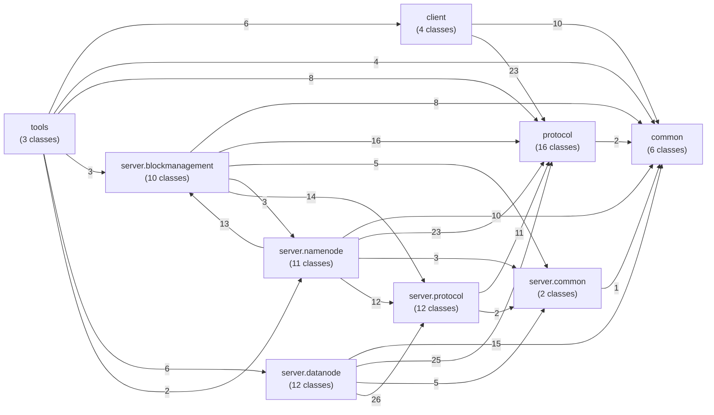

The number on an edge is the number of class dependencies between the two packages.

### Matrix (row uses column)

| uses → | `client` | `common` | `protocol` | `server.blockmanagement` | `server.common` | `server.datanode` | `server.namenode` | `server.protocol` | `tools` |
|---|---|---|---|---|---|---|---|---|---|
| `client` | · | 10 | 23 |  |  |  |  |  |  |
| `common` |  | · |  |  |  |  |  |  |  |
| `protocol` |  | 2 | · |  |  |  |  |  |  |
| `server.blockmanagement` |  | 8 | 16 | · | 5 |  | 3 | 14 |  |
| `server.common` |  | 1 |  |  | · |  |  |  |  |
| `server.datanode` |  | 15 | 25 |  | 5 | · |  | 26 |  |
| `server.namenode` |  | 10 | 23 | 13 | 3 |  | · | 12 |  |
| `server.protocol` |  |  | 11 |  | 2 |  |  | · |  |
| `tools` | 6 | 4 | 8 | 3 |  | 6 | 2 |  | · |

### Cycles between packages

* `server.blockmanagement` ⇄ `server.namenode` (3 / 13 dependencies)

These cycles exist in exactly the same way in the Hadoop original: `FSNamesystem` owns the `BlockManager`, and the `BlockManager` needs the lock or the file (`INodeFile`) of a block via the FSNamesystem.

### Layering

* `common` and `protocol` depend on no server or client package – they are the shared foundation.
* `client` does **not** depend on `server.*` – client and server share only the protocol classes.
* `server.datanode` does **not** depend on `server.namenode`/`server.blockmanagement` – DataNode and NameNode know each other only via `server.protocol`.
* `tools` sits on top and uses everything.

## 2. Inheritance and interfaces

```mermaid
classDiagram
    Closeable <|.. DFSClient
    InputStream <|-- DFSInputStream
    OutputStream <|-- DFSOutputStream
    Runnable <|.. LeaseRenewer
    IOException <|-- ChecksumException
    IOException <|-- AlreadyBeingCreatedException
    Serializable <|.. Block
    Comparable <|.. Block
    Remote <|.. ClientProtocol
    Serializable <|.. DatanodeID
    DatanodeID <|-- DatanodeInfo
    IOException <|-- FileAlreadyExistsException
    Serializable <|.. HdfsFileStatus
    Serializable <|.. LastBlockWithStatus
    IOException <|-- LeaseExpiredException
    Serializable <|.. LocatedBlock
    Serializable <|.. LocatedBlocks
    IOException <|-- RecoveryInProgressException
    Block <|-- BlockInfo
    DatanodeInfo <|-- DatanodeDescriptor
    SequentialNumber <|-- SequentialBlockIdGenerator
    SequentialNumber <|-- GenerationStamp
    Runnable <|.. BPServiceActor
    Closeable <|.. BlockReceiver
    Closeable <|.. BlockSender
    InterDatanodeProtocol <|.. DataNode
    Runnable <|.. DataXceiver
    Runnable <|.. DataXceiverServer
    INode <|-- INodeDirectory
    INode <|-- INodeFile
    SequentialNumber <|-- INodeId
    ClientProtocol <|.. NameNodeRpcServer
    DatanodeProtocol <|.. NameNodeRpcServer
    DatanodeCommand <|-- BlockCommand
    DatanodeCommand <|-- BlockRecoveryCommand
    Serializable <|.. BlockReportReplica
    Serializable <|.. DatanodeCommand
    Remote <|.. DatanodeProtocol
    Serializable <|.. DatanodeStorage
    Remote <|.. InterDatanodeProtocol
    Serializable <|.. ReceivedDeletedBlockInfo
    Block <|-- ReplicaRecoveryInfo
    Serializable <|.. StorageBlockReport
    Serializable <|.. StorageReceivedDeletedBlocks
    Serializable <|.. StorageReport
    Closeable <|.. MiniDFSCluster
```

| Class | extends / implements |
|---|---|
| `AlreadyBeingCreatedException` | `IOException` |
| `BPServiceActor` | `Runnable` |
| `Block` | `Serializable`, `Comparable` |
| `BlockCommand` | `DatanodeCommand` |
| `BlockInfo` | `Block` |
| `BlockReceiver` | `Closeable` |
| `BlockRecoveryCommand` | `DatanodeCommand` |
| `BlockReportReplica` | `Serializable` |
| `BlockSender` | `Closeable` |
| `ChecksumException` | `IOException` |
| `ClientProtocol` | `Remote` |
| `DFSClient` | `Closeable` |
| `DFSInputStream` | `InputStream` |
| `DFSOutputStream` | `OutputStream` |
| `DataNode` | `InterDatanodeProtocol` |
| `DataXceiver` | `Runnable` |
| `DataXceiverServer` | `Runnable` |
| `DatanodeCommand` | `Serializable` |
| `DatanodeDescriptor` | `DatanodeInfo` |
| `DatanodeID` | `Serializable` |
| `DatanodeInfo` | `DatanodeID` |
| `DatanodeProtocol` | `Remote` |
| `DatanodeStorage` | `Serializable` |
| `FileAlreadyExistsException` | `IOException` |
| `GenerationStamp` | `SequentialNumber` |
| `HdfsFileStatus` | `Serializable` |
| `INodeDirectory` | `INode` |
| `INodeFile` | `INode` |
| `INodeId` | `SequentialNumber` |
| `InterDatanodeProtocol` | `Remote` |
| `LastBlockWithStatus` | `Serializable` |
| `LeaseExpiredException` | `IOException` |
| `LeaseRenewer` | `Runnable` |
| `LocatedBlock` | `Serializable` |
| `LocatedBlocks` | `Serializable` |
| `MiniDFSCluster` | `Closeable` |
| `NameNodeRpcServer` | `ClientProtocol`, `DatanodeProtocol` |
| `ReceivedDeletedBlockInfo` | `Serializable` |
| `RecoveryInProgressException` | `IOException` |
| `ReplicaRecoveryInfo` | `Block` |
| `SequentialBlockIdGenerator` | `SequentialNumber` |
| `StorageBlockReport` | `Serializable` |
| `StorageReceivedDeletedBlocks` | `Serializable` |
| `StorageReport` | `Serializable` |

## 3. Class graphs per package

Per package: all classes of the package, their dependencies among each other (solid) and on classes of other packages (dashed, grouped by package).

### `client`

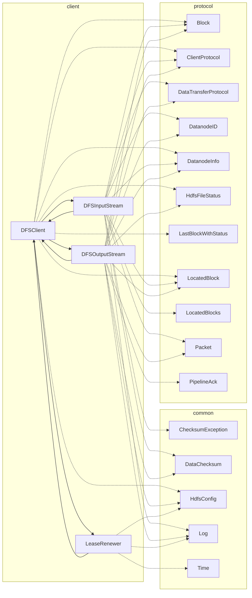

### `common`

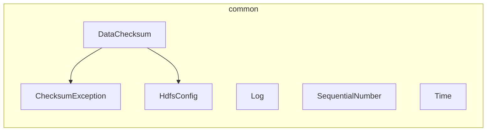

### `protocol`

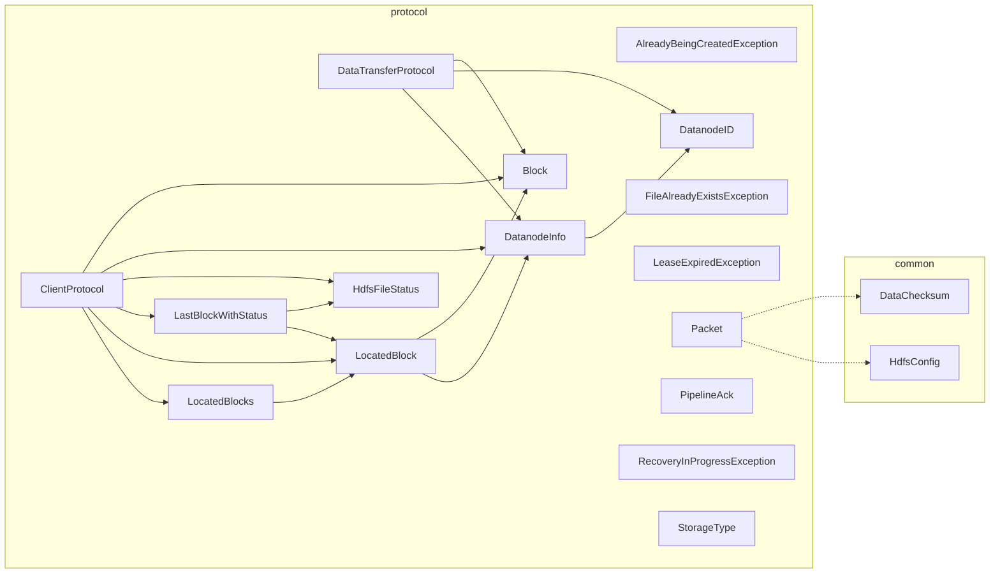

### `server.blockmanagement`

```mermaid
flowchart LR
    subgraph server_blockmanagement_box["server.blockmanagement"]
        server_blockmanagement_BlockIdManager["BlockIdManager"]
        server_blockmanagement_BlockInfo["BlockInfo"]
        server_blockmanagement_BlockManager["BlockManager"]
        server_blockmanagement_BlockPlacementPolicy["BlockPlacementPolicy"]
        server_blockmanagement_BlockUnderConstructionFeature["BlockUnderConstructionFeature"]
        server_blockmanagement_BlocksMap["BlocksMap"]
        server_blockmanagement_DatanodeDescriptor["DatanodeDescriptor"]
        server_blockmanagement_DatanodeManager["DatanodeManager"]
        server_blockmanagement_DatanodeStorageInfo["DatanodeStorageInfo"]
        server_blockmanagement_SequentialBlockIdGenerator["SequentialBlockIdGenerator"]
    end
    subgraph common_ext_server_blockmanagement["common"]
        common_HdfsConfig["HdfsConfig"]
        common_Log["Log"]
        common_SequentialNumber["SequentialNumber"]
        common_Time["Time"]
    end
    subgraph protocol_ext_server_blockmanagement["protocol"]
        protocol_Block["Block"]
        protocol_DatanodeID["DatanodeID"]
        protocol_DatanodeInfo["DatanodeInfo"]
        protocol_StorageType["StorageType"]
    end
    subgraph server_common_ext_server_blockmanagement["server.common"]
        server_common_GenerationStamp["GenerationStamp"]
        server_common_HdfsServerConstants["HdfsServerConstants"]
    end
    subgraph server_namenode_ext_server_blockmanagement["server.namenode"]
        server_namenode_FSNamesystem["FSNamesystem"]
        server_namenode_INodeFile["INodeFile"]
    end
    subgraph server_protocol_ext_server_blockmanagement["server.protocol"]
        server_protocol_BlockCommand["BlockCommand"]
        server_protocol_BlockRecoveryCommand["BlockRecoveryCommand"]
        server_protocol_BlockReportReplica["BlockReportReplica"]
        server_protocol_DatanodeCommand["DatanodeCommand"]
        server_protocol_DatanodeProtocol["DatanodeProtocol"]
        server_protocol_DatanodeStorage["DatanodeStorage"]
        server_protocol_ReceivedDeletedBlockInfo["ReceivedDeletedBlockInfo"]
        server_protocol_StorageBlockReport["StorageBlockReport"]
        server_protocol_StorageReceivedDeletedBlocks["StorageReceivedDeletedBlocks"]
        server_protocol_StorageReport["StorageReport"]
    end
    server_blockmanagement_BlockIdManager --> server_blockmanagement_BlockManager
    server_blockmanagement_BlockIdManager --> server_blockmanagement_SequentialBlockIdGenerator
    server_blockmanagement_BlockIdManager -.-> server_common_GenerationStamp
    server_blockmanagement_BlockInfo -.-> protocol_Block
    server_blockmanagement_BlockInfo --> server_blockmanagement_BlockUnderConstructionFeature
    server_blockmanagement_BlockInfo --> server_blockmanagement_DatanodeDescriptor
    server_blockmanagement_BlockInfo --> server_blockmanagement_DatanodeStorageInfo
    server_blockmanagement_BlockInfo -.-> server_common_HdfsServerConstants
    server_blockmanagement_BlockManager -.-> common_HdfsConfig
    server_blockmanagement_BlockManager -.-> common_Log
    server_blockmanagement_BlockManager -.-> common_Time
    server_blockmanagement_BlockManager -.-> protocol_Block
    server_blockmanagement_BlockManager -.-> protocol_DatanodeID
    server_blockmanagement_BlockManager -.-> protocol_DatanodeInfo
    server_blockmanagement_BlockManager --> server_blockmanagement_BlockInfo
    server_blockmanagement_BlockManager --> server_blockmanagement_BlockPlacementPolicy
    server_blockmanagement_BlockManager --> server_blockmanagement_BlockUnderConstructionFeature
    server_blockmanagement_BlockManager --> server_blockmanagement_BlocksMap
    server_blockmanagement_BlockManager --> server_blockmanagement_DatanodeDescriptor
    server_blockmanagement_BlockManager --> server_blockmanagement_DatanodeManager
    server_blockmanagement_BlockManager --> server_blockmanagement_DatanodeStorageInfo
    server_blockmanagement_BlockManager -.-> server_common_HdfsServerConstants
    server_blockmanagement_BlockManager -.-> server_namenode_FSNamesystem
    server_blockmanagement_BlockManager -.-> server_namenode_INodeFile
    server_blockmanagement_BlockManager -.-> server_protocol_BlockReportReplica
    server_blockmanagement_BlockManager -.-> server_protocol_DatanodeStorage
    server_blockmanagement_BlockManager -.-> server_protocol_ReceivedDeletedBlockInfo
    server_blockmanagement_BlockManager -.-> server_protocol_StorageBlockReport
    server_blockmanagement_BlockManager -.-> server_protocol_StorageReceivedDeletedBlocks
    server_blockmanagement_BlockPlacementPolicy -.-> protocol_DatanodeID
    server_blockmanagement_BlockPlacementPolicy -.-> protocol_StorageType
    server_blockmanagement_BlockPlacementPolicy --> server_blockmanagement_DatanodeDescriptor
    server_blockmanagement_BlockPlacementPolicy --> server_blockmanagement_DatanodeStorageInfo
    server_blockmanagement_BlockUnderConstructionFeature -.-> common_Time
    server_blockmanagement_BlockUnderConstructionFeature --> server_blockmanagement_BlockInfo
    server_blockmanagement_BlockUnderConstructionFeature --> server_blockmanagement_DatanodeDescriptor
    server_blockmanagement_BlockUnderConstructionFeature --> server_blockmanagement_DatanodeStorageInfo
    server_blockmanagement_BlockUnderConstructionFeature -.-> server_common_HdfsServerConstants
    server_blockmanagement_BlocksMap -.-> protocol_Block
    server_blockmanagement_BlocksMap --> server_blockmanagement_BlockInfo
    server_blockmanagement_BlocksMap --> server_blockmanagement_DatanodeStorageInfo
    server_blockmanagement_DatanodeDescriptor -.-> protocol_Block
    server_blockmanagement_DatanodeDescriptor -.-> protocol_DatanodeID
    server_blockmanagement_DatanodeDescriptor -.-> protocol_DatanodeInfo
    server_blockmanagement_DatanodeDescriptor -.-> protocol_StorageType
    server_blockmanagement_DatanodeDescriptor --> server_blockmanagement_BlockInfo
    server_blockmanagement_DatanodeDescriptor --> server_blockmanagement_DatanodeStorageInfo
    server_blockmanagement_DatanodeDescriptor -.-> server_protocol_DatanodeStorage
    server_blockmanagement_DatanodeDescriptor -.-> server_protocol_StorageReport
    server_blockmanagement_DatanodeManager -.-> common_HdfsConfig
    server_blockmanagement_DatanodeManager -.-> common_Log
    server_blockmanagement_DatanodeManager -.-> common_Time
    server_blockmanagement_DatanodeManager -.-> protocol_Block
    server_blockmanagement_DatanodeManager -.-> protocol_DatanodeID
    server_blockmanagement_DatanodeManager -.-> protocol_DatanodeInfo
    server_blockmanagement_DatanodeManager --> server_blockmanagement_BlockInfo
    server_blockmanagement_DatanodeManager --> server_blockmanagement_BlockManager
    server_blockmanagement_DatanodeManager --> server_blockmanagement_BlockUnderConstructionFeature
    server_blockmanagement_DatanodeManager --> server_blockmanagement_DatanodeDescriptor
    server_blockmanagement_DatanodeManager --> server_blockmanagement_DatanodeStorageInfo
    server_blockmanagement_DatanodeManager -.-> server_common_HdfsServerConstants
    server_blockmanagement_DatanodeManager -.-> server_namenode_FSNamesystem
    server_blockmanagement_DatanodeManager -.-> server_protocol_BlockCommand
    server_blockmanagement_DatanodeManager -.-> server_protocol_BlockRecoveryCommand
    server_blockmanagement_DatanodeManager -.-> server_protocol_DatanodeCommand
    server_blockmanagement_DatanodeManager -.-> server_protocol_DatanodeProtocol
    server_blockmanagement_DatanodeManager -.-> server_protocol_StorageReport
    server_blockmanagement_DatanodeStorageInfo -.-> protocol_StorageType
    server_blockmanagement_DatanodeStorageInfo --> server_blockmanagement_BlockInfo
    server_blockmanagement_DatanodeStorageInfo --> server_blockmanagement_DatanodeDescriptor
    server_blockmanagement_DatanodeStorageInfo -.-> server_protocol_DatanodeStorage
    server_blockmanagement_DatanodeStorageInfo -.-> server_protocol_StorageReport
    server_blockmanagement_SequentialBlockIdGenerator -.-> common_SequentialNumber
    server_blockmanagement_SequentialBlockIdGenerator -.-> protocol_Block
    server_blockmanagement_SequentialBlockIdGenerator --> server_blockmanagement_BlockInfo
    server_blockmanagement_SequentialBlockIdGenerator --> server_blockmanagement_BlockManager
```

### `server.common`

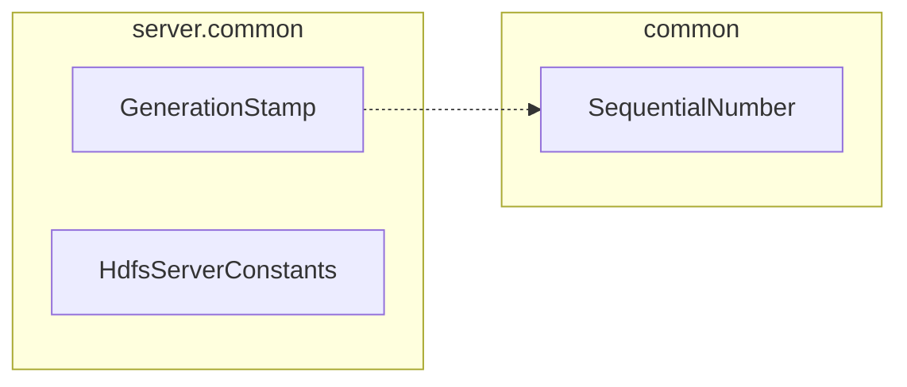

### `server.datanode`

```mermaid
flowchart LR
    subgraph server_datanode_box["server.datanode"]
        server_datanode_BPServiceActor["BPServiceActor"]
        server_datanode_BlockReceiver["BlockReceiver"]
        server_datanode_BlockRecoveryWorker["BlockRecoveryWorker"]
        server_datanode_BlockSender["BlockSender"]
        server_datanode_DataNode["DataNode"]
        server_datanode_DataXceiver["DataXceiver"]
        server_datanode_DataXceiverServer["DataXceiverServer"]
        server_datanode_FsDatasetImpl["FsDatasetImpl"]
        server_datanode_FsVolumeImpl["FsVolumeImpl"]
        server_datanode_ReplicaInfo["ReplicaInfo"]
        server_datanode_RoundRobinVolumeChoosingPolicy["RoundRobinVolumeChoosingPolicy"]
        server_datanode_StorageLocation["StorageLocation"]
    end
    subgraph common_ext_server_datanode["common"]
        common_DataChecksum["DataChecksum"]
        common_HdfsConfig["HdfsConfig"]
        common_Log["Log"]
        common_Time["Time"]
    end
    subgraph protocol_ext_server_datanode["protocol"]
        protocol_Block["Block"]
        protocol_DataTransferProtocol["DataTransferProtocol"]
        protocol_DatanodeID["DatanodeID"]
        protocol_DatanodeInfo["DatanodeInfo"]
        protocol_Packet["Packet"]
        protocol_PipelineAck["PipelineAck"]
        protocol_StorageType["StorageType"]
    end
    subgraph server_common_ext_server_datanode["server.common"]
        server_common_HdfsServerConstants["HdfsServerConstants"]
    end
    subgraph server_protocol_ext_server_datanode["server.protocol"]
        server_protocol_BlockCommand["BlockCommand"]
        server_protocol_BlockRecoveryCommand["BlockRecoveryCommand"]
        server_protocol_BlockReportReplica["BlockReportReplica"]
        server_protocol_DatanodeCommand["DatanodeCommand"]
        server_protocol_DatanodeProtocol["DatanodeProtocol"]
        server_protocol_DatanodeStorage["DatanodeStorage"]
        server_protocol_InterDatanodeProtocol["InterDatanodeProtocol"]
        server_protocol_ReceivedDeletedBlockInfo["ReceivedDeletedBlockInfo"]
        server_protocol_ReplicaRecoveryInfo["ReplicaRecoveryInfo"]
        server_protocol_StorageBlockReport["StorageBlockReport"]
        server_protocol_StorageReceivedDeletedBlocks["StorageReceivedDeletedBlocks"]
        server_protocol_StorageReport["StorageReport"]
    end
    server_datanode_BPServiceActor -.-> common_HdfsConfig
    server_datanode_BPServiceActor -.-> common_Log
    server_datanode_BPServiceActor -.-> common_Time
    server_datanode_BPServiceActor -.-> protocol_Block
    server_datanode_BPServiceActor -.-> protocol_DatanodeID
    server_datanode_BPServiceActor -.-> protocol_DatanodeInfo
    server_datanode_BPServiceActor -.-> server_common_HdfsServerConstants
    server_datanode_BPServiceActor --> server_datanode_BlockRecoveryWorker
    server_datanode_BPServiceActor --> server_datanode_DataNode
    server_datanode_BPServiceActor --> server_datanode_FsDatasetImpl
    server_datanode_BPServiceActor --> server_datanode_FsVolumeImpl
    server_datanode_BPServiceActor --> server_datanode_ReplicaInfo
    server_datanode_BPServiceActor -.-> server_protocol_BlockCommand
    server_datanode_BPServiceActor -.-> server_protocol_BlockRecoveryCommand
    server_datanode_BPServiceActor -.-> server_protocol_DatanodeCommand
    server_datanode_BPServiceActor -.-> server_protocol_DatanodeProtocol
    server_datanode_BPServiceActor -.-> server_protocol_DatanodeStorage
    server_datanode_BPServiceActor -.-> server_protocol_ReceivedDeletedBlockInfo
    server_datanode_BPServiceActor -.-> server_protocol_StorageBlockReport
    server_datanode_BPServiceActor -.-> server_protocol_StorageReceivedDeletedBlocks
    server_datanode_BPServiceActor -.-> server_protocol_StorageReport
    server_datanode_BlockReceiver -.-> common_DataChecksum
    server_datanode_BlockReceiver -.-> common_Log
    server_datanode_BlockReceiver -.-> protocol_Block
    server_datanode_BlockReceiver -.-> protocol_DataTransferProtocol
    server_datanode_BlockReceiver -.-> protocol_Packet
    server_datanode_BlockReceiver -.-> protocol_PipelineAck
    server_datanode_BlockReceiver --> server_datanode_DataNode
    server_datanode_BlockReceiver --> server_datanode_FsDatasetImpl
    server_datanode_BlockReceiver --> server_datanode_ReplicaInfo
    server_datanode_BlockRecoveryWorker -.-> common_Log
    server_datanode_BlockRecoveryWorker -.-> protocol_Block
    server_datanode_BlockRecoveryWorker -.-> protocol_DatanodeID
    server_datanode_BlockRecoveryWorker -.-> protocol_DatanodeInfo
    server_datanode_BlockRecoveryWorker -.-> server_common_HdfsServerConstants
    server_datanode_BlockRecoveryWorker --> server_datanode_DataNode
    server_datanode_BlockRecoveryWorker -.-> server_protocol_BlockRecoveryCommand
    server_datanode_BlockRecoveryWorker -.-> server_protocol_DatanodeProtocol
    server_datanode_BlockRecoveryWorker -.-> server_protocol_InterDatanodeProtocol
    server_datanode_BlockRecoveryWorker -.-> server_protocol_ReplicaRecoveryInfo
    server_datanode_BlockSender -.-> common_DataChecksum
    server_datanode_BlockSender -.-> common_HdfsConfig
    server_datanode_BlockSender -.-> protocol_Block
    server_datanode_BlockSender -.-> protocol_Packet
    server_datanode_BlockSender --> server_datanode_FsDatasetImpl
    server_datanode_BlockSender --> server_datanode_ReplicaInfo
    server_datanode_DataNode -.-> common_HdfsConfig
    server_datanode_DataNode -.-> common_Log
    server_datanode_DataNode -.-> protocol_Block
    server_datanode_DataNode -.-> protocol_DataTransferProtocol
    server_datanode_DataNode -.-> protocol_DatanodeID
    server_datanode_DataNode -.-> protocol_DatanodeInfo
    server_datanode_DataNode -.-> protocol_PipelineAck
    server_datanode_DataNode --> server_datanode_BPServiceActor
    server_datanode_DataNode --> server_datanode_BlockRecoveryWorker
    server_datanode_DataNode --> server_datanode_BlockSender
    server_datanode_DataNode --> server_datanode_DataXceiverServer
    server_datanode_DataNode --> server_datanode_FsDatasetImpl
    server_datanode_DataNode --> server_datanode_FsVolumeImpl
    server_datanode_DataNode --> server_datanode_ReplicaInfo
    server_datanode_DataNode --> server_datanode_StorageLocation
    server_datanode_DataNode -.-> server_protocol_BlockRecoveryCommand
    server_datanode_DataNode -.-> server_protocol_DatanodeProtocol
    server_datanode_DataNode -.-> server_protocol_DatanodeStorage
    server_datanode_DataNode -.-> server_protocol_InterDatanodeProtocol
    server_datanode_DataNode -.-> server_protocol_ReceivedDeletedBlockInfo
    server_datanode_DataNode -.-> server_protocol_ReplicaRecoveryInfo
    server_datanode_DataXceiver -.-> common_Log
    server_datanode_DataXceiver -.-> protocol_Block
    server_datanode_DataXceiver -.-> protocol_DataTransferProtocol
    server_datanode_DataXceiver -.-> protocol_DatanodeID
    server_datanode_DataXceiver -.-> protocol_DatanodeInfo
    server_datanode_DataXceiver --> server_datanode_BlockReceiver
    server_datanode_DataXceiver --> server_datanode_BlockSender
    server_datanode_DataXceiver --> server_datanode_DataNode
    server_datanode_DataXceiver --> server_datanode_DataXceiverServer
    server_datanode_DataXceiver --> server_datanode_FsDatasetImpl
    server_datanode_DataXceiver --> server_datanode_ReplicaInfo
    server_datanode_DataXceiverServer -.-> common_Log
    server_datanode_DataXceiverServer --> server_datanode_DataNode
    server_datanode_DataXceiverServer --> server_datanode_DataXceiver
    server_datanode_FsDatasetImpl -.-> common_DataChecksum
    server_datanode_FsDatasetImpl -.-> common_HdfsConfig
    server_datanode_FsDatasetImpl -.-> common_Log
    server_datanode_FsDatasetImpl -.-> protocol_Block
    server_datanode_FsDatasetImpl -.-> server_common_HdfsServerConstants
    server_datanode_FsDatasetImpl --> server_datanode_FsVolumeImpl
    server_datanode_FsDatasetImpl --> server_datanode_ReplicaInfo
    server_datanode_FsDatasetImpl --> server_datanode_RoundRobinVolumeChoosingPolicy
    server_datanode_FsDatasetImpl --> server_datanode_StorageLocation
    server_datanode_FsDatasetImpl -.-> server_protocol_BlockRecoveryCommand
    server_datanode_FsDatasetImpl -.-> server_protocol_BlockReportReplica
    server_datanode_FsDatasetImpl -.-> server_protocol_DatanodeStorage
    server_datanode_FsDatasetImpl -.-> server_protocol_ReplicaRecoveryInfo
    server_datanode_FsDatasetImpl -.-> server_protocol_StorageBlockReport
    server_datanode_FsDatasetImpl -.-> server_protocol_StorageReport
    server_datanode_FsVolumeImpl -.-> protocol_StorageType
    server_datanode_FsVolumeImpl -.-> server_common_HdfsServerConstants
    server_datanode_FsVolumeImpl --> server_datanode_StorageLocation
    server_datanode_FsVolumeImpl -.-> server_protocol_DatanodeStorage
    server_datanode_ReplicaInfo -.-> protocol_Block
    server_datanode_ReplicaInfo -.-> server_common_HdfsServerConstants
    server_datanode_ReplicaInfo --> server_datanode_FsVolumeImpl
    server_datanode_RoundRobinVolumeChoosingPolicy --> server_datanode_FsVolumeImpl
    server_datanode_StorageLocation -.-> protocol_StorageType
```

### `server.namenode`

```mermaid
flowchart LR
    subgraph server_namenode_box["server.namenode"]
        server_namenode_FSDirectory["FSDirectory"]
        server_namenode_FSNamesystem["FSNamesystem"]
        server_namenode_FileUnderConstructionFeature["FileUnderConstructionFeature"]
        server_namenode_INode["INode"]
        server_namenode_INodeDirectory["INodeDirectory"]
        server_namenode_INodeFile["INodeFile"]
        server_namenode_INodeId["INodeId"]
        server_namenode_INodesInPath["INodesInPath"]
        server_namenode_LeaseManager["LeaseManager"]
        server_namenode_NameNode["NameNode"]
        server_namenode_NameNodeRpcServer["NameNodeRpcServer"]
    end
    subgraph common_ext_server_namenode["common"]
        common_HdfsConfig["HdfsConfig"]
        common_Log["Log"]
        common_SequentialNumber["SequentialNumber"]
        common_Time["Time"]
    end
    subgraph protocol_ext_server_namenode["protocol"]
        protocol_AlreadyBeingCreatedException["AlreadyBeingCreatedException"]
        protocol_Block["Block"]
        protocol_ClientProtocol["ClientProtocol"]
        protocol_DatanodeID["DatanodeID"]
        protocol_DatanodeInfo["DatanodeInfo"]
        protocol_FileAlreadyExistsException["FileAlreadyExistsException"]
        protocol_HdfsFileStatus["HdfsFileStatus"]
        protocol_LastBlockWithStatus["LastBlockWithStatus"]
        protocol_LeaseExpiredException["LeaseExpiredException"]
        protocol_LocatedBlock["LocatedBlock"]
        protocol_LocatedBlocks["LocatedBlocks"]
        protocol_RecoveryInProgressException["RecoveryInProgressException"]
        protocol_StorageType["StorageType"]
    end
    subgraph server_blockmanagement_ext_server_namenode["server.blockmanagement"]
        server_blockmanagement_BlockIdManager["BlockIdManager"]
        server_blockmanagement_BlockInfo["BlockInfo"]
        server_blockmanagement_BlockManager["BlockManager"]
        server_blockmanagement_BlockUnderConstructionFeature["BlockUnderConstructionFeature"]
        server_blockmanagement_DatanodeDescriptor["DatanodeDescriptor"]
        server_blockmanagement_DatanodeManager["DatanodeManager"]
        server_blockmanagement_DatanodeStorageInfo["DatanodeStorageInfo"]
    end
    subgraph server_common_ext_server_namenode["server.common"]
        server_common_HdfsServerConstants["HdfsServerConstants"]
    end
    subgraph server_protocol_ext_server_namenode["server.protocol"]
        server_protocol_DatanodeCommand["DatanodeCommand"]
        server_protocol_DatanodeProtocol["DatanodeProtocol"]
        server_protocol_DatanodeStorage["DatanodeStorage"]
        server_protocol_StorageBlockReport["StorageBlockReport"]
        server_protocol_StorageReceivedDeletedBlocks["StorageReceivedDeletedBlocks"]
        server_protocol_StorageReport["StorageReport"]
    end
    server_namenode_FSDirectory -.-> common_Time
    server_namenode_FSDirectory -.-> protocol_FileAlreadyExistsException
    server_namenode_FSDirectory -.-> protocol_HdfsFileStatus
    server_namenode_FSDirectory -.-> server_blockmanagement_BlockInfo
    server_namenode_FSDirectory --> server_namenode_INode
    server_namenode_FSDirectory --> server_namenode_INodeDirectory
    server_namenode_FSDirectory --> server_namenode_INodeFile
    server_namenode_FSDirectory --> server_namenode_INodeId
    server_namenode_FSDirectory --> server_namenode_INodesInPath
    server_namenode_FSNamesystem -.-> common_HdfsConfig
    server_namenode_FSNamesystem -.-> common_Log
    server_namenode_FSNamesystem -.-> common_Time
    server_namenode_FSNamesystem -.-> protocol_AlreadyBeingCreatedException
    server_namenode_FSNamesystem -.-> protocol_Block
    server_namenode_FSNamesystem -.-> protocol_DatanodeID
    server_namenode_FSNamesystem -.-> protocol_DatanodeInfo
    server_namenode_FSNamesystem -.-> protocol_FileAlreadyExistsException
    server_namenode_FSNamesystem -.-> protocol_HdfsFileStatus
    server_namenode_FSNamesystem -.-> protocol_LastBlockWithStatus
    server_namenode_FSNamesystem -.-> protocol_LeaseExpiredException
    server_namenode_FSNamesystem -.-> protocol_LocatedBlock
    server_namenode_FSNamesystem -.-> protocol_LocatedBlocks
    server_namenode_FSNamesystem -.-> protocol_RecoveryInProgressException
    server_namenode_FSNamesystem -.-> protocol_StorageType
    server_namenode_FSNamesystem -.-> server_blockmanagement_BlockIdManager
    server_namenode_FSNamesystem -.-> server_blockmanagement_BlockInfo
    server_namenode_FSNamesystem -.-> server_blockmanagement_BlockManager
    server_namenode_FSNamesystem -.-> server_blockmanagement_BlockUnderConstructionFeature
    server_namenode_FSNamesystem -.-> server_blockmanagement_DatanodeDescriptor
    server_namenode_FSNamesystem -.-> server_blockmanagement_DatanodeManager
    server_namenode_FSNamesystem -.-> server_blockmanagement_DatanodeStorageInfo
    server_namenode_FSNamesystem -.-> server_common_HdfsServerConstants
    server_namenode_FSNamesystem --> server_namenode_FSDirectory
    server_namenode_FSNamesystem --> server_namenode_FileUnderConstructionFeature
    server_namenode_FSNamesystem --> server_namenode_INode
    server_namenode_FSNamesystem --> server_namenode_INodeDirectory
    server_namenode_FSNamesystem --> server_namenode_INodeFile
    server_namenode_FSNamesystem --> server_namenode_INodeId
    server_namenode_FSNamesystem --> server_namenode_INodesInPath
    server_namenode_FSNamesystem --> server_namenode_LeaseManager
    server_namenode_FSNamesystem -.-> server_protocol_DatanodeCommand
    server_namenode_FSNamesystem -.-> server_protocol_DatanodeProtocol
    server_namenode_FSNamesystem -.-> server_protocol_DatanodeStorage
    server_namenode_FSNamesystem -.-> server_protocol_StorageBlockReport
    server_namenode_FSNamesystem -.-> server_protocol_StorageReceivedDeletedBlocks
    server_namenode_FSNamesystem -.-> server_protocol_StorageReport
    server_namenode_INode -.-> server_blockmanagement_BlockInfo
    server_namenode_INode --> server_namenode_INodeDirectory
    server_namenode_INode --> server_namenode_INodeFile
    server_namenode_INode --> server_namenode_INodeId
    server_namenode_INodeDirectory -.-> server_blockmanagement_BlockInfo
    server_namenode_INodeDirectory --> server_namenode_INode
    server_namenode_INodeFile -.-> server_blockmanagement_BlockInfo
    server_namenode_INodeFile -.-> server_common_HdfsServerConstants
    server_namenode_INodeFile --> server_namenode_FileUnderConstructionFeature
    server_namenode_INodeFile --> server_namenode_INode
    server_namenode_INodeId -.-> common_SequentialNumber
    server_namenode_INodesInPath --> server_namenode_INode
    server_namenode_INodesInPath --> server_namenode_INodeDirectory
    server_namenode_LeaseManager -.-> common_HdfsConfig
    server_namenode_LeaseManager -.-> common_Log
    server_namenode_LeaseManager -.-> common_Time
    server_namenode_LeaseManager -.-> server_common_HdfsServerConstants
    server_namenode_LeaseManager --> server_namenode_FSNamesystem
    server_namenode_LeaseManager --> server_namenode_FileUnderConstructionFeature
    server_namenode_LeaseManager --> server_namenode_INodeFile
    server_namenode_NameNode -.-> common_HdfsConfig
    server_namenode_NameNode -.-> common_Log
    server_namenode_NameNode -.-> protocol_ClientProtocol
    server_namenode_NameNode --> server_namenode_FSNamesystem
    server_namenode_NameNode --> server_namenode_NameNodeRpcServer
    server_namenode_NameNode -.-> server_protocol_DatanodeProtocol
    server_namenode_NameNodeRpcServer -.-> protocol_Block
    server_namenode_NameNodeRpcServer -.-> protocol_ClientProtocol
    server_namenode_NameNodeRpcServer -.-> protocol_DatanodeID
    server_namenode_NameNodeRpcServer -.-> protocol_DatanodeInfo
    server_namenode_NameNodeRpcServer -.-> protocol_HdfsFileStatus
    server_namenode_NameNodeRpcServer -.-> protocol_LastBlockWithStatus
    server_namenode_NameNodeRpcServer -.-> protocol_LocatedBlock
    server_namenode_NameNodeRpcServer -.-> protocol_LocatedBlocks
    server_namenode_NameNodeRpcServer -.-> server_blockmanagement_BlockManager
    server_namenode_NameNodeRpcServer -.-> server_blockmanagement_DatanodeManager
    server_namenode_NameNodeRpcServer --> server_namenode_FSNamesystem
    server_namenode_NameNodeRpcServer -.-> server_protocol_DatanodeCommand
    server_namenode_NameNodeRpcServer -.-> server_protocol_DatanodeProtocol
    server_namenode_NameNodeRpcServer -.-> server_protocol_StorageBlockReport
    server_namenode_NameNodeRpcServer -.-> server_protocol_StorageReceivedDeletedBlocks
    server_namenode_NameNodeRpcServer -.-> server_protocol_StorageReport
```

### `server.protocol`

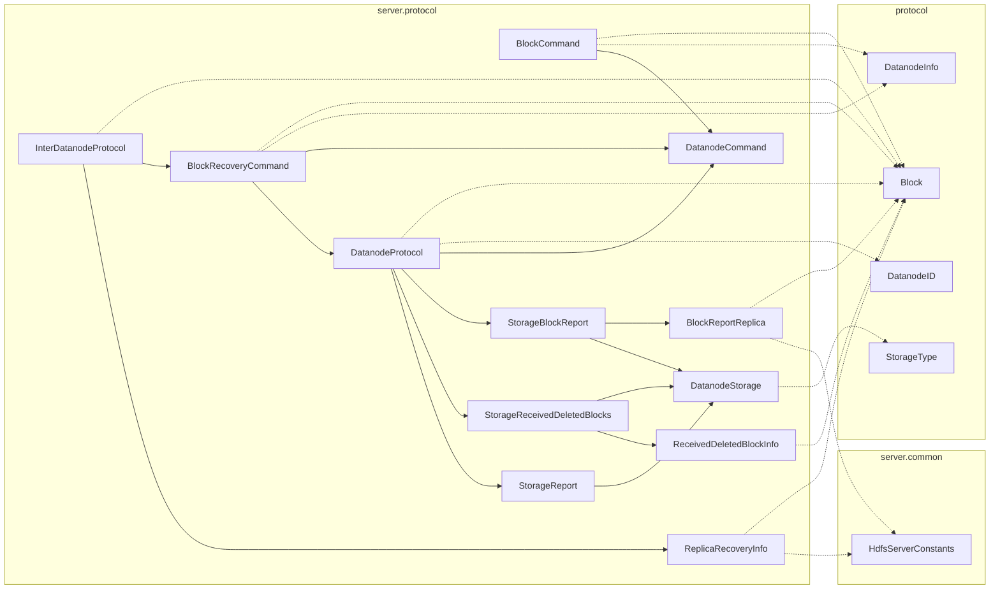

### `tools`

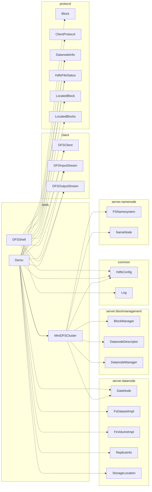

## 4. All classes in detail

Columns: **uses** = outgoing dependencies (fan-out), **used by** = incoming (fan-in).

### Package `client`

#### `DFSClient`

*class* · [`src/main/java/edudfs/client/DFSClient.java`](../src/main/java/edudfs/client/DFSClient.java) · 197 lines

Corresponds to org.apache.hadoop.hdfs.DFSClient.

**extends / implements:** `Closeable`

| uses (10) | used by (5) |
|---|---|
| *client:* `DFSInputStream`, `DFSOutputStream`, `LeaseRenewer` *common:* `HdfsConfig` *protocol:* `Block`, `ClientProtocol`, `DatanodeInfo`, `HdfsFileStatus`, `LastBlockWithStatus`, `LocatedBlock` | *client:* `DFSInputStream`, `DFSOutputStream`, `LeaseRenewer` *tools:* `DFSShell`, `Demo` |

#### `DFSInputStream`

*class* · [`src/main/java/edudfs/client/DFSInputStream.java`](../src/main/java/edudfs/client/DFSInputStream.java) · 209 lines

Corresponds to org.apache.hadoop.hdfs.DFSInputStream.

**extends / implements:** `InputStream`

**inner types:** `BlockReader`

| uses (12) | used by (3) |
|---|---|
| *client:* `DFSClient` *common:* `ChecksumException`, `DataChecksum`, `Log` *protocol:* `Block`, `ClientProtocol`, `DataTransferProtocol`, `DatanodeID`, `DatanodeInfo`, `LocatedBlock`, `LocatedBlocks`, `Packet` | *client:* `DFSClient` *tools:* `DFSShell`, `Demo` |

#### `DFSOutputStream`

*class* · [`src/main/java/edudfs/client/DFSOutputStream.java`](../src/main/java/edudfs/client/DFSOutputStream.java) · 435 lines

Corresponds to org.apache.hadoop.hdfs.DFSOutputStream (+ DataStreamer).

**extends / implements:** `OutputStream`

**inner types:** `BadNodeException`, `DataStreamer`, `ResponseProcessor`

| uses (13) | used by (3) |
|---|---|
| *client:* `DFSClient` *common:* `DataChecksum`, `HdfsConfig`, `Log` *protocol:* `Block`, `ClientProtocol`, `DataTransferProtocol`, `DatanodeID`, `DatanodeInfo`, `HdfsFileStatus`, `LocatedBlock`, `Packet`, `PipelineAck` | *client:* `DFSClient` *tools:* `DFSShell`, `Demo` |

#### `LeaseRenewer`

*class* · [`src/main/java/edudfs/client/LeaseRenewer.java`](../src/main/java/edudfs/client/LeaseRenewer.java) · 63 lines

Corresponds to org.apache.hadoop.hdfs.client.impl.LeaseRenewer. Background thread that renews the client's lease every softLimit/2 as long as the client has files …

**extends / implements:** `Runnable`

| uses (4) | used by (1) |
|---|---|
| *client:* `DFSClient` *common:* `HdfsConfig`, `Log`, `Time` | *client:* `DFSClient` |

### Package `common`

#### `ChecksumException`

*class* · [`src/main/java/edudfs/common/ChecksumException.java`](../src/main/java/edudfs/common/ChecksumException.java) · 12 lines

Corresponds to org.apache.hadoop.fs.ChecksumException.

**extends / implements:** `IOException`

| uses (0) | used by (2) |
|---|---|
| – | *client:* `DFSInputStream` *common:* `DataChecksum` |

#### `DataChecksum`

*class* · [`src/main/java/edudfs/common/DataChecksum.java`](../src/main/java/edudfs/common/DataChecksum.java) · 54 lines

Corresponds to org.apache.hadoop.util.DataChecksum (CRC32 only).

| uses (2) | used by (6) |
|---|---|
| *common:* `ChecksumException`, `HdfsConfig` | *client:* `DFSInputStream`, `DFSOutputStream` *protocol:* `Packet` *server.datanode:* `BlockReceiver`, `BlockSender`, `FsDatasetImpl` |

#### `HdfsConfig`

*class* · [`src/main/java/edudfs/common/HdfsConfig.java`](../src/main/java/edudfs/common/HdfsConfig.java) · 215 lines

Central configuration (corresponds to org.apache.hadoop.conf.Configuration + DFSConfigKeys).

| uses (0) | used by (17) |
|---|---|
| – | *client:* `DFSClient`, `DFSOutputStream`, `LeaseRenewer` *common:* `DataChecksum` *protocol:* `Packet` *server.blockmanagement:* `BlockManager`, `DatanodeManager` *server.datanode:* `BPServiceActor`, `BlockSender`, `DataNode`, `FsDatasetImpl` *server.namenode:* `FSNamesystem`, `LeaseManager`, `NameNode` *tools:* `DFSShell`, `Demo`, `MiniDFSCluster` |

#### `Log`

*class* · [`src/main/java/edudfs/common/Log.java`](../src/main/java/edudfs/common/Log.java) · 26 lines

Minimalist logging (instead of log4j / slf4j).

| uses (0) | used by (16) |
|---|---|
| – | *client:* `DFSInputStream`, `DFSOutputStream`, `LeaseRenewer` *server.blockmanagement:* `BlockManager`, `DatanodeManager` *server.datanode:* `BPServiceActor`, `BlockReceiver`, `BlockRecoveryWorker`, `DataNode`, `DataXceiver`, `DataXceiverServer`, `FsDatasetImpl` *server.namenode:* `FSNamesystem`, `LeaseManager`, `NameNode` *tools:* `DFSShell` |

#### `SequentialNumber`

*abstract class* · [`src/main/java/edudfs/common/SequentialNumber.java`](../src/main/java/edudfs/common/SequentialNumber.java) · 29 lines

Corresponds to org.apache.hadoop.util.SequentialNumber. Base for INode IDs, block IDs and generation stamps.

| uses (0) | used by (3) |
|---|---|
| – | *server.blockmanagement:* `SequentialBlockIdGenerator` *server.common:* `GenerationStamp` *server.namenode:* `INodeId` |

#### `Time`

*class* · [`src/main/java/edudfs/common/Time.java`](../src/main/java/edudfs/common/Time.java) · 18 lines

Corresponds to org.apache.hadoop.util.Time.

| uses (0) | used by (8) |
|---|---|
| – | *client:* `LeaseRenewer` *server.blockmanagement:* `BlockManager`, `BlockUnderConstructionFeature`, `DatanodeManager` *server.datanode:* `BPServiceActor` *server.namenode:* `FSDirectory`, `FSNamesystem`, `LeaseManager` |

### Package `protocol`

#### `AlreadyBeingCreatedException`

*class* · [`src/main/java/edudfs/protocol/AlreadyBeingCreatedException.java`](../src/main/java/edudfs/protocol/AlreadyBeingCreatedException.java) · 12 lines

The file is already being written by another client (the lease holder). (Name as in the original HDFS.)

**extends / implements:** `IOException`

| uses (0) | used by (1) |
|---|---|
| – | *server.namenode:* `FSNamesystem` |

#### `Block`

*class* · [`src/main/java/edudfs/protocol/Block.java`](../src/main/java/edudfs/protocol/Block.java) · 87 lines

Corresponds to org.apache.hadoop.hdfs.protocol.Block.

**extends / implements:** `Serializable`, `Comparable`

| uses (0) | used by (30) |
|---|---|
| – | *client:* `DFSClient`, `DFSInputStream`, `DFSOutputStream` *protocol:* `ClientProtocol`, `DataTransferProtocol`, `LocatedBlock` *server.blockmanagement:* `BlockInfo`, `BlockManager`, `BlocksMap`, `DatanodeDescriptor`, `DatanodeManager`, `SequentialBlockIdGenerator` *server.datanode:* `BPServiceActor`, `BlockReceiver`, `BlockRecoveryWorker`, `BlockSender`, `DataNode`, `DataXceiver`, `FsDatasetImpl`, `ReplicaInfo` *server.namenode:* `FSNamesystem`, `NameNodeRpcServer` *server.protocol:* `BlockCommand`, `BlockRecoveryCommand`, `BlockReportReplica`, `DatanodeProtocol`, `InterDatanodeProtocol`, `ReceivedDeletedBlockInfo`, `ReplicaRecoveryInfo` *tools:* `Demo` |

#### `ClientProtocol`

*interface* · [`src/main/java/edudfs/protocol/ClientProtocol.java`](../src/main/java/edudfs/protocol/ClientProtocol.java) · 74 lines

Corresponds to org.apache.hadoop.hdfs.protocol.ClientProtocol: the RPC interface between the client (DFSClient) and the NameNode.

**extends / implements:** `Remote`

| uses (6) | used by (6) |
|---|---|
| *protocol:* `Block`, `DatanodeInfo`, `HdfsFileStatus`, `LastBlockWithStatus`, `LocatedBlock`, `LocatedBlocks` | *client:* `DFSClient`, `DFSInputStream`, `DFSOutputStream` *server.namenode:* `NameNode`, `NameNodeRpcServer` *tools:* `Demo` |

#### `DataTransferProtocol`

*class* · [`src/main/java/edudfs/protocol/DataTransferProtocol.java`](../src/main/java/edudfs/protocol/DataTransferProtocol.java) · 104 lines

Corresponds to org.apache.hadoop.hdfs.protocol.datatransfer.DataTransferProtocol (+ Sender/Receiver).

| uses (3) | used by (5) |
|---|---|
| *protocol:* `Block`, `DatanodeID`, `DatanodeInfo` | *client:* `DFSInputStream`, `DFSOutputStream` *server.datanode:* `BlockReceiver`, `DataNode`, `DataXceiver` |

#### `DatanodeID`

*class* · [`src/main/java/edudfs/protocol/DatanodeID.java`](../src/main/java/edudfs/protocol/DatanodeID.java) · 71 lines

Corresponds to org.apache.hadoop.hdfs.protocol.DatanodeID. Identity of a DataNode: a stable UUID (stored in the storage directory) plus the address for data transfer …

**extends / implements:** `Serializable`

| uses (0) | used by (15) |
|---|---|
| – | *client:* `DFSInputStream`, `DFSOutputStream` *protocol:* `DataTransferProtocol`, `DatanodeInfo` *server.blockmanagement:* `BlockManager`, `BlockPlacementPolicy`, `DatanodeDescriptor`, `DatanodeManager` *server.datanode:* `BPServiceActor`, `BlockRecoveryWorker`, `DataNode`, `DataXceiver` *server.namenode:* `FSNamesystem`, `NameNodeRpcServer` *server.protocol:* `DatanodeProtocol` |

#### `DatanodeInfo`

*class* · [`src/main/java/edudfs/protocol/DatanodeInfo.java`](../src/main/java/edudfs/protocol/DatanodeInfo.java) · 81 lines

Corresponds to org.apache.hadoop.hdfs.protocol.DatanodeInfo: DatanodeID + status as clients see it (e.g. in LocatedBlock).

**extends / implements:** `DatanodeID`

| uses (1) | used by (19) |
|---|---|
| *protocol:* `DatanodeID` | *client:* `DFSClient`, `DFSInputStream`, `DFSOutputStream` *protocol:* `ClientProtocol`, `DataTransferProtocol`, `LocatedBlock` *server.blockmanagement:* `BlockManager`, `DatanodeDescriptor`, `DatanodeManager` *server.datanode:* `BPServiceActor`, `BlockRecoveryWorker`, `DataNode`, `DataXceiver` *server.namenode:* `FSNamesystem`, `NameNodeRpcServer` *server.protocol:* `BlockCommand`, `BlockRecoveryCommand` *tools:* `DFSShell`, `Demo` |

#### `FileAlreadyExistsException`

*class* · [`src/main/java/edudfs/protocol/FileAlreadyExistsException.java`](../src/main/java/edudfs/protocol/FileAlreadyExistsException.java) · 12 lines

The file already exists. (Name as in the original HDFS.)

**extends / implements:** `IOException`

| uses (0) | used by (2) |
|---|---|
| – | *server.namenode:* `FSDirectory`, `FSNamesystem` |

#### `HdfsFileStatus`

*class* · [`src/main/java/edudfs/protocol/HdfsFileStatus.java`](../src/main/java/edudfs/protocol/HdfsFileStatus.java) · 63 lines

Corresponds to org.apache.hadoop.hdfs.protocol.HdfsFileStatus (without owner/group/permission).

**extends / implements:** `Serializable`

| uses (0) | used by (9) |
|---|---|
| – | *client:* `DFSClient`, `DFSOutputStream` *protocol:* `ClientProtocol`, `LastBlockWithStatus` *server.namenode:* `FSDirectory`, `FSNamesystem`, `NameNodeRpcServer` *tools:* `DFSShell`, `Demo` |

#### `LastBlockWithStatus`

*class* · [`src/main/java/edudfs/protocol/LastBlockWithStatus.java`](../src/main/java/edudfs/protocol/LastBlockWithStatus.java) · 30 lines

Corresponds to org.apache.hadoop.hdfs.protocol.LastBlockWithStatus: response to append() - file status plus the file's current last block. The client needs the last …

**extends / implements:** `Serializable`

| uses (2) | used by (4) |
|---|---|
| *protocol:* `HdfsFileStatus`, `LocatedBlock` | *client:* `DFSClient` *protocol:* `ClientProtocol` *server.namenode:* `FSNamesystem`, `NameNodeRpcServer` |

#### `LeaseExpiredException`

*class* · [`src/main/java/edudfs/protocol/LeaseExpiredException.java`](../src/main/java/edudfs/protocol/LeaseExpiredException.java) · 12 lines

The client does not (or no longer) hold the lease for the file. (Name as in the original HDFS.)

**extends / implements:** `IOException`

| uses (0) | used by (1) |
|---|---|
| – | *server.namenode:* `FSNamesystem` |

#### `LocatedBlock`

*class* · [`src/main/java/edudfs/protocol/LocatedBlock.java`](../src/main/java/edudfs/protocol/LocatedBlock.java) · 42 lines

Corresponds to org.apache.hadoop.hdfs.protocol.LocatedBlock: a block, its offset in the file and the DataNodes that hold it (or, when writing: the pipeline targets).

**extends / implements:** `Serializable`

| uses (2) | used by (9) |
|---|---|
| *protocol:* `Block`, `DatanodeInfo` | *client:* `DFSClient`, `DFSInputStream`, `DFSOutputStream` *protocol:* `ClientProtocol`, `LastBlockWithStatus`, `LocatedBlocks` *server.namenode:* `FSNamesystem`, `NameNodeRpcServer` *tools:* `Demo` |

#### `LocatedBlocks`

*class* · [`src/main/java/edudfs/protocol/LocatedBlocks.java`](../src/main/java/edudfs/protocol/LocatedBlocks.java) · 33 lines

Corresponds to org.apache.hadoop.hdfs.protocol.LocatedBlocks.

**extends / implements:** `Serializable`

| uses (1) | used by (5) |
|---|---|
| *protocol:* `LocatedBlock` | *client:* `DFSInputStream` *protocol:* `ClientProtocol` *server.namenode:* `FSNamesystem`, `NameNodeRpcServer` *tools:* `Demo` |

#### `Packet`

*class* · [`src/main/java/edudfs/protocol/Packet.java`](../src/main/java/edudfs/protocol/Packet.java) · 77 lines

Corresponds to DFSPacket / PacketHeader / PacketReceiver.

| uses (2) | used by (4) |
|---|---|
| *common:* `DataChecksum`, `HdfsConfig` | *client:* `DFSInputStream`, `DFSOutputStream` *server.datanode:* `BlockReceiver`, `BlockSender` |

#### `PipelineAck`

*class* · [`src/main/java/edudfs/protocol/PipelineAck.java`](../src/main/java/edudfs/protocol/PipelineAck.java) · 43 lines

Corresponds to org.apache.hadoop.hdfs.protocol.datatransfer.PipelineAck. Acks travel backwards through the pipeline: each DataNode puts its own status in front of the …

| uses (0) | used by (3) |
|---|---|
| – | *client:* `DFSOutputStream` *server.datanode:* `BlockReceiver`, `DataNode` |

#### `RecoveryInProgressException`

*class* · [`src/main/java/edudfs/protocol/RecoveryInProgressException.java`](../src/main/java/edudfs/protocol/RecoveryInProgressException.java) · 12 lines

Lease recovery for the file is in progress - try again later. (Name as in the original HDFS.)

**extends / implements:** `IOException`

| uses (0) | used by (1) |
|---|---|
| – | *server.namenode:* `FSNamesystem` |

#### `StorageType`

*enum* · [`src/main/java/edudfs/protocol/StorageType.java`](../src/main/java/edudfs/protocol/StorageType.java) · 18 lines

Corresponds to org.apache.hadoop.fs.StorageType: the kind of storage medium of a volume.

| uses (0) | used by (7) |
|---|---|
| – | *server.blockmanagement:* `BlockPlacementPolicy`, `DatanodeDescriptor`, `DatanodeStorageInfo` *server.datanode:* `FsVolumeImpl`, `StorageLocation` *server.namenode:* `FSNamesystem` *server.protocol:* `DatanodeStorage` |

### Package `server.blockmanagement`

#### `BlockIdManager`

*class* · [`src/main/java/edudfs/server/blockmanagement/BlockIdManager.java`](../src/main/java/edudfs/server/blockmanagement/BlockIdManager.java) · 34 lines

Corresponds to org.apache.hadoop.hdfs.server.blockmanagement.BlockIdManager: manages the block ID generator and the generation stamp. (In the original, both counters …

| uses (3) | used by (1) |
|---|---|
| *server.blockmanagement:* `BlockManager`, `SequentialBlockIdGenerator` *server.common:* `GenerationStamp` | *server.namenode:* `FSNamesystem` |

#### `BlockInfo`

*class* · [`src/main/java/edudfs/server/blockmanagement/BlockInfo.java`](../src/main/java/edudfs/server/blockmanagement/BlockInfo.java) · 140 lines

Corresponds to org.apache.hadoop.hdfs.server.blockmanagement.BlockInfo(Contiguous).

**extends / implements:** `Block`

| uses (5) | used by (12) |
|---|---|
| *protocol:* `Block` *server.blockmanagement:* `BlockUnderConstructionFeature`, `DatanodeDescriptor`, `DatanodeStorageInfo` *server.common:* `HdfsServerConstants` | *server.blockmanagement:* `BlockManager`, `BlockUnderConstructionFeature`, `BlocksMap`, `DatanodeDescriptor`, `DatanodeManager`, `DatanodeStorageInfo`, `SequentialBlockIdGenerator` *server.namenode:* `FSDirectory`, `FSNamesystem`, `INode`, `INodeDirectory`, `INodeFile` |

#### `BlockManager`

*class* · [`src/main/java/edudfs/server/blockmanagement/BlockManager.java`](../src/main/java/edudfs/server/blockmanagement/BlockManager.java) · 506 lines

Corresponds to org.apache.hadoop.hdfs.server.blockmanagement.BlockManager.

| uses (21) | used by (6) |
|---|---|
| *common:* `HdfsConfig`, `Log`, `Time` *protocol:* `Block`, `DatanodeID`, `DatanodeInfo` *server.blockmanagement:* `BlockInfo`, `BlockPlacementPolicy`, `BlockUnderConstructionFeature`, `BlocksMap`, `DatanodeDescriptor`, `DatanodeManager`, `DatanodeStorageInfo` *server.common:* `HdfsServerConstants` *server.namenode:* `FSNamesystem`, `INodeFile` *server.protocol:* `BlockReportReplica`, `DatanodeStorage`, `ReceivedDeletedBlockInfo`, `StorageBlockReport`, `StorageReceivedDeletedBlocks` | *server.blockmanagement:* `BlockIdManager`, `DatanodeManager`, `SequentialBlockIdGenerator` *server.namenode:* `FSNamesystem`, `NameNodeRpcServer` *tools:* `MiniDFSCluster` |

#### `BlockPlacementPolicy`

*class* · [`src/main/java/edudfs/server/blockmanagement/BlockPlacementPolicy.java`](../src/main/java/edudfs/server/blockmanagement/BlockPlacementPolicy.java) · 44 lines

Heavily simplified variant of BlockPlacementPolicyDefault.

| uses (4) | used by (1) |
|---|---|
| *protocol:* `DatanodeID`, `StorageType` *server.blockmanagement:* `DatanodeDescriptor`, `DatanodeStorageInfo` | *server.blockmanagement:* `BlockManager` |

#### `BlockUnderConstructionFeature`

*class* · [`src/main/java/edudfs/server/blockmanagement/BlockUnderConstructionFeature.java`](../src/main/java/edudfs/server/blockmanagement/BlockUnderConstructionFeature.java) · 107 lines

Corresponds to org.apache.hadoop.hdfs.server.blockmanagement.BlockUnderConstructionFeature.

| uses (5) | used by (4) |
|---|---|
| *common:* `Time` *server.blockmanagement:* `BlockInfo`, `DatanodeDescriptor`, `DatanodeStorageInfo` *server.common:* `HdfsServerConstants` | *server.blockmanagement:* `BlockInfo`, `BlockManager`, `DatanodeManager` *server.namenode:* `FSNamesystem` |

#### `BlocksMap`

*class* · [`src/main/java/edudfs/server/blockmanagement/BlocksMap.java`](../src/main/java/edudfs/server/blockmanagement/BlocksMap.java) · 60 lines

Corresponds to org.apache.hadoop.hdfs.server.blockmanagement.BlocksMap.

| uses (3) | used by (1) |
|---|---|
| *protocol:* `Block` *server.blockmanagement:* `BlockInfo`, `DatanodeStorageInfo` | *server.blockmanagement:* `BlockManager` |

#### `DatanodeDescriptor`

*class* · [`src/main/java/edudfs/server/blockmanagement/DatanodeDescriptor.java`](../src/main/java/edudfs/server/blockmanagement/DatanodeDescriptor.java) · 234 lines

Corresponds to org.apache.hadoop.hdfs.server.blockmanagement.DatanodeDescriptor: the NameNode-internal view of a DataNode.

**extends / implements:** `DatanodeInfo`

**inner types:** `BlockTargetPair`

| uses (8) | used by (8) |
|---|---|
| *protocol:* `Block`, `DatanodeID`, `DatanodeInfo`, `StorageType` *server.blockmanagement:* `BlockInfo`, `DatanodeStorageInfo` *server.protocol:* `DatanodeStorage`, `StorageReport` | *server.blockmanagement:* `BlockInfo`, `BlockManager`, `BlockPlacementPolicy`, `BlockUnderConstructionFeature`, `DatanodeManager`, `DatanodeStorageInfo` *server.namenode:* `FSNamesystem` *tools:* `MiniDFSCluster` |

#### `DatanodeManager`

*class* · [`src/main/java/edudfs/server/blockmanagement/DatanodeManager.java`](../src/main/java/edudfs/server/blockmanagement/DatanodeManager.java) · 189 lines

Corresponds to DatanodeManager + HeartbeatManager. Manages registration, heartbeats and the detection of dead DataNodes.

| uses (18) | used by (4) |
|---|---|
| *common:* `HdfsConfig`, `Log`, `Time` *protocol:* `Block`, `DatanodeID`, `DatanodeInfo` *server.blockmanagement:* `BlockInfo`, `BlockManager`, `BlockUnderConstructionFeature`, `DatanodeDescriptor`, `DatanodeStorageInfo` *server.common:* `HdfsServerConstants` *server.namenode:* `FSNamesystem` *server.protocol:* `BlockCommand`, `BlockRecoveryCommand`, `DatanodeCommand`, `DatanodeProtocol`, `StorageReport` | *server.blockmanagement:* `BlockManager` *server.namenode:* `FSNamesystem`, `NameNodeRpcServer` *tools:* `MiniDFSCluster` |

#### `DatanodeStorageInfo`

*class* · [`src/main/java/edudfs/server/blockmanagement/DatanodeStorageInfo.java`](../src/main/java/edudfs/server/blockmanagement/DatanodeStorageInfo.java) · 147 lines

Corresponds to org.apache.hadoop.hdfs.server.blockmanagement.DatanodeStorageInfo: the NameNode's view of ONE storage (volume/disk) of a DataNode.

**inner types:** `AddBlockResult`

| uses (5) | used by (8) |
|---|---|
| *protocol:* `StorageType` *server.blockmanagement:* `BlockInfo`, `DatanodeDescriptor` *server.protocol:* `DatanodeStorage`, `StorageReport` | *server.blockmanagement:* `BlockInfo`, `BlockManager`, `BlockPlacementPolicy`, `BlockUnderConstructionFeature`, `BlocksMap`, `DatanodeDescriptor`, `DatanodeManager` *server.namenode:* `FSNamesystem` |

#### `SequentialBlockIdGenerator`

*class* · [`src/main/java/edudfs/server/blockmanagement/SequentialBlockIdGenerator.java`](../src/main/java/edudfs/server/blockmanagement/SequentialBlockIdGenerator.java) · 34 lines

Corresponds to org.apache.hadoop.hdfs.server.blockmanagement.SequentialBlockIdGenerator.

**extends / implements:** `SequentialNumber`

| uses (4) | used by (1) |
|---|---|
| *common:* `SequentialNumber` *protocol:* `Block` *server.blockmanagement:* `BlockInfo`, `BlockManager` | *server.blockmanagement:* `BlockIdManager` |

### Package `server.common`

#### `GenerationStamp`

*class* · [`src/main/java/edudfs/server/common/GenerationStamp.java`](../src/main/java/edudfs/server/common/GenerationStamp.java) · 19 lines

Corresponds to org.apache.hadoop.hdfs.server.common.GenerationStamp. Every new block and every block recovery gets a new, globally monotonically increasing generation …

**extends / implements:** `SequentialNumber`

| uses (1) | used by (1) |
|---|---|
| *common:* `SequentialNumber` | *server.blockmanagement:* `BlockIdManager` |

#### `HdfsServerConstants`

*class* · [`src/main/java/edudfs/server/common/HdfsServerConstants.java`](../src/main/java/edudfs/server/common/HdfsServerConstants.java) · 61 lines

Corresponds to org.apache.hadoop.hdfs.server.common.HdfsServerConstants.

**inner types:** `BlockUCState`, `ReplicaState`

| uses (0) | used by (14) |
|---|---|
| – | *server.blockmanagement:* `BlockInfo`, `BlockManager`, `BlockUnderConstructionFeature`, `DatanodeManager` *server.datanode:* `BPServiceActor`, `BlockRecoveryWorker`, `FsDatasetImpl`, `FsVolumeImpl`, `ReplicaInfo` *server.namenode:* `FSNamesystem`, `INodeFile`, `LeaseManager` *server.protocol:* `BlockReportReplica`, `ReplicaRecoveryInfo` |

### Package `server.datanode`

#### `BPServiceActor`

*class* · [`src/main/java/edudfs/server/datanode/BPServiceActor.java`](../src/main/java/edudfs/server/datanode/BPServiceActor.java) · 213 lines

Corresponds to org.apache.hadoop.hdfs.server.datanode.BPServiceActor: the thread that talks to the NameNode.

**extends / implements:** `Runnable`

| uses (21) | used by (1) |
|---|---|
| *common:* `HdfsConfig`, `Log`, `Time` *protocol:* `Block`, `DatanodeID`, `DatanodeInfo` *server.common:* `HdfsServerConstants` *server.datanode:* `BlockRecoveryWorker`, `DataNode`, `FsDatasetImpl`, `FsVolumeImpl`, `ReplicaInfo` *server.protocol:* `BlockCommand`, `BlockRecoveryCommand`, `DatanodeCommand`, `DatanodeProtocol`, `DatanodeStorage`, `ReceivedDeletedBlockInfo`, `StorageBlockReport`, `StorageReceivedDeletedBlocks`, `StorageReport` | *server.datanode:* `DataNode` |

#### `BlockReceiver`

*class* · [`src/main/java/edudfs/server/datanode/BlockReceiver.java`](../src/main/java/edudfs/server/datanode/BlockReceiver.java) · 163 lines

Corresponds to org.apache.hadoop.hdfs.server.datanode.BlockReceiver.

**extends / implements:** `Closeable`

**inner types:** `PacketResponder`

| uses (9) | used by (1) |
|---|---|
| *common:* `DataChecksum`, `Log` *protocol:* `Block`, `DataTransferProtocol`, `Packet`, `PipelineAck` *server.datanode:* `DataNode`, `FsDatasetImpl`, `ReplicaInfo` | *server.datanode:* `DataXceiver` |

#### `BlockRecoveryWorker`

*class* · [`src/main/java/edudfs/server/datanode/BlockRecoveryWorker.java`](../src/main/java/edudfs/server/datanode/BlockRecoveryWorker.java) · 147 lines

Corresponds to org.apache.hadoop.hdfs.server.datanode.BlockRecoveryWorker.

**inner types:** `BlockRecord`

| uses (10) | used by (2) |
|---|---|
| *common:* `Log` *protocol:* `Block`, `DatanodeID`, `DatanodeInfo` *server.common:* `HdfsServerConstants` *server.datanode:* `DataNode` *server.protocol:* `BlockRecoveryCommand`, `DatanodeProtocol`, `InterDatanodeProtocol`, `ReplicaRecoveryInfo` | *server.datanode:* `BPServiceActor`, `DataNode` |

#### `BlockSender`

*class* · [`src/main/java/edudfs/server/datanode/BlockSender.java`](../src/main/java/edudfs/server/datanode/BlockSender.java) · 89 lines

Corresponds to org.apache.hadoop.hdfs.server.datanode.BlockSender. Reads data + stored CRCs from disk and sends them as packets - both to reading clients and to other …

**extends / implements:** `Closeable`

| uses (6) | used by (2) |
|---|---|
| *common:* `DataChecksum`, `HdfsConfig` *protocol:* `Block`, `Packet` *server.datanode:* `FsDatasetImpl`, `ReplicaInfo` | *server.datanode:* `DataNode`, `DataXceiver` |

#### `DataNode`

*class* · [`src/main/java/edudfs/server/datanode/DataNode.java`](../src/main/java/edudfs/server/datanode/DataNode.java) · 253 lines

Corresponds to org.apache.hadoop.hdfs.server.datanode.DataNode.

**extends / implements:** `InterDatanodeProtocol`

| uses (21) | used by (7) |
|---|---|
| *common:* `HdfsConfig`, `Log` *protocol:* `Block`, `DataTransferProtocol`, `DatanodeID`, `DatanodeInfo`, `PipelineAck` *server.datanode:* `BPServiceActor`, `BlockRecoveryWorker`, `BlockSender`, `DataXceiverServer`, `FsDatasetImpl`, `FsVolumeImpl`, `ReplicaInfo`, `StorageLocation` *server.protocol:* `BlockRecoveryCommand`, `DatanodeProtocol`, `DatanodeStorage`, `InterDatanodeProtocol`, `ReceivedDeletedBlockInfo`, `ReplicaRecoveryInfo` | *server.datanode:* `BPServiceActor`, `BlockReceiver`, `BlockRecoveryWorker`, `DataXceiver`, `DataXceiverServer` *tools:* `Demo`, `MiniDFSCluster` |

#### `DataXceiver`

*class* · [`src/main/java/edudfs/server/datanode/DataXceiver.java`](../src/main/java/edudfs/server/datanode/DataXceiver.java) · 134 lines

Corresponds to org.apache.hadoop.hdfs.server.datanode.DataXceiver: handles ONE data connection (one thread per connection).

**extends / implements:** `Runnable`

| uses (11) | used by (1) |
|---|---|
| *common:* `Log` *protocol:* `Block`, `DataTransferProtocol`, `DatanodeID`, `DatanodeInfo` *server.datanode:* `BlockReceiver`, `BlockSender`, `DataNode`, `DataXceiverServer`, `FsDatasetImpl`, `ReplicaInfo` | *server.datanode:* `DataXceiverServer` |

#### `DataXceiverServer`

*class* · [`src/main/java/edudfs/server/datanode/DataXceiverServer.java`](../src/main/java/edudfs/server/datanode/DataXceiverServer.java) · 75 lines

Corresponds to org.apache.hadoop.hdfs.server.datanode.DataXceiverServer: accepts connections on the xferPort and starts a DataXceiver thread for each.

**extends / implements:** `Runnable`

| uses (3) | used by (2) |
|---|---|
| *common:* `Log` *server.datanode:* `DataNode`, `DataXceiver` | *server.datanode:* `DataNode`, `DataXceiver` |

#### `FsDatasetImpl`

*class* · [`src/main/java/edudfs/server/datanode/FsDatasetImpl.java`](../src/main/java/edudfs/server/datanode/FsDatasetImpl.java) · 414 lines

Corresponds to FsDatasetImpl (+ FsVolumeList, ReplicaMap): all replicas of a DataNode on all of its volumes (disks).

| uses (15) | used by (6) |
|---|---|
| *common:* `DataChecksum`, `HdfsConfig`, `Log` *protocol:* `Block` *server.common:* `HdfsServerConstants` *server.datanode:* `FsVolumeImpl`, `ReplicaInfo`, `RoundRobinVolumeChoosingPolicy`, `StorageLocation` *server.protocol:* `BlockRecoveryCommand`, `BlockReportReplica`, `DatanodeStorage`, `ReplicaRecoveryInfo`, `StorageBlockReport`, `StorageReport` | *server.datanode:* `BPServiceActor`, `BlockReceiver`, `BlockSender`, `DataNode`, `DataXceiver` *tools:* `Demo` |

#### `FsVolumeImpl`

*class* · [`src/main/java/edudfs/server/datanode/FsVolumeImpl.java`](../src/main/java/edudfs/server/datanode/FsVolumeImpl.java) · 166 lines

Corresponds to FsVolumeImpl + BlockPoolSlice (+ the part of DataStorage / BlockPoolSliceStorage that writes the VERSION files): ONE volume = one disk = one entry in …

| uses (4) | used by (6) |
|---|---|
| *protocol:* `StorageType` *server.common:* `HdfsServerConstants` *server.datanode:* `StorageLocation` *server.protocol:* `DatanodeStorage` | *server.datanode:* `BPServiceActor`, `DataNode`, `FsDatasetImpl`, `ReplicaInfo`, `RoundRobinVolumeChoosingPolicy` *tools:* `Demo` |

#### `ReplicaInfo`

*class* · [`src/main/java/edudfs/server/datanode/ReplicaInfo.java`](../src/main/java/edudfs/server/datanode/ReplicaInfo.java) · 142 lines

Corresponds to ReplicaInfo and the subclasses FinalizedReplica, ReplicaBeingWritten, ReplicaWaitingToBeRecovered, ReplicaUnderRecovery - combined here using a state …

| uses (3) | used by (7) |
|---|---|
| *protocol:* `Block` *server.common:* `HdfsServerConstants` *server.datanode:* `FsVolumeImpl` | *server.datanode:* `BPServiceActor`, `BlockReceiver`, `BlockSender`, `DataNode`, `DataXceiver`, `FsDatasetImpl` *tools:* `Demo` |

#### `RoundRobinVolumeChoosingPolicy`

*class* · [`src/main/java/edudfs/server/datanode/RoundRobinVolumeChoosingPolicy.java`](../src/main/java/edudfs/server/datanode/RoundRobinVolumeChoosingPolicy.java) · 43 lines

Corresponds to org.apache.hadoop.hdfs.server.datanode.fsdataset.RoundRobinVolumeChoosingPolicy (default of dfs.datanode.fsdataset.volume.choosing.policy).

| uses (1) | used by (1) |
|---|---|
| *server.datanode:* `FsVolumeImpl` | *server.datanode:* `FsDatasetImpl` |

#### `StorageLocation`

*class* · [`src/main/java/edudfs/server/datanode/StorageLocation.java`](../src/main/java/edudfs/server/datanode/StorageLocation.java) · 68 lines

Corresponds to org.apache.hadoop.hdfs.server.datanode.StorageLocation: one entry from dfs.datanode.data.dir, e.g. "[SSD]/data/3/dfs/dn".

| uses (1) | used by (4) |
|---|---|
| *protocol:* `StorageType` | *server.datanode:* `DataNode`, `FsDatasetImpl`, `FsVolumeImpl` *tools:* `Demo` |

### Package `server.namenode`

#### `FSDirectory`

*class* · [`src/main/java/edudfs/server/namenode/FSDirectory.java`](../src/main/java/edudfs/server/namenode/FSDirectory.java) · 170 lines

Corresponds to org.apache.hadoop.hdfs.server.namenode.FSDirectory (including the logic from FSDirMkdirOp, FSDirWriteFileOp, FSDirDeleteOp, FSDirRenameOp).

| uses (9) | used by (1) |
|---|---|
| *common:* `Time` *protocol:* `FileAlreadyExistsException`, `HdfsFileStatus` *server.blockmanagement:* `BlockInfo` *server.namenode:* `INode`, `INodeDirectory`, `INodeFile`, `INodeId`, `INodesInPath` | *server.namenode:* `FSNamesystem` |

#### `FSNamesystem`

*class* · [`src/main/java/edudfs/server/namenode/FSNamesystem.java`](../src/main/java/edudfs/server/namenode/FSNamesystem.java) · 854 lines

Corresponds to org.apache.hadoop.hdfs.server.namenode.FSNamesystem.

**inner types:** `RecoverLeaseOp`

| uses (37) | used by (6) |
|---|---|
| *common:* `HdfsConfig`, `Log`, `Time` *protocol:* `AlreadyBeingCreatedException`, `Block`, `DatanodeID`, `DatanodeInfo`, `FileAlreadyExistsException`, `HdfsFileStatus`, `LastBlockWithStatus`, `LeaseExpiredException`, `LocatedBlock`, `LocatedBlocks`, `RecoveryInProgressException`, `StorageType` *server.blockmanagement:* `BlockIdManager`, `BlockInfo`, `BlockManager`, `BlockUnderConstructionFeature`, `DatanodeDescriptor`, `DatanodeManager`, `DatanodeStorageInfo` *server.common:* `HdfsServerConstants` *server.namenode:* `FSDirectory`, `FileUnderConstructionFeature`, `INode`, `INodeDirectory`, `INodeFile`, `INodeId`, `INodesInPath`, `LeaseManager` *server.protocol:* `DatanodeCommand`, `DatanodeProtocol`, `DatanodeStorage`, `StorageBlockReport`, `StorageReceivedDeletedBlocks`, `StorageReport` | *server.blockmanagement:* `BlockManager`, `DatanodeManager` *server.namenode:* `LeaseManager`, `NameNode`, `NameNodeRpcServer` *tools:* `MiniDFSCluster` |

#### `FileUnderConstructionFeature`

*class* · [`src/main/java/edudfs/server/namenode/FileUnderConstructionFeature.java`](../src/main/java/edudfs/server/namenode/FileUnderConstructionFeature.java) · 30 lines

Corresponds to org.apache.hadoop.hdfs.server.namenode.FileUnderConstructionFeature. Only files that are currently being written carry this "feature" - it holds the …

| uses (0) | used by (3) |
|---|---|
| – | *server.namenode:* `FSNamesystem`, `INodeFile`, `LeaseManager` |

#### `INode`

*abstract class* · [`src/main/java/edudfs/server/namenode/INode.java`](../src/main/java/edudfs/server/namenode/INode.java) · 91 lines

Corresponds to org.apache.hadoop.hdfs.server.namenode.INode.

| uses (4) | used by (5) |
|---|---|
| *server.blockmanagement:* `BlockInfo` *server.namenode:* `INodeDirectory`, `INodeFile`, `INodeId` | *server.namenode:* `FSDirectory`, `FSNamesystem`, `INodeDirectory`, `INodeFile`, `INodesInPath` |

#### `INodeDirectory`

*class* · [`src/main/java/edudfs/server/namenode/INodeDirectory.java`](../src/main/java/edudfs/server/namenode/INodeDirectory.java) · 97 lines

Corresponds to org.apache.hadoop.hdfs.server.namenode.INodeDirectory. Children are kept - as in the original - in an ArrayList SORTED by name; lookup via binary …

**extends / implements:** `INode`

| uses (2) | used by (4) |
|---|---|
| *server.blockmanagement:* `BlockInfo` *server.namenode:* `INode` | *server.namenode:* `FSDirectory`, `FSNamesystem`, `INode`, `INodesInPath` |

#### `INodeFile`

*class* · [`src/main/java/edudfs/server/namenode/INodeFile.java`](../src/main/java/edudfs/server/namenode/INodeFile.java) · 150 lines

Corresponds to org.apache.hadoop.hdfs.server.namenode.INodeFile.

**extends / implements:** `INode`

**inner types:** `HeaderFormat`

| uses (4) | used by (5) |
|---|---|
| *server.blockmanagement:* `BlockInfo` *server.common:* `HdfsServerConstants` *server.namenode:* `FileUnderConstructionFeature`, `INode` | *server.blockmanagement:* `BlockManager` *server.namenode:* `FSDirectory`, `FSNamesystem`, `INode`, `LeaseManager` |

#### `INodeId`

*class* · [`src/main/java/edudfs/server/namenode/INodeId.java`](../src/main/java/edudfs/server/namenode/INodeId.java) · 20 lines

Corresponds to org.apache.hadoop.hdfs.server.namenode.INodeId. IDs up to 16384 are reserved; the root directory always has ID 16385.

**extends / implements:** `SequentialNumber`

| uses (1) | used by (3) |
|---|---|
| *common:* `SequentialNumber` | *server.namenode:* `FSDirectory`, `FSNamesystem`, `INode` |

#### `INodesInPath`

*class* · [`src/main/java/edudfs/server/namenode/INodesInPath.java`](../src/main/java/edudfs/server/namenode/INodesInPath.java) · 87 lines

Corresponds to org.apache.hadoop.hdfs.server.namenode.INodesInPath.

| uses (2) | used by (2) |
|---|---|
| *server.namenode:* `INode`, `INodeDirectory` | *server.namenode:* `FSDirectory`, `FSNamesystem` |

#### `LeaseManager`

*class* · [`src/main/java/edudfs/server/namenode/LeaseManager.java`](../src/main/java/edudfs/server/namenode/LeaseManager.java) · 228 lines

Corresponds to org.apache.hadoop.hdfs.server.namenode.LeaseManager.

**inner types:** `Lease`

| uses (7) | used by (1) |
|---|---|
| *common:* `HdfsConfig`, `Log`, `Time` *server.common:* `HdfsServerConstants` *server.namenode:* `FSNamesystem`, `FileUnderConstructionFeature`, `INodeFile` | *server.namenode:* `FSNamesystem` |

#### `NameNode`

*class* · [`src/main/java/edudfs/server/namenode/NameNode.java`](../src/main/java/edudfs/server/namenode/NameNode.java) · 61 lines

Corresponds to org.apache.hadoop.hdfs.server.namenode.NameNode. Starts FSNamesystem + RPC server. The namespace lives only in memory: after a restart it is empty (no …

| uses (6) | used by (1) |
|---|---|
| *common:* `HdfsConfig`, `Log` *protocol:* `ClientProtocol` *server.namenode:* `FSNamesystem`, `NameNodeRpcServer` *server.protocol:* `DatanodeProtocol` | *tools:* `MiniDFSCluster` |

#### `NameNodeRpcServer`

*class* · [`src/main/java/edudfs/server/namenode/NameNodeRpcServer.java`](../src/main/java/edudfs/server/namenode/NameNodeRpcServer.java) · 159 lines

Corresponds to org.apache.hadoop.hdfs.server.namenode.NameNodeRpcServer: implements the RPC interfaces and delegates to FSNamesystem.

**extends / implements:** `ClientProtocol`, `DatanodeProtocol`

| uses (16) | used by (1) |
|---|---|
| *protocol:* `Block`, `ClientProtocol`, `DatanodeID`, `DatanodeInfo`, `HdfsFileStatus`, `LastBlockWithStatus`, `LocatedBlock`, `LocatedBlocks` *server.blockmanagement:* `BlockManager`, `DatanodeManager` *server.namenode:* `FSNamesystem` *server.protocol:* `DatanodeCommand`, `DatanodeProtocol`, `StorageBlockReport`, `StorageReceivedDeletedBlocks`, `StorageReport` | *server.namenode:* `NameNode` |

### Package `server.protocol`

#### `BlockCommand`

*class* · [`src/main/java/edudfs/server/protocol/BlockCommand.java`](../src/main/java/edudfs/server/protocol/BlockCommand.java) · 30 lines

Corresponds to org.apache.hadoop.hdfs.server.protocol.BlockCommand. DNA_TRANSFER: copy blocks[i] to targets[i]. DNA_INVALIDATE: delete blocks.

**extends / implements:** `DatanodeCommand`

| uses (3) | used by (2) |
|---|---|
| *protocol:* `Block`, `DatanodeInfo` *server.protocol:* `DatanodeCommand` | *server.blockmanagement:* `DatanodeManager` *server.datanode:* `BPServiceActor` |

#### `BlockRecoveryCommand`

*class* · [`src/main/java/edudfs/server/protocol/BlockRecoveryCommand.java`](../src/main/java/edudfs/server/protocol/BlockRecoveryCommand.java) · 63 lines

Corresponds to org.apache.hadoop.hdfs.server.protocol.BlockRecoveryCommand. With it, the NameNode instructs a "primary" DataNode to bring the replicas of an …

**extends / implements:** `DatanodeCommand`

**inner types:** `RecoveringBlock`

| uses (4) | used by (6) |
|---|---|
| *protocol:* `Block`, `DatanodeInfo` *server.protocol:* `DatanodeCommand`, `DatanodeProtocol` | *server.blockmanagement:* `DatanodeManager` *server.datanode:* `BPServiceActor`, `BlockRecoveryWorker`, `DataNode`, `FsDatasetImpl` *server.protocol:* `InterDatanodeProtocol` |

#### `BlockReportReplica`

*class* · [`src/main/java/edudfs/server/protocol/BlockReportReplica.java`](../src/main/java/edudfs/server/protocol/BlockReportReplica.java) · 31 lines

An entry in the full block report (in the original: BlockListAsLongs.BlockReportReplica - encoded compactly as long[] there).

**extends / implements:** `Serializable`

| uses (2) | used by (3) |
|---|---|
| *protocol:* `Block` *server.common:* `HdfsServerConstants` | *server.blockmanagement:* `BlockManager` *server.datanode:* `FsDatasetImpl` *server.protocol:* `StorageBlockReport` |

#### `DatanodeCommand`

*class* · [`src/main/java/edudfs/server/protocol/DatanodeCommand.java`](../src/main/java/edudfs/server/protocol/DatanodeCommand.java) · 20 lines

Corresponds to org.apache.hadoop.hdfs.server.protocol.DatanodeCommand.

**extends / implements:** `Serializable`

| uses (0) | used by (7) |
|---|---|
| – | *server.blockmanagement:* `DatanodeManager` *server.datanode:* `BPServiceActor` *server.namenode:* `FSNamesystem`, `NameNodeRpcServer` *server.protocol:* `BlockCommand`, `BlockRecoveryCommand`, `DatanodeProtocol` |

#### `DatanodeProtocol`

*interface* · [`src/main/java/edudfs/server/protocol/DatanodeProtocol.java`](../src/main/java/edudfs/server/protocol/DatanodeProtocol.java) · 53 lines

Corresponds to org.apache.hadoop.hdfs.server.protocol.DatanodeProtocol.

**extends / implements:** `Remote`

| uses (6) | used by (8) |
|---|---|
| *protocol:* `Block`, `DatanodeID` *server.protocol:* `DatanodeCommand`, `StorageBlockReport`, `StorageReceivedDeletedBlocks`, `StorageReport` | *server.blockmanagement:* `DatanodeManager` *server.datanode:* `BPServiceActor`, `BlockRecoveryWorker`, `DataNode` *server.namenode:* `FSNamesystem`, `NameNode`, `NameNodeRpcServer` *server.protocol:* `BlockRecoveryCommand` |

#### `DatanodeStorage`

*class* · [`src/main/java/edudfs/server/protocol/DatanodeStorage.java`](../src/main/java/edudfs/server/protocol/DatanodeStorage.java) · 69 lines

Corresponds to org.apache.hadoop.hdfs.server.protocol.DatanodeStorage: identity of a storage (= a volume / a disk) of a DataNode, as it is sent to the NameNode in …

**extends / implements:** `Serializable`

**inner types:** `State`

| uses (1) | used by (11) |
|---|---|
| *protocol:* `StorageType` | *server.blockmanagement:* `BlockManager`, `DatanodeDescriptor`, `DatanodeStorageInfo` *server.datanode:* `BPServiceActor`, `DataNode`, `FsDatasetImpl`, `FsVolumeImpl` *server.namenode:* `FSNamesystem` *server.protocol:* `StorageBlockReport`, `StorageReceivedDeletedBlocks`, `StorageReport` |

#### `InterDatanodeProtocol`

*interface* · [`src/main/java/edudfs/server/protocol/InterDatanodeProtocol.java`](../src/main/java/edudfs/server/protocol/InterDatanodeProtocol.java) · 28 lines

Corresponds to org.apache.hadoop.hdfs.server.protocol.InterDatanodeProtocol. Used exclusively for block recovery: the primary DataNode asks all participating …

**extends / implements:** `Remote`

| uses (3) | used by (2) |
|---|---|
| *protocol:* `Block` *server.protocol:* `BlockRecoveryCommand`, `ReplicaRecoveryInfo` | *server.datanode:* `BlockRecoveryWorker`, `DataNode` |

#### `ReceivedDeletedBlockInfo`

*class* · [`src/main/java/edudfs/server/protocol/ReceivedDeletedBlockInfo.java`](../src/main/java/edudfs/server/protocol/ReceivedDeletedBlockInfo.java) · 37 lines

Corresponds to org.apache.hadoop.hdfs.server.protocol.ReceivedDeletedBlockInfo (entry in the IBR).

**extends / implements:** `Serializable`

**inner types:** `BlockStatus`

| uses (1) | used by (4) |
|---|---|
| *protocol:* `Block` | *server.blockmanagement:* `BlockManager` *server.datanode:* `BPServiceActor`, `DataNode` *server.protocol:* `StorageReceivedDeletedBlocks` |

#### `ReplicaRecoveryInfo`

*class* · [`src/main/java/edudfs/server/protocol/ReplicaRecoveryInfo.java`](../src/main/java/edudfs/server/protocol/ReplicaRecoveryInfo.java) · 21 lines

Corresponds to org.apache.hadoop.hdfs.server.protocol.ReplicaRecoveryInfo.

**extends / implements:** `Block`

| uses (2) | used by (4) |
|---|---|
| *protocol:* `Block` *server.common:* `HdfsServerConstants` | *server.datanode:* `BlockRecoveryWorker`, `DataNode`, `FsDatasetImpl` *server.protocol:* `InterDatanodeProtocol` |

#### `StorageBlockReport`

*class* · [`src/main/java/edudfs/server/protocol/StorageBlockReport.java`](../src/main/java/edudfs/server/protocol/StorageBlockReport.java) · 29 lines

Corresponds to org.apache.hadoop.hdfs.server.protocol.StorageBlockReport: the full block report consists of one entry PER STORAGE. Even an empty volume is reported - …

**extends / implements:** `Serializable`

| uses (2) | used by (6) |
|---|---|
| *server.protocol:* `BlockReportReplica`, `DatanodeStorage` | *server.blockmanagement:* `BlockManager` *server.datanode:* `BPServiceActor`, `FsDatasetImpl` *server.namenode:* `FSNamesystem`, `NameNodeRpcServer` *server.protocol:* `DatanodeProtocol` |

#### `StorageReceivedDeletedBlocks`

*class* · [`src/main/java/edudfs/server/protocol/StorageReceivedDeletedBlocks.java`](../src/main/java/edudfs/server/protocol/StorageReceivedDeletedBlocks.java) · 28 lines

Corresponds to org.apache.hadoop.hdfs.server.protocol.StorageReceivedDeletedBlocks: incremental block report (IBR), grouped by the storage that holds the replicas.

**extends / implements:** `Serializable`

| uses (2) | used by (5) |
|---|---|
| *server.protocol:* `DatanodeStorage`, `ReceivedDeletedBlockInfo` | *server.blockmanagement:* `BlockManager` *server.datanode:* `BPServiceActor` *server.namenode:* `FSNamesystem`, `NameNodeRpcServer` *server.protocol:* `DatanodeProtocol` |

#### `StorageReport`

*class* · [`src/main/java/edudfs/server/protocol/StorageReport.java`](../src/main/java/edudfs/server/protocol/StorageReport.java) · 48 lines

Corresponds to org.apache.hadoop.hdfs.server.protocol.StorageReport: part of every heartbeat - capacity and usage of ONE storage. The NameNode uses "remaining" when …

**extends / implements:** `Serializable`

| uses (1) | used by (8) |
|---|---|
| *server.protocol:* `DatanodeStorage` | *server.blockmanagement:* `DatanodeDescriptor`, `DatanodeManager`, `DatanodeStorageInfo` *server.datanode:* `BPServiceActor`, `FsDatasetImpl` *server.namenode:* `FSNamesystem`, `NameNodeRpcServer` *server.protocol:* `DatanodeProtocol` |

### Package `tools`

#### `DFSShell`

*class* · [`src/main/java/edudfs/tools/DFSShell.java`](../src/main/java/edudfs/tools/DFSShell.java) · 228 lines

Corresponds (in excerpts) to 'hdfs dfs' (FsShell) plus some admin/debug commands.

| uses (7) | used by (0) |
|---|---|
| *client:* `DFSClient`, `DFSInputStream`, `DFSOutputStream` *common:* `HdfsConfig`, `Log` *protocol:* `DatanodeInfo`, `HdfsFileStatus` | – |

#### `Demo`

*class* · [`src/main/java/edudfs/tools/Demo.java`](../src/main/java/edudfs/tools/Demo.java) · 230 lines

Guided tour of the core concepts. Starts a MiniDFSCluster (1 NameNode, 4 DataNodes) and runs through several scenarios one after another. The log output of the …

| uses (16) | used by (0) |
|---|---|
| *client:* `DFSClient`, `DFSInputStream`, `DFSOutputStream` *common:* `HdfsConfig` *protocol:* `Block`, `ClientProtocol`, `DatanodeInfo`, `HdfsFileStatus`, `LocatedBlock`, `LocatedBlocks` *server.datanode:* `DataNode`, `FsDatasetImpl`, `FsVolumeImpl`, `ReplicaInfo`, `StorageLocation` *tools:* `MiniDFSCluster` | – |

#### `MiniDFSCluster`

*class* · [`src/main/java/edudfs/tools/MiniDFSCluster.java`](../src/main/java/edudfs/tools/MiniDFSCluster.java) · 137 lines

Corresponds (heavily simplified) to org.apache.hadoop.hdfs.MiniDFSCluster: NameNode + n DataNodes in ONE JVM - they still communicate over real RMI/TCP connections on …

**extends / implements:** `Closeable`

| uses (7) | used by (1) |
|---|---|
| *common:* `HdfsConfig` *server.blockmanagement:* `BlockManager`, `DatanodeDescriptor`, `DatanodeManager` *server.datanode:* `DataNode` *server.namenode:* `FSNamesystem`, `NameNode` | *tools:* `Demo` |

## 5. Metrics

### Most used classes (fan-in)

| Class | Package | used by |
|---|---|---|
| `Block` | `protocol` | 30 |
| `DatanodeInfo` | `protocol` | 19 |
| `HdfsConfig` | `common` | 17 |
| `Log` | `common` | 16 |
| `DatanodeID` | `protocol` | 15 |
| `HdfsServerConstants` | `server.common` | 14 |
| `BlockInfo` | `server.blockmanagement` | 12 |
| `DatanodeStorage` | `server.protocol` | 11 |
| `HdfsFileStatus` | `protocol` | 9 |
| `LocatedBlock` | `protocol` | 9 |
| `DatanodeDescriptor` | `server.blockmanagement` | 8 |
| `DatanodeProtocol` | `server.protocol` | 8 |
| `DatanodeStorageInfo` | `server.blockmanagement` | 8 |
| `StorageReport` | `server.protocol` | 8 |
| `Time` | `common` | 8 |

### Classes with the most dependencies (fan-out)

| Class | Package | uses |
|---|---|---|
| `FSNamesystem` | `server.namenode` | 37 |
| `BPServiceActor` | `server.datanode` | 21 |
| `BlockManager` | `server.blockmanagement` | 21 |
| `DataNode` | `server.datanode` | 21 |
| `DatanodeManager` | `server.blockmanagement` | 18 |
| `Demo` | `tools` | 16 |
| `NameNodeRpcServer` | `server.namenode` | 16 |
| `FsDatasetImpl` | `server.datanode` | 15 |
| `DFSOutputStream` | `client` | 13 |
| `DFSInputStream` | `client` | 12 |
| `DataXceiver` | `server.datanode` | 11 |
| `BlockRecoveryWorker` | `server.datanode` | 10 |
| `DFSClient` | `client` | 10 |
| `BlockReceiver` | `server.datanode` | 9 |
| `FSDirectory` | `server.namenode` | 9 |

### Package sizes

| Package | Classes | Lines |
|---|---|---|
| `client` | 4 | 904 |
| `common` | 6 | 354 |
| `protocol` | 16 | 771 |
| `server.blockmanagement` | 10 | 1495 |
| `server.common` | 2 | 80 |
| `server.datanode` | 12 | 1907 |
| `server.namenode` | 11 | 1947 |
| `server.protocol` | 12 | 457 |
| `tools` | 3 | 595 |

