# EduDFS – Technical Documentation

> Teaching implementation in Java, inspired by Apache Hadoop HDFS (Hadoop 3.x).
> Class, method and field names follow the original, so that you can find every spot
> again afterwards in `hadoop-hdfs-project/`.
>
> EduDFS is an independent project, not affiliated with or endorsed by the Apache Software Foundation.
> “The original” always refers to Apache Hadoop HDFS. See the [README](../README.md#license-and-trademarks) for license and trademark notices.

## Contents

1. [Overview](#1-overview) – incl. [1.1 Core concepts in the code](#11-the-core-concepts-in-the-code-quick-tour), [1.2 Reading path through the code](#12-reading-path-through-the-code)
2. [Quick start](#2-quick-start)
3. [Project structure](#3-project-structure) – incl. [3.1 Kinds of classes](#31-kinds-of-classes)
4. [Architecture](#4-architecture)
5. [NameNode: in-memory data structures](#5-namenode-in-memory-data-structures) – incl. [5.3 Block IDs in the namespace](#53-block-ids-in-the-namespace-file--blocks)
6. [DataNode: on-disk storage](#6-datanode-on-disk-storage) – incl. [6.1 From configuration to disk](#61-from-configuration-to-disk), [6.2 Directory layout](#62-directory-layout-of-a-volume)
7. [Protocols](#7-protocols)
8. [Flows in detail](#8-flows-in-detail) – incl. [8.1 Writing: pipeline, packets, last packet, acks](#81-writing-a-file), [8.8 Restart](#88-restart-what-survives), [8.9 Append](#89-append), [8.10 Disk failure](#810-disk-failure-volume-failure)
9. [State machines](#9-state-machines) – block, replica, file, lease, DataNode/storage, pipeline, packet
10. [Configuration](#10-configuration)
11. [Tools](#11-tools)
12. [Mapping to the Hadoop original](#12-mapping-to-the-hadoop-original)
13. [Simplifications and limitations](#13-simplifications-and-limitations)
14. [Exercises](#14-exercises)
15. [Troubleshooting](#15-troubleshooting)
16. [Tests](#16-tests)
17. [Glossary](#17-glossary) – all abbreviations (NN, DN, GS, IBR, RBW, UC …)

> The dependencies of **all 76 classes** (package graph, inheritance, graph per package, "uses / used by" per class) are in [`DEPENDENCIES.md`](DEPENDENCIES.md).

---

## 1. Overview

HDFS separates **metadata** from **data**:

| Role | Task | Holds in memory | Holds on disk |
|---|---|---|---|
| **NameNode** (1×) | namespace, block mapping, leases, replication control | INode tree, BlocksMap, leases, DataNode status | – (original: FSImage + EditLog) |
| **DataNode** (n×) | stores block replicas, serves them | replica table (`volumeMap`), list of volumes | block files + `.meta` checksums, spread across several disks (volumes) |
| **Client** (`DFSClient`) | file system API for applications | open streams, lease renewer | – |

The central ideas this project makes visible:

* The **entire namespace lives in the RAM** of the NameNode (INode tree + `inodeMap`).
* Files consist of **blocks** with a globally unique, **sequentially assigned ID** and a **generation stamp**.
* The NameNode **does not store block locations** – it reconstructs them from **block reports**.
  A location is not just a DataNode but a **storage** (one disk of that DataNode).
* The NameNode **never actively** calls DataNodes; commands travel as the response to **heartbeats**.
* Data flows **directly** between client and DataNodes, when writing through a **pipeline**.
* Each file has exactly **one writer** – secured by **leases** with a soft and a hard limit
  and a **lease/block recovery** when a writer disappears.

Size: 76 Java files, approx. 8500 lines (a large part of them comments), no dependencies, Java ≥ 21.

### 1.1 The core concepts in the code (quick tour)

A tour through the most important ideas, each with a reference to the section containing all the details.

#### 1.1.1 In-memory namespace (`FSDirectory`) → 5.1
* Tree of `INodeDirectory`/`INodeFile`. Children are kept in an **ArrayList sorted by name**
  and are found by binary search, exactly as in the original.
* `inodeMap`: INode ID → INode. Every INode has a 64-bit ID that is never reused. IDs up to
  16384 are reserved, **root = 16385** (`INodeId`).
* The path of a file is not stored anywhere. It is derived by walking up the `parent` references.
* `INodeFile` packs replication factor and block size into **one `long`** (`HeaderFormat`).
* A global `ReentrantReadWriteLock` in `FSNamesystem` protects all structures.

#### 1.1.2 Blocks and block IDs (`BlocksMap`, `BlockIdManager`) → 5.2–5.4
* `Block` = (blockId, numBytes, generationStamp). `equals` compares **only the ID**.
* Block IDs are assigned **sequentially**, starting at `2^30 + 1 = 1073741825` (`SequentialBlockIdGenerator`).
* **Generation stamps** count from 1001. Every new block and every recovery gets a new GS.
  A replica with a smaller GS is therefore recognizably stale.
* The file knows its blocks directly: `INodeFile.blocks` is a `BlockInfo[]` with `blk_<id>_<GS>` in
  file order – exactly as in the original (FSImage: `<inode><blocks><block><id>…</id><genstamp>…`).
  Visible with `./hdfs dfs -metasave` (corresponds to `hdfs fsck <path> -files -blocks`):
  ```
  data.bin   [file, inode=16388, repl=3, blockSize=131072, len=307200]
        blk_1073741825_1001  len=131072  COMPLETE  replicas=[…]
  ```
* `BlocksMap`: block → `BlockInfo` (bcId = INode ID of the file + list of DataNodes).
  The NameNode does **not persist** block locations. It reconstructs them from the
  block reports of the DataNodes.
* Block states: `UNDER_CONSTRUCTION → COMMITTED` (client reports the length) `→ COMPLETE`
  (at least `minReplication` DataNodes have reported FINALIZED). During a lease recovery
  there is additionally `UNDER_RECOVERY`.
* Replica states on the DataNode: `RBW`, `FINALIZED`, `RWR` (RBW after restart), `RUR`.

#### 1.1.3 Writing (pipeline) → 8.1
`create` → (`addBlock` → set up pipeline → packets → last packet → acks)* → `complete` (with retry).
The parenthesized part is run **once per block**. The individual steps:

| Step | What happens | Code |
|---|---|---|
| `addBlock` | NameNode assigns `blk_<id>_<GS>` and chooses *repl* DataNodes = **pipeline** `[DN1, DN2, DN3]` | `FSNamesystem.getAdditionalBlock`, `BlockPlacementPolicy` |
| Set up pipeline | Client opens TCP to DN1 and sends `WRITE_BLOCK` with `targets=[DN2, DN3]`. DN1 creates an RBW replica, connects to DN2 and sends `targets=[DN3]`, and so on. The setup response (`SUCCESS` or `ERROR` + `firstBadLink`) travels back. Result: a **chain of TCP connections** client → DN1 → DN2 → DN3 | `DataStreamer.createBlockOutputStream`, `DataXceiver.writeBlock` |
| Packets | Data in **packets ≤ 64 KB**: header (`offsetInBlock`, `seqno`, `lastPacketInBlock`, `dataLen`) + **one CRC32 per 512 bytes** + data. A packet never crosses a block boundary | `Packet`, `DFSOutputStream.write` |
| Forwarding | Each DataNode sends the packet **immediately** to its successor and then writes it to disk. Only the **last** DataNode verifies the CRCs | `BlockReceiver.receiveBlock` |
| Last packet | **empty** packet (`dataLen = 0`) with `lastPacketInBlock = true`. On receiving it, each DataNode finalizes its replica (`rbw/` → `finalized/`) and reports it via **IBR** (`blockReceivedAndDeleted`) | `Packet.lastPacket`, `FsDatasetImpl.finalizeBlock` |
| Acks | `PipelineAck(seqno, replies[])` travels **backwards**. Each DataNode waits for the ack of its successor and prepends its own status: DN3 `[S]` → DN2 `[S,S]` → DN1 `[S,S,S]` → client. The client removes the packet from the `ackQueue` | `PacketResponder`, `ResponseProcessor` |

Example: 300 KB with 128 KB blocks yields 3 blocks and 8 packets (seqno continues across all blocks):

```
blk_…825:  seqno 0 (0, 64 KB)   seqno 1 (65536, 64 KB)   seqno 2 (131072, empty, last)
blk_…826:  seqno 3 (0, 64 KB)   seqno 4 (65536, 64 KB)   seqno 5 (131072, empty, last)
blk_…827:  seqno 6 (0, 44 KB)                            seqno 7 (45056,  empty, last)
```

Details with sequence diagram, wire format and differences from the original: 8.1.

#### 1.1.4 Leases (`LeaseManager`, `FSNamesystem.internalReleaseLease`) → 5.6, 8.6
* A lease belongs to a **client** and covers all of its open files. INode IDs are stored,
  which is why renaming an open file is not a problem.
* The client's `LeaseRenewer` renews the lease every softLimit/2.
* **Soft limit** expired: *another* client may take over the lease. Its `create` then
  triggers the recovery (`RecoveryInProgressException`).
* **Hard limit** expired: the monitor thread of the `LeaseManager` starts the recovery itself.
* Recovery flow:
  1. The lease goes to `HDFS_NameNode`.
  2. The last block becomes `UNDER_RECOVERY` and gets a new GS (= recoveryId).
  3. A primary DataNode receives `DNA_RECOVERBLOCK` in a heartbeat response.
  4. The primary calls `initReplicaRecovery` on all replicas (stops the writer, state RUR),
     determines the **minimum common length** and calls `updateReplicaUnderRecovery`
     (truncate, new GS, finalize).
  5. `commitBlockSynchronization` → the file is closed.

#### 1.1.5 Fault tolerance → 8.4, 8.7, 8.8, 8.10
* **DataNode dead**: after `HEARTBEAT_EXPIRE_MS` without a heartbeat, its replicas are removed.
  The `RedundancyMonitor` then instructs another DataNode with `DNA_TRANSFER`.
* **Corrupt replica**: the client detects the CRC error and reads from the next DataNode.
  Through `reportBadBlocks` the NameNode learns about it, deletes the replica and has it re-replicated.
* **Disk dead** (8.10): the DataNode notices a broken volume, drops it and keeps running
  (`dfs.datanode.failed.volumes.tolerated`). The NameNode sets the storage to FAILED and re-replicates **only its**
  replicas.
* **Orphaned blocks**: if a reported block belongs to no file, it is deleted. You can see this,
  e.g., after a NameNode restart.


### 1.2 Reading path through the code

You don't have to read the 76 classes in order. This path follows **one file through its life**:
create → write → store → confirm → read → failure cases. Each step builds on the previous one.
Paths relative to `src/main/java/edudfs/`.

| # | Question | Read | Try it out |
|---|---|---|---|
| 1 | What is a block? | `protocol/Block` (only 3 fields; `equals` only on the ID) | `ProtocolTest` |
| 2 | What does the namespace look like? | `server/namenode/INode`, `INodeDirectory.getChild` (binary search), `INodeFile` (`blocks`, `HeaderFormat`), `INodesInPath.resolve`, `FSDirectory.mkdirs` | `NamespaceTest`, `-metasave` |
| 3 | What happens on `create`? | `FSNamesystem.startFile` → `FSDirectory.addFile` → `LeaseManager.addLease` | `-touchz`, then `-metasave` |
| 4 | Where does a block ID come from? | `FSNamesystem.getAdditionalBlock`, `BlockIdManager`, `SequentialBlockIdGenerator`, `GenerationStamp`, `BlockPlacementPolicy.chooseTarget` | `NamespaceTest`: first ID 1073741825 |
| 5 | How does the client write? | `client/DFSOutputStream.write` (building packets), inner class `DataStreamer.run` (`nextBlockOutputStream`, `createBlockOutputStream`), `ResponseProcessor.run` | Section 8.1, `-put` |
| 6 | What does a DataNode do with the packets? | `server/datanode/DataXceiver.writeBlock` (extending the pipeline), `BlockReceiver.receiveBlock` + `PacketResponder`, `FsDatasetImpl.createRbw` / `finalizeBlock` | Look at the folders `data/dn0/data/1/dfs/dn/current/BP-…/current/rbw` and `finalized/subdir0/subdir0` (6.2) |
| 7 | How does the NameNode learn about it? | `BPServiceActor.offerService` (heartbeat, IBR), `BlockManager.processIncrementalBlockReport` → `addStoredBlock` → `completeBlock` | `FSNamesystemTest.blockBecomesCompleteAfterCommitAndFirstReplica` |
| 8 | When is the file done? | `DFSOutputStream.close` → `completeFile` (retry), `FSNamesystem.completeFile`, `BlockManager.commitOrCompleteLastBlock` | State machine 9.1 |
| 9 | How is data read? | `FSNamesystem.getBlockLocations`, `client/DFSInputStream.read` / `blockSeekTo`, inner class `BlockReader`, `server/datanode/BlockSender` | `-cat`, demo scenario 2 |
| 10 | What if a DataNode or a disk dies? | `DatanodeManager.heartbeatCheck`, `BlockManager.removeBlocksAssociatedTo` → `checkRedundancy` → `computeDatanodeWork`, `DataNode.transferBlock`; for disks: `FsDatasetImpl.checkDataDir`, `DatanodeDescriptor.updateHeartbeatState` | Demo scenarios 5–6 |
| 11 | What if the writer crashes? | `LeaseManager.checkLeases`, `FSNamesystem.internalReleaseLease`, `BlockManager.initializeBlockRecovery`, `BlockRecoveryWorker.recoverBlock` / `syncBlock`, `FsDatasetImpl.initReplicaRecovery` / `updateReplicaUnderRecovery`, `FSNamesystem.commitBlockSynchronization` | `-writeAndCrash`, demo scenarios 7–8 |
| 12 | How does it all fit together? | `NameNode`, `NameNodeRpcServer` (only forwards to `FSNamesystem`), `DataNode.start`, `tools/MiniDFSCluster` | Section 4, `DEPENDENCIES.md` |

Tip: Almost every class starts with a comment `Corresponds to org.apache.hadoop.…`. If you want to continue reading in the
original, you will find the same class there and usually the same method names (mapping: section 12).
Classes you can **skip** on a first read: `common/Log`, `common/Time`, `tools/Demo`, `tools/DFSShell`,
the exceptions and the pure data classes in `server/protocol/`.

---

## 2. Quick start

```bash
./hdfs build
./hdfs demo
```

`build` compiles to `out/` (only javac required), `demo` is a guided tour (~1 minute).

Interactively with a running cluster. **Terminal 1** – NameNode + 3 DataNodes in one JVM:

```bash
./hdfs minicluster 3
```

**Terminal 2** – the second `-metasave` shows the lease and the block UNDER_CONSTRUCTION left behind by the crash:

```bash
./hdfs dfs -mkdir /user/me
./hdfs dfs -put -bs 65536 README.md /user/me/readme.md
./hdfs dfs -ls -R /
./hdfs dfs -cat /user/me/readme.md
./hdfs dfs -metasave
./hdfs dfs -writeAndCrash /user/me/x.bin 100000
./hdfs dfs -metasave
./hdfs dfs -recoverLease /user/me/x.bin
```

Or as separate processes (more realistic – each node its own JVM). The first argument is the root of the
DataNode's "machine"; its disks live below it, as specified by `conf/hdfs-site.xml` (6.1) –
for the first DataNode, the volumes are `/tmp/dn0/data/1/dfs/dn` and `/tmp/dn0/data/2/dfs/dn`:

```bash
./hdfs namenode
./hdfs datanode /tmp/dn0 50010 50020
./hdfs datanode /tmp/dn1 50011 50021
./hdfs datanode /tmp/dn2 50012 50022
```

Alternatively: `mvn compile` (classes end up in `target/classes`).

---

## 3. Project structure

```
edudfs/
│                                ── maintained by hand (belongs in Git) ──
├── hdfs                         launcher script (build|demo|minicluster|namenode|datanode|dfs|test)
├── pom.xml                      Maven build: JUnit 5, shortened timings for tests
├── .gitignore                   excludes the generated folders below
├── README.md                    entry point: quick start, commands, overview
├── demo.txt                     sample file for the shell commands
├── conf/                        ONE configuration for all processes (like $HADOOP_CONF_DIR, section 10)
│   ├── core-site.xml            fs.defaultFS
│   └── hdfs-site.xml            dfs.datanode.data.dir (volumes), failed.volumes.tolerated, replication, …
├── docs/
│   ├── DOCUMENTATION.md         this document
│   ├── DEPENDENCIES.md          class dependencies (generated by gen_dependencies.py, still kept in Git)
│   └── gen_dependencies.py      its generator: ./hdfs build && python3 docs/gen_dependencies.py
├── src/test/java/edudfs/        JUnit tests, same package structure as src/main (section 16)
│   ├── common/DataChecksumTest, HdfsConfigTest
│   ├── protocol/ProtocolTest
│   ├── server/namenode/NamespaceTest, FSNamesystemTest
│   ├── server/datanode/FsDatasetImplTest
│   └── tools/MiniDFSClusterTest
│                                ── generated (in .gitignore, can be deleted at any time) ──
├── out/                         .class files from ./hdfs build (javac); all ./hdfs commands start from here
├── target/                      Maven: target/classes, target/test-classes, target/surefire-reports
├── data/                        DataNode "machines" of ./hdfs minicluster: data/dn<i>/data/<n>/dfs/dn/…
├── demo-data/                   the same for ./hdfs demo (cleared on every demo start)
│                                ── source code (maintained by hand), 76 classes ──
└── src/main/java/edudfs/
    ├── common/                  helper classes without HDFS logic
    │   ├── HdfsConfig           reads conf/core-site.xml + hdfs-site.xml, all constants/timeouts
    │   ├── DataChecksum         CRC32 per 512-byte chunk
    │   ├── SequentialNumber     base for ID/GS counters
    │   ├── Time, Log, ChecksumException
    ├── protocol/                everything that client and server both know
    │   ├── Block                (blockId, numBytes, generationStamp)
    │   ├── DatanodeID / DatanodeInfo
    │   ├── StorageType          DISK, SSD, ARCHIVE, RAM_DISK
    │   ├── LocatedBlock(s), HdfsFileStatus, LastBlockWithStatus
    │   ├── ClientProtocol       RPC client → NameNode
    │   ├── DataTransferProtocol op codes + headers for the TCP data channel
    │   ├── Packet, PipelineAck  wire formats of the data channel
    │   └── *Exception           AlreadyBeingCreated, RecoveryInProgress, LeaseExpired, FileAlreadyExists
    ├── client/
    │   ├── DFSClient            entry point for applications
    │   ├── DFSOutputStream      writing (DataStreamer + ResponseProcessor)
    │   ├── DFSInputStream       reading (BlockReader, failover, CRC verification)
    │   └── LeaseRenewer         renews the lease periodically
    ├── server/common/
    │   ├── HdfsServerConstants  ReplicaState, BlockUCState, NAMENODE_LEASE_HOLDER, CLUSTER_ID, BLOCK_POOL_ID
    │   └── GenerationStamp
    ├── server/protocol/         RPC NameNode ↔ DataNode and DataNode ↔ DataNode
    │   ├── DatanodeProtocol, InterDatanodeProtocol
    │   ├── DatanodeCommand, BlockCommand, BlockRecoveryCommand
    │   ├── DatanodeStorage      identity of a storage (storageID, type, state)
    │   ├── StorageReport, StorageBlockReport, StorageReceivedDeletedBlocks   reports per storage
    │   └── BlockReportReplica, ReceivedDeletedBlockInfo, ReplicaRecoveryInfo
    ├── server/namenode/
    │   ├── NameNode, NameNodeRpcServer
    │   ├── FSNamesystem         facade + global lock + lease recovery logic
    │   ├── FSDirectory          namespace (INode tree + inodeMap)
    │   ├── INode, INodeDirectory, INodeFile, INodeId, INodesInPath
    │   ├── FileUnderConstructionFeature
    │   └── LeaseManager
    ├── server/blockmanagement/
    │   ├── BlockManager         replica bookkeeping, redundancy, invalidates
    │   ├── BlocksMap, BlockInfo, BlockUnderConstructionFeature
    │   ├── BlockIdManager, SequentialBlockIdGenerator
    │   ├── DatanodeManager      registration, heartbeats, death detection
    │   ├── DatanodeDescriptor   NN view of a DataNode: storages + command queues
    │   ├── DatanodeStorageInfo  NN view of ONE disk of a DataNode (with its blocks)
    │   └── BlockPlacementPolicy
    ├── server/datanode/
    │   ├── DataNode             main class, InterDatanodeProtocol, DNA_TRANSFER
    │   ├── FsDatasetImpl, ReplicaInfo   replicas on all disks
    │   ├── FsVolumeImpl         one volume: layout, VERSION, subdir computation
    │   ├── StorageLocation      one entry from dfs.datanode.data.dir
    │   ├── RoundRobinVolumeChoosingPolicy   which disk gets the next replica?
    │   ├── DataXceiverServer, DataXceiver   TCP server, one thread per connection
    │   ├── BlockReceiver        writing (incl. PacketResponder)
    │   ├── BlockSender          reading / sending
    │   ├── BPServiceActor       heartbeat/report thread
    │   └── BlockRecoveryWorker  primary of a block recovery
    └── tools/
        ├── MiniDFSCluster       NN + n DNs in one JVM
        ├── DFSShell             `hdfs dfs`-like shell
        └── Demo                 guided scenarios
```

**Why these folders?** The layout follows the Maven convention that Hadoop itself also uses:
production code in `src/main/java`, tests in `src/test/java`, each with **the same package structure**. This way a
test lives in the same package as the class under test and may also access package-private methods
(e.g. `FSNamesystemTest` accessing `FSNamesystem.startFile`).

| Folder | Contents | created by | delete? |
|---|---|---|---|
| `src/main/java` | source code, 76 classes | by hand | no |
| `src/test/java` | 7 test classes, 121 tests | by hand | no |
| `conf/` | `core-site.xml`, `hdfs-site.xml` – applies to NameNode, all DataNodes and client | by hand | no |
| `docs/` | documentation + generator | by hand or `gen_dependencies.py` | no |
| `out/` | compiled classes for the `./hdfs` script | `./hdfs build` (also automatically on first invocation) | yes, gets rebuilt |
| `target/` | compiled classes + test reports from Maven | `mvn compile` / `mvn test` / `./hdfs test` | yes (`mvn clean`) |
| `data/` | per DataNode one "machine" `dn<i>/` with its volumes (`data/<n>/dfs/dn/…`) | `./hdfs minicluster` | yes, with the cluster stopped – all data is gone (8.8) |
| `demo-data/` | the same for the demo | `./hdfs demo` | yes |

There are two build paths that don't get in each other's way: `./hdfs build` needs only `javac` and writes to
`out/`; Maven writes to `target/` and is needed for the tests (JUnit). The contents of a DataNode folder
are explained in section 6.2.

All packages live here under `edudfs.`, in the original under `org.apache.hadoop.`:

| Package (`edudfs.` …) | Contents | Original package |
|---|---|---|
| `common` | `HdfsConfig`, `DataChecksum`, `SequentialNumber`, `Time`, `Log` | `org.apache.hadoop.util`, `org.apache.hadoop.hdfs.DFSConfigKeys` |
| `protocol` | `Block`, `StorageType`, `LocatedBlock(s)`, `LastBlockWithStatus`, `ClientProtocol`, `DataTransferProtocol`, `Packet`, `PipelineAck` | `org.apache.hadoop.hdfs.protocol` and `org.apache.hadoop.hdfs.protocol.datatransfer` |
| `server.common` | `HdfsServerConstants` (`ReplicaState`, `BlockUCState`), `GenerationStamp` | `org.apache.hadoop.hdfs.server.common` |
| `server.namenode` | `INode`, `INodeDirectory`, `INodeFile`, `INodesInPath`, `FSDirectory`, `FSNamesystem`, `LeaseManager`, `NameNodeRpcServer` | `org.apache.hadoop.hdfs.server.namenode` |
| `server.blockmanagement` | `BlockInfo`, `BlockUnderConstructionFeature`, `BlocksMap`, `BlockIdManager`, `SequentialBlockIdGenerator`, `BlockManager`, `DatanodeManager`, `DatanodeDescriptor`, `DatanodeStorageInfo` | `org.apache.hadoop.hdfs.server.blockmanagement` |
| `server.datanode` | `DataNode`, `FsDatasetImpl`, `FsVolumeImpl`, `StorageLocation`, `RoundRobinVolumeChoosingPolicy`, `ReplicaInfo`, `DataXceiver(Server)`, `BlockReceiver`, `BlockSender`, `BPServiceActor`, `BlockRecoveryWorker` | `org.apache.hadoop.hdfs.server.datanode` |
| `server.protocol` | `DatanodeProtocol`, `InterDatanodeProtocol`, `DatanodeCommand`, `BlockCommand`, `BlockRecoveryCommand`, `DatanodeStorage`, `StorageReport`, `StorageBlockReport`, `StorageReceivedDeletedBlocks` | `org.apache.hadoop.hdfs.server.protocol` |
| `client` | `DFSClient`, `DFSOutputStream` (+ `DataStreamer`, `ResponseProcessor`), `DFSInputStream`, `LeaseRenewer` | `org.apache.hadoop.hdfs` and `org.apache.hadoop.hdfs.client.impl` |
| `tools` | `MiniDFSCluster`, `DFSShell`, `Demo` | `org.apache.hadoop.hdfs.MiniDFSCluster` (test jar), `org.apache.hadoop.fs.FsShell` |

The mapping of every single class is in section 12.

### 3.1 Kinds of classes

Overview:

| Kind | Examples | Purpose |
|---|---|---|
| abstract class | `INode`, `SequentialNumber` | shared fields/methods, never instantiated directly |
| interface (RMI, `extends Remote`) | `ClientProtocol`, `DatanodeProtocol`, `InterDatanodeProtocol` | contract between processes |
| enum | `ReplicaState`, `BlockUCState`, `BlockStatus`, `RecoverLeaseOp` | states of the state machines |
| utility class (`final`, private constructor) | `HdfsConfig`, `DataChecksum`, `DataTransferProtocol`, `HdfsServerConstants` | only constants and static methods |
| thread / `Runnable` | `DataStreamer`, `ResponseProcessor`, `PacketResponder`, `BPServiceActor`, `DataXceiver` | concurrent flows |
| exception (`extends IOException`) | `AlreadyBeingCreatedException`, `RecoveryInProgressException`, `LeaseExpiredException` | errors that reach the client via RPC |
| nested class | `LeaseManager.Lease`, `INodeFile.HeaderFormat`, `DFSOutputStream.DataStreamer` | logically belongs to the outer class |

In detail:

Which Java language features are used for what. The column "Original" names the kind of the class with the same name
in Hadoop 3.x when it differs – usually because the original has several subclasses that are merged here.

**Abstract classes** – common base, never created directly with `new`:

| Class | Subclasses | Shared |
|---|---|---|
| `server.namenode.INode` | `INodeDirectory`, `INodeFile` | `id`, `localName`, `parent`, `modificationTime`, `getFullPathName()` |
| `common.SequentialNumber` | `INodeId`, `SequentialBlockIdGenerator`, `GenerationStamp` | thread-safe counter (`AtomicLong`) with `nextValue()` |

**Classes that are abstract in the original** and concrete here (one implementation is enough for teaching):

| Class here | Original (`org.apache.hadoop.hdfs.` …) |
|---|---|
| `BlockInfo` | `server.blockmanagement.BlockInfo` *abstract* → `BlockInfoContiguous`, `BlockInfoStriped` (erasure coding) |
| `ReplicaInfo` (state as enum field) | `server.datanode.ReplicaInfo` *abstract* → `FinalizedReplica`, `ReplicaBeingWritten`, `ReplicaWaitingToBeRecovered`, `ReplicaUnderRecovery` (state as class) |
| `DatanodeCommand` | `server.protocol.DatanodeCommand` *abstract* (inherits from `ServerCommand`) |
| `BlockPlacementPolicy` | `server.blockmanagement.BlockPlacementPolicy` *abstract* → `BlockPlacementPolicyDefault` among others |

**Concrete inheritance** (`extends`):

| Subclass | Superclass | Idea |
|---|---|---|
| `BlockInfo`, `ReplicaRecoveryInfo` | `protocol.Block` | a block *with* additional knowledge (locations or replica state) |
| `DatanodeInfo` → `DatanodeDescriptor` | `DatanodeID` | identity → + statistics → + NameNode-internal knowledge (storages with blocks, command queues) |
| `BlockCommand`, `BlockRecoveryCommand` | `DatanodeCommand` | commands in the heartbeat response, distinguished by `action` (`DNA_*`) |
| `DFSOutputStream` / `DFSInputStream` | `java.io.OutputStream` / `InputStream` | use HDFS files like normal Java streams (original: `FSOutputSummer` / `FSInputStream`) |

**Interfaces** – all three RPC protocols extend `java.rmi.Remote`; every method throws `IOException`
(with RMI: `RemoteException`):

| Interface | implemented by | Direction |
|---|---|---|
| `protocol.ClientProtocol` | `NameNodeRpcServer` | client → NameNode |
| `server.protocol.DatanodeProtocol` | `NameNodeRpcServer` | DataNode → NameNode |
| `server.protocol.InterDatanodeProtocol` | `DataNode` | DataNode → DataNode |

In addition, classes implement interfaces from the JDK: `Runnable` (threads, see below), `Closeable` (`DFSClient`,
`BlockReceiver`, `BlockSender`, `MiniDFSCluster`, `DFSInputStream.BlockReader`), `Serializable` (everything sent via
RMI: `Block`, `DatanodeID`, `LocatedBlock(s)`, `LastBlockWithStatus`, `HdfsFileStatus`, `DatanodeCommand`,
`BlockReportReplica`, `ReceivedDeletedBlockInfo`, `RecoveringBlock`, `DatanodeStorage`, `StorageReport`,
`StorageBlockReport`, `StorageReceivedDeletedBlocks`) and `Comparable` (`Block`, sorted by ID).

**Enums** – the states of the state machines from section 9:

| Enum | Values | State machine |
|---|---|---|
| `HdfsServerConstants.BlockUCState` | `COMPLETE`, `UNDER_CONSTRUCTION`, `UNDER_RECOVERY`, `COMMITTED` | 9.1 block |
| `HdfsServerConstants.ReplicaState` | `FINALIZED`, `RBW`, `RWR`, `RUR` | 9.2 replica |
| `ReceivedDeletedBlockInfo.BlockStatus` | `RECEIVED_BLOCK`, `DELETED_BLOCK` | kind of an IBR entry |
| `StorageType` | `RAM_DISK`, `SSD`, `DISK`, `ARCHIVE` | kind of a disk (prefix in `dfs.datanode.data.dir`) |
| `DatanodeStorage.State` | `NORMAL`, `READ_ONLY_SHARED`, `FAILED` | 9.5 storage |
| `DatanodeStorageInfo.AddBlockResult` | `ADDED`, `REPLACED`, `ALREADY_EXIST` | result of adding a replica |
| `FSNamesystem.RecoverLeaseOp` | `CREATE_FILE`, `APPEND_FILE`, `RECOVER_LEASE` | trigger of a lease recovery (only for error messages) |

**Utility classes** – `final`, private constructor, only `static` members:
`HdfsConfig`, `DataChecksum`, `Time`, `Log` (`common`), `DataTransferProtocol` (`protocol`),
`HdfsServerConstants` (`server.common`). In the original, `DataTransferProtocol` and `HdfsServerConstants`
are **interfaces** (constants in interfaces; `DataTransferProtocol` is implemented there by `Sender`).

**Exceptions** – all `extends IOException`, so that they reach the client through RMI:
`AlreadyBeingCreatedException`, `RecoveryInProgressException`, `LeaseExpiredException`,
`FileAlreadyExistsException` (`protocol`), `ChecksumException` (`common`),
`DFSOutputStream.BadNodeException` (private, carries the culprit DataNode during pipeline setup).

**Threads** – every class that runs on its own:

| Class | Kind | runs where |
|---|---|---|
| `DFSOutputStream.DataStreamer` | inner class `extends Thread` | client, one thread per open file |
| `DataStreamer.ResponseProcessor` | inner class `implements Runnable` | client, one thread per block |
| `LeaseRenewer` | `implements Runnable` | client |
| `BPServiceActor`, `DataXceiverServer`, `DataXceiver` | `implements Runnable` | DataNode |
| `BlockReceiver.PacketResponder` | inner class `implements Runnable` | DataNode, one thread per write operation |
| monitors in `LeaseManager`, `DatanodeManager`, `BlockManager` | lambdas in `new Thread(…)` | NameNode |
| DNA_TRANSFER in `DataNode`, recovery in `BlockRecoveryWorker` | lambdas in `new Thread(…)` | DataNode, one thread per command |

**Nested classes** – two kinds:

| Class | Kind | Why |
|---|---|---|
| `LeaseManager.Lease`, `BlockRecoveryCommand.RecoveringBlock`, `DatanodeDescriptor.BlockTargetPair`, `INodeFile.HeaderFormat`, `BlockRecoveryWorker.BlockRecord`, `DFSInputStream.BlockReader`, `DFSOutputStream.BadNodeException` | `static` nested | does not need an instance of the outer class |
| `DFSOutputStream.DataStreamer`, `DataStreamer.ResponseProcessor`, `BlockReceiver.PacketResponder` | inner (not `static`) | access fields of the outer instance directly (`dataQueue`, `ackQueue`, `src`, `mirrorIn` …) |

In the original, `DataStreamer` is a separate top-level class (`org.apache.hadoop.hdfs.DataStreamer`) and
`INodeFile.HeaderFormat` is an enum.

---

## 4. Architecture

Short version as text – who talks to whom over which protocol:

```
               ClientProtocol (RMI)                    DatanodeProtocol (RMI)
 DFSClient  ───────────────────────►  NameNode  ◄───────────────────────────  DataNode (BPServiceActor)
   │  create/addBlock/complete/        FSNamesystem                 register / heartbeat / blockReport /
   │  renewLease/getBlockLocations     ├─ FSDirectory  (INode tree)   blockReceivedAndDeleted /
   │                                   ├─ BlockManager (BlocksMap)    commitBlockSynchronization
   │                                   └─ LeaseManager (leases)     ◄── response: DNA_TRANSFER /
   │                                                                     DNA_INVALIDATE / DNA_RECOVERBLOCK
   │   DataTransferProtocol (TCP, packets of 64 KB + CRC32 per 512 B)
   └──────────► DataNode ──► DataNode ──► DataNode        (write pipeline, acks travel back)
                    ▲  InterDatanodeProtocol (RMI): block recovery
```

In detail with all components:

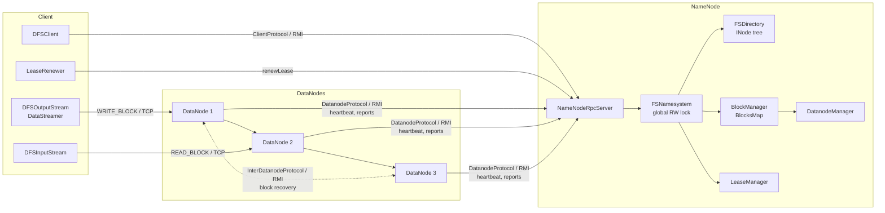

### Communication channels

| Channel | Technology | Port | Direction | Contents |
|---|---|---|---|---|
| `ClientProtocol` | Java RMI | NN 9000 | client → NN | metadata operations |
| `DatanodeProtocol` | Java RMI | NN 9000 | DN → NN | registration, heartbeat, reports, recovery result |
| `InterDatanodeProtocol` | Java RMI | DN ipcPort (5002x) | DN → DN | block recovery |
| `DataTransferProtocol` | raw TCP | DN xferPort (5001x) | client/DN → DN | block data in packets |

Important: bulk data **never** travels over RPC, but over the TCP data channel – exactly as in the original.

### Threads

| Process | Thread | Task |
|---|---|---|
| NameNode | RMI workers | handle RPCs under the FSNamesystem lock |
| | `HeartbeatManager.Monitor` | declares DataNodes without heartbeats dead |
| | `RedundancyMonitor` | schedules re-replication |
| | `LeaseManager.Monitor` | checks hard limits, starts lease recovery |
| DataNode | `BPServiceActor` | heartbeats, IBRs, block reports, executing commands |
| | `DataXceiverServer` | accepts TCP connections |
| | `DataXceiver` (per connection) | WRITE_BLOCK / READ_BLOCK |
| | `PacketResponder` (per write operation) | acks upstream |
| | `DataTransfer`, `BlockRecoveryWorker` | re-replication, block recovery |
| Client | `DataStreamer` (per file) | requesting blocks, sending packets |
| | `ResponseProcessor` (per block) | reading acks |
| | `LeaseRenewer` | renewing the lease |

---

## 5. NameNode: in-memory data structures

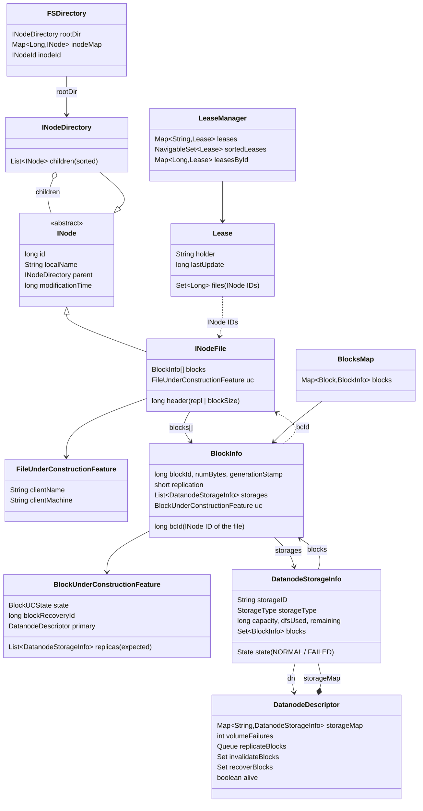

### 5.1 INode tree (`FSDirectory`)

* `INodeDirectory.children` is an **`ArrayList` sorted by name**; `getChild()` uses binary search.
  Rationale in the original: minimal memory per directory (no HashMap entries).
* The **path is not stored anywhere**. `INode.getFullPathName()` walks up the `parent` chain.
* `inodeMap` (ID → INode) allows access without a path: the client passes the **fileId** with
  `addBlock`/`complete`, and `BlockInfo.bcId` and the leases refer to files by ID.
  This is why ongoing write operations and leases survive a **rename**.
* `INodeFile.header` packs replication (11 bits) and preferred block size (48 bits) into **one `long`**
  (`INodeFile.HeaderFormat`).
* `INodesInPath` is the result of path resolution: `"/a/b"` → components `["", "a", "b"]`,
  INodes `[root, a, b]` (non-existent ones = `null`).

**INode IDs** (`INodeId`):

| Value | Meaning |
|---|---|
| 0 | `GRANDFATHER_INODE_ID` – "no ID", resolution is done via the path |
| 1 … 16384 | reserved (`LAST_RESERVED_ID = 2 << 14 - 1`) |
| 16385 | `ROOT_INODE_ID` |
| from 16386 | sequential for every new file / every new directory, never reused |

### 5.2 Blocks, IDs and generation stamps

```java
class Block { long blockId; long numBytes; long generationStamp; }
// equals()/hashCode() compare ONLY blockId
```

| Counter | Class | Start value | first assigned value |
|---|---|---|---|
| Block ID | `SequentialBlockIdGenerator` | `LAST_RESERVED_BLOCK_ID = 2^30` | **1073741825** (`blk_1073741825`) |
| Generation stamp | `GenerationStamp` | `LAST_RESERVED_STAMP = 1000` | **1001** |

* Every new block (`addBlock`) gets a new ID **and** a new GS.
* Every block recovery assigns a new GS (the *recoveryId*). Replicas with a smaller GS are then
  recognizable as **stale** and are deleted.
* The notation `blk_1073741825_1001` means ID 1073741825, GS 1001.
* `SequentialBlockIdGenerator.nextValue()` skips IDs that are already in the BlocksMap
  (in the original because of legacy blocks with random IDs).

### 5.3 Block IDs in the namespace: file → blocks

For every file, the namespace knows the **list of its block IDs** – this is the actual link between
"path" and "data". As in the original, it hangs directly off the INode:

```java
class INodeFile extends INode {
    long header;              // replication | block size
    BlockInfo[] blocks;       // blk_1073741825_1001, blk_1073741826_1002, … in file order
}
```

* `FSNamesystem.getAdditionalBlock` creates **one** `BlockInfo` object and hooks it into two places:
  `blockManager.addBlockCollection(blockInfo, file.getId())` (BlocksMap) and `file.addBlock(blockInfo)` (namespace).
  Both structures therefore point to the same object.
* Both directions are possible without searching:
  file → blocks via `INodeFile.blocks`, block → file via `BlockInfo.bcId` + `inodeMap`.
* The **ID, generation stamp and length** of a block belong to the namespace. The **locations** do not –
  they come only from block reports (5.4).

| | here | original |
|---|---|---|
| in RAM | `INodeFile.blocks: BlockInfo[]` | `INodeFile.blocks: BlockInfo[]` (same) |
| on disk | – | FSImage: per file a list `BlockProto {blockId, genStamp, numBytes}`, EditLog: `OP_ADD_BLOCK` |
| inspect | `./hdfs dfs -metasave` | `hdfs fsck <path> -files -blocks -locations`, `hdfs oiv -p XML` (FSImage) |
| on the DataNode | `…/BP-…/current/finalized/subdirX/subdirY/blk_<id>` + `blk_<id>_<GS>.meta` (6.2) | same |

This is how it looks in `-metasave` – the tree at the top, the INode object with its `blocks` field at the bottom:

```
/user/student/
    data.bin   [file, inode=16388, repl=3, blockSize=131072, len=307200]
          blk_1073741825_1001  len=131072  COMPLETE  replicas=[[DISK]DS-9c1e…:NORMAL:localhost:50011, [DISK]DS-04ab…:NORMAL:localhost:50010, [DISK]DS-77f2…:NORMAL:localhost:50012]
          blk_1073741826_1002  len=131072  COMPLETE  replicas=[…]
          blk_1073741827_1003  len=45056   COMPLETE  replicas=[…]
…
INodeFile id=16388
    localName="data.bin"  parent=16387  …
    header: repl=3  preferredBlockSize=131072
    blocks=[blk_1073741825_1001(COMPLETE), blk_1073741826_1002(COMPLETE), blk_1073741827_1003(COMPLETE)]
```

For comparison, the original output of `fsck` for the same file (shortened):

```
/user/student/data.bin 307200 bytes, replicated: replication=3, 3 block(s):  OK
0. BP-…:blk_1073741825_1001 len=131072 Live_repl=3  [DatanodeInfoWithStorage[…], …]
1. BP-…:blk_1073741826_1002 len=131072 Live_repl=3  […]
2. BP-…:blk_1073741827_1003 len=45056  Live_repl=3  […]
```

`BP-…` is the block pool ID. Here there is exactly one block pool with the hard-wired ID
`BP-1-127.0.0.1-1700000000000` (`HdfsServerConstants.BLOCK_POOL_ID`, structure see 6.2); it shows up in the
directories of the DataNodes and in every block report. `DatanodeInfoWithStorage` corresponds here to
`DatanodeStorageInfo`. The client sees the same blocks via `getBlockLocations` as `LocatedBlocks`.

### 5.4 BlocksMap and BlockInfo

* `BlocksMap`: `Block → BlockInfo`. Since `equals` compares only the ID, any `Block` with the same ID
  suffices for the lookup (e.g. from a block report with a different GS).
* `BlockInfo.storages`: the **storages** (disks) on which a **FINALIZED** replica has been reported –
  at most one per DataNode. `DatanodeStorageInfo.blocks` is the reverse direction.
  (Original: both directions in one `Object[] triplets` without additional list objects.)
* Only replicas on storages in state `NORMAL` of live DataNodes are counted (`countLiveReplicas`).
* If a DataNode reports a block from a **different** one of its disks than before, the old entry is
  replaced (`DatanodeStorageInfo.addBlock` → `REPLACED`).
* `BlockInfo.bcId`: INode ID of the file, `-1` = file deleted.
* `BlockUnderConstructionFeature` exists only as long as the block is not COMPLETE. It remembers the
  **expected locations** (the pipeline from `addBlock`) – while writing, the NameNode does not yet know any
  FINALIZED replicas, but needs the locations for the recovery.

### 5.5 DatanodeDescriptor – storages and command queues

**Storages.** Since Hadoop 2.4 (HDFS-2832, "Heterogeneous Storage") the NameNode sees each disk of a
DataNode individually: `DatanodeDescriptor.storageMap` holds, per `storageID`, a `DatanodeStorageInfo` with type
(`DISK`, `SSD` …), state (`NORMAL`/`FAILED`), capacity/free space from the last heartbeat and the blocks
of that disk. A storage is created as soon as it first shows up in a heartbeat, block report or IBR
(`updateStorage`). This allows the NameNode to

* choose **one storage per DataNode** with enough free space when placing (`chooseStorage4Block`),
* detect the failure of **one** disk and re-replicate exactly its replicas (8.10).

**Command queues.** The NameNode cannot call DataNodes. Instead it collects commands per DataNode:

| Queue | filled by | delivered as | max. per heartbeat |
|---|---|---|---|
| `recoverBlocks` | `internalReleaseLease` | `BlockRecoveryCommand` (DNA_RECOVERBLOCK) | all |
| `replicateBlocks` | `RedundancyMonitor` | `BlockCommand` (DNA_TRANSFER) | 2 (`MAX_REPLICATION_STREAMS`) |
| `invalidateBlocks` | delete, over-replication, stale/corrupt replicas | `BlockCommand` (DNA_INVALIDATE) | 1000 |

### 5.6 Leases

```
leases        : holder        → Lease
sortedLeases  : TreeSet by (lastUpdate, holder)  – oldest first
leasesById    : INode ID      → Lease
Lease         : holder, lastUpdate (monotonic), files = {INode IDs}
```

* A lease belongs to a **client** (`DFSClient_NONMAPREDUCE_<random>_<thread>`), not to a file.
  `renewLease(holder)` extends all of the client's files at once.
* When the last file of a lease is closed, the lease disappears.
* Thanks to `sortedLeases`, the monitor only has to look at the front until it finds the first non-expired lease.
* `FileUnderConstructionFeature.clientName` and the lease holder are always in sync
  (`LeaseManager.reassignLease` sets both).

### 5.7 Locking

All structures are protected by **one** fair `ReentrantReadWriteLock` in `FSNamesystem`
(read operations: read lock; everything else incl. heartbeats: write lock). The `LeaseManager` is additionally
`synchronized` internally, so that `renewLease` gets by without the FS lock.
Lock order is always **FS lock → LeaseManager** (no deadlocks).

---

## 6. DataNode: on-disk storage

### 6.1 From configuration to disk

In a real cluster, **the same** `hdfs-site.xml` is present on every machine. It specifies where the disks of a
DataNode are mounted:

```xml
<name>dfs.datanode.data.dir</name>
<value>[DISK]/data/1/dfs/dn,[DISK]/data/2/dfs/dn</value>
```

Each entry is a **volume** (= one disk = one **storage** with its own `storageID`). Because every machine has mounted its
own disks under `/data/1`, `/data/2`, the same paths work everywhere.

EduDFS runs on **one** machine. So that all processes can still read the same `conf/hdfs-site.xml`,
each DataNode gets a **root directory** that represents its file system. The paths from the configuration
are resolved below it (`StorageLocation.parse`):

| | Original | EduDFS |
|---|---|---|
| Configuration | `$HADOOP_CONF_DIR/hdfs-site.xml`, the same on every machine | `conf/hdfs-site.xml`, the same for all processes |
| Disk | device, mounted, e.g. `/dev/sdb` → `/data/1` | subfolder `data/<n>` in the DataNode's root directory |
| Root of the machine | `/` | `data/dn<i>/` (MiniDFSCluster) or the 1st argument of `./hdfs datanode` |
| Volume 1 of DataNode 2 | `/data/1/dfs/dn` on machine 2 | `data/dn2/data/1/dfs/dn` |
| Disk failure | disk defective / removed | delete folder `data/dn2/data/1` or `chmod 000` (8.10) |

The real `MiniDFSCluster` takes a different approach: it overrides `dfs.datanode.data.dir` for each DataNode
(`data/data1,data/data2` for DN 0, `data/data3,data/data4` for DN 1 …). Here the configuration stays the same, and
the difference lies only in the root directory – which corresponds to the real cluster.

### 6.2 Directory layout of a volume

```
data/dn0/                                     root of DataNode 0's "machine"
├── data/1/dfs/dn/                            volume 1 (1st entry in dfs.datanode.data.dir)
│   └── current/
│       ├── VERSION                           storageID=DS-…, clusterID=CID-…, datanodeUuid=…,
│       │                                     storageType=DATA_NODE, layoutVersion=-57, cTime=0
│       └── BP-1-127.0.0.1-1700000000000/     one folder per block pool (= per namespace)
│           └── current/
│               ├── VERSION                   namespaceID, blockpoolID, layoutVersion, cTime
│               ├── finalized/
│               │   └── subdir0/subdir0/      computed from the block ID (see below)
│               │       ├── blk_1073741825              raw data
│               │       └── blk_1073741825_1001.meta    checksums; the GS is in the file name
│               └── rbw/                      "Replica Being Written" (flat)
│                   ├── blk_1073741829
│                   └── blk_1073741829_1005.meta
└── data/2/dfs/dn/                            volume 2: same structure, its own storageID
```

| Element | Meaning | here |
|---|---|---|
| `storageID` | identity of **one disk**, `DS-` + UUID, generated on the volume's first start ("formatting") | as in the original (`DatanodeStorage.generateUuid`) |
| `datanodeUuid` | identity of **the DataNode**, stored in the `VERSION` of **every** volume (the same everywhere) | as in the original |
| `clusterID` | original: `CID-` + UUID, generated by `hdfs namenode -format`; a DataNode with a foreign clusterID is rejected | fixed `CID-edudfs-…` (`HdfsServerConstants.CLUSTER_ID`), checked when the volume is opened |
| `BP-…` | block pool ID. Original: `BP-` + random number + `-` + IP of the NameNode + `-` + formatting time in ms, e.g. `BP-526805057-192.168.1.10-1697712345678`; with federation, several pools on the same disks | fixed `BP-1-127.0.0.1-1700000000000` (`HdfsServerConstants.BLOCK_POOL_ID`) |
| `subdirX/subdirY` | `X = (blockId >> 16) & 31`, `Y = (blockId >> 8) & 31` (`DatanodeUtil.idToBlockDir`): at most 32×32 folders, never too many files in one folder, the path does not need to be stored anywhere | as in the original (`FsVolumeImpl.idToBlockDir`) |

In the original, the DataNode fetches `clusterID`, `namespaceID` and block pool ID before registration via
`versionRequest()` from the NameNode, which has stored them in `dfs.namenode.name.dir/current/VERSION`. Here they are
constants, because the NameNode persists nothing.

Not reproduced: `in_use.lock` (prevents two DataNodes on one volume), `tmp/` (re-replication writes here
instead of `rbw/`), `previous/` (rollback after upgrades), `scanner.cursor` (block scanner).

### 6.3 `.meta` format

```
short  version          = 1
byte   checksumType     = 1 (CRC32)
int    bytesPerChecksum = 512
int[]  CRC32 per 512-byte chunk (last chunk possibly shorter)
```
Header = 7 bytes. The CRC of chunk *i* is at offset `7 + 4·i`.

### 6.4 Replica table

`FsDatasetImpl.volumeMap: blockId → ReplicaInfo(blockId, GS, numBytes, state, volume, dir, writer…)` – **one**
table across all volumes; each replica knows its volume. On startup every volume is scanned:
`finalized/` (recursively over the `subdir`s) → FINALIZED, `rbw/` → **RWR** (the writer no longer exists after a
restart). If the same block is on two volumes, the higher GS wins.

| Operation | Method | Effect |
|---|---|---|
| Begin writing | `createRbw` | choose a volume (6.5), empty files in its `rbw/`, write the meta header |
| Finish writing | `finalizeBlock` | `rbw/` → `finalized/subdirX/subdirY/` of **the same** volume, state FINALIZED |
| Delete | `invalidate` | only if the GS matches exactly; the writer is stopped; IBR for the replica's storage |
| Recovery step 1 | `initReplicaRecovery` | stop the writer, state → RUR, measure the length |
| Recovery step 2 | `updateReplicaUnderRecovery` | truncate (`truncateBlock`), rename meta (new GS), → `finalized/…`; returns the `storageID` |
| Block report | `getBlockReport` | one `StorageBlockReport` **per healthy volume**, even for empty ones |
| Heartbeat data | `getStorageReports` | per healthy volume: capacity, used bytes, free space |
| Check disks | `checkDataDir` | remove broken volumes together with their replicas (6.5) |

`truncateBlock` truncates the data and meta files and recomputes the CRC of the last (partial) chunk –
identical to the original.

### 6.5 Volume choice and disk failure

**Which disk?** The NameNode chooses only the DataNode and storage type; **which** disk gets a new replica
is decided by the DataNode itself with the `RoundRobinVolumeChoosingPolicy` (default of
`dfs.datanode.fsdataset.volume.choosing.policy`): in turn, volumes without space for a block are skipped.
The storage expected by the NameNode is therefore only a suggestion; what counts is the storage in the IBR.

**Disk broken.** On every heartbeat the DataNode checks its volumes (`DataNode.checkDiskError` →
`FsDatasetImpl.checkDataDir`: do `finalized/` and `rbw/` still exist and are they writable?). A broken volume
is removed, and its replicas disappear from the `volumeMap`.

| failed volumes | DataNode's reaction |
|---|---|
| ≤ `dfs.datanode.failed.volumes.tolerated` | keeps running; reports one storage fewer and the number of failures in the next heartbeat; immediately sends a full block report |
| > `dfs.datanode.failed.volumes.tolerated` | shuts down ("Too many failed volumes") – for the NameNode a normal DataNode failure (8.4) |

Already at startup, a volume that cannot be created counts as failed. `failed.volumes.tolerated`
must be smaller than the number of volumes (as in the original). In the original, the `DatasetVolumeChecker` checks
asynchronously after IO errors and at most every 15 min; here simply on every heartbeat.

---

## 7. Protocols

### 7.1 ClientProtocol (client → NameNode, RMI)

| Method | Purpose | Lock |
|---|---|---|
| `getBlockLocations(src, off, len)` | blocks + locations for reading | read |
| `create(src, client, overwrite, repl, blockSize)` | create file, grant lease | write |
| `append(src, client)` | reopen a closed file, grant lease; returns `LastBlockWithStatus` (8.9) | write |
| `addBlock(src, client, previous, fileId, exclude[])` | commit the previous block, new block + pipeline | write |
| `abandonBlock(b, fileId, src, holder)` | discard the block just allocated | write |
| `complete(src, client, last, fileId)` | close file; `false` = try again later | write |
| `reportBadBlocks(blocks[])` | report a corrupt replica | write |
| `renewLease(client)` | extend lease | – (LeaseManager) |
| `recoverLease(src, client)` | force recovery; `true` = file closed | write |
| `mkdirs`, `delete`, `rename`, `getFileInfo`, `getListing` | namespace | read/write |
| `getDatanodeReport`, `metaSave` | admin/teaching | read |

### 7.2 DatanodeProtocol (DataNode → NameNode, RMI)

| Method | When | Response |
|---|---|---|
| `registerDatanode(id)` | startup, or after `DNA_REGISTER` | – |
| `sendHeartbeat(id, StorageReport[], failedVolumes)` | every second; one report per healthy volume | `DatanodeCommand[]` |
| `blockReport(id, poolId, StorageBlockReport[])` | after registration, every 30 s, immediately after a disk failure; one list per storage | possibly `DNA_REGISTER` |
| `blockReceivedAndDeleted(id, poolId, StorageReceivedDeletedBlocks[])` | immediately after receipt/deletion (IBR), grouped by storage | – |
| `commitBlockSynchronization(block, newGS, newLen, closeFile, deleteBlock, targets[], targetStorages[])` | end of a block recovery | – |

All reports about replicas are **grouped by storage** – as in the original since Hadoop 2.4. A storage is
transmitted as `DatanodeStorage(storageID, state, storageType)`. The NameNode rejects reports with a foreign
block pool ID.

Command codes (identical to the original):

| Code | Name | Meaning |
|---|---|---|
| 1 | `DNA_TRANSFER` | copy block to other DataNodes |
| 2 | `DNA_INVALIDATE` | delete blocks |
| 4 | `DNA_REGISTER` | "I don't know you – register again" |
| 6 | `DNA_RECOVERBLOCK` | perform block recovery as primary |

### 7.3 InterDatanodeProtocol (DataNode → DataNode, RMI)

| Method | Effect |
|---|---|
| `initReplicaRecovery(RecoveringBlock)` | stop the writer, replica → RUR, returns length/GS/original state (`null` = no replica) |
| `updateReplicaUnderRecovery(oldBlock, recoveryId, newLength)` | truncate, GS = recoveryId, finalize, IBR to NN |

### 7.4 DataTransferProtocol (TCP)

All numbers big-endian (`DataOutputStream`), strings as `writeUTF`.

**Request header**

```
short  version = 28
byte   op      = 80 (WRITE_BLOCK) | 81 (READ_BLOCK)
long   blockId, long numBytes, long generationStamp
```

| Op | further fields |
|---|---|
| `WRITE_BLOCK` | `UTF clientName` (empty = DataNode-to-DataNode) · `int n` · n × (`UTF uuid`, `UTF host`, `int xferPort`, `int ipcPort`) = **downstream** pipeline nodes |
| `READ_BLOCK` | `long offset` · `long length` |

**Response** (after pipeline setup or before the read packets)

```
short status (0 = SUCCESS, 1 = ERROR)
UTF   message   (for WRITE_BLOCK: firstBadLink = address of the first faulty node)
```

**Packet** (the same in both directions)

```
long    offsetInBlock
long    seqno
boolean lastPacketInBlock
int     dataLen              (≤ 64 KB)
int     numChecksums         (= ceil(dataLen / 512))
int[]   CRC32 per chunk
byte[]  data
```
Every block ends with an **empty** packet with `lastPacketInBlock = true`.

**PipelineAck** (upstream)

```
long    seqno
int     n
short[] replies   (one status per DataNode, own status first)
```

---

## 8. Flows in detail

### 8.1 Writing a file

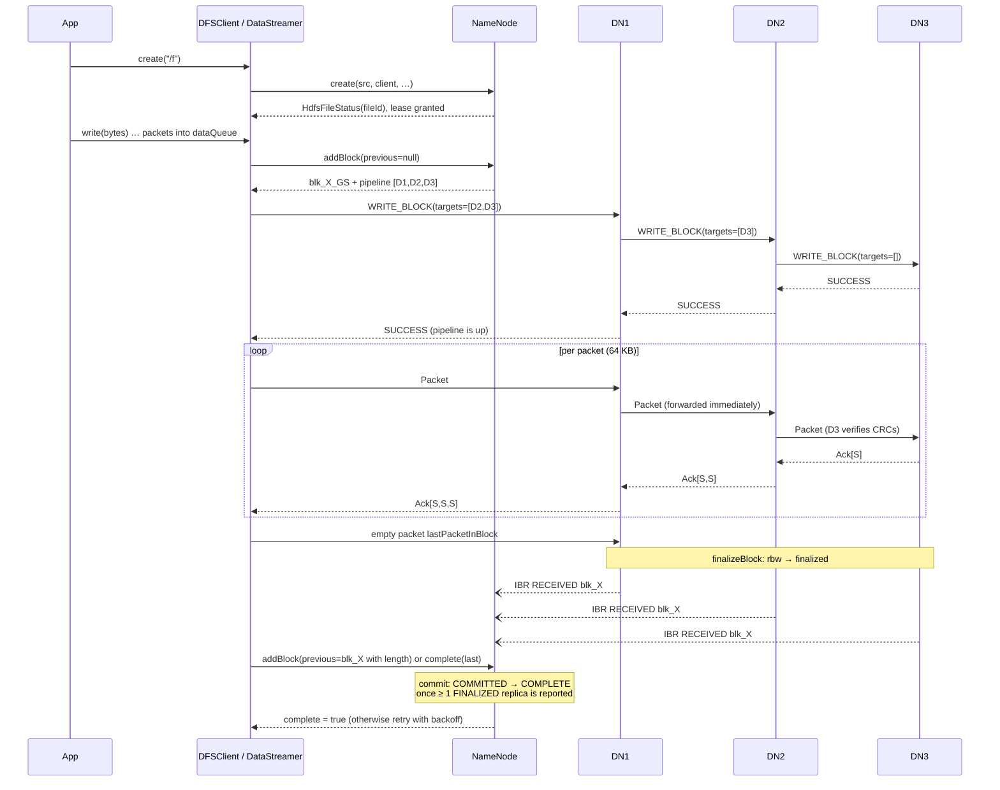

For each block, the section from `addBlock` to the last ack runs once:

```
create → ( addBlock → set up pipeline → packets → last packet → acks )* → complete
```

The individual steps in detail:

#### 8.1.1 `addBlock`: block ID and pipeline from the NameNode

`FSNamesystem.getAdditionalBlock` (under the write lock):

1. **Commit** the previous block (take over the length from `previous`, state COMMITTED or COMPLETE).
2. Assign a new block ID (`SequentialBlockIdGenerator`) and a new generation stamp → e.g. `blk_1073741825_1001`.
3. `BlockPlacementPolicy.chooseTarget`: *repl* random live DataNodes, excluding those the client excluded;
   per DataNode one healthy DISK storage with room for a whole block (`chooseStorage4Block`, 5.5).
   The **order of the array is the order of the pipeline**.
4. Create a `BlockInfo` in state UNDER_CONSTRUCTION, remember the target storages as expected locations (5.4),
   and enter it into the BlocksMap and `INodeFile.blocks` (5.3).
5. Response: `LocatedBlock(blk_1073741825_1001, [DN1, DN2, DN3])`.

#### 8.1.2 Setting up the pipeline

The pipeline is a **chain of TCP connections** (DataTransferProtocol, 7.4). Each connection is used in
both directions: packets flow downstream, acks flow upstream.

```
           packets →             packets →             packets →
 Client ──────────────── DN1 ──────────────── DN2 ──────────────── DN3
           ← acks                ← acks                ← acks
 DataStreamer          DataXceiver           DataXceiver           DataXceiver
 ResponseProcessor     PacketResponder       PacketResponder       PacketResponder
```

| Step | who | what |
|---|---|---|
| 1 | Client (`DataStreamer.createBlockOutputStream`) | connects to `nodes[0]` = DN1, sends `WRITE_BLOCK(blk, clientName, targets=[DN2, DN3])` |
| 2 | DN1 (`DataXceiver.writeBlock`) | `createRbw` → empty files in `rbw/`; connects to `targets[0]` = DN2 ("mirror"), sends `WRITE_BLOCK(targets=[DN3])` |
| 3 | DN2 | like DN1, sends `WRITE_BLOCK(targets=[])` to DN3 |
| 4 | DN3 | has no more targets = **end of the pipeline**, replies `SUCCESS` |
| 5 | DN2, DN1 | pass `SUCCESS` upstream as soon as their successor has replied |
| 6 | Client | starts the `ResponseProcessor` for this block; the pipeline is up |

So each node removes itself from the list and passes the rest on. A node that cannot reach its successor
replies `ERROR` with **`firstBadLink`** = address of the successor. The client excludes that node,
returns the block via `abandonBlock` and requests a new one with `addBlock(…, excludedNodes)`
(up to 3 attempts).

#### 8.1.3 Packets

`DFSOutputStream.write()` collects the bytes in a 64 KB buffer. When it is full (or the block boundary is reached),
a `Packet` is created:

| Field | Bytes | Content |
|---|---|---|
| `offsetInBlock` | 8 | position of the data in the block |
| `seqno` | 8 | sequence number per stream (continues across block boundaries) |
| `lastPacketInBlock` | 1 | `false` for data packets |
| `dataLen` | 4 | ≤ 65536 |
| `numChecksums` | 4 | `ceil(dataLen / 512)` |
| Checksums | 4 · n | one **CRC32 per 512-byte chunk**, computed by the client |
| Data | `dataLen` | |

A full packet is 25 + 512 + 65536 = 66073 bytes. Rules:

* A packet **never crosses a block boundary** – the last data packet of a block may be shorter.
* The `DataStreamer` takes packets from the `dataQueue`, sends them and puts them into the `ackQueue`.
  At most **80 packets** are in both queues combined; after that `write()` blocks (backpressure).
* Each DataNode (`BlockReceiver.receiveBlock`) checks that `offsetInBlock` matches the current replica length,
  and then, in this order:
  1. **forwards the packet to the successor immediately** (so all nodes work at the same time),
  2. only the **last** DataNode verifies the CRCs (the others rely on it doing so),
  3. writes the data to `blk_<id>` and the CRCs to `blk_<id>_<GS>.meta`,
  4. puts the packet into its own `ackQueue` for the `PacketResponder`.

#### 8.1.4 Last packet

At the end of the block, the client sends an **empty** packet: `dataLen = 0`, no checksums,
`lastPacketInBlock = true`, `offsetInBlock` = block length (`Packet.lastPacket`). It carries no data;
it only means "the block is done". Each DataNode

1. passes it on (like any packet),
2. closes the files and calls `finalizeBlock`: `rbw/` → `finalized/`, state RBW → FINALIZED,
3. immediately reports the block to the NameNode via IBR `RECEIVED_BLOCK` (`blockReceivedAndDeleted`),
4. sends the ack for it and closes the connection.

After sending, the client waits until the `ackQueue` is empty, closes the connection and remembers the block
as `previous` for the next `addBlock` or for `complete`. Only the client knows the **final length** of the block –
that is why it is reported to the NameNode from there (**commit**).

#### 8.1.5 Acks

`PipelineAck` = `seqno` + one status per DataNode (7.4). The `PacketResponder` of each DataNode processes
its `ackQueue` in order:

1. take the packet with `seqno = s` from the queue,
2. if there is a successor: read its ack and check that it also has `seqno = s`,
3. **prepend its own status** and send the ack upstream.

```
DN3 → DN2:     Ack(seqno=s, [SUCCESS])
DN2 → DN1:     Ack(seqno=s, [SUCCESS, SUCCESS])
DN1 → Client:  Ack(seqno=s, [SUCCESS, SUCCESS, SUCCESS])     ← index i = nodes[i]
```

On the client, the `ResponseProcessor` checks that all statuses are `SUCCESS` and that the `seqno` matches the first
packet in the `ackQueue`, and then removes it. An ack for packet *s* means: **all** DataNodes have written *s*.
Since the acks travel in the same order as the packets, comparing with the first element is enough.

Errors: if something fails on a DataNode (e.g. a CRC error at the end of the pipeline), it aborts the connections.
This propagates up to the client, and the stream fails – there is no pipeline recovery here (13).

#### 8.1.6 Example: 300 KB with 128 KB blocks (demo, scenario 1)

```
Block              seqno  offsetInBlock  dataLen  lastPacketInBlock
blk_1073741825_1001   0             0    65536    false
                      1         65536    65536    false
                      2        131072        0    true     → commit len=131072 on addBlock(previous)
blk_1073741826_1002   3             0    65536    false
                      4         65536    65536    false
                      5        131072        0    true     → commit len=131072 on addBlock(previous)
blk_1073741827_1003   6             0    45056    false    (on close(), 88 checksums)
                      7         45056        0    true     → commit len=45056 on complete(last)
```

#### 8.1.7 `complete`

* `complete()` returns `false` as long as the last block is not yet COMPLETE (no FINALIZED IBR yet).
  The client retries up to 10× (100 ms, doubled, max. 2 s).
* `BlockManager.completeBlock` records pipeline replicas that are still missing as *pending*
  (`addExpectedReplicasToPending`), so that no unnecessary re-replication happens right away.
* Afterwards the NameNode removes the file from the lease (`FileUnderConstructionFeature` gone, file closed).

#### 8.1.8 Differences from the original

| | here | original |
|---|---|---|
| Packet header | fixed fields, `DataOutputStream` | `PLEN` + `HLEN` + `PacketHeaderProto` (Protobuf) |
| Packet size | 64 KB of **payload** | 64 KB **including** checksums → 126 chunks = 64512 bytes of data |
| Last packet | sent immediately | only once all previous packets are acknowledged (`PIPELINE_CLOSE`) |
| Heartbeat packets | none | empty packets with `seqno = -1`, so that an idle pipeline does not time out |
| Ack content | status per DataNode | additionally flags (e.g. ECN/overload) and `downstreamAckTimeNanos` |
| CRC error | connection abort | ack with `ERROR_CHECKSUM` |
| DataNode fails | stream fails | pipeline recovery: remove node, get new GS (`updatePipeline`), keep writing |
| `hflush`/`hsync` | – | packet with `syncBlock`, data visible to readers or on disk, respectively |

### 8.2 Reading a file

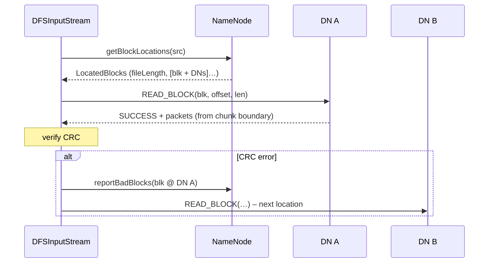

* The DataNode extends the range to **512-byte chunk boundaries**; the client discards the surplus bytes at the front.
* On a connection or checksum error, the node is marked as "dead" for this block and the next one is tried.
* Open files: only the blocks that are already completed are readable (simplification).

### 8.3 Heartbeats, block reports, registration

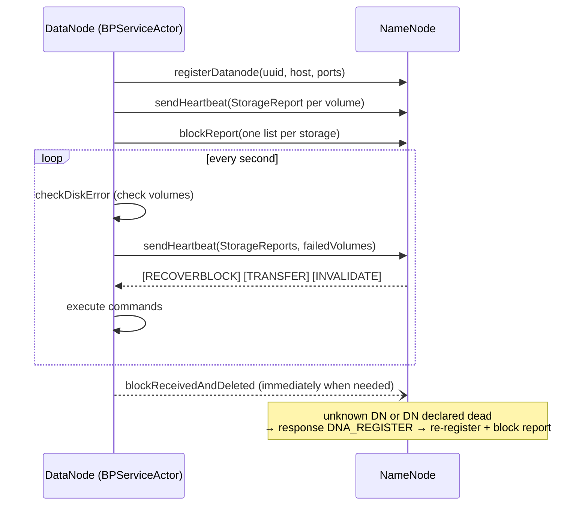

**Processing of reported FINALIZED replicas** (`BlockManager.addStoredBlock`):

| Situation | Reaction |
|---|---|
| block unknown / file deleted | have the replica deleted (invalidate) |
| reported GS < stored GS | stale → invalidate |
| reported GS > stored GS | ignore (recovery result, `commitBlockSynchronization` follows) |
| block COMMITTED/COMPLETE, length does not match | corrupt → invalidate |
| otherwise | add location; COMMITTED + enough replicas → COMPLETE; check redundancy |

On a **full block report** (`processReport`), the difference is computed **per storage**: blocks that the
storage no longer reports are removed from it. Non-finalized replicas (RBW/RWR) of a block under construction
are added as an expected location, otherwise deleted. Storages missing from the report entirely (disk removed,
failed, reformatted) are removed together with their replicas ("zombie storages", HDFS-7960).

The first heartbeat comes **before** the first block report: only with it does the NameNode know the storages and
their free space, and choose the DataNode as a pipeline target.

### 8.4 DataNode failure and re-replication

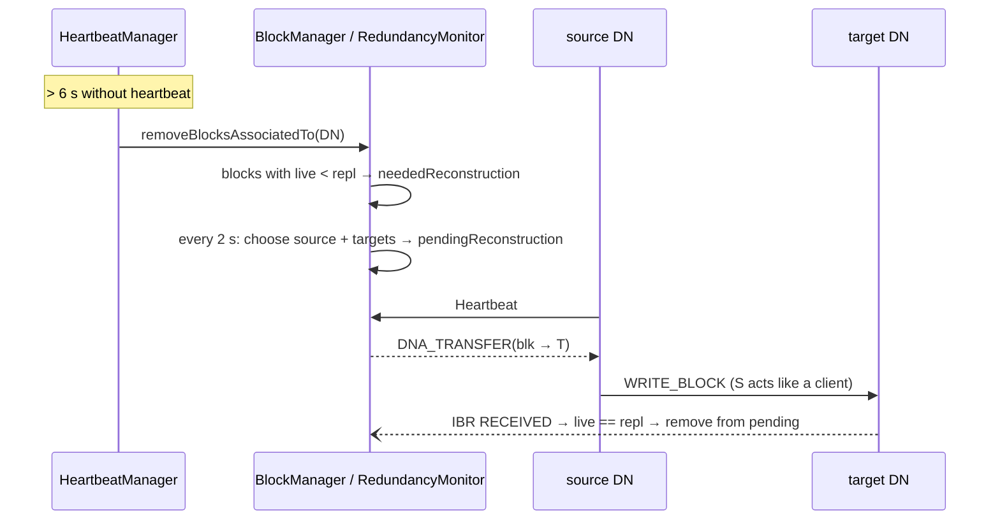

* Source: a live holder with the fewest pending commands.
* Targets: random among live DataNodes that do not have the block and have no pending deletion for it.
* If no confirmation arrives within 15 s, the block is scheduled again.
* Over-replication (e.g. a dead DataNode comes back): surplus replicas are deleted.

### 8.5 Deletion

`delete` detaches the subtree, removes the INodes from the `inodeMap`, the leases of open files, and the blocks from
the BlocksMap. The **data on the DataNodes** is only deleted when the `DNA_INVALIDATE` commands are picked up with the
next heartbeat. The DataNode confirms via IBR `DELETED_BLOCK`.

### 8.6 Lease recovery

**Triggers**

| Trigger | Condition | Code |
|---|---|---|
| another client calls `create(overwrite=false)` | soft limit (5 s) expired | `recoverLeaseInternal(CREATE_FILE, force=false)` |
| `recoverLease(src)` | immediately, no limit | `recoverLeaseInternal(RECOVER_LEASE, force=true)` |
| `LeaseManager.Monitor` | hard limit (15 s) expired | `checkLeases()` |

`create(overwrite=true)`, on the other hand, simply deletes the open file (as in the original).

**`FSNamesystem.internalReleaseLease`** – decision based on the state of the last block:

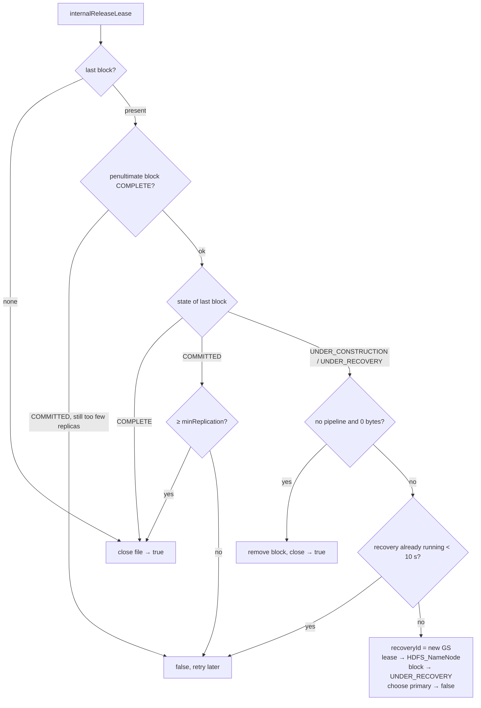

**Block recovery on the DataNodes**

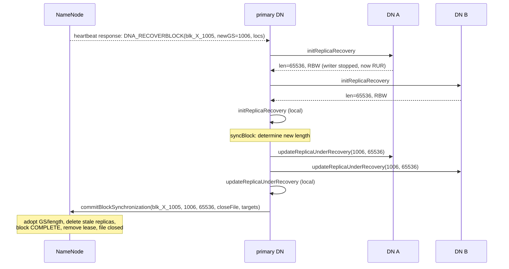

**Rules of `syncBlock`** (`BlockRecoveryWorker`):

| existing replicas | new length | participants |
|---|---|---|
| at least one FINALIZED | length of the FINALIZED replica | FINALIZED + RBW with length ≥ that |
| only RBW (+RWR) | **minimum** of the RBW lengths | all RBW |
| only RWR | minimum of the RWR lengths | all RWR |
| none | – | `commitBlockSynchronization(deleteBlock=true)` → block is removed from the file |

Why the minimum? All bytes up to the smallest length are **guaranteed to be present on all** participating replicas
– that is the largest state everyone can consistently agree on. Data that was only in the buffer of the
crashed client is lost (see demo: 200 KB written, 192 KB rescued).

**Error messages for the second client** (`create` on someone else's open file):

| When | Exception |
|---|---|
| lease still valid | `AlreadyBeingCreatedException … already being created by <holder>` |
| soft limit expired (recovery is started) | `RecoveryInProgressException … lease recovery is in progress` |
| recovery running | `RecoveryInProgressException Recovery in progress, file [...]` |
| file closed | `FileAlreadyExistsException` (with `overwrite=false`) |

From the takeover on, the original writer gets a `LeaseExpiredException` on `addBlock`/`complete`.

### 8.7 Corrupt replica

1. Client reads, CRC does not match → `reportBadBlocks`.
2. `BlockManager.markBlockAsCorrupt`: remove the location, schedule the replica for deletion, the block becomes under-replicated.
   (If it is the **last** replica, it is kept.)
3. Re-replication as in 8.4.

### 8.8 Restart: what survives?

| | stored in | after restart |
|---|---|---|
| Namespace, block IDs per file, leases | NameNode RAM | **gone** (no persistence) |
| Block locations (BlocksMap) | NameNode RAM | rebuilt from block reports |
| Block contents | `<volume>/current/BP-…/current/finalized/` on the DataNodes' volumes | remain, as long as the NameNode does not have them deleted |
| Identity of DataNode and disks | `<volume>/current/VERSION` (`datanodeUuid`, `storageID`) | remains |

**DataNode restart:** `FsDatasetImpl` scans `finalized/` (→ FINALIZED) and `rbw/` (→ RWR) on each volume;
UUID and storageIDs come from the `VERSION` files. If a volume directory is missing (e.g. deleted = "new disk"),
it is reformatted and gets a new storageID; the NameNode removes the old storage on the next
block report. The DataNode registers, sends a block report, and the NameNode adds it back as a location.
The files are then readable unchanged.

**NameNode restart** (also: stopping the minicluster with Ctrl+C and starting it again): the NameNode starts with an empty
namespace. DataNodes receive `DNA_REGISTER` in response to their heartbeat, re-register and send a
block report. None of the reported blocks belong to a file:

```
[BlockManager] BLOCK* addStoredBlock: blk_1073741831_1007 on localhost:51012 does not belong to any file -> invalidate
```

With the next heartbeat, the DataNodes pick up `DNA_INVALIDATE` and **delete the block files from disk**.
So the data is not only gone from the namespace, but a few seconds later physically as well.
In the original, FSImage + EditLog prevent exactly this; in addition, the NameNode stays in **safe mode** until enough blocks
have been reported, and deletes nothing during that time.

**Cleaning up:** with the cluster running, `./hdfs dfs -rm -r '/*'` (the DataNodes delete their blocks via invalidate);
with the cluster stopped, `rm -rf data/`.

Older data directories (layout before the switch to volumes: `data/dn<i>/current/finalized/blk_…`) are no longer
read; they can be deleted.

### 8.9 Append

`./hdfs dfs -appendToFile <local> <hdfs>` or `DFSClient.append(src)` appends to a **closed** file.
What is implemented is the `append` variant with `CreateFlag.NEW_BLOCK` from the original: the new data always starts
in a **new block**; the previous last block remains unchanged.

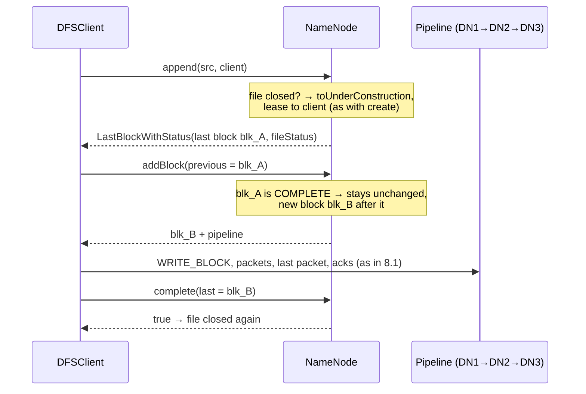

* **NameNode** (`FSNamesystem.appendFile`): error if the file is missing or is a directory. If it is still
  open, the same rules apply as for `create` (`recoverLeaseInternal` with `APPEND_FILE`):
  `AlreadyBeingCreatedException`, after the soft limit has expired `RecoveryInProgressException`.
  Otherwise the file becomes *under construction* again and the client gets a lease.
* **Client** (`DFSClient.append`): builds a `DFSOutputStream` with the old last block as the `lastBlock` of the
  `DataStreamer`. It is sent along as `previous` with the first `addBlock` – exactly as if the same
  stream had just written the block itself. From then on, everything runs as in 8.1.
* If nothing is written, `complete(last = old last block)` closes the file unchanged.

Consequence: blocks in the middle of a file can be **shorter than the block size**. This is also allowed in the original
(variable-length blocks). Reading still works, because `LocatedBlock.startOffset` is computed from the actual block lengths
and not from `index · blockSize`.

```
./hdfs dfs -put demo.txt /demo.txt
./hdfs dfs -appendToFile demo.txt /demo.txt
./hdfs dfs -metasave
    demo.txt   [file, inode=16389, repl=3, blockSize=1048576, len=54]
          blk_1073741828_1004  len=27  COMPLETE  replicas=[…]
          blk_1073741829_1005  len=27  COMPLETE  replicas=[…]
```

The original additionally has the "normal" append without `NEW_BLOCK`: if the last block is not full, it becomes
UNDER_CONSTRUCTION again, gets a **new generation stamp**, and the client builds a pipeline to the
**existing** replicas (`BlockConstructionStage.PIPELINE_SETUP_APPEND`, replica FINALIZED → RBW).
That is exercise 5.

#### 8.9.1 Watching RBW → FINALIZED

A normal `-put` or `-appendToFile` takes only milliseconds: the replica sits in `rbw/` so briefly that you
never see it in the file system. With `-appendToFile -` (data from stdin) and a pause, the write can be
kept open.

**Terminal 1:**

```bash
./hdfs minicluster 3
```

**Terminal 2** – show the block files every second (macOS has no `watch`):

```bash
while true; do clear; date; find data -name 'blk_*' | sort; sleep 1; done
```

**Terminal 3** – append needs an existing file, so `-put` comes first:

```bash
./hdfs dfs -mkdir /user/me
./hdfs dfs -put demo.txt /user/me/demo.txt
(head -c 100000 /dev/urandom; sleep 30) | ./hdfs dfs -appendToFile - /user/me/demo.txt
```

1. `head -c 100000 /dev/urandom` immediately sends 100,000 bytes into the pipe.
2. `sleep 30` then waits 30 seconds without sending anything. The pipe stays open during that time.
3. `appendToFile -` reads from the pipe (stdin) and can only close the file once the pipe is closed,
   i.e. when `sleep` is done.

So the pause is intentional. During these 30 seconds the new block (`blk_…` + `blk_…_<GS>.meta`) sits on each
of the three DataNodes in `…/current/rbw/`, afterwards in `…/current/finalized/subdir0/subdir0/`. The command therefore
always takes at least as long as the `sleep`.

Why 100,000 bytes and not `echo`?

* The client only sends data once a packet is full (`HdfsConfig.PACKET_SIZE` = 64 KB,
  `DFSOutputStream.write`). Only with the first packet does the `DataStreamer` fetch the block from the NameNode and set up the
  pipeline (`nextBlockOutputStream`) – only then does the DataNode create the files in `rbw/` (`createRbw`).
  With less than 64 KB, nothing happens until `close()`, and `rbw/` stays empty.
* The remaining ~35 KB and the last packet only go out on `close()`; this is followed by `finalizeBlock`
  (`rbw/` → `finalized/`) and `complete` at the NameNode.

Limits:

* The pause must stay **under 60 s**. The DataNode does not wait longer for the next packet
  (`DataTransferProtocol.READ_TIMEOUT_MS`); the write aborts.
* Without the part before the `|` (just `./hdfs dfs -appendToFile - …`), the command reads from the **keyboard** and waits
  until you press Ctrl+D – it then looks as if it were hanging.
* `/dev/urandom` appends random bytes. For readable text: `yes | head -c 100000` instead of `head -c 100000 /dev/urandom`.

### 8.10 Disk failure (volume failure)

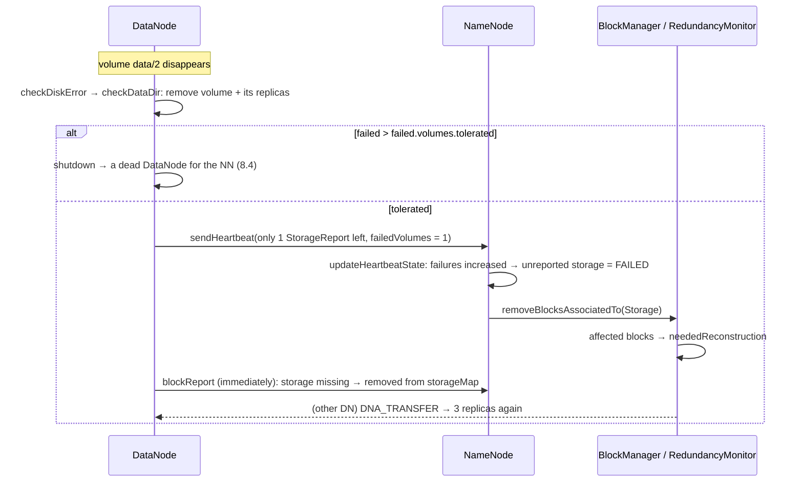

* The DataNode stays **LIVE**; only the replicas on the broken disk are missing. Without storages in the NameNode, one would
  have to either write off the whole DataNode or wait until the next block report (original: 6 h) reveals the
  gap.
* Try it: start the minicluster, write a file, then e.g. `rm -rf data/dn0/data/2` and watch `./hdfs dfs -metasave`
  (`failed volumes=1`, one storage fewer, `neededReconstruction`). Demo scenario 6 does exactly that.
* Tests: `FsDatasetImplTest.failedVolumeIsRemovedTogetherWithItsReplicas`,
  `FSNamesystemTest.failedVolumeInHeartbeatRemovesOnlyThatStoragesReplicas`,
  `MiniDFSClusterTest.failedVolumeIsDetectedAndOnlyItsReplicasAreReReplicated`.

---

## 9. State machines

Many flows in HDFS can be read as a state machine. Two state machines are spelled out in the code as an **enum**
(block and replica); the others follow from fields:

| State machine | States | State is held in | Section |
|---|---|---|---|
| Block (NameNode) | `UNDER_CONSTRUCTION → COMMITTED → COMPLETE`, during recovery `UNDER_RECOVERY` | `BlockInfo.getBlockUCState()` – `COMPLETE` once no `BlockUnderConstructionFeature` exists any more | 9.1 |
| Replica (DataNode) | `RBW → FINALIZED`, after restart `RWR`, during recovery `RUR` | `ReplicaInfo.state` (`ReplicaState`) + directory `rbw/` or `finalized/` | 9.2 |
| File | open (lease held by client) → in recovery (lease held by `HDFS_NameNode`) → closed, open again via `append` | `INodeFile.uc` (`FileUnderConstructionFeature`) + lease holder | 9.3 |
| Lease | valid → soft limit expired → hard limit expired | `Lease.lastUpdate` compared with soft/hard limit | 9.4 |
| DataNode (NameNode view) | unknown → LIVE → DEAD → (re-registered) LIVE | `DatanodeDescriptor.alive` + `lastUpdateMonotonic` | 9.5 |
| Write pipeline (client) | get block → set up pipeline → send data → wait for acks → block done | `DataStreamer`: `block`, `blockStream`, `ackQueue` | 9.6 |
| Packet (client) | `dataQueue` → `ackQueue` → acknowledged | which queue it is in | 9.7 |

The state machines are connected: a block becomes COMPLETE because replicas become FINALIZED; a file goes into
recovery because its lease expires; the recovery brings block and replicas back into a final state.

### 9.1 Block (NameNode view, `BlockUCState`)

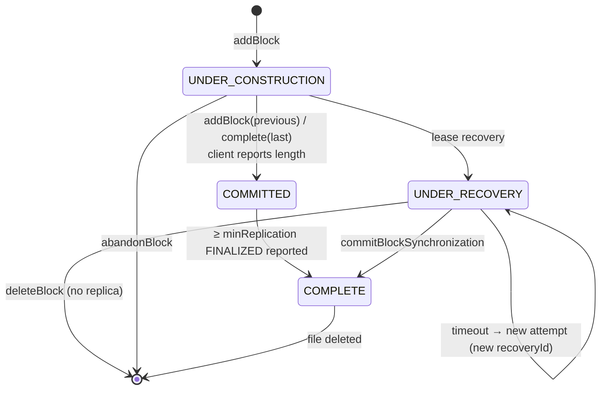

| from | event | to | code |
|---|---|---|---|
| – | client requests a new block | UNDER_CONSTRUCTION | `FSNamesystem.getAdditionalBlock` → `BlockInfo.convertToBlockUnderConstruction` |
| UNDER_CONSTRUCTION | client reports the length (next `addBlock` or `complete`) | COMMITTED | `BlockManager.commitOrCompleteLastBlock` |
| COMMITTED | the IBRs are already there at commit time – happens in the same call | COMPLETE | `commitOrCompleteLastBlock` → `completeBlock` |
| COMMITTED | IBR `RECEIVED_BLOCK` brings the number of FINALIZED replicas to ≥ minReplication | COMPLETE | `BlockManager.addStoredBlock` |
| UNDER_CONSTRUCTION | lease expired / `recoverLease` | UNDER_RECOVERY | `FSNamesystem.internalReleaseLease` |
| UNDER_RECOVERY | primary reports the result | COMPLETE | `FSNamesystem.commitBlockSynchronization` |
| UNDER_RECOVERY | no DataNode has a replica | removed | `commitBlockSynchronization(deleteBlock=true)` |
| UNDER_CONSTRUCTION | pipeline setup failed | removed | `FSNamesystem.abandonBlock` |

Rule of thumb: **COMMITTED** means "the client is done", **COMPLETE** means "in addition, at least
one finished replica is on a DataNode". Only when all blocks are COMPLETE may the file be closed.

### 9.2 Replica (DataNode view, `ReplicaState`)

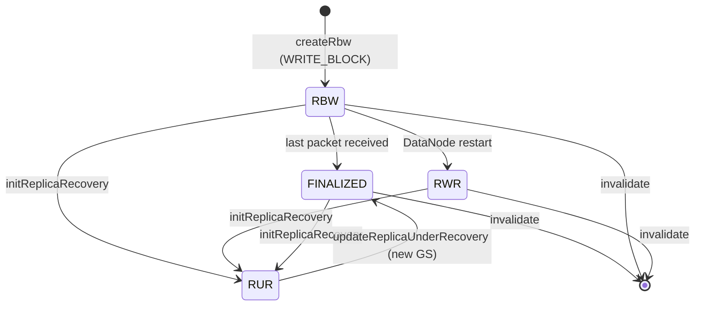

| State | Meaning | Directory | Writer thread |
|---|---|---|---|
| `RBW` | Replica Being Written – a `BlockReceiver` is currently writing | `rbw/` | yes |
| `FINALIZED` | done, immutable, reported as a location in the block report | `finalized/` | no |
| `RWR` | Replica Waiting to be Recovered – was RBW when the DataNode restarted | `rbw/` | no (lost) |
| `RUR` | Replica Under Recovery – a block recovery has taken it over | `rbw/` or `finalized/` | was stopped |

The transition to RUR **stops the old writer** (`ReplicaInfo.stopWriter`). This way a "lost"
client that still sends data after all can no longer modify the replica after the recovery.

### 9.3 File

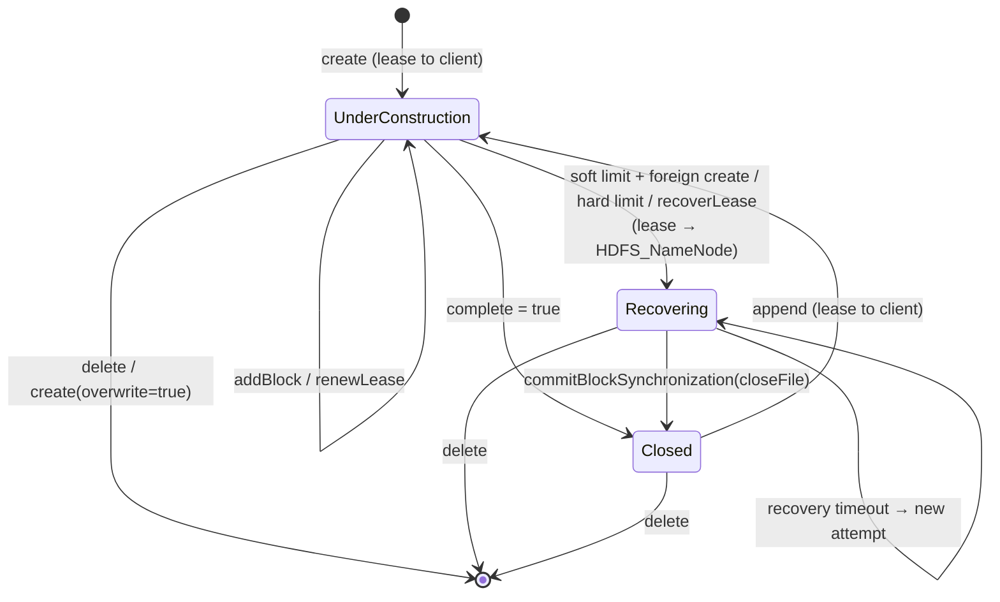

| State | recognizable by | Who may write |
|---|---|---|
| UnderConstruction | `INodeFile.isUnderConstruction()`, lease holder = `DFSClient_…` | only the lease holder |
| Recovering | lease holder = `HDFS_NameNode`, last block UNDER_RECOVERY | nobody; the old client gets `LeaseExpiredException` |
| Closed | no `FileUnderConstructionFeature`, no lease | nobody – only `append` opens it again |

`internalReleaseLease` can also close a file **directly** (without Recovering) if the last block is already
COMPLETE or sufficiently replicated, or is empty – see the decision tree in 8.6.

### 9.4 Lease (`LeaseManager.Lease`)

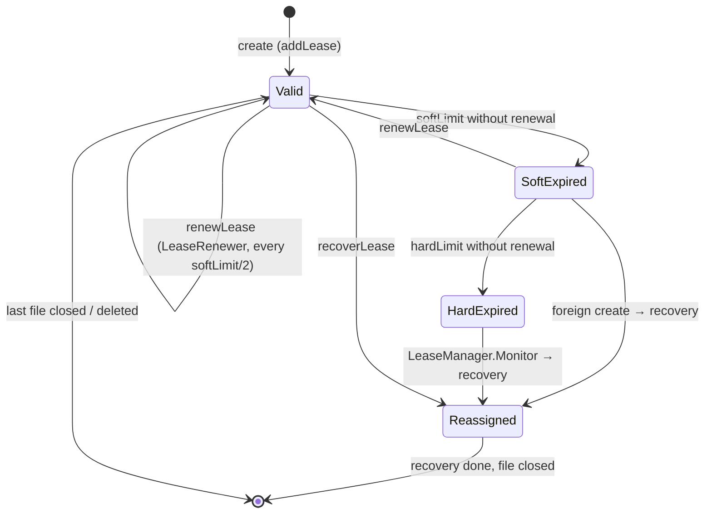

* The states are **not** stored, but computed from `now - lastUpdate`
  (`expiredSoftLimit`, `expiredHardLimit`).
* *Reassigned* means: `reassignLease` takes the file out of the client's lease and puts it into a lease with
  holder `HDFS_NameNode`. This lease starts out as *valid* again; if it in turn expires, the monitor starts
  a new recovery attempt.
* A lease ends when its file list is empty (`removeLease`).

### 9.5 DataNode (NameNode view, `DatanodeDescriptor`)

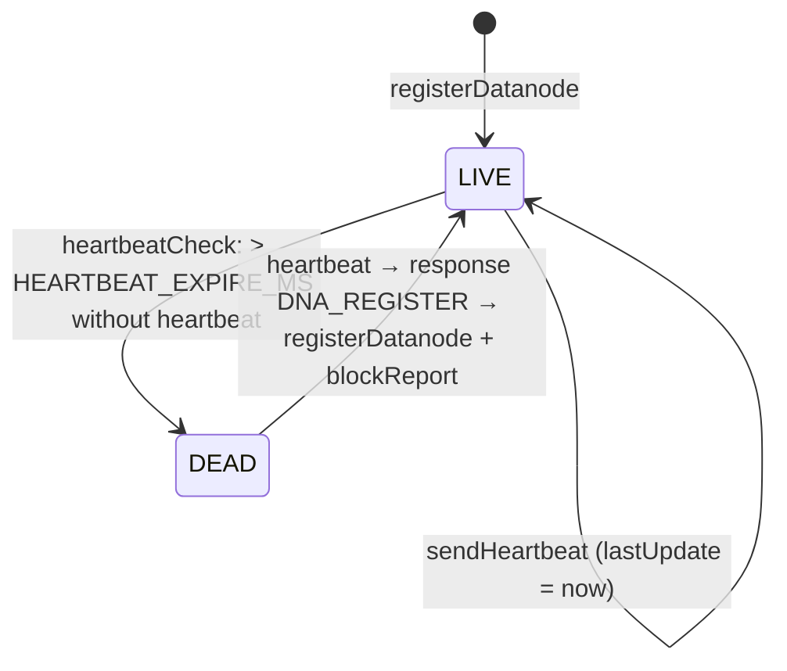

| Transition | Consequences | Code |
|---|---|---|
| → LIVE | may be a pipeline target and replication source; block report adds locations | `DatanodeManager.registerDatanode`, `BlockManager.processReport` |
| LIVE → DEAD | all replicas are removed, under-replicated blocks go into `neededReconstruction` | `DatanodeManager.heartbeatCheck`, `BlockManager.removeBlocksAssociatedTo` |
| DEAD → LIVE | only via re-registration: a heartbeat from a dead DataNode is answered with `DNA_REGISTER` | `DatanodeManager.handleHeartbeat` |

The NameNode identifies a DataNode by its **UUID** (file `VERSION`), not by host and port.

**Storage** (`DatanodeStorageInfo.state`, one disk):

| Transition | Trigger | Consequences |
|---|---|---|
| new → `NORMAL` | first report in heartbeat, block report or IBR (`updateStorage`) | may accept replicas |
| `NORMAL` → `FAILED` | heartbeat with an increased number of failed volumes, storage no longer reported | all its replicas are removed (8.10) |
| → removed | missing from a full block report | is deleted from `storageMap` |

### 9.6 Write pipeline (client, `DataStreamer`)

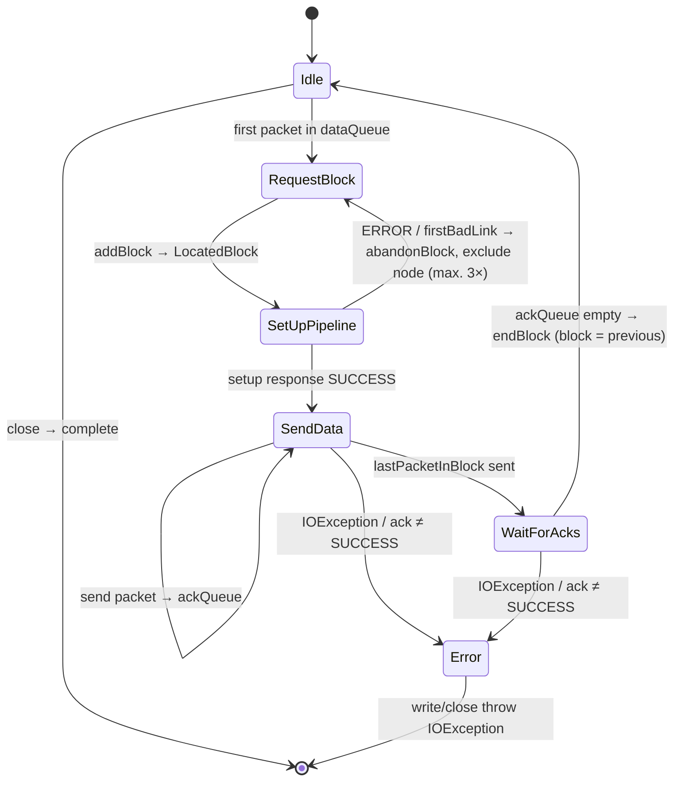

There is no enum for this in the code; the state follows from `blockStream == null` (no block open),
the packet just sent, and `lastException`. The original tracks the state explicitly as
`BlockConstructionStage` (`org.apache.hadoop.hdfs.protocol.datatransfer.BlockConstructionStage`):

| here | original `BlockConstructionStage` |
|---|---|
| SetUpPipeline | `PIPELINE_SETUP_CREATE` |
| SendData | `DATA_STREAMING` |
| WaitForAcks | `PIPELINE_CLOSE` |
| Error | `PIPELINE_SETUP_STREAMING_RECOVERY` / `PIPELINE_CLOSE_RECOVERY` – there it continues with pipeline recovery, here the stream ends |

In the original, the stage also travels in the `WRITE_BLOCK` header, so that the DataNode knows whether to create a new RBW
or continue an existing one. Here there is only the "create new" case.

### 9.7 Packet (client)

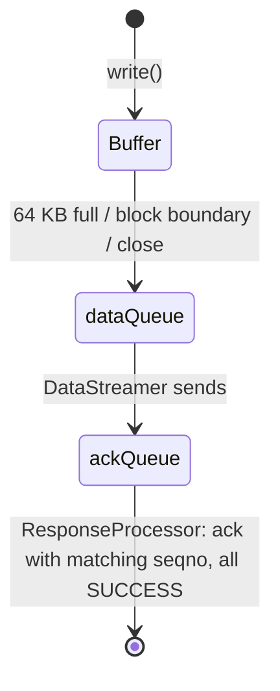

`dataQueue` and `ackQueue` together hold at most 80 packets. A packet in the `ackQueue` has been sent, but not yet
acknowledged by all DataNodes. In the original, exactly these packets are the reason why pipeline recovery is
possible: after an error they are put back into the `dataQueue` and sent again to the new pipeline.

---

## 10. Configuration

As in the original, **all** processes (NameNode, DataNodes, client) read the same Hadoop-format files from the
configuration directory: `conf/core-site.xml` and `conf/hdfs-site.xml` (directory: `-Dedudfs.conf.dir`,
otherwise `$HADOOP_CONF_DIR`, otherwise `./conf`). `common/HdfsConfig` reads them at startup.

```xml
<configuration>
  <property>
    <name>dfs.datanode.data.dir</name>
    <value>[DISK]/data/1/dfs/dn,[DISK]/data/2/dfs/dn</value>
  </property>
  …
</configuration>
```

Precedence: **`-Dname=value` > XML file > built-in default**. Via the launcher script using `JAVA_OPTS`:

```bash
JAVA_OPTS="-Ddfs.datanode.failed.volumes.tolerated=0 -Dedudfs.quiet=true" ./hdfs minicluster 3
```

**Keys in the XML files** (names and units as in the original; sizes with `k`/`m`/`g`, times with
`ms`/`s`/`m`/`h` allowed):

| Key | File | Value in `conf/` | Default without file | Original default | Meaning |
|---|---|---|---|---|---|
| `fs.defaultFS` | core-site | `hdfs://localhost:9000` | the same | `file:///` | address of the NameNode |
| `dfs.datanode.data.dir` | hdfs-site | `[DISK]/data/1/dfs/dn,[DISK]/data/2/dfs/dn` | `[DISK]/data/1/dfs/dn` | `file://${hadoop.tmp.dir}/dfs/data` | volumes of each DataNode, relative to its root (6.1) |
| `dfs.datanode.failed.volumes.tolerated` | hdfs-site | 1 | 0 | 0 | number of disk failures a DataNode survives (6.5) |
| `dfs.replication` | hdfs-site | 3 | 3 | 3 | default replication factor |
| `dfs.blocksize` | hdfs-site | `1m` (demo: 128 KB) | 1 MB | 128 MB | default block size (multiple of 512) |
| `dfs.heartbeat.interval` | hdfs-site | `1s` | 1 s | 3 s | heartbeat interval (without suffix: seconds) |
| `dfs.blockreport.intervalMsec` | hdfs-site | 30000 | 30000 | 6 h | full block report |

Deliberately **not** configurable (noted as a comment in `hdfs-site.xml`): `dfs.namenode.name.dir` (no
persistence), `dfs.datanode.address` / `dfs.datanode.ipc.address` (ports differ per DataNode, `50010+i` /
`50020+i`, because all run on `localhost`), the volume choosing policy (round-robin only).

**Additional switches** (only via `-D`; the tests set them in the `pom.xml`). The `*.ms` keys take precedence over the
XML values:

| Property | Default | Original default | Meaning |
|---|---|---|---|
| `edudfs.heartbeat.interval.ms` | – (XML) | 3 s | heartbeat interval in ms |
| `edudfs.heartbeat.expire.ms` | 6000 | 10.5 min | after that, the DataNode is considered dead |
| `edudfs.blockreport.interval.ms` | – (XML) | 6 h | full block report |
| `edudfs.blocksize`, `edudfs.replication` | – (XML) | | older short forms of `dfs.blocksize` / `dfs.replication` |
| `edudfs.lease.softlimit.ms` | 5000 | 60 s | soft limit; the client renews every half of it |
| `edudfs.lease.hardlimit.ms` | 15000 | 20 min | hard limit |
| `edudfs.blockrecovery.timeout.ms` | 10000 | – | after that, a recovery may be restarted |
| `edudfs.namenode.host`, `edudfs.namenode.port` | from `fs.defaultFS` | | override host/port |
| `edudfs.conf.dir` | `conf` | `$HADOOP_CONF_DIR` | directory with the XML files |
| `edudfs.quiet` | false | – | suppress INFO logs |
| `edudfs.verbose` | false | – | show logs in `DFSShell` |

Fixed constants: 512 bytes per checksum, 64 KB packets, minReplication 1, 80 packets in flight,
lease monitor 1 s, RedundancyMonitor 2 s, pending timeout 15 s, 2 transfers / 1000 invalidates per heartbeat.
Cluster ID, block pool ID and namespaceID are fixed in `HdfsServerConstants` (6.2).

---

## 11. Tools

### 11.1 Launcher `./hdfs`

| Command | starts |
|---|---|
| `./hdfs build` | `javac` into `out/` |
| `./hdfs demo` | `tools.Demo` |
| `./hdfs minicluster [n] [dir]` | `tools.MiniDFSCluster` (default 3 DNs, directory `data/`) |
| `./hdfs namenode` | `server.namenode.NameNode` |
| `./hdfs datanode <root> <xfer> <ipc>` | `server.datanode.DataNode`; `root` = root of its "machine", the volumes from `dfs.datanode.data.dir` lie below it |
| `./hdfs dfs …` | `tools.DFSShell` |
| `./hdfs test` | `mvn -q test` (all tests, results in `target/`) |

All commands except `test` run from `out/`. If `out/` is missing, the script builds it automatically first.

Ports in the MiniDFSCluster: NameNode 9000, DataNode *i*: xfer `50010+i`, ipc `50020+i`. Root of DataNode *i*:
`<dir>/dn<i>`.

### 11.2 `./hdfs dfs`

| Command | Description |
|---|---|
| `-ls [-R] <path>` | list (`(under construction)` for open files) |
| `-mkdir <path>` | create directories (like `mkdir -p`) |
| `-put [-f] [-repl n] [-bs bytes] <local> <dst>` / `-copyFromLocal …` | local → HDFS; `-f` overwrites |
| `-get <src> <local>` / `-copyToLocal <src> <local>` | HDFS → local |
| `-appendToFile <local>… <dst>` | append local file(s), `-` = stdin (8.9) |
| `-cat <src>` | print |
| `-touchz <path>` | empty file |
| `-rm [-r] [-skipTrash] <path>` | delete; `*` allowed in the last path component, e.g. `'/*'` = everything |
| `-mv <src> <dst>` | rename |
| `-recoverLease <path>` | force lease recovery |
| `-metasave` | dump of all NameNode structures |
| `-report` | DataNodes (blocks, used bytes, free space) |
| `-writeAndCrash <path> <bytes>` | write, then simulate a client crash |

Example with the file `demo.txt` from the project directory (content `This is a test 234 test`): see
[README, section "Commands"](../README.md#commands) – it lists the core commands ready to copy.
Always put patterns like `'/*'` in quotes, otherwise the local shell expands them. The globbing is
deliberately minimal (only `*`, only in the last component); the original can do more (`?`, `[abc]`, `{a,b}`).

### 11.3 Reading `-metasave`

The output has five blocks:

| Block | shows | Data structure |
|---|---|---|
| `NAMESPACE (INode tree)` | counters (INodes, last INode ID, blocks, last GS) and the tree with blocks per file | `FSDirectory.rootDir`, `INodeFile.blocks` |
| `INODES` | each INode object with its fields (`parent`, `children`, `header`, `ucFeature`, lease) | `FSDirectory.inodeMap` |
| `LEASES` | holder, age, open files | `LeaseManager` |
| `DATANODES` | LIVE/DEAD, number of blocks, failed volumes, pending deletions; below that, per storage: ID, type, state, blocks, free space | `DatanodeManager`, `DatanodeDescriptor`, `DatanodeStorageInfo` |
| `REPLICATION` | blocks that are (currently) being re-replicated | `neededReconstruction`, `pendingReconstruction` |

Excerpt with an open file:

```
/   [dir, inode=16385]
    user/   [dir, inode=16386]
        student/   [dir, inode=16387]
            soft.bin   [file, inode=16389, repl=3, blockSize=131072, len=131072,
                        UNDER_CONSTRUCTION, leaseHolder=DFSClient_NONMAPREDUCE_560844119_3]
                  blk_1073741828_1004  len=131072  COMPLETE  replicas=[[DISK]DS-…:NORMAL:localhost:50011, …]
                  blk_1073741829_1005  len=0  UNDER_CONSTRUCTION  replicas=[]  pipeline=[[DISK]DS-…:NORMAL:localhost:50011, …]
==================== LEASES ====================
holder=DFSClient_NONMAPREDUCE_560844119_3  last renewed 1.0 s ago  files=[16389:/user/student/soft.bin]
==================== DATANODES ====================
localhost:50010  DEAD  blocks=0  last heartbeat 13.2 s ago  uuid=…
localhost:50011  LIVE  blocks=4  last heartbeat 0.4 s ago  uuid=…  failed volumes=1
    storage DS-5f0e…  DISK  NORMAL  blocks=4  used=524288 B  free=81234 MB
```

* `replicas` = reported FINALIZED locations as storages (`BlockInfo.storages`): `[type]storageID:state:DataNode`
* `pipeline` = expected locations of a block under construction
* `len=0` for the UC block: the NameNode only learns the length after the commit
* for `UNDER_RECOVERY`, additionally `recoveryId` and `primary`

### 11.4 Demo scenarios

| # | Scenario | Observation |
|---|---|---|
| 1 | write 300 KB with 128 KB blocks | INode 16388, `blk_1073741825_1001` …`_1003`, COMMITTED → COMPLETE |
| 2 | read back | content identical |
| 3 | rename | INode ID stays the same |
| 4 | flip a byte in a replica | CRC error, failover, `markBlockAsCorrupt`, re-replication |
| 5 | stop a DataNode | DEAD after 6 s, `DNA_TRANSFER`, 3 replicas again |
| 6 | delete one volume of a DataNode | storage FAILED, only its replicas re-replicated, DataNode stays LIVE (8.10) |
| 7 | client A crashes, client B wants the file | `AlreadyBeingCreated` → (soft limit) `RecoveryInProgress` → file closed with 196608 bytes |
| 8 | client C crashes, nobody reacts | after 15 s the LeaseManager closes the file (65536 bytes) |
| 9 | delete recursively | invalidates via heartbeat, all block files gone |

### 11.5 Programmatic use

```java
try (DFSClient client = new DFSClient("localhost", 9000)) {
    client.mkdirs("/data");
    try (DFSOutputStream out = client.create("/data/a.txt", false, (short) 3, 1024 * 1024)) {
        out.write("Hello HDFS".getBytes());
    }
    try (DFSInputStream in = client.open("/data/a.txt")) {
        System.out.println(new String(in.readAllBytes()));
    }
}
```

---

## 12. Mapping to the Hadoop original

Package prefix here: `edudfs.` – in the original: `org.apache.hadoop.` (Hadoop 3.x, module `hadoop-hdfs-project/`).
The right-hand column is written out in full so that you can find the class directly in the IDE.

| EduDFS (`edudfs.` …) | Hadoop 3.x | Note |
|---|---|---|
| `common.DataChecksum`, `common.Time`, `common.SequentialNumber` | `org.apache.hadoop.util.DataChecksum`, `org.apache.hadoop.util.Time`, `org.apache.hadoop.util.SequentialNumber` | CRC32 only |
| `common.HdfsConfig` | `org.apache.hadoop.conf.Configuration`, `org.apache.hadoop.hdfs.DFSConfigKeys`, `org.apache.hadoop.hdfs.client.HdfsClientConfigKeys` | reads core-/hdfs-site.xml once into constants |
| `protocol.Block` | `org.apache.hadoop.hdfs.protocol.Block` | without BlockPoolId (`org.apache.hadoop.hdfs.protocol.ExtendedBlock`) – there is only one pool |
| `protocol.StorageType` | `org.apache.hadoop.fs.StorageType` | without `PROVIDED`, `NVDIMM` |
| `protocol.DatanodeID`, `DatanodeInfo`, `LocatedBlock(s)`, `HdfsFileStatus` | `org.apache.hadoop.hdfs.protocol.*` (same names) | |
| `protocol.ClientProtocol` | `org.apache.hadoop.hdfs.protocol.ClientProtocol` | subset |
| `protocol.LastBlockWithStatus` | `org.apache.hadoop.hdfs.protocol.LastBlockWithStatus` | |
| `FSNamesystem.appendFile` | `org.apache.hadoop.hdfs.server.namenode.FSDirAppendOp` | `NEW_BLOCK` only |
| `protocol.DataTransferProtocol` | `org.apache.hadoop.hdfs.protocol.datatransfer.DataTransferProtocol` (+ `Sender`, `Receiver`) | custom binary format instead of Protobuf |
| `protocol.Packet` | `org.apache.hadoop.hdfs.DFSPacket`, `org.apache.hadoop.hdfs.protocol.datatransfer.PacketHeader`, `PacketReceiver` | see 8.1.8 |
| `protocol.PipelineAck` | `org.apache.hadoop.hdfs.protocol.datatransfer.PipelineAck` | without flags |
| `server.common.HdfsServerConstants`, `GenerationStamp` | `org.apache.hadoop.hdfs.server.common.HdfsServerConstants`, `org.apache.hadoop.hdfs.server.common.GenerationStamp` | |
| `server.namenode.NameNode`, `NameNodeRpcServer` | `org.apache.hadoop.hdfs.server.namenode.NameNode`, `org.apache.hadoop.hdfs.server.namenode.NameNodeRpcServer` | |
| `server.namenode.FSNamesystem` | `org.apache.hadoop.hdfs.server.namenode.FSNamesystem` | incl. `internalReleaseLease`, `commitBlockSynchronization` |
| `server.namenode.FSDirectory` | `org.apache.hadoop.hdfs.server.namenode.FSDirectory` + `FSDirMkdirOp`, `FSDirWriteFileOp`, `FSDirDeleteOp`, `FSDirRenameOp` | merged |
| `server.namenode.INode`, `INodeDirectory`, `INodeFile`, `INodeId`, `INodesInPath` | `org.apache.hadoop.hdfs.server.namenode.*` (same names) | name as String instead of byte[] |
| `server.namenode.FileUnderConstructionFeature`, `LeaseManager` | `org.apache.hadoop.hdfs.server.namenode.*` (same names) | same data structures |
| `server.blockmanagement.BlockManager` | `org.apache.hadoop.hdfs.server.blockmanagement.BlockManager` | without safe mode, corrupt replica map |
| `server.blockmanagement.BlocksMap` | `org.apache.hadoop.hdfs.server.blockmanagement.BlocksMap` (LightWeightGSet) | HashMap |
| `server.blockmanagement.BlockInfo` | `org.apache.hadoop.hdfs.server.blockmanagement.BlockInfo` / `BlockInfoContiguous` | list instead of triplets |
| `server.blockmanagement.BlockUnderConstructionFeature` | `org.apache.hadoop.hdfs.server.blockmanagement.BlockUnderConstructionFeature` | without ReplicaUnderConstruction states |
| `server.blockmanagement.SequentialBlockIdGenerator`, `BlockIdManager` | `org.apache.hadoop.hdfs.server.blockmanagement.*` (same names) | |
| `server.blockmanagement.DatanodeManager` | `org.apache.hadoop.hdfs.server.blockmanagement.DatanodeManager` + `HeartbeatManager` | |
| `server.blockmanagement.DatanodeDescriptor` | `org.apache.hadoop.hdfs.server.blockmanagement.DatanodeDescriptor` + `InvalidateBlocks` | |
| `server.blockmanagement.DatanodeStorageInfo` | `org.apache.hadoop.hdfs.server.blockmanagement.DatanodeStorageInfo` | blocks as a HashSet instead of a list via triplets |
| `server.blockmanagement.BlockPlacementPolicy` | `org.apache.hadoop.hdfs.server.blockmanagement.BlockPlacementPolicyDefault` | random, without racks |
| `neededReconstruction` / `pendingReconstruction` (in `BlockManager`) | `org.apache.hadoop.hdfs.server.blockmanagement.LowRedundancyBlocks` / `PendingReconstructionBlocks` | without priorities |
| `server.protocol.DatanodeProtocol`, `InterDatanodeProtocol`, `DatanodeCommand`, `BlockCommand`, `BlockRecoveryCommand` | `org.apache.hadoop.hdfs.server.protocol.*` (same names) | |
| `server.protocol.DatanodeStorage`, `StorageReport`, `StorageBlockReport`, `StorageReceivedDeletedBlocks` | `org.apache.hadoop.hdfs.server.protocol.*` (same names) | block report as an object array instead of `BlockListAsLongs` |
| `server.datanode.DataNode`, `BPServiceActor`, `DataXceiver(Server)`, `BlockReceiver`, `BlockSender`, `BlockRecoveryWorker`, `ReplicaInfo` | `org.apache.hadoop.hdfs.server.datanode.*` (same names) | `ReplicaInfo` there has subclasses per state |
| `server.datanode.FsDatasetImpl` | `org.apache.hadoop.hdfs.server.datanode.fsdataset.impl.FsDatasetImpl` + `FsVolumeList` + `ReplicaMap` | volume check synchronous on heartbeat |
| `server.datanode.FsVolumeImpl` | `org.apache.hadoop.hdfs.server.datanode.fsdataset.impl.FsVolumeImpl` + `BlockPoolSlice`, `org.apache.hadoop.hdfs.server.datanode.DataStorage` + `BlockPoolSliceStorage` (VERSION files) | one block pool, no upgrade/rollback |
| `server.datanode.StorageLocation` | `org.apache.hadoop.hdfs.server.datanode.StorageLocation` | path relative to the DataNode's root |
| `server.datanode.RoundRobinVolumeChoosingPolicy` | `org.apache.hadoop.hdfs.server.datanode.fsdataset.RoundRobinVolumeChoosingPolicy` | without distinguishing by StorageType |
| `client.DFSClient`, `DFSOutputStream`, `DFSInputStream` | `org.apache.hadoop.hdfs.DFSClient`, `org.apache.hadoop.hdfs.DFSOutputStream`, `org.apache.hadoop.hdfs.DFSInputStream` | |
| `client.DFSOutputStream.DataStreamer` | `org.apache.hadoop.hdfs.DataStreamer` | a separate class there |
| `client.LeaseRenewer` | `org.apache.hadoop.hdfs.client.impl.LeaseRenewer` | |
| `tools.DFSShell` | `org.apache.hadoop.fs.FsShell`, `org.apache.hadoop.hdfs.tools.DFSAdmin`, `org.apache.hadoop.hdfs.tools.DFSck`, `org.apache.hadoop.hdfs.tools.DebugAdmin` | excerpt |
| `tools.MiniDFSCluster` | `org.apache.hadoop.hdfs.MiniDFSCluster` (test jar) | |

---

## 13. Simplifications and limitations

| Area | Here | Original |
|---|---|---|
| Persistence | namespace only in RAM; block files do live on the DataNodes, but are deleted as orphaned after a NN restart (8.8) | FSImage, EditLog, checkpointing (Secondary/Standby NN), JournalNodes |
| Availability | one NameNode, one block pool; clusterID and block pool ID hard-wired | HA (Active/Standby), Federation (multiple namespaces/block pools); IDs are created by `namenode -format` |
| Security | none | Kerberos, delegation tokens, block access tokens, permissions/ACLs |
| Further features | – | snapshots, quotas, xattrs, storage policies (StorageTypes are only reported here), erasure coding, caching |
| Safe mode | no | yes – NN waits for block reports after startup |
| Writing | an error in the pipeline aborts the stream | pipeline recovery (`updatePipeline`, new GS) |
| API | create/write/close, append only with a new block | append into the last block, truncate, hflush, hsync, concat |
| Reading open files | only completed blocks | client asks the DataNode for the "visible length" |
| Placement | random DataNodes, per DataNode the DISK storage with the most free space | `BlockPlacementPolicyDefault`: rack-aware (1st replica local, 2nd/3rd on another rack), load, free space, storage policy |
| Locking | one global lock | also global, but finer-grained (e.g. block lock splits in newer versions) |
| Block reports | per storage, as an object array | per storage, `BlockListAsLongs` (compact), split across multiple RPCs for many blocks |
| Corrupt replicas | delete immediately | `CorruptReplicasMap`, deletion only after re-replication |
| Over-replication | remove immediately | via excess replicas, taking racks into account |
| RPC | Java RMI; data transfer over separate TCP streams as in the original | Hadoop IPC + Protobuf |
| DataNode storage | multiple volumes, block pool and `subdir` directories as in the original; without `tmp/`, `in_use.lock`, upgrade directories | plus hot-swapping of disks (`dfsadmin -reconfig`), DiskBalancer |
| Disk check | on every heartbeat: directories present and writable? | `DatasetVolumeChecker`: asynchronous after IO errors, probe files, min. interval 15 min |
| Disks of a machine | subdirectories under the DataNode's root, all on the same real disk (capacity/free space therefore the same for all) | real devices |

**Known limitations:**

* All DataNodes report `localhost` as host – the project is meant for a single machine.
* Lease recovery always reassigns the lease to `HDFS_NameNode` (also with `recoverLease`).
* If no expected pipeline node is alive any more, the recovery is retried on every expiry,
  but cannot succeed.

---

## 14. Exercises

1. **EditLog**: log every namespace change (`mkdirs`, `startFile`, `addBlock`, `complete`, `delete`, `rename`) as a line
   and replay it at startup. Which counters (INode ID, block ID, GS) have to be recorded as well?
   What happens to open files and their leases after a restart?
2. **Safe mode**: after startup, reject write accesses until 99.9 % of the known blocks have been reported.
3. **Pipeline recovery**: if a DataNode fails in the `DataStreamer`, rebuild the pipeline without it.
   Why is a new generation stamp needed for this?
4. **Rack awareness**: assign DataNodes to a rack and implement the default strategy (local / other rack / same rack as the 2nd).
5. **Append into the last block**: so far `append` always starts a new block (8.9). Extend it so that a
   half-full last block is written further: block back to UNDER_CONSTRUCTION, new generation stamp,
   pipeline to the existing replicas (FINALIZED → RBW). Why is the new GS needed here?
6. **Memory footprint**: create 1 million files with 1 block each and measure the heap. How much does a file cost,
   how much a block? How do `LightWeightGSet`, `triplets` and `byte[]` names reduce this in the original?
7. **AvailableSpaceVolumeChoosingPolicy**: instead of round-robin, prefer the volume with the most free space.
   How do you test this when all volumes are on the same real disk? (Hint: replace `FsVolumeImpl.getAvailable`
   with a value from the configuration, similar to `dfs.datanode.du.reserved`.)
8. **Lease thought experiment**: what happens if a client is only temporarily disconnected from the NameNode,
   but can still reach the DataNodes? Why do we then need the GS comparison?

---

## 15. Troubleshooting

| Problem | Cause / solution |
|---|---|
| `Port already in use` / `ExportException` | an old process is still running: `pkill -f edudfs` |
| `Connection refused to host: localhost` | NameNode is not running or uses a different port (`-Dedudfs.namenode.port`) |
| `could only be written to 0 of the 1 minReplication nodes` | no live DataNodes registered – `./hdfs dfs -report` |
| File stays `(under construction)` | the writer crashed: wait for the soft/hard limit or use `-recoverLease` |
| `complete` waits forever | DataNodes do not send IBRs – check the DataNode logs |
| After a NN restart all files are gone | expected – no persistence (see 8.8) |
| Too many logs | `-Dedudfs.quiet=true` (in the shell, logs are off by default) |
| `UnsupportedClassVersionError` | Java ≥ 21 required |
| `-appendToFile` only shows the usage, or `append` fails via RMI | shell or minicluster is running old code – `./hdfs build`, restart the minicluster |
| `appendToFile: Failed to APPEND_FILE … already being created by` | the file is still open (another writer) – wait for the lease to expire or use `-recoverLease` |
| `-rm -r /*` does not delete what you expect | the local shell expands `*` – put `'/*'` in quotes |
| After a restart, the block files under `data/` are gone too | expected: orphaned blocks are deleted (8.8) |
| `Invalid value configured for dfs.datanode.failed.volumes.tolerated` | the value must be smaller than the number of volumes in `dfs.datanode.data.dir` |
| `Too many failed volumes` | more volumes broken or impossible to create than tolerated – check permissions/paths under the DataNode root |
| Configuration is not read | process not started in the project directory – use `./hdfs` or `-Dedudfs.conf.dir=…` |
| Pasted command fails with `Path must be absolute: …`, `command not found: #`, or a stray local file appears | zsh (macOS default shell) does not treat `#` as a comment interactively, so comment words become arguments. Run `setopt interactivecomments`, or permanently: `echo 'setopt interactivecomments' >> ~/.zshrc` |

---

## 16. Tests

`./hdfs test` is the same as `mvn -q test`; plain `mvn test` prints a summary (results in
`target/surefire-reports/`); `-Dtest=` runs a single test:

```bash
./hdfs test
mvn test
mvn test -Dtest=MiniDFSClusterTest#softLimitLetsAnotherClientTriggerRecovery
```

121 tests with JUnit 5, runtime approx. 45 s. The Surefire configuration in the `pom.xml` shortens the timings
(heartbeat 0.5 s, DataNode dead after 3 s, soft limit 2 s, hard limit 5 s) and runs all tests sequentially
in one JVM, because the integration tests use fixed ports (9000, 50010 ff.).

| Test class | Kind | Tests | What is checked |
|---|---|---|---|
| `common.DataChecksumTest` | unit | 5 | number of chunks, CRC per 512 bytes, partial chunks, detection of flipped bits |
| `common.HdfsConfigTest` | unit | 3 | Hadoop XML format, suffixes `k`/`m`/`g` and `ms`/`s`/`m`, project configuration from `conf/` is loaded, `-D` beats XML |
| `protocol.ProtocolTest` | unit | 10 | `Block.equals` only via the ID, DatanodeID via the UUID, round trips of Packet, PipelineAck and WRITE_BLOCK header |
| `server.namenode.NamespaceTest` | unit | 19 | INode IDs (root 16385, sequential, never reused), sorted children, `mkdirs`, `INodesInPath`, rename rules, delete collects blocks, `HeaderFormat`, file size, first block ID 1073741825 / GS 1001, skipping IDs already in use |
| `server.namenode.FSNamesystemTest` | unit (DataNodes simulated) | 41 | lease granting, one lease per client, `AlreadyBeingCreated`, overwrite, `LeaseExpired`, writing across renames, `addBlock` with excludes, COMMITTED → COMPLETE, stale/unknown/too-short replicas, block report diff, invalidates via heartbeat, `DNA_REGISTER`, soft/hard limit, complete block recovery on the NameNode side incl. wrong recoveryId and `deleteBlock`, append (new block after the old one, without data, on an open/missing file); storages: one storage per DataNode in the pipeline, a full disk is not chosen, a replica on another disk of the same DataNode replaces the old entry, disk failure via heartbeat removes only its replicas, a storage missing from the block report is removed, foreign block pool ID rejected |
| `server.datanode.FsDatasetImplTest` | unit (temporary directory, 2 volumes) | 19 | `StorageLocation` with `[SSD]` prefix, `subdir` computation, round-robin across the volumes, VERSION files and stable storageIDs, disk failure during operation and at startup, check of `failed.volumes.tolerated`, duplicate block on two volumes, layout `rbw/` and `finalized/subdirX/subdirY`, meta header, finalizing, block report, restart (RBW → RWR), invalidate only with matching GS, recovery with truncation and CRC recomputation, rejected stale recoveryIds, old writer cannot finalize an RUR replica |
| `tools.MiniDFSClusterTest` | integration (NN + 4 DNs, 2 volumes each) | 24 | 12 file sizes at all chunk, packet and block boundaries, reading from any offset, namespace via the client, rename while writing, soft limit, hard limit, `recoverLease`, writer loses the lease, LeaseRenewer keeps the lease, re-replication after DataNode failure, corrupt replica, pipeline error with abandon/exclude, deletion on the disks, DataNode restart, NameNode restart (orphaned blocks), reading without replicas, visible length of open files, double append with variable-length blocks, on-disk layout (root/volume/BP/subdir) and use of both volumes, disk failure with re-replication while the DataNode keeps running, too many disk failures shut down the DataNode |

`MiniDFSCluster.restartNameNode()` was added for the integration tests.

---

## 17. Glossary

| Term | Meaning |
|---|---|
| **Ack** (`PipelineAck`) | acknowledgment of a packet, travels backwards through the pipeline; contains one status per DataNode (8.1.5) |
| **bcId** | "Block Collection ID": INode ID of the file a block belongs to (`BlockInfo.bcId`) |
| **Block** | piece of a file (default here 1 MB, original 128 MB) with ID, length and GS |
| **Block pool** | all blocks of a namespace; on each volume a directory `BP-…` (exactly one here, 6.2) |
| **Block report** | complete list of all replicas of a DataNode, grouped per storage, every 30 s (`blockReport`) |
| **Block recovery** | agreement of the replicas of an open block on a common length after a writer crash (8.6) |
| **BlocksMap** | table block → `BlockInfo` in the NameNode (5.4) |
| **Commit** | client reports the final length of a block → state COMMITTED (9.1) |
| **clusterID** | identifier of the cluster, stored in every `VERSION` file (fixed here, 6.2) |
| **CRC32 / checksum** | checksum per 512 bytes, detects corrupted data (6.3) |
| **DataNode (DN)** | stores block data on its disks (volumes) |
| **DNA_…** | "DataNode Action": command from the NameNode in the heartbeat response (7.2) |
| **firstBadLink** | address of the first DataNode that could not be reached during pipeline setup (8.1.2) |
| **GS – generation stamp** | version number of a block; new for every new block and every recovery. Smaller GS = stale replica (5.2) |
| **Hard limit** | lease age from which the NameNode rescues the file itself (15 s here) |
| **Heartbeat** | the DataNode's "I am still alive" every second; the response carries commands |
| **IBR – incremental block report** | immediate report of a single received/deleted replica (`blockReceivedAndDeleted`) |
| **INode** | entry in the namespace: file or directory, with a fixed ID (5.1) |
| **Invalidate** | command to a DataNode to delete a replica (`DNA_INVALIDATE`) |
| **Lease** | a client's write permission for its open files, must be renewed regularly (5.6) |
| **Mirror** | successor of a DataNode in the pipeline |
| **minReplication** | minimum number of FINALIZED replicas for COMPLETE (1 here) |
| **NameNode (NN)** | manages the namespace, block mapping and leases – stores no file data |
| **Namespace** | directory tree with all files and their block IDs |
| **Packet** | unit of transfer in the data channel, ≤ 64 KB of data + CRCs (8.1.3) |
| **Pipeline** | chain client → DN1 → DN2 → DN3 through which a block is written (8.1.2) |
| **Primary** | DataNode that leads a block recovery |
| **RBW / RWR / RUR / FINALIZED** | replica states: Being Written / Waiting to be Recovered / Under Recovery / done (9.2) |
| **recoveryId** | new GS assigned by a block recovery |
| **Replica** | a copy of a block on a DataNode |
| **RMI** | Java Remote Method Invocation – here a replacement for Hadoop RPC |
| **seqno** | sequence number of a packet; ack and packet are matched via it |
| **Storage / storageID** | NameNode view of a volume (`DatanodeStorageInfo`), identified by `DS-<uuid>` from the volume's `VERSION` file (5.5) |
| **StorageType** | kind of disk: DISK, SSD, ARCHIVE, RAM_DISK |
| **Soft limit** | lease age from which another client may take over the file (5 s here) |
| **UC – under construction** | file or block is currently being written (`FileUnderConstructionFeature`, `BlockUnderConstructionFeature`) |
| **Volume** | one disk of a DataNode = one entry in `dfs.datanode.data.dir` (`FsVolumeImpl`, 6.1) |
