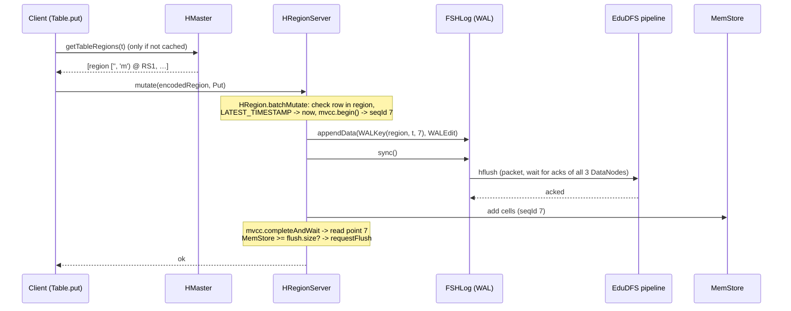
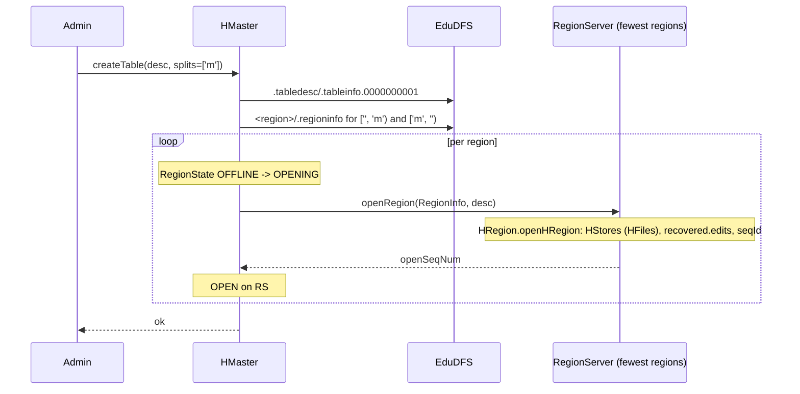
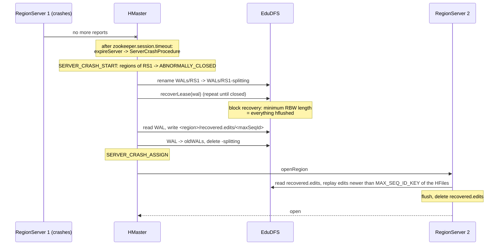
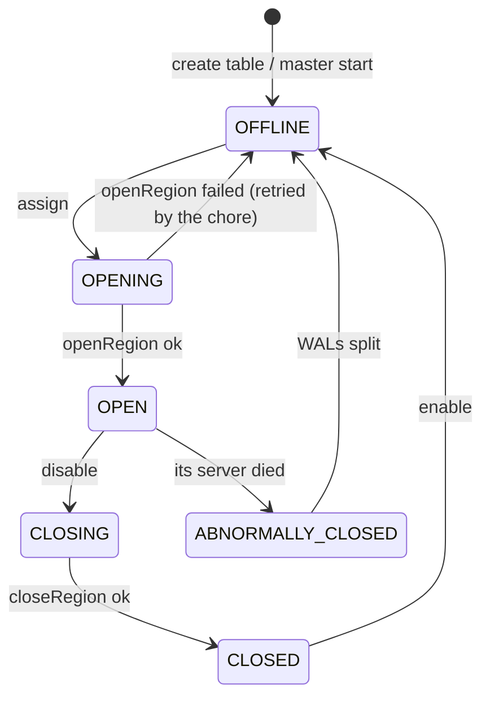
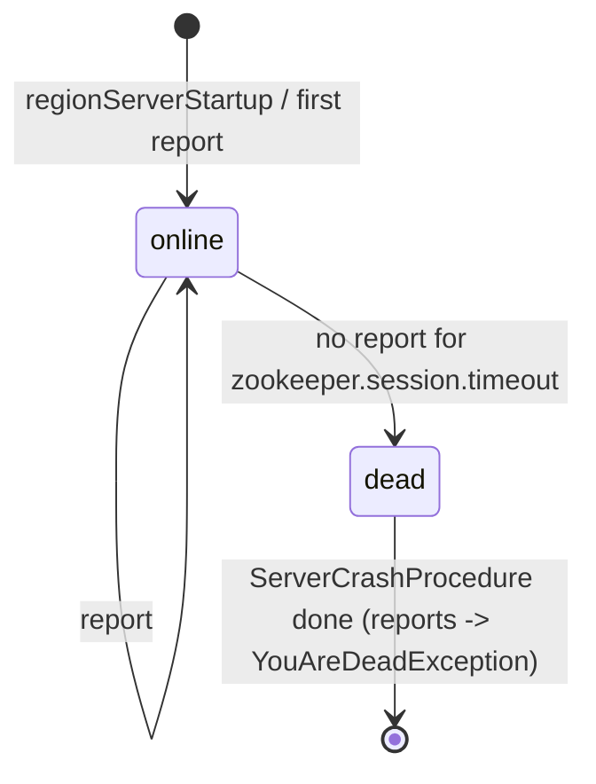
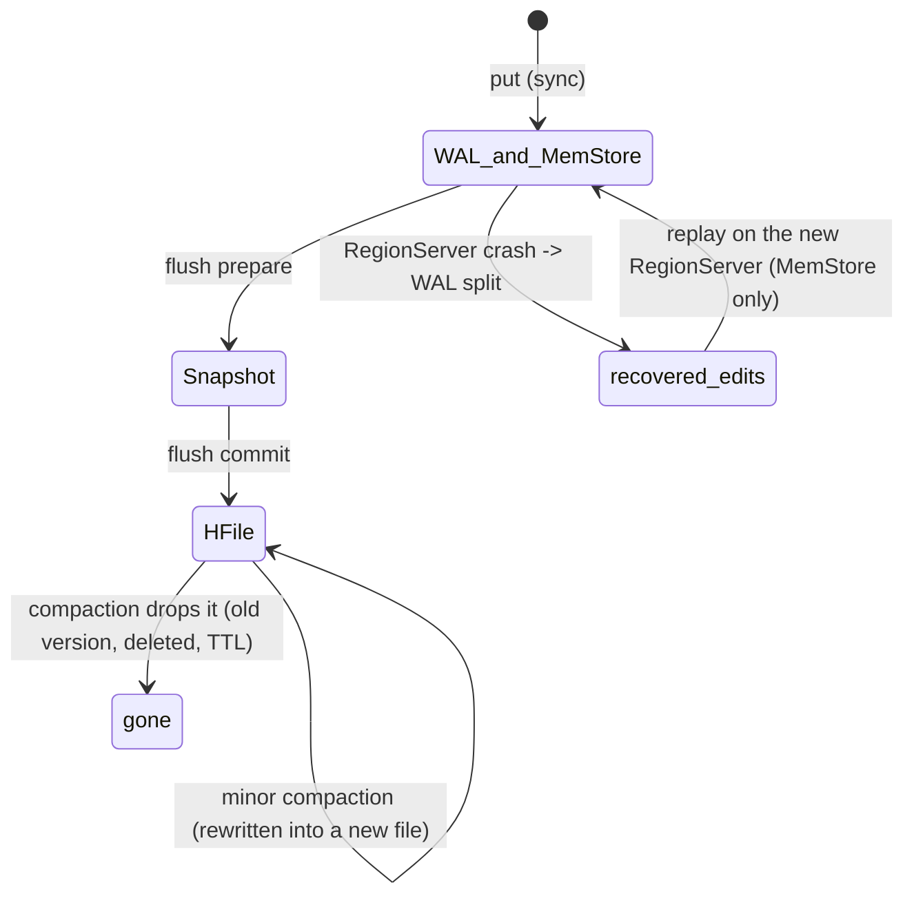
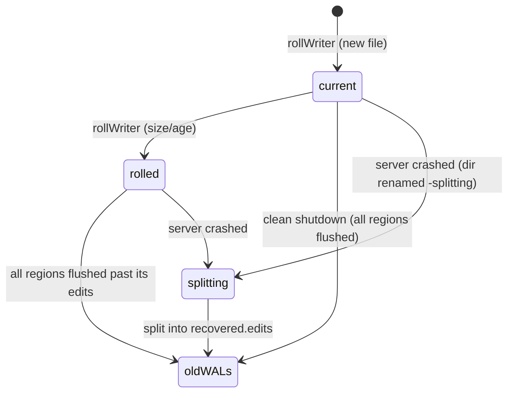
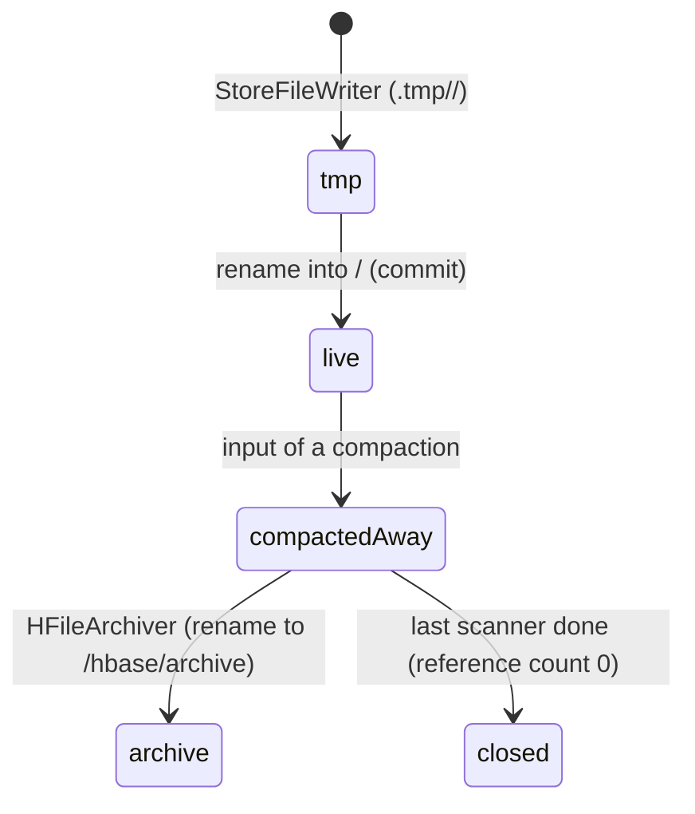

# EduBase – Technical Documentation

> Teaching implementation of a **wide column store** in Java, inspired by Apache HBase (2.x), running on top of
> EduDFS. Class, method and field names follow the original, so that you can find every spot again afterwards in
> `hbase-server/` and `hbase-client/`.
>
> EduBase is an independent project, not affiliated with or endorsed by the Apache Software Foundation.
> "The original" always refers to Apache HBase. See the [README](../README.md#license-and-trademarks) for license and
> trademark notices.

**One deliberate deviation runs through everything:** EduBase writes its files – HFiles, WALs, `.regioninfo`,
`.tableinfo` – as **readable text**. The original writes them **binary** (fixed-width numbers, KeyValue bytes, Protobuf).
Layout, block types, magics and the order in which a reader walks through a file are the original ones. What the
original looks like on disk is described in [5.6](#56-text-instead-of-binary-what-the-original-writes).

## Contents

1. [Overview](#1-overview) – incl. [1.1 Data model](#11-data-model), [1.2 Core concepts in the code](#12-the-core-concepts-in-the-code-quick-tour), [1.3 Reading path through the code](#13-reading-path-through-the-code)
2. [Quick start](#2-quick-start)
3. [Project structure](#3-project-structure)
4. [Architecture](#4-architecture)
5. [Files in HDFS](#5-files-in-hdfs) – incl. [5.2 HFile](#52-hfile), [5.3 Bloom filter](#53-bloom-filter), [5.4 WAL](#54-wal), [5.6 Text instead of binary](#56-text-instead-of-binary-what-the-original-writes)
6. [In-memory structures](#6-in-memory-structures)
7. [Protocols](#7-protocols)
8. [Flows in detail](#8-flows-in-detail) – write, read, scan, deletes, flush, compaction, WAL roll, assignment, crash, restart
9. [State machines](#9-state-machines)
10. [Configuration](#10-configuration)
11. [Tools](#11-tools) – shell, `hbase hfile`, `hbase wal`, `metasave`, demo, Java API
12. [Mapping to the HBase original](#12-mapping-to-the-hbase-original)
13. [Simplifications and limitations](#13-simplifications-and-limitations)
14. [Exercises](#14-exercises)
15. [Troubleshooting](#15-troubleshooting)
16. [Tests](#16-tests)
17. [Glossary](#17-glossary)

> The dependencies of all 104 classes (package graph, inheritance, graph per package) are in
> [`EDUBASE_DEPENDENCIES.md`](EDUBASE_DEPENDENCIES.md).

---

## 1. Overview

HBase is a **distributed, sorted, persistent map** on top of HDFS. It splits the work like this:

| Role | Task | Holds in memory | Holds in HDFS |
|---|---|---|---|
| **HMaster** (1×) | DDL, region assignment, detecting dead RegionServers, recovery | `hbase:meta` content (EduBase), server list | `.tableinfo`, `.regioninfo` (directory layout) |
| **HRegionServer** (n×) | serves regions: reads, writes, flushes, compactions | MemStores, BlockCache, open HFile readers | its WAL, the HFiles of its regions |
| **Client** (`Connection`, `Table`) | API for applications | region location cache | – |
| **EduDFS** (NameNode + DataNodes) | stores all files, replicated 3× | – | everything |

The central ideas this project makes visible:

* A table is split into **regions** (key ranges). Each region is served by exactly **one RegionServer** – but its
  files lie in HDFS, so **any** RegionServer can take it over.
* HBase is an **LSM tree**: writes go to the **WAL** (sequential, in HDFS) and the **MemStore** (sorted, in RAM).
  Full MemStores are **flushed** into immutable, sorted **HFiles**. **Compactions** merge HFiles.
* Nothing is updated in place. A new value is a new **cell** with a newer timestamp; a delete is a **tombstone**.
  Old versions and tombstones disappear only during compactions.
* Reads merge MemStore + all HFiles of a store. **Bloom filters**, **block index** and **BlockCache** keep that cheap.
* The master is **not in the data path**. Clients talk to RegionServers directly.
* A crashed RegionServer's MemStore content is reconstructed from its WAL (**WAL splitting**, `recovered.edits`).

Size: 104 Java files, approx. 10 900 lines (a large part of them comments), no dependencies beyond EduDFS, Java ≥ 21.

### 1.1 Data model

```
table "users"
                 family "info"                                   family "stats"
row key          info:name             info:email      info:city      stats:logins
-------------------------------------------------------------------------------------
alice            Alice Adams           alice@new.org
                 (older: –)            (older: alice@example.org)
bob              Bob Brown
zoe              Zoe Zimmer                                           42
```

* **Row key**: byte[], the only index. Rows are stored **sorted by row key** (unsigned bytes – `row10` < `row9`).
* **Column family**: fixed when the table is created (`create 't', 'info', 'stats'`). Each family is a separate
  **store** with its own MemStore, its own HFiles and its own settings (`VERSIONS`, `BLOOMFILTER`, `TTL`, `BLOCKSIZE`).
* **Column qualifier**: free per row – any row may have any columns. Missing columns cost nothing (**sparse**).
  That is the "wide column" in *wide column store*.
* **Timestamp / version**: every cell has a timestamp (ms). A family keeps up to `VERSIONS` versions.
* **Cell** = (row, family, qualifier, timestamp, type) → value. `type` is `Put` or one of the delete markers.

Logically, a table is a nested sorted map:

```
SortedMap<RowKey, SortedMap<Family, SortedMap<Qualifier, SortedMap<Timestamp (descending), Value>>>>
```

Physically, everything is **one sorted list of cells** per store – in the MemStore and in every HFile. The sort order
(`CellComparator`, 8.4) is the key to understanding the whole system.

### 1.2 The core concepts in the code (quick tour)

#### 1.2.1 Cell and sort order (`KeyValue`, `CellComparator`) → 8.4
* `KeyValue` = row, family, qualifier, timestamp, type, value, **sequence ID**.
* Order: row ↑, family ↑, qualifier ↑, **timestamp ↓** (newest first), **type ↓** (delete markers before Puts),
  sequence ID ↓. One pass over the sorted cells is enough to apply versions and deletes.

#### 1.2.2 Write path (`HRegion.batchMutate`) → 8.1
* Sequence ID from **MVCC** → append to **WAL** → `hflush` to all DataNodes → cells into the **MemStore** →
  MVCC complete (readers see the row). Atomic per row.

#### 1.2.3 Flush (`HRegion.internalFlushcache`, `HStore.flushSnapshot`) → 8.5
* MemStore → snapshot (under lock, cheap) → written as an HFile into `.tmp/`, then **renamed** into the family directory.
  The HFile records `MAX_SEQ_ID_KEY`: all edits up to this sequence ID are now persistent.

#### 1.2.4 HFile (`HFileWriterImpl`, `HFileReaderImpl`) → 5.2
* Data blocks (`DATABLK*`), Bloom chunk (`BLMFBLK2`), root index (`IDXROOT2`), FileInfo (`FILEINF2`),
  Bloom meta (`BLMFMET2`), fixed trailer (`TRABLK"$`). Read from the **back**: trailer → load-on-open section → blocks.

#### 1.2.5 Read path (`RegionScanner`, `StoreScanner`, `KeyValueHeap`, `ScanQueryMatcher`) → 8.2
* Per store: MemStore scanner + one scanner per HFile that **can** contain the row (time range, key range,
  **Bloom filter**) → k-way merge (`KeyValueHeap`) → `ScanQueryMatcher` (versions, deletes, TTL).
* HFile access: block index (binary search) → block → **BlockCache** or HDFS (pread).

#### 1.2.6 Compaction (`HStore.compact`, `RatioBasedCompactionPolicy`, `Compactor`) → 8.6
* After a flush, from 3 HFiles per store (`hbase.hstore.compactionThreshold`) a **minor** compaction merges some files.
  `major_compact` merges all. Only when **all** files of a store take part may delete markers be dropped.

#### 1.2.7 WAL (`FSHLog`, `TextLogWriter`, `WALSplitter`) → 5.4, 8.7, 8.9
* One WAL per RegionServer for all its regions. Rolled at a size limit; archived to `oldWALs/` once all regions
  have flushed past its edits. After a crash: **split** by region into `recovered.edits`.

#### 1.2.8 Master (`HMaster`, `ServerManager`, `AssignmentManager`, `ServerCrashProcedure`) → 8.8, 8.9
* Heartbeats from the RegionServers; a missing heartbeat for `zookeeper.session.timeout` → server dead →
  `ServerCrashProcedure`: split its WALs, reassign its regions.

### 1.3 Reading path through the code

You don't have to read the 104 classes in order. This path follows **one put and one get through their life**:

| Step | Class | What to look at |
|---|---|---|
| 1 | `client.Table.put` → `Connection.callWithRetries` | region lookup (`locateRegion`), retry loop |
| 2 | `regionserver.RSRpcServices.mutate` → `HRegion.batchMutate` | timestamps, MVCC, WAL, MemStore |
| 3 | `wal.FSHLog.appendData` / `sync`, `wal.TextLogWriter` | the WAL line, `hflush` |
| 4 | `regionserver.DefaultMemStore.add` | the skip list |
| 5 | `regionserver.HRegion.internalFlushcache` → `HStore.flushSnapshot` | snapshot, `.tmp`, commit |
| 6 | `regionserver.StoreFileWriter` → `io.hfile.HFileWriterImpl` | blocks, index, Bloom, trailer |
| 7 | `client.Table.get` → `HRegion.get` → `getScanner` | one `StoreScanner` per family |
| 8 | `regionserver.HStore.getScanners` → `StoreFileScanner.shouldUseScanner` | time range, key range, **Bloom** |
| 9 | `regionserver.KeyValueHeap` | merging MemStore and HFiles |
| 10 | `io.hfile.HFileReaderImpl` (`HFileScannerImpl.seekTo`, `readBlock`) | index, BlockCache, pread |
| 11 | `regionserver.ScanQueryMatcher.match` | versions, delete markers, TTL |
| 12 | `regionserver.HStore.compact` → `compactions.Compactor` | the same scanners, writing a new HFile |
| 13 | `master.ServerCrashProcedure` → `wal.WALSplitter` → `HRegion.replayRecoveredEditsIfAny` | recovery |

---

## 2. Quick start

EduBase needs a running EduDFS. Three terminals:

```bash
./hdfs build
./hdfs minicluster 3
```

```bash
./hbase minicluster 2
```

```bash
./hbase shell
```

`./hbase minicluster 2` starts an HMaster and 2 RegionServers in one JVM; they store everything in the running
EduDFS under `/hbase`. Ctrl+C stops EduBase cleanly (the RegionServers flush their MemStores first); EduDFS keeps
running, and a new `./hbase minicluster` finds all tables again.

**Guided tour** (starts its own EduDFS + EduBase in `demo-data/`, approx. 15 s):

```bash
./hbase demo
```

A first shell session:

```
hbase:001:0> create 'users', {NAME => 'info', VERSIONS => 3, BLOCKSIZE => 256}, {NAME => 'stats'}, SPLITS => ['m']
hbase:002:0> put 'users', 'alice', 'info:name', 'Alice Adams'
hbase:003:0> put 'users', 'zoe', 'stats:logins', '42'
hbase:004:0> scan 'users', {SOURCE => true}
ROW                          COLUMN+CELL
 alice                       column=info:name, timestamp=1792755702620, value=Alice Adams, source=MemStore
 zoe                         column=stats:logins, timestamp=1792755702630, value=42, source=MemStore
2 row(s)
hbase:005:0> flush 'users'
hbase:006:0> get 'users', 'alice', {TRACE => true}
hbase:007:0> metasave
```

Look at the files in HDFS – they are text:

```bash
./hdfs dfs -ls -R /hbase
./hdfs dfs -cat /hbase/WALs/<server>/<wal>
./hbase hfile --layout -m -f /hbase/data/default/users/<region>/info/<hfile>
```

Separate processes (closer to a real cluster, and you can `kill -9` a RegionServer):

```bash
./hbase master
./hbase regionserver 0
./hbase regionserver 1
```

RegionServer `i` listens on port `16020 + i`, the master on 16000.

---

## 3. Project structure

EduBase lives in the same Maven project as EduDFS (one `src/main/java`, one `out/`), in the package `edubase`.

```
edudfs/
├── hbase                        launcher (minicluster|master|regionserver|shell|hfile|wal|metasave|demo)
├── conf/hbase-site.xml          configuration of master, RegionServers and client (section 10)
├── docs/EDUBASE.md              this document
├── docs/EDUBASE_DEPENDENCIES.md class dependencies (python3 docs/gen_dependencies.py edubase)
├── src/test/java/edubase/       tests (section 16)
└── src/main/java/edubase/
    ├── Cell, KeyValue           the cell (row, family, qualifier, timestamp, type, value, sequence ID)
    ├── CellComparator           THE sort order
    ├── TableName, RegionInfo, ServerName, HRegionLocation
    ├── HConstants, HBaseConfiguration   constants, hbase-site.xml
    ├── *Exception               NotServingRegion, TableNotFound, YouAreDead, PleaseHold, UnknownScanner, …
    ├── util/                    Bytes, MurmurHash, BloomFilterChunk, BloomFilterUtil, ReadTrace, EnvironmentEdgeManager
    ├── codec/KeyValueCodec      a cell as a text line (HFile and WAL)
    ├── io/                      PositionedReadable (pread), TimeRange
    ├── io/hfile/                the HFile format
    │   ├── HFile                Writer/Reader interfaces, factories
    │   ├── HFileWriterImpl, HFileReaderImpl (+ HFileScannerImpl)
    │   ├── HFileBlock, BlockType            fixed-size header + body, magics
    │   ├── HFileBlockIndex      root index (BlockIndexWriter / BlockIndexReader)
    │   ├── HFileInfo, FixedFileTrailer      FileInfo, trailer
    │   ├── LruBlockCache        block cache with statistics
    │   └── HFilePrettyPrinter   ./hbase hfile
    ├── fs/                      HFileSystem (EduDFS client of a server), CommonFSUtils (paths)
    ├── wal/                     WAL, FSHLog, WALKeyImpl, WALEdit, TextLogWriter/Reader, WALSplitter, WALPrettyPrinter
    ├── regionserver/
    │   ├── HRegionServer, RSRpcServices      the server and its RPC endpoints
    │   ├── HRegion, RegionScanner, HRegionFileSystem
    │   ├── HStore, DefaultMemStore, MultiVersionConcurrencyControl
    │   ├── HStoreFile, StoreFileReader, StoreFileWriter, BloomType
    │   ├── KeyValueScanner, SegmentScanner, StoreFileScanner, KeyValueHeap, StoreScanner, ScanQueryMatcher
    │   ├── MemStoreFlusher, CompactSplit     background threads
    │   └── compactions/         RatioBasedCompactionPolicy, CompactionRequest, Compactor, CompactionRecord
    ├── master/                  HMaster, MasterRpcServices, ServerManager, AssignmentManager, RegionState,
    │                            ServerCrashProcedure, MasterFileSystem
    ├── ipc/                     RMI interfaces: ClientService, AdminService, MasterService, RegionServerStatusService
    ├── client/                  Connection(Factory), Table, Admin, Put, Delete, Get, Scan, Result, ResultScanner,
    │                            Mutation, TableDescriptor(Builder), ColumnFamilyDescriptor(Builder)
    └── tools/                   HBaseShell, MiniHBaseCluster, Demo
```

The packages mirror the original (`org.apache.hadoop.hbase.*`); section 12 maps every class.

**Changes in EduDFS** that EduBase needs (documented in [DOCUMENTATION.md](DOCUMENTATION.md)):

| EduDFS change | why HBase needs it |
|---|---|
| `DFSInputStream.seek` / `read(position, …)` (pread) | the HFile reader jumps to the block the index names |
| `DFSOutputStream.hflush` / `hsync` | the WAL makes every edit durable without closing the file |
| `ClientDatanodeProtocol.getReplicaVisibleLength` | read the open WAL (`./hdfs dfs -cat`, `./hbase wal`) |
| heartbeat packets (`seqno = -1`) | the WAL's write pipeline stays open for minutes without traffic |

---

## 4. Architecture

```mermaid
flowchart LR
    subgraph client["Client (Connection)"]
        MC["region location cache"]
    end
    subgraph master["HMaster :16000"]
        SM[ServerManager]
        AM["AssignmentManager<br/>(hbase:meta)"]
        SCP[ServerCrashProcedure]
    end
    subgraph rs1["HRegionServer :16020"]
        R1["HRegion t,,…<br/>HStore info | stats"]
        WAL1[FSHLog]
        BC1[LruBlockCache]
    end
    subgraph rs2["HRegionServer :16021"]
        R2["HRegion t,m,…"]
        WAL2[FSHLog]
    end
    subgraph hdfs["EduDFS"]
        NN[NameNode]
        DN["DataNodes<br/>HFiles, WALs"]
    end
    client -- "MasterService: DDL, getTableRegions" --> master
    client -- "ClientService: get/mutate/scan" --> rs1
    client -- "ClientService" --> rs2
    rs1 -- "RegionServerStatusService: report (heartbeat)" --> master
    rs2 -- "report" --> master
    master -- "AdminService: openRegion/closeRegion" --> rs1
    rs1 -- "DFSClient: WAL hflush, HFile pread" --> hdfs
    rs2 --> hdfs
    master -- "split WALs, .regioninfo" --> hdfs
```



### Communication channels

| From → to | Interface | Transport | Content |
|---|---|---|---|
| Client → master | `MasterService` | RMI, port 16000 | create/disable/enable/drop table, region locations, `hbase:meta`, metasave |
| Client → RegionServer | `ClientService` | RMI, port 16020+i | get, mutate, openScanner/next/closeScanner |
| Client/master → RegionServer | `AdminService` | RMI | openRegion, closeRegion, flushRegion, compactRegion, metaSave |
| RegionServer → master | `RegionServerStatusService` | RMI | regionServerStartup, regionServerReport (heartbeat + region loads) |
| master, RegionServers → EduDFS | `DFSClient` | RMI + TCP (EduDFS) | all files |

The original uses HBase RPC with Protobuf, and ZooKeeper for master election, RegionServer liveness and the location
of `hbase:meta`. EduBase has no ZooKeeper (section 13).

### Threads

| Process | Thread | Task |
|---|---|---|
| HMaster | `HMaster <name>` | initialization, then every 0.5 s: expired servers → `ServerCrashProcedure`, assign OFFLINE regions |
| HMaster | `ServerCrashProcedure <server>` | one per dead server |
| HRegionServer | `RS report` | heartbeat every `hbase.regionserver.msginterval`, scanner lease expiry |
| HRegionServer | `MemStoreFlusher` | executes flush requests |
| HRegionServer | `CompactSplit` | executes compactions (one thread) |
| HRegionServer | `LogRoller` | rolls the WAL by size/age |
| HRegionServer | RMI threads | one per call: get/put/scan run in the caller's RMI thread |
| both | EduDFS `DataStreamer`, `ResponseProcessor`, `LeaseRenewer` | the HDFS client |

---

## 5. Files in HDFS

### 5.1 Directory layout

`./hdfs dfs -ls -R /hbase` after the demo (shortened):

```
/hbase/hbase.version                                      "8" – layout version
/hbase/hbase.id                                           cluster ID (UUID)
/hbase/data/default/users/.tabledesc/.tableinfo.0000000001  table descriptor
/hbase/data/default/users/18a3bca30b22b8d0a9544b09b0e06e82/.regioninfo   region ['', 'm')
/hbase/data/default/users/18a3bca30b22b8d0a9544b09b0e06e82/info/58b2d501a4524cb79d112811568fd45c   HFile
/hbase/data/default/users/c41345ff5db24ac015b71eed580124bf/.regioninfo   region ['m', '')
/hbase/data/default/users/c41345ff5db24ac015b71eed580124bf/info/70dbca317cef43878fbbcecc7945a59e
/hbase/data/default/users/c41345ff5db24ac015b71eed580124bf/stats/2019dcc3e38a43dc880bace27e622a23
/hbase/WALs/localhost,16021,1792756031390/localhost%2C16021%2C1792756031390.1792756031391   open WAL
/hbase/oldWALs/localhost%2C16020%2C1792756031374.1792756031375                          split WAL of the dead server
/hbase/archive/data/default/users/c41345ff…/info/e1fd2273…  HFiles replaced by compactions
```

| Path | Written by | Contents |
|---|---|---|
| `data/<ns>/<table>/.tabledesc/.tableinfo.0000000001` | master (create table) | `TableDescriptor` |
| `data/<ns>/<table>/<encoded region>/.regioninfo` | master (create table) | `RegionInfo` |
| `…/<region>/<family>/<32 hex chars>` | RegionServer (flush, compaction) | HFile |
| `…/<region>/.tmp/<family>/…` | RegionServer | HFile while it is being written |
| `…/<region>/recovered.edits/<19-digit seqid>` | master (`WALSplitter`) | the region's edits from a dead server's WAL |
| `WALs/<host,port,startcode>/<host%2Cport%2Cstartcode>.<ts>` | RegionServer | WAL files |
| `WALs/<server>-splitting/` | master | WAL directory while it is being split |
| `oldWALs/` | RegionServer (archiving), master (after splitting) | WALs nobody needs any more |
| `archive/data/<ns>/<table>/<region>/<family>/` | RegionServer (`HFileArchiver`) | HFiles replaced by a compaction |

The encoded region name is the MD5 hex of `table,startKey,regionId`; the region name is
`users,m,1792756034574.c41345ff5db24ac015b71eed580124bf.` (table, start key, creation time, encoded name).

### 5.2 HFile

An HFile is written **once, sorted, and never changed** (immutable). `./hbase hfile --layout -b -f <path>`:

```
Physical layout (offset = byte position in the file):
    offset   bytes  magic     content
         0     373  DATABLK*  data block #0: 4 cells, user01 .. user03
       373     374  DATABLK*  data block #1: 4 cells, user04 .. user06
       …
      3009     154  DATABLK*  data block #8: 1 cells, zoe .. zoe
      3163     171  BLMFBLK2  Bloom bit array: 320 bits, 25 keys, 40% of bits set
  -------- load-on-open section (read completely when the file is opened) --------
      3334     720  IDXROOT2  block index: 9 entries (first key + offset per data block)
      4054     437  FILEINF2  FileInfo: 13 key/value pairs
      4491     228  BLMFMET2  Bloom metadata: hash count, key count, where the bit array is
      4719     512  TRABLK"$  fixed trailer: loadOnOpenDataOffset=3334, 33 cells, version 3.3 <- the reader starts here
```

**Sections** (as in HFile version 3):

| Section | Blocks | Read when |
|---|---|---|
| scanned block section | data blocks `DATABLK*` (+ Bloom chunk `BLMFBLK2`, in the original between the data blocks) | on demand, block by block |
| load-on-open section | root index `IDXROOT2`, FileInfo `FILEINF2`, Bloom meta `BLMFMET2` | completely, when the file is opened |
| trailer | `TRABLK"$`, fixed 512 bytes | first – it says where the load-on-open section starts |

**Opening** (`HFileReaderImpl`): file length − 512 → trailer → `loadOnOpenDataOffset` → read index, FileInfo and Bloom
meta → (EduBase:) load the Bloom chunk. From now on the reader knows the first key and offset of every data block.

**Block** (`HFileBlock`): header of **fixed** size, then the body. The reader reads the header first, learns
`onDiskSizeWithoutHeader` and then reads exactly the body.

```
DATABLK* onDiskSizeWithoutHeader=       284 prevBlockOffset=        -1 checksum=7385361e
K: user01/info:name/1792755721641/Put/vlen=14/seqid=3 V: Name number 01
K: user02/info:name/1792755721646/Put/vlen=14/seqid=4 V: Name number 02
K: user03/info:city/1792755721648/Put/vlen=10/seqid=6 V: Ingolstadt
K: user03/info:name/1792755721647/Put/vlen=14/seqid=5 V: Name number 03
DATABLK* onDiskSizeWithoutHeader=       285 prevBlockOffset=         0 checksum=78690ab3
…
```

| Header field | Meaning |
|---|---|
| magic (8 bytes) | block type |
| `onDiskSizeWithoutHeader` | size of the body |
| `prevBlockOffset` | offset of the previous block of the same type (−1 = none) – lets you walk backwards |
| `checksum` | CRC32 over the body; checked on every read ("Checksum failed for DATA block at offset …") |

A data block is closed as soon as it holds `BLOCKSIZE` bytes (family attribute; EduBase default 1 KB, original 64 KB).
Small blocks = finer index, less data per random read; large blocks = smaller index, better for scans.

**Cell line** (`KeyValueCodec`) – exactly the format the original `hbase hfile -p` prints:

```
K: user03/info:city/1792755721648/Put/vlen=10/seqid=6 V: Ingolstadt
   row   /family:qualifier/timestamp/type/value length/sequence ID   value
```

Non-printable bytes are written as `\xNN`; in the key parts `/`, `:` and space are escaped too, so a line can always be
split unambiguously.

**Root index** (`HFileBlockIndex`), one line per data block:

```
IDXROOT2 onDiskSizeWithoutHeader=       631 prevBlockOffset=        -1 checksum=…
offset=0 onDiskSize=373 firstKey=user01/info:name/1792756034681/Put
offset=373 onDiskSize=374 firstKey=user04/info:name/1792756034684/Put
…
```

`rootBlockContainingKey(key)` is a binary search for the last block whose first key is smaller than the key. A get for
`user05` therefore reads exactly one block (offset 373) instead of the whole file.

**FileInfo** (`HFileInfo`):

| Key | Written by | Meaning |
|---|---|---|
| `hfile.LASTKEY`, `hfile.AVG_KEY_LEN`, `hfile.AVG_VALUE_LEN`, `hfile.CREATE_TIME_KEY` | HFile writer | last key, average sizes, creation time |
| `MAX_SEQ_ID_KEY` | StoreFileWriter | highest sequence ID in the file – decides which WAL edits must be replayed |
| `MAX_MEMSTORE_TS_KEY` | StoreFileWriter | highest MVCC number of a cell |
| `TIMERANGE` | StoreFileWriter | smallest..largest timestamp – a scan with a time range skips the file |
| `BLOOM_FILTER_TYPE` | StoreFileWriter | NONE / ROW / ROWCOL |
| `MAJOR_COMPACTION_KEY` | StoreFileWriter | true: result of a compaction over all files (no delete markers left) |
| `EARLIEST_PUT_TS`, `DELETE_FAMILY_COUNT`, `KEY_VALUE_VERSION` | StoreFileWriter | as in the original |
| `COMPACTION_EVENT_KEY` | Compactor | names of the input files of the compaction |
| `EDU_CREATED_BY` | EduBase only | flush / minor compaction / major compaction |

**Trailer** (`FixedFileTrailer`): `fileInfoOffset`, `loadOnOpenDataOffset`, `dataIndexCount`, `entryCount`,
`firstDataBlockOffset`, `lastDataBlockOffset`, `numDataIndexLevels` (always 1), `comparatorClassName`, padded with
spaces to exactly 512 bytes; the last line is `majorVersion=3 minorVersion=3`.

### 5.3 Bloom filter

A Bloom filter answers "is key X in this file?" with **"definitely not"** or **"maybe"** – using a few bits per key
instead of the keys themselves.

```
add(key):      h1 = murmur(key, 0); h2 = murmur(key, h1)
               for i in 0..k-1: set bit (h1 + i*h2) mod m
contains(key): all k bits set? -> "maybe", otherwise "definitely not"
```

Sizing (`BloomFilterUtil`, n = expected keys, p = `io.storefile.bloom.error.rate`):

| Quantity | Formula | Example n = 1000, p = 1 % |
|---|---|---|
| bits m | −n · ln p / (ln 2)² | 9 586 bits ≈ 1.2 KB |
| hash functions k | m/n · ln 2 | 7 |
| false positive rate | (1 − e^(−k·n/m))^k | 1 % |

| BLOOMFILTER | key | helps for |
|---|---|---|
| `NONE` | – | – (every get reads a block of every file whose key range fits) |
| `ROW` (default) | row | get of a row |
| `ROWCOL` | row + qualifier | get of exactly **one** column; also skips files that have the row but other columns |

The writer gets the expected number of cells as `maxKeys` (MemStore size at flush, sum of the inputs at compaction) and
adds each key once (consecutive duplicates are skipped). `./hbase hfile -m` shows size, hash count, fill ratio and
the expected false positive rate; `--bloom` draws the bit array, `--bloom -r <row>` asks the filter.

Only **gets** use the Bloom filter: a scan over a range cannot ask "is row X in it?". The `TRACE` of a get shows every
decision (8.2), the statistics `bloom req/neg/fp` per HFile are in `metasave`.

### 5.4 WAL

```
PWAL hasCompression=false cellCodecClsName=edubase.codec.KeyValueCodec
ENTRY encodedRegionName=616b17d99e54d8a34c4ad068368d2323 tableName=users logSeqNum=1 writeTime=1792755702620 cells=1
  K: alice/info:name/1792755702620/Put/vlen=11/seqid=1 V: Alice Adams
ENTRY encodedRegionName=616b17d99e54d8a34c4ad068368d2323 tableName=users logSeqNum=2 writeTime=1792755702623 cells=1
  K: alice/info:email/1792755702623/Put/vlen=17/seqid=2 V: alice@example.org
…
LAWP trailer                                     <- only when the WAL was closed properly
```

* One `ENTRY` per mutation (= one row): the `WALKeyImpl` (region, table, sequence ID, time) plus the `WALEdit` (cells).
* **All regions of a RegionServer write into the same WAL** – sequential writes into one HDFS pipeline. The price:
  after a crash the WAL must be split by region (8.9).
* File name: `<host%2Cport%2Cstartcode>.<creation time>`; the directory is the server name with commas.
* An open WAL has no trailer. Thanks to the EduDFS change (visible length) `./hdfs dfs -cat` shows it while it is
  being written.
* A crash may cut off the last entry (only part of it reached the DataNodes). The reader then ignores it – it was never
  acknowledged to the client (`TextLogReader.isTruncated`).

### 5.5 `.regioninfo` and `.tableinfo`

```
$ ./hdfs dfs -cat /hbase/data/default/users/466023beb7dcb16f632fbbd0ae017e43/.regioninfo
tableName=users
startKey=m
endKey=
regionId=1792755702568
encodedName=466023beb7dcb16f632fbbd0ae017e43

$ ./hdfs dfs -cat /hbase/data/default/users/.tabledesc/.tableinfo.0000000001
tableName=users
family=NAME=info,BLOOMFILTER=ROW,VERSIONS=3,TTL=FOREVER,BLOCKSIZE=256,BLOCKCACHE=true
family=NAME=stats,BLOOMFILTER=ROW,VERSIONS=1,TTL=FOREVER,BLOCKSIZE=1024,BLOCKCACHE=true
```

A restarted master rebuilds its picture of all tables and regions from these files (8.10).

### 5.6 Text instead of binary: what the original writes

> **In the original, HFiles, WALs, `.regioninfo` and `.tableinfo` are binary files.** Numbers have fixed widths,
> cells are KeyValue byte arrays, and all metadata is serialized with **Protocol Buffers** (protobuf). A text editor
> shows only fragments (row keys, values, the magics). You need the tools `hbase hfile` (HFilePrettyPrinter) and
> `hbase wal` (WALPrettyPrinter) to look inside – and EduBase has both, with the same flags.

| File / part | EduBase (text) | Original (binary) |
|---|---|---|
| KeyValue in an HFile | `K: row/cf:q/ts/Put/vlen=N/seqid=S V: value` | `int keylen, int vallen, short rowlen, row, byte famlen, family, qualifier, long ts, byte type, value` + memstoreTS as vlong |
| block header | text line, 89 bytes | 33 bytes: magic(8), onDiskSizeWithoutHeader(4), uncompressedSizeWithoutHeader(4), prevBlockOffset(8), checksumType(1), bytesPerChecksum(4), onDiskDataSizeWithHeader(4) |
| block checksum | one CRC32 per block in the header | CRC32C per 16 KB of the block, after the data |
| data block contents | plain | optionally compressed (Snappy, LZ4, ZSTD, GZ) and encoded (`DATA_BLOCK_ENCODING`: PREFIX, DIFF, FAST_DIFF, ROW_INDEX_V1) |
| root index entry | `offset=… onDiskSize=… firstKey=…` | long offset, int size, length-prefixed key; plus mid-key info; multi-level (leaf/intermediate blocks) |
| FileInfo | `KEY=value` lines | magic `PBUF` + protobuf `FileInfoProto` (byte[] keys and values) |
| Bloom chunk | hex, 32 bytes per line | the raw bit array; several chunks (`CompoundBloomFilter`, 128 KB each) |
| trailer | `key=value` lines, padded to 512 bytes, version line at the end | magic `TRABLK"$` + protobuf `FileTrailerProto`, padded to the version's fixed size; the **last 4 bytes** hold the version (minor << 24 \| major) |
| WAL | lines `PWAL …`, `ENTRY …`, `  K: …`, `LAWP trailer` | magic `PWAL` (4 bytes), protobuf `WALHeader`; per entry a length-prefixed protobuf `WALKey` followed by the cells via `WALCellCodec` (KeyValue bytes, optionally dictionary-compressed); at the end protobuf `WALTrailer` + its size + `LAWP` |
| `.regioninfo` | `key=value` lines | `PBUF` + protobuf `RegionInfo` |
| `.tableinfo` | one line per family | `PBUF` + protobuf `TableSchema` |
| `hbase.version`, `hbase.id` | text | `PBUF` + protobuf |

What one cell `row1/cf:a/1700000000000/Put` with value `v1` looks like in the original HFile (`hexdump -C`):

```
00 00 00 13  00 00 00 02  00 04  72 6f 77 31  02  63 66  61  00 00 01 8b cf e5 68 00  04  76 31
keylength=19 valuelength=2 rowlen=4 "row1"   famlen "cf"  "a"  timestamp (8 bytes)       Put  "v1"
```

**Why text in EduBase?** You can watch every step with `./hdfs dfs -cat` – the WAL growing with each put, a flush
creating an HFile, the block index pointing to byte offsets, a compaction writing a new file. Since the text format keeps
the original *structure* (blocks with fixed-size headers, offsets, reading from the trailer, length checks), the
concepts carry over one to one. What you do not learn here: compression, block encoding, and why binary formats with
fixed widths are faster to parse.

---

## 6. In-memory structures

### 6.1 RegionServer

| Structure | Class | Contents |
|---|---|---|
| online regions | `HRegionServer.onlineRegions` | encoded name → `HRegion` |
| stores | `HRegion.stores` | family name → `HStore` (sorted) |
| MemStore | `DefaultMemStore` | **active** `ConcurrentSkipListSet<Cell>` + **snapshot** (during a flush) |
| HFile list | `HStore.storefiles` | `HStoreFile`s sorted by max sequence ID, replaced as a whole (copy-on-write) |
| MVCC | `MultiVersionConcurrencyControl` | write point, read point, queue of running writes |
| BlockCache | `LruBlockCache` | (HFile name, offset) → parsed `HFileBlock`; hits, misses, evictions |
| WAL accounting | `FSHLog` | current file; per rolled file the highest sequence ID per region; flushed sequence IDs |
| open scanners | `RSRpcServices.scanners` | scanner ID → `RegionScanner` + last access (lease) |
| compaction history | `HRegionServer.compactionHistory` | the last 20 `CompactionRecord`s (EduBase) |

**MemStore**: a skip list sorted by the `CellComparator`. `add` is O(log n), a flush writes it out from front to back –
no sorting needed. Size = sum of the cells in the binary layout of the original (`KeyValue.getSerializedSize`).

**Sequence ID / MVCC**: every write gets the next number of its region (`mvcc.begin()`); all its cells carry it. The
read point advances only when the write is complete (WAL synced, cells in the MemStore). A scanner remembers the read
point at its start and skips younger cells (`SegmentScanner`). This is how a reader never sees half a row – without
locks.

### 6.2 Master

| Structure | Class | Contents |
|---|---|---|
| online RegionServers | `ServerManager.lastReport` | server → time of the last report; plus the reported region loads |
| dead servers | `ServerManager.deadServers` | servers declared dead (their reports get `YouAreDeadException`) |
| `hbase:meta` | `AssignmentManager.regionStates` | encoded name → `RegionState` (RegionInfo, state, server, openSeqNum) |
| tables | `AssignmentManager.tables`, `tableEnabled` | descriptors, ENABLED/DISABLED |
| procedures | `HMaster.procedures` | `ServerCrashProcedure`s with their steps |

`scan 'hbase:meta'` shows this in the row/column form of the original:

```
 users,m,1792755702568.466023beb7dcb16f632fbbd0ae017e43. column=info:regioninfo, …, value={ENCODED => 466023be…, NAME => 'users,m,…', STARTKEY => 'm', ENDKEY => ''}
 users,m,1792755702568.466023beb7dcb16f632fbbd0ae017e43. column=info:seqnumDuringOpen, …, value=1
 users,m,1792755702568.466023beb7dcb16f632fbbd0ae017e43. column=info:server, …, value=localhost:16021
 users,m,1792755702568.466023beb7dcb16f632fbbd0ae017e43. column=info:serverstartcode, …, value=1792755690764
 users,m,1792755702568.466023beb7dcb16f632fbbd0ae017e43. column=info:state, …, value=OPEN
```

In the original `hbase:meta` is a real table (one region, served by one RegionServer, location in ZooKeeper).

---

## 7. Protocols

All four are Java RMI interfaces in `edubase.ipc` (original: protobuf services over HBase RPC). Server-side exceptions
arrive at the client with their class (`NotServingRegionException`, `TableNotFoundException`, …).

### 7.1 ClientService (client → RegionServer)

| Method | Effect |
|---|---|
| `get(encodedRegion, Get)` | one row → `Result` (with sources/trace if requested) |
| `mutate(encodedRegion, Mutation)` | Put or Delete of one row |
| `openScanner(encodedRegion, Scan)` | opens a `RegionScanner` on the server, returns its ID |
| `next(scannerId, nbRows)` | up to nbRows rows + "more in this region?" |
| `closeScanner(scannerId)` | releases the scanner (otherwise its lease expires after `hbase.client.scanner.timeout.period`) |

### 7.2 AdminService (master/admin → RegionServer)

| Method | Effect |
|---|---|
| `openRegion(RegionInfo, TableDescriptor)` | opens the region (HFiles, recovered.edits), returns openSeqNum |
| `closeRegion(encodedRegion)` | flush + close |
| `flushRegion`, `compactRegion(…, major)` | flush / compaction now (synchronous here) |
| `getOnlineRegions`, `metaSave`, `getCompactionHistory` | information |

### 7.3 RegionServerStatusService (RegionServer → master)

| Method | Effect |
|---|---|
| `regionServerStartup(ServerName)` | registration ("reportForDuty") |
| `regionServerReport(ServerName, List<RegionLoad>)` | heartbeat; `YouAreDeadException` if the server has been declared dead |

### 7.4 MasterService (client → master)

| Method | Effect |
|---|---|
| `createTable(desc, splitKeys)`, `disableTable`, `enableTable`, `deleteTable` | DDL |
| `listTableDescriptors`, `getDescriptor`, `isTableEnabled` | |
| `getTableRegions(table)` | the "meta lookup": regions + server (null while not open) |
| `scanMeta()` | `hbase:meta` in its row/column form |
| `metaSave()`, `getClusterStatus(detailed)` | |

`PleaseHoldException` while the master is still initializing; the client retries.

---

## 8. Flows in detail

### 8.1 Write path



* **WAL first**: once `sync` returns, the edit is in the memory of 3 DataNodes and survives a crash of the RegionServer.
* **Atomic per row**: all cells of a mutation are one WAL entry and become visible together.
* `Delete` without columns → one `DeleteFamily` marker per family. `addColumn` (newest version) → the RegionServer
  looks up the timestamp of the newest version (`prepareDeleteTimestamps` in the original).
* Simplification: writes of a region are serialized (`updatesLock`); the original locks per row and syncs many edits
  together ("group commit").

### 8.2 Read path (get)

```
hbase> get 'users', 'user05', {TRACE => true, SOURCE => true}
COLUMN                       CELL
 info:city                   timestamp=1792756034823, value=Munich, source=HFile e5621abd
 info:name                   timestamp=1792756034685, value=Name number 05, source=HFile e1fd2273
1 row(s)
Read path (TRACE):
  region users,m,1792756034574.c41345ff5db24ac015b71eed580124bf., MVCC read point 36
  store info: MemStore (0 cells) + 2 HFile(s)
    HFile e5621abd: Bloom filter (ROW) says MAYBE -> must read
    HFile e1fd2273: Bloom filter (ROW) says MAYBE -> must read
    HFile e5621abd: seek
        block index: key user05/:/9223372036854775807/Maximum -> data block #0 of 1
        data block #0 (first key user05/info:city/1792756034823/Put)
        block @0: BlockCache MISS -> read 222 bytes from HDFS (pread)
    HFile e1fd2273: seek
        block index: key user05/:/9223372036854775807/Maximum -> data block #1 of 9
        data block #1 (first key user04/info:name/1792756034684/Put)
        block @373: BlockCache MISS -> read 374 bytes from HDFS (pread)
  store stats: MemStore (0 cells) + 1 HFile(s)
    HFile 30474519: key range of the file does not overlap the requested rows -> skipped
```

1. `HRegion.get` turns the get into a scan over one row (`Scan(Get)`).
2. Per requested family a `StoreScanner`: MemStore scanners + one `StoreFileScanner` per HFile.
3. `shouldUseScanner` per HFile – the cheap checks first, no block is read for them:
   time range (FileInfo `TIMERANGE`), key range (first/last key), **Bloom filter** (only for gets).
4. The remaining scanners **seek** to `createFirstOnRow(row)` (`row/:/LATEST_TIMESTAMP/Maximum`, the smallest key of the
   row): index → block → binary search in the block. Block from the **BlockCache** or via **pread** from HDFS.
5. `KeyValueHeap` merges; `ScanQueryMatcher` decides cell by cell (8.4).

Running the same get again shows `BlockCache HIT` – no HDFS access. A get for a row that does not exist:

```
    HFile e5621abd: Bloom filter (ROW) says MAYBE -> must read
    HFile e1fd2273: Bloom filter (ROW) says NO -> skipped, no block read
    HFile e5621abd: seek
        …
    HFile e5621abd: row not in the file after all -> Bloom FALSE POSITIVE
```

### 8.3 Scan

`ResultScanner` (ClientScanner) walks the regions in key order. Per region: `openScanner` with the scan's start row
(or the region's start key), then `next(scannerId, caching)` until `moreResultsInRegion = false`, then the next region
from its start key. If the RegionServer fails in the middle, the client reopens the scanner behind the last row it has
received – no row is returned twice. `LIMIT` ends the scan on the client side.

A scan uses no Bloom filter (it does not ask for one row); the key range and time range checks still skip files.

### 8.4 Sort order, versions and delete markers

`CellComparator`: row ↑, family ↑, qualifier ↑, timestamp ↓, type ↓ (DeleteFamily 14 > DeleteColumn 12 > Delete 8 >
Put 4), sequence ID ↓. A `RAW` scan shows the physical order:

```
hbase> scan 'users', {STARTROW => 'user05', STOPROW => 'user08', RAW => true, VERSIONS => 10, SOURCE => true}
 user05   column=info:city, timestamp=1792756034851, type=DeleteColumn, source=MemStore
 user05   column=info:city, timestamp=1792756034823, value=Munich, source=HFile e5621abd
 user05   column=info:name, timestamp=1792756034685, value=Name number 05, source=HFile e1fd2273
 user06   column=info:, timestamp=1792756034852, type=DeleteFamily, source=MemStore
 user06   column=info:city, timestamp=1792756034687, value=Ingolstadt, source=HFile e1fd2273
 user06   column=info:name, timestamp=1792756034686, value=Name number 06, source=HFile e1fd2273
 user06   column=stats:, timestamp=1792756034852, type=DeleteFamily, source=MemStore
 user07   column=info:name, timestamp=1792756034850, value=Renamed 07, source=MemStore
 user07   column=info:name, timestamp=1792756034688, value=Name number 07, source=HFile e1fd2273
```

The marker of `user06` (empty qualifier) sorts before all columns of the family; the marker of `user05/info:city` before
the Puts it covers. `ScanQueryMatcher` therefore decides in one pass:

| Cell | User scan | Minor compaction (not all files) | Major compaction / all files |
|---|---|---|---|
| `DeleteFamily ts=T` | remember T, SKIP | remember, **keep** | remember, drop |
| `DeleteColumn ts=T` | remember for the column, SKIP | keep | drop |
| `Delete ts=T` (one version) | remember T, SKIP | keep | drop |
| Put covered by a marker | SKIP | drop | drop |
| Put beyond `VERSIONS` | SEEK_NEXT_COL | drop | drop |
| Put older than `TTL` | SKIP | drop | drop |
| Put outside the time range / not a requested column | SKIP / SEEK_NEXT_COL | – | – |
| other Put | INCLUDE | keep | keep |

Why a minor compaction must keep markers: an older HFile that did not take part may still contain a Put the marker
has to hide. As in the original, a delete marker also hides Puts written **later** with an older or equal timestamp
("deletes mask puts") – until a compaction over all files has removed it.

| Shell | Java | Marker |
|---|---|---|
| `delete 't', 'r', 'cf:q'` | `addColumns(f, q)` | `DeleteColumn` – all versions ≤ now |
| `delete 't', 'r', 'cf:q', ts` | `addColumns(f, q, ts)` | `DeleteColumn` – all versions ≤ ts |
| – | `addColumn(f, q)` | `Delete` – exactly the newest version |
| `deleteall 't', 'r'` | `new Delete(row)` | `DeleteFamily` per family |
| `deleteall 't', 'r', 'cf'` | `addFamily(f)` | `DeleteFamily` |

### 8.5 Flush

```
hbase> flush 'users'
  18a3bca3/info: 3 cells -> HFile 16963d028d6a45068c798e65bca62a9e (1720 bytes)
  c41345ff/info: 33 cells -> HFile e1fd22730dcd4e4ca4ab689c98f28a61 (5231 bytes)
  c41345ff/stats: 1 cells -> HFile 30474519ef9b4e41bf6a37c11ab0b1f6 (1573 bytes)
```

1. **Prepare** (under the region's update lock, quick): every store's active MemStore becomes its snapshot; the flush
   sequence ID = current write point. New writes go into fresh MemStores.
2. **Flush** (no lock): each snapshot is written into `.tmp/<family>/<uuid>` via `StoreFileWriter` (with
   `MAX_SEQ_ID_KEY = flush sequence ID`).
3. **Commit**: rename into `<family>/`, open the reader, add it to the store's file list, drop the snapshot.
4. Tell the WAL: everything of this region up to the flush sequence ID is persistent (`completeCacheFlush`) – WAL files
   may become archivable (8.7).
5. Enough HFiles? → request a compaction.

Triggers: `flush` in the shell, MemStore ≥ `hbase.hregion.memstore.flush.size` (64 KB here) after a write, region close,
after replaying `recovered.edits`.

### 8.6 Compaction

```
hbase> compaction_history
13:47:14 minor compaction of users,c41345ff, family info (after flush: 3 HFiles >= hbase.hstore.compactionThreshold=3)
  input HFile                           bytes    cells  created by
  e1fd22730dcd4e4ca4ab689c98f28a61       5231       33  flush
  e5621abd374d453d8fa316dab6a70eb4       1649        2  flush
  0726f2df8928426aa8285d3d1ad1ab00       1726        3  flush
  -> afdaf24fe16e4534b9149984bd83c32d     5370       33
  cells: 38 in, 33 out; dropped: 0 old versions, 3 deleted cells, 2 delete markers, 0 expired (TTL)
  delete markers DROPPED (all files of the store took part), 1 HFile(s) in the store afterwards, took 35 ms
```

**Selection** (`RatioBasedCompactionPolicy`, files oldest first): skip an old file as long as it is larger than
`ratio × (sum of the newer files)` (and larger than `hbase.hstore.compaction.min.size`); from there take up to
`hbase.hstore.compaction.max` files, at least `hbase.hstore.compactionThreshold`. Example with ratio 1.2:

| Sizes (old → new) | Selected | Why |
|---|---|---|
| 100, 90, 80 | all three | similar sizes |
| 1000, 10, 10, 10 | the three small ones | 1000 > 1.2 × 30: rewriting the big file would be expensive |
| 1000, 500, 10, 10 | none | after skipping, too few files remain |

**Execution** (`Compactor`): StoreFileScanners over the inputs (blocks are **not** cached) → `KeyValueHeap` →
`ScanQueryMatcher` with `COMPACT_RETAIN_DELETES` or `COMPACT_DROP_DELETES` → one new HFile in `.tmp` → commit (rename)
→ swap the file list → the old files go to `/hbase/archive/…` (`HFileArchiver`); their readers are closed when the last
scanner using them is done (reference counting).

| | minor | major (`major_compact`) |
|---|---|---|
| which files | selection by the ratio rule | all files of the store |
| delete markers | kept – **unless** the selection happens to cover all files | dropped |
| old versions, covered cells, TTL-expired cells | dropped | dropped |
| trigger | after a flush (≥ 3 files) or `compact` | `major_compact` (periodically: `hbase.hregion.majorcompaction`, 0 = off here) |

### 8.7 WAL roll and archiving

* The `LogRoller` thread rolls the WAL when it is larger than `hbase.regionserver.hlog.blocksize ×
  hbase.regionserver.logroll.multiplier` (32 KB here) or older than `hbase.regionserver.logroll.period`.
* Per WAL file, `FSHLog` remembers the highest sequence ID of each region in it (`SequenceIdAccounting` in the
  original). A rolled file moves to `/hbase/oldWALs` once **every** region in it has flushed beyond that ID.
  `metasave` shows which region a rolled WAL is still waiting for:

```
  WAL      /hbase/WALs/localhost,16020,1792756822507/localhost%2C16020%2C1792756822507.1792756828570
           3 entries, 680 bytes (roll at 2048 bytes)
           rolled: localhost%2C16020%2C1792756822507.1792756822509  waiting for flush: f7b7f910 has edits up to seqid 22, not flushed yet
```

  (with `-Dhbase.regionserver.hlog.blocksize=4k`). After `flush` the line changes to `archived to oldWALs: 1 file(s)`.
* A clean shutdown flushes all regions, then all WAL files can go to `oldWALs` and the WAL directory disappears.

### 8.8 Create table, assignment, disable/enable/drop



* **Pre-split**: `SPLITS => ['g', 'n']` creates 3 regions right away. EduBase does not split regions automatically,
  so pre-splitting is the way to spread a table over several RegionServers.
* **Assignment**: the RegionServer with the fewest regions (the original's `LoadBalancer` also moves regions later).
* `disable` closes all regions (flush) → `CLOSED`; `enable` reopens them; `drop` (only when disabled) deletes the table
  directory.

### 8.9 RegionServer crash



From the demo (`metasave`):

```
Procedures:
  pid=1 ServerCrashProcedure server=localhost,16020,1792756031374  SUCCESS
      13:47:22.537 SERVER_CRASH_START server=localhost,16020,1792756031374, 1 region(s) affected
      13:47:22.537 SERVER_CRASH_SPLIT_LOGS
      13:47:22.540   renamed localhost,16020,1792756031374 -> localhost,16020,1792756031374-splitting
      13:47:22.541   recoverLease localhost%2C16020%2C1792756031374.1792756031375 (still open: the dead server never closed it)
      13:47:23.576   split localhost%2C16020%2C1792756031374.1792756031375: 6 entries -> recovered.edits of 1 region(s) {18a3bca3…=6}
      13:47:23.580 SERVER_CRASH_ASSIGN 1 region(s)
      13:47:23.620   18a3bca3 -> localhost,16021,1792756031390
      13:47:23.620 SERVER_CRASH_FINISH
```

* **Why the lease recovery?** The dead server's WAL is still "under construction" in HDFS, and its last block exists
  only as RBW replicas. `recoverLease` makes the NameNode close the file; the block recovery agrees on the minimum
  length of the replicas – which contains every hflushed edit (EduDFS 8.6).
* **Why only edits newer than the HFiles?** Edits up to `MAX_SEQ_ID_KEY` were flushed before the crash; replaying them
  would only create duplicates.
* **MTTR** (mean time to recovery) = detection (`zookeeper.session.timeout`, 6 s here, 90 s in the original) +
  lease recovery + splitting + opening. During this time the region is unavailable; clients retry
  (`hbase.client.retries.number`, `hbase.client.pause`) and then succeed.
* A crashed RegionServer that comes back (zombie) gets `YouAreDeadException` on its next report and aborts.
* Simulate it: `./hbase demo` (scenario 7), `MiniHBaseCluster.killRegionServer(i)`, or with separate processes
  `kill -9 <pid of ./hbase regionserver 0>`.

### 8.10 Restart: what survives?

| | stored in | after an EduBase restart (EduDFS keeps running) |
|---|---|---|
| tables, regions | `.tableinfo`, `.regioninfo` in HDFS | rebuilt by the master (`MasterFileSystem.loadTables`) |
| region locations (`hbase:meta`) | master memory | rebuilt: regions reported by RegionServers stay where they are, the rest is assigned |
| flushed data | HFiles in HDFS | yes |
| MemStore content | RegionServer memory + WAL | clean stop: flushed first; crash: replayed from the WAL |
| table state (DISABLED) | master memory | lost – all tables come back ENABLED (simplification) |

* **Master restart, RegionServers keep running**: the new master registers the RegionServers from their reports and
  takes over their regions without reopening them.
* **Everything crashed** (e.g. `kill -9` of `./hbase minicluster`): the new master finds WAL directories of servers
  that are not alive, splits them **before** assigning, and the data is back.
* **EduDFS restart**: the NameNode of EduDFS persists nothing (EduDFS 8.8) – `/hbase` is gone with it.

---

## 9. State machines

### 9.1 Region (master view, `RegionState.State`)



### 9.2 RegionServer (master view)



### 9.3 Cell



### 9.4 WAL file



### 9.5 HFile



---

## 10. Configuration

`conf/hbase-site.xml` (Hadoop XML format, read by `HBaseConfiguration`, same directory as `core-site.xml`).
Precedence: `-Dname=value` (via `JAVA_OPTS`) > XML > built-in default. Times in ms, sizes with `k`/`m`/`g`.

```bash
JAVA_OPTS="-Dzookeeper.session.timeout=3000" ./hbase minicluster 2
```

| Key | Here | Original default | Meaning |
|---|---|---|---|
| `hbase.rootdir` | `hdfs://localhost:9000/hbase` | `${hbase.tmp.dir}/hbase` | everything in HDFS lives below |
| `hbase.master.port` | 16000 | 16000 | master RPC |
| `hbase.regionserver.port` | 16020 | 16020 | RegionServer i: port + i |
| `hbase.hregion.memstore.flush.size` | 64k | 128 MB | flush a region from this MemStore size |
| `hbase.hstore.compactionThreshold` | 3 | 3 | minor compaction from this many HFiles per store |
| `hbase.hstore.compaction.max` | 10 | 10 | at most this many files per minor compaction |
| `hbase.hstore.compaction.ratio` | 1.2 | 1.2 | ratio rule (8.6) |
| `hbase.hstore.compaction.min.size` | = flush size | = flush size | smaller files are always selected |
| `hbase.hregion.majorcompaction` | 0 (off) | 7 days | periodic major compaction |
| `hbase.regionserver.hlog.blocksize` | 64k | 2 × HDFS block size | WAL block size |
| `hbase.regionserver.logroll.multiplier` | 0.5 | 0.5 | roll at blocksize × multiplier |
| `hbase.regionserver.logroll.period` | 1 h | 1 h | roll at least this often |
| `io.storefile.bloom.error.rate` | 0.01 | 0.01 | target false positive rate |
| `hfile.block.cache.size` | 0.4 | 0.4 | share of the heap for the BlockCache |
| `hbase.regionserver.msginterval` | 1000 | 3000 | heartbeat interval |
| `zookeeper.session.timeout` | 6000 | 90000 | RegionServer declared dead after this long without a heartbeat |
| `hbase.master.wait.on.regionservers.mintostart` | 1 | 1 | master waits for this many RegionServers at startup |
| `hbase.master.wait.on.regionservers.timeout` | 3000 | 4500 | … and at least this long |
| `hbase.client.retries.number` | 15 | 15 | attempts per operation |
| `hbase.client.pause` | 100 | 100 | pause = pause × `RETRY_BACKOFF[attempt]` (1, 2, 3, 5, 10, 20, 40, 100, …) |
| `hbase.client.scanner.caching` | 100 | (unlimited, size-bounded) | rows per `next` RPC |
| `hbase.client.scanner.timeout.period` | 60000 | 60000 | scanner lease on the RegionServer |
| `hbase.server.thread.wakefrequency` | 1000 | 10000 | LogRoller interval |

**Column family attributes** (`create`/`describe`):

| Attribute | EduBase default | Original default |
|---|---|---|
| `VERSIONS` | 1 | 1 |
| `BLOOMFILTER` | ROW | ROW |
| `BLOCKSIZE` | 1024 | 65536 |
| `TTL` | FOREVER | FOREVER |
| `BLOCKCACHE` | true | true |

Not configurable (comment in `hbase-site.xml`): ZooKeeper (there is none), region splitting (`hbase.hregion.max.filesize`
– pre-split instead), compression, block encoding.

The tests shorten the timings in the `pom.xml`: session timeout 3 s, heartbeat 0.3 s, master startup wait 0.5 s,
client pause 50 ms.

---

## 11. Tools

### 11.1 Launcher `./hbase`

| Command | Starts |
|---|---|
| `./hbase minicluster [n]` | HMaster + n RegionServers in one JVM (`MiniHBaseCluster`), default 2 |
| `./hbase master` | HMaster |
| `./hbase regionserver <i>` | RegionServer i, port 16020 + i |
| `./hbase shell [-n \| -e cmd \| script]` | shell: interactive; `-n` reads commands from stdin; `-e` one command; a file runs a script |
| `./hbase hfile [options] -f <path>` | HFilePrettyPrinter (11.3) |
| `./hbase wal [options] <path>` | WALPrettyPrinter (11.4) |
| `./hbase metasave` | `metasave` of master and all RegionServers |
| `./hbase demo` | guided tour (own EduDFS + EduBase in `demo-data/`) |

All of them need `./hdfs build` (one build for EduDFS and EduBase). With `JAVA_OPTS="-Dedudfs.verbose=true"` the shell
and the tools show the logs too.

### 11.2 Shell

Same syntax as the original (Ruby literals: `'string'`, `"string with \x00 escapes"`, `{KEY => value}`, `[a, b]`,
`true`) and the same output format. `help` lists everything.

| Group | Commands |
|---|---|
| general | `status ['detailed']`, `list`, `help`, `exit` |
| DDL | `create`, `describe`, `disable`, `enable`, `drop`, `exists`, `is_enabled`, `list_regions` |
| DML | `put`, `get`, `scan`, `delete`, `deleteall`, `count` |
| tools | `flush`, `compact`, `major_compact`, `scan 'hbase:meta'` |
| EduBase | `metasave`, `compaction_history`, option `TRACE => true`, option `SOURCE => true` |

Options of `get`: `COLUMN`/`COLUMNS`, `VERSIONS`, `TIMERANGE => [min, max]`, `TRACE`, `SOURCE`.
Options of `scan`: `STARTROW`, `STOPROW`, `COLUMNS`, `VERSIONS`, `RAW`, `LIMIT`, `TIMERANGE`, `TRACE`, `SOURCE`.

Differences from the original shell: timestamps are printed as milliseconds (the original prints a date), `put`
accepts no attribute hash, no `alter`, `truncate`, `get_splits`, `balancer`, …

Scripts: one command per line, `#` starts a comment line:

```bash
./hbase shell -n < my-commands.txt
./hbase shell -e "scan 'users', {RAW => true, VERSIONS => 10}"
```

### 11.3 `./hbase hfile` (HFilePrettyPrinter)

| Flag | Shows | Original |
|---|---|---|
| `-m` | trailer, FileInfo (with explanations), Bloom filter statistics | ✓ |
| `-b` | block index: block number, offset, size, first key | ✓ |
| `-h` | header of every block in file order | ✓ |
| `-p` | all cells as `K: … V: …` | ✓ |
| `-e` | keys only (with `-p`) | ✓ |
| `-s` | statistics: cells per type, rows, columns, largest row, average sizes | ✓ (extended) |
| `-r row` | only this row (with `-p`, `--table`); with `--bloom`: ask the filter | ✓ |
| `-v` | `-m -b -s` | ✓ (verbose) |
| `--layout` | physical map: which block lies at which offset, sections | EduBase |
| `--table` | the cells as a table with the data block they are in | EduBase |
| `--grid` | wide column view: one line per row, one column per family:qualifier | EduBase |
| `--bloom` | the Bloom filter's bit array as `#`/`.` | EduBase |

Without flags: `--layout -m`. The path is an HDFS path; `file:<local path>` reads a local copy
(`./hdfs dfs -get … x.hfile; ./hbase hfile -f file:x.hfile`). `metasave` prints the store directory of every HFile.

```
$ ./hbase hfile --grid -f /hbase/data/default/users/c41345ff…/info/e1fd2273…
Logical view (one line per row, one column per family:qualifier; empty = column not present):
  row            | info:city        | info:name
  ----------------------------------------------------
  user01         |                  | Name number 01
  user02         |                  | Name number 02
  user03         | Ingolstadt       | Name number 03
  …
```

### 11.4 `./hbase wal` (WALPrettyPrinter)

```
./hbase wal [-p] [-r encodedRegion] [-s sequence] [-w row] [--table] <file or directory>...
```

`-p` prints values; `-r` (prefix of the encoded name), `-s`, `-w` filter; `--table` prints one line per cell. Works for
`WALs/…` (also while open), `oldWALs/…` and `recovered.edits/…`. Default output as in the original:

```
Sequence=2 , table=users , region=616b17d99e54d8a34c4ad068368d2323 at write timestamp=2026-10-23T13:41:42.623
row=alice, type=Put
    column=info:email
    timestamp=1792755702623
    value: alice@example.org
  -> 4 entries, 4 cells, sequence IDs 1..4, entries per region {616b17d9=4}, no trailer (open or crashed writer)
```

### 11.5 Reading `metasave`

```
HMaster localhost,16000,1792756031333
Online RegionServers (1):
  localhost,16021,1792756031390        last report 0.6 s ago, 1 region(s), MemStore 0 bytes, 2 HFile(s)
Dead RegionServers: [localhost,16020,1792756031374]
hbase:meta (in master memory):
  table users  ENABLED  {NAME => 'info', …}  {NAME => 'stats', …}
    18a3bca30b22b8d0a9544b09b0e06e82  ['', 'm')  OPEN              on localhost,16021,1792756031390
    c41345ff5db24ac015b71eed580124bf  ['m', '')  OPEN              on localhost,16021,1792756031390
Procedures:
  pid=1 ServerCrashProcedure server=localhost,16020,1792756031374  SUCCESS
      …

RegionServer localhost,16021,1792756031390
  WAL      /hbase/WALs/localhost,16021,1792756031390/localhost%2C16021%2C1792756031390.1792756031391
           39 entries, 7561 bytes (roll at 32768 bytes)
  BlockCache blocks=4, size=1342 of 2576980377 bytes, hits=11, misses=26, hitRatio=30%, evicted=0
  Regions (2):
  users,,1792756034574.18a3bca30b22b8d0a9544b09b0e06e82.  ['', 'm')
      openSeqNum=7 readPoint=6 lastFlushSeqId=6 reads=1 writes=0
      store info: MemStore 0 cells, 0 bytes (flush at 65536)
        HFiles (2) in /hbase/data/default/users/18a3bca30b22b8d0a9544b09b0e06e82/info/:
          name                                 bytes  cells blocks  seqid bloom  bloom req/neg/fp       created by
          58b2d501a4524cb79d112811568fd45c      1784      3      1      3 ROW    0/0/0                  major compaction
          68e62deadd3b44af8ec9ed8550980b2b      1719      3      1      6 ROW    0/0/0                  flush
```

| Part | What it tells you |
|---|---|
| `last report … ago` | heartbeats; > `zookeeper.session.timeout` → the server is declared dead. Region and HFile counts are those of the last report – right after a recovery they lag behind (here: the second region was opened after the report) |
| `hbase:meta` lines | where each region is open, its state (section 9.1) |
| `Procedures` | the steps of every ServerCrashProcedure with time stamps |
| `WAL` | current WAL file, its size, when it rolls, which rolled files wait for which flush |
| `BlockCache` | cached blocks and hit ratio |
| `openSeqNum`, `readPoint`, `lastFlushSeqId` | MVCC/sequence IDs: everything ≤ lastFlushSeqId is in HFiles |
| `store …: MemStore` | cells and bytes not yet flushed (the first 5 cells are listed) |
| HFile table | per file: size, cells, data blocks, `MAX_SEQ_ID_KEY`, Bloom type, Bloom requests/negatives/false positives, origin |

### 11.6 Demo

| # | Scenario | Shows |
|---|---|---|
| 1 | table with 2 families, pre-split at `m` | regions, `list_regions` |
| 2 | puts, scan with `SOURCE`, WAL | everything in the MemStore; the WAL in text |
| 3 | 24 more rows, flush | HFiles, `--layout`, block index, `--grid` |
| 4 | second flush, gets with `TRACE` | Bloom NO/MAYBE, false positive, block index, BlockCache MISS → HIT |
| 5 | new version, delete, deleteall, RAW scan | tombstones, versions, sources |
| 6 | third flush → minor compaction, `major_compact` | which cells are dropped why |
| 7 | 3 puts, kill a RegionServer | ServerCrashProcedure, WAL split, replay, data back |

### 11.7 Programmatic use

```java
try (Connection conn = ConnectionFactory.createConnection()) {
    Admin admin = conn.getAdmin();
    admin.createTable(TableDescriptorBuilder.newBuilder(TableName.valueOf("t"))
            .setColumnFamily(ColumnFamilyDescriptorBuilder.newBuilder(Bytes.toBytes("cf")).setMaxVersions(3).build())
            .build(), new byte[][]{Bytes.toBytes("m")});
    Table t = conn.getTable(TableName.valueOf("t"));
    t.put(new Put(Bytes.toBytes("row1")).addColumn(Bytes.toBytes("cf"), Bytes.toBytes("a"), Bytes.toBytes("v")));
    Result r = t.get(new Get(Bytes.toBytes("row1")).setTrace(true));
    System.out.println(Bytes.toString(r.getValue(Bytes.toBytes("cf"), Bytes.toBytes("a"))) + "\n" + r.getTrace());
    try (ResultScanner s = t.getScanner(new Scan().withStartRow(Bytes.toBytes("a")))) {
        for (Result row : s) {
            System.out.println(row);
        }
    }
}
```

The API is that of the original (`org.apache.hadoop.hbase.client`) in a subset; `setTrace`/`setShowSource` are EduBase
additions.

---

## 12. Mapping to the HBase original

| EduBase | Original | Note |
|---|---|---|
| `Cell`, `KeyValue` | `org.apache.hadoop.hbase.Cell`, `KeyValue` | separate fields instead of one byte[] |
| `CellComparator` | `CellComparatorImpl` | |
| `HConstants`, `HBaseConfiguration`, `TableName`, `ServerName`, `HRegionLocation` | same names | |
| `RegionInfo` | `client.RegionInfo` (formerly `HRegionInfo`) | |
| `util.Bytes`, `util.MurmurHash`, `util.BloomFilterChunk`, `util.BloomFilterUtil`, `util.EnvironmentEdgeManager` | same names | one chunk per file |
| `codec.KeyValueCodec` | `codec.KeyValueCodec`, `regionserver.wal.WALCellCodec` | text |
| `io.PositionedReadable` | `org.apache.hadoop.fs.PositionedReadable`, `FSDataInputStreamWrapper` | |
| `io.TimeRange` | `io.TimeRange` | |
| `io.hfile.HFile`, `HFileWriterImpl`, `HFileReaderImpl`, `HFileBlock`, `BlockType`, `HFileBlockIndex`, `HFileInfo`, `FixedFileTrailer`, `HFileScanner`, `LruBlockCache`, `HFilePrettyPrinter` | same names | text, single-level index |
| `fs.HFileSystem`, `fs.CommonFSUtils` | `fs.HFileSystem`, `util.CommonFSUtils`, `util.HFileArchiveUtil` | |
| `wal.WAL`, `FSHLog`, `WALKeyImpl`, `WALEdit`, `WALSplitter`, `WALPrettyPrinter` | same names (`regionserver.wal.FSHLog`) | |
| `wal.TextLogWriter`, `TextLogReader` | `regionserver.wal.ProtobufLogWriter`, `ProtobufLogReader` | text instead of protobuf |
| `regionserver.HRegionServer`, `RSRpcServices`, `HRegion`, `HRegionFileSystem`, `HStore`, `HStoreFile`, `StoreFileReader`, `StoreFileWriter`, `StoreFileScanner`, `StoreScanner`, `KeyValueHeap`, `KeyValueScanner`, `SegmentScanner`, `DefaultMemStore`, `MultiVersionConcurrencyControl`, `MemStoreFlusher`, `CompactSplit`, `BloomType` | same names | |
| `regionserver.RegionScanner` | `RegionScanner` / `RegionScannerImpl` | |
| `regionserver.ScanQueryMatcher` | `querymatcher.ScanQueryMatcher` + `UserScanQueryMatcher`, `RawScanQueryMatcher`, `MinorCompactionScanQueryMatcher`, `MajorCompactionScanQueryMatcher`, `ScanDeleteTracker`, `ColumnTracker` | one class |
| `regionserver.compactions.RatioBasedCompactionPolicy`, `CompactionRequest`, `Compactor` | `RatioBasedCompactionPolicy` (default: `ExploringCompactionPolicy`), `CompactionRequestImpl`, `DefaultCompactor` | |
| `regionserver.compactions.CompactionRecord` | – | EduBase |
| `master.HMaster`, `MasterRpcServices`, `ServerManager`, `MasterFileSystem` | same names | |
| `master.AssignmentManager`, `RegionState` | `master.assignment.AssignmentManager`, `RegionStates`, `RegionStateNode`, `master.RegionState`, `TableStateManager` | no procedures |
| `master.ServerCrashProcedure` | `master.procedure.ServerCrashProcedure`, `SplitWALManager`, `MasterWalManager` | |
| `ipc.ClientService`, `AdminService`, `MasterService`, `RegionServerStatusService` | protobuf services of the same names | RMI |
| `client.*` | `client.Connection`, `ConnectionFactory`, `Table`, `Admin`, `Put`, `Delete`, `Get`, `Scan`, `Result`, `ResultScanner`, `Mutation`, `TableDescriptor(Builder)`, `ColumnFamilyDescriptor(Builder)`, `RetriesExhaustedException` | classes instead of interfaces |
| `tools.HBaseShell` | `hbase-shell` (JRuby) | |
| `tools.MiniHBaseCluster` | `MiniHBaseCluster` (hbase-testing-util) | |
| `util.ReadTrace`, `tools.Demo` | – | EduBase |

---

## 13. Simplifications and limitations

| Topic | EduBase | Original |
|---|---|---|
| File formats | text (5.6) | binary, protobuf |
| HFile | single-level index, one Bloom chunk, no compression/encoding, no tags, no MOB | multi-level index, compound Bloom filter, compression, block encoding, tags (ACL, TTL per cell), MOB files |
| Coordination | no ZooKeeper; heartbeats to the master; `hbase:meta` in master memory | ZooKeeper (master election, RegionServer liveness, meta location), `hbase:meta` as a table |
| Master | one, no backup; no procedure store; table state not persisted | active + backup masters; procedures in the procedure WAL survive master crashes |
| Regions | no automatic split or merge; no balancer | split at `hbase.hregion.max.filesize`, merges, `StochasticLoadBalancer` |
| Write path | writes of a region serialized, one sync per mutation | row locks, mini-batches, group commit via a ring buffer |
| WAL | one WAL per server, no compression, no replication | multiwal, `AsyncFSWAL`, WAL compression, replication to other clusters |
| WAL splitting | in the master | distributed: RegionServers split (procedure-based), optionally directly into HFiles |
| MemStore | `DefaultMemStore` | also `CompactingMemStore` (in-memory compaction), off-heap chunks (MSLAB) |
| BlockCache | plain LRU, on-heap | priorities (single/multi/in-memory), `BucketCache` off-heap, `CombinedBlockCache` |
| Compaction | ratio-based; one thread; synchronous on request | exploring policy, date-tiered, stripe; thread pools for small/large; throttling |
| Read | no filters, no coprocessors, no snapshots, no replicas | filters (`PrefixFilter`, `SingleColumnValueFilter`, …), coprocessors, snapshots, read replicas |
| Client | sync API only; region location from the master | async client; location from `hbase:meta`; batching, `BufferedMutator` |
| Security | none | Kerberos, ACLs, cell visibility labels |
| Namespaces | only `default` | namespaces with quotas |

---

## 14. Exercises

1. **Text vs. binary**: compute the size of one cell `row1/cf:a/<ts>/Put` with value `v1` in the original binary layout
   (5.6) and compare it with the text line in an EduBase HFile. What does that mean for the block size?
2. **LSM write path**: put 5 rows and look at the WAL with `./hdfs dfs -cat` *before* any flush. Then `flush` and look at
   the HFile with `./hdfs dfs -cat`. Where is the sort order created?
3. **Block index**: create a table with `BLOCKSIZE => 128`, write 50 rows, flush. Use `./hbase hfile -b` to predict
   which block a `get` for a given row reads; check it with `TRACE => true`.
4. **Bloom filter**: write rows `a…z` with two flushes in between so that the store has 3 HFiles. Compare the trace of
   a get for an existing and a non-existing row. Create the same table with `BLOOMFILTER => 'NONE'` – what changes?
   Find a false positive (`-r` with `--bloom`).
5. **ROWCOL**: when does `BLOOMFILTER => 'ROWCOL'` skip a file that `ROW` cannot skip? Construct an example and prove it
   with `TRACE`.
6. **Versions**: `VERSIONS => 2`, put the same column 4 times with explicit timestamps 10, 20, 30, 40. What do `get … {VERSIONS
   => 10}` and a RAW scan show before and after `major_compact`?
7. **Deletes mask puts**: `delete` a column, then `put` it again with an explicit **older** timestamp. Why is the value
   invisible? When does it become visible?
8. **Minor vs. major**: make a minor compaction select only some files (hint: one large old HFile + 3 small ones) and
   show with `compaction_history` that delete markers are kept. Then `major_compact`.
9. **TTL**: `TTL => 10`, put a row, wait 15 s: get, RAW scan, `major_compact`, RAW scan.
10. **WAL archiving**: set `-Dhbase.regionserver.hlog.blocksize=4k`, write until the WAL rolls (`metasave`), then flush.
    When does the old WAL move to `oldWALs`, and why not earlier?
11. **Crash**: start `./hbase master` and two `./hbase regionserver i`, write rows without flushing, `kill -9` one
    RegionServer. Follow the ServerCrashProcedure in `metasave` and the files under `WALs/`, `recovered.edits`, `oldWALs`.
    How long were the regions unavailable, and which setting dominates that time?
12. **Durability**: what would be lost in exercise 11 if the WAL did `write` without `hflush`? (Hint: EduDFS 8.6, minimum
    length of the RBW replicas.)
13. **Hotspotting**: write 1000 rows with increasing keys `row0000…` into a table pre-split at `row5000`. Which
    RegionServer gets the writes? Design a row key (salting/hashing) that spreads them.
14. **Code reading**: in `HRegion.replayRecoveredEditsIfAny`, why is the comparison `seq <= maxSeqIdInStores` per
    *store* and not per region?

---

## 15. Troubleshooting

| Problem | Cause / solution |
|---|---|
| `./hbase …` hangs or `Master not available after attempts=…` | EduBase is not running, or EduDFS is not running – start `./hdfs minicluster` first, then `./hbase minicluster` |
| `ERROR: … Connection refused` to port 9000 | EduDFS is not running |
| `Port already in use: 16000` / `16020` | an old EduBase process is still running – `pgrep -fl edubase`, stop it |
| `ERROR: Unknown table t!` | table does not exist (`list`) |
| `TableNotEnabledException` | the table is disabled – `enable 't'` |
| `NoSuchColumnFamilyException` | the family is not in the table (`describe`) |
| A get takes several seconds right after a crash | expected: the client retries while the master recovers the region (`zookeeper.session.timeout` + split + open) |
| After a restart of EduDFS all tables are gone | expected: the EduDFS NameNode persists nothing (EduDFS 8.8) – stop EduBase before EduDFS and keep EduDFS running |
| `./hbase wal` shows 0 entries for an open WAL | the DataNodes of its pipeline are not reachable (visible length) – or nothing was written yet |
| `NoClassDefFoundError: edubase/...` | `out/` is from before the EduBase checkout – `./hdfs build` |
| Shell prints `Took 0,0123` with a comma | old build – `./hdfs build` |

---

## 16. Tests

`./hdfs test` (= `mvn -q test`) runs the tests of EduDFS and EduBase; only EduBase:

```bash
mvn test -Dtest='edubase.**'
mvn test -Dtest=MiniHBaseClusterTest#regionServerCrashIsRecoveredFromWAL
```

The integration test starts EduDFS (NameNode + 3 DataNodes) and EduBase (master + 2 RegionServers) in one JVM; the
`pom.xml` shortens the session timeout to 3 s. Stop running miniclusters first – the tests use the same ports.

| Test class | Kind | Tests | What is checked |
|---|---|---|---|
| `CellComparatorTest` | unit | 4 | newest version first, delete markers before Puts, later edit first, first/last-on-row keys, unsigned row order |
| `io.hfile.HFileTest` | unit | 8 | write/read round trip with many blocks, original magics in the text, seek via the index, out-of-order keys rejected, corrupt block detected by the checksum, Bloom filter without false negatives and with a bounded false positive rate, BlockCache hit, escaping in the codec |
| `regionserver.ScanQueryMatcherTest` | unit | 6 | user scan, raw scan, minor and major compaction on the same row with all three marker types, TTL, column selection |
| `regionserver.compactions.RatioBasedCompactionPolicyTest` | unit | 6 | too few files, similar sizes, large old file skipped, nothing left after skipping, at most `compaction.max`, small files below min size |
| `wal.TextLogTest` | unit | 2 | round trip with trailer, last entry cut off by a crash is ignored |
| `tools.HBaseShellParserTest` | unit | 4 | Ruby-like syntax: hashes, arrays, trailing `KEY => value`, `\xNN` escapes |
| `tools.MiniHBaseClusterTest` | integration | 7 | put/get/scan/delete across pre-split regions, versions and delete markers in MemStore and HFiles, flush + Bloom filter in the trace, compactions drop versions and deletes, RegionServer crash recovered from the WAL, clean restart keeps the data, crash of everything → new master replays the WALs |

---

## 17. Glossary

| Term | Meaning |
|---|---|
| **Block (HFile)** | unit of reading and caching in an HFile (`BLOCKSIZE`), not to be confused with an HDFS block |
| **BlockCache** | cache of HFile blocks on the RegionServer (`LruBlockCache`) |
| **Bloom filter** | bit array per HFile that can say "this row is definitely not in the file" |
| **Cell** | (row, family, qualifier, timestamp, type) → value |
| **Column family** | group of columns, fixed per table; one store per family and region |
| **Compaction** | merging HFiles of a store (minor: some; major: all) |
| **Delete marker / tombstone** | cell of type `Delete`, `DeleteColumn` or `DeleteFamily` that hides older cells |
| **Flush** | writing a MemStore into a new HFile |
| **HFile** | immutable sorted file of cells (store file) |
| **hbase:meta** | catalog of all regions and their RegionServers |
| **LSM tree** | log-structured merge tree: log + sorted in-memory part + immutable sorted files + merging |
| **MemStore** | sorted in-memory part of a store (skip list) |
| **MVCC** | multi-version concurrency control: readers see only completed writes (read point) |
| **MTTR** | mean time to recovery: how long regions of a crashed server are unavailable |
| **Pre-split** | creating a table with several regions right away (`SPLITS`) |
| **pread** | positional read: read at an offset without moving the stream position |
| **Qualifier** | column name within a family, free per row |
| **Read point** | highest sequence ID a scanner may see |
| **recovered.edits** | a region's edits extracted from a dead server's WAL |
| **Region** | key range [startKey, endKey) of a table, served by one RegionServer |
| **RegionServer** | server process that serves regions |
| **Row key** | the primary key; rows are sorted by it |
| **Sequence ID** | number of an edit within a region (= MVCC write number); `MAX_SEQ_ID_KEY` of an HFile |
| **ServerCrashProcedure (SCP)** | master procedure that recovers the regions of a dead RegionServer |
| **Store** | MemStore + HFiles of one family in one region (`HStore`) |
| **TTL** | time to live of the cells of a family |
| **WAL** | write-ahead log; every edit is in it before it is in the MemStore |
| **WAL splitting** | sorting a dead server's WAL into recovered.edits per region |
| **Wide column store** | data model with rows, families and arbitrarily many sparse columns per row |
