# EduDFSBase – Dependencies of All Classes

> Generated automatically by `docs/gen_dependencies.py` – do not edit by hand.  
> Regenerate: `./hdfs build && python3 docs/gen_dependencies.py edudfsbase`

**104 classes** in **13 packages**, **582 class dependencies**. Sources: source code analysis + `jdeps` (Bytecode). Inner classes (e.g. `HFileBlockIndex.BlockIndexReader`, `WAL.Entry`) are attributed to their outer class. Package names are given without the prefix `edudfsbase.`; dependencies on EduDFS (`edudfs.*`) are not shown.

**How to read:** “A → B” means *A uses B* (import, field, parameter, call, inheritance or constant).

## Contents

1. [Package dependencies](#1-package-dependencies)
2. [Inheritance and interfaces](#2-inheritance-and-interfaces)
3. [Class graphs per package](#3-class-graphs-per-package)
4. [All classes in detail](#4-all-classes-in-detail)
5. [Metrics](#5-metrics)

## 1. Package dependencies

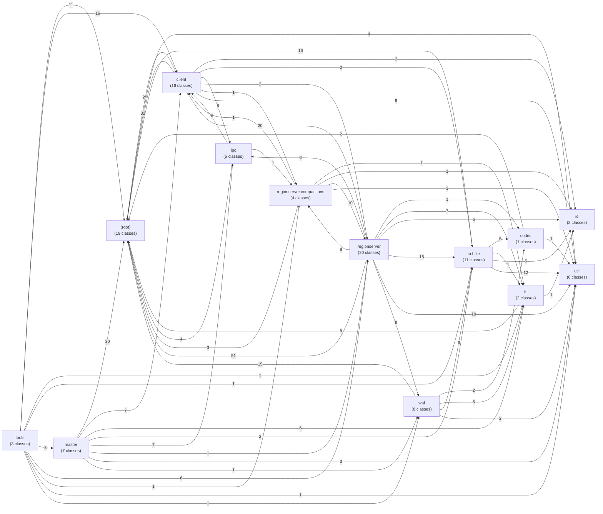

The number on an edge is the number of class dependencies between the two packages.

### Matrix (row uses column)

| uses → | `(root)` | `client` | `codec` | `fs` | `io` | `io.hfile` | `ipc` | `master` | `regionserver` | `regionserver.compactions` | `tools` | `util` | `wal` |
|---|---|---|---|---|---|---|---|---|---|---|---|---|---|
| `(root)` | · | 2 |  |  |  |  |  |  |  |  |  | 4 |  |
| `client` | 32 | · |  |  | 2 | 2 | 8 |  | 2 | 1 |  | 9 |  |
| `codec` | 2 |  | · |  |  |  |  |  |  |  |  | 1 |  |
| `fs` | 5 |  |  | · | 1 |  |  |  |  |  |  |  |  |
| `io` |  |  |  |  | · |  |  |  |  |  |  |  |  |
| `io.hfile` | 16 |  | 5 | 1 | 5 | · |  |  |  |  |  | 12 |  |
| `ipc` | 4 | 8 |  |  |  |  | · |  |  | 1 |  |  |  |
| `master` | 30 | 7 |  | 6 |  | 2 | 7 | · | 1 |  |  | 3 | 1 |
| `regionserver` | 51 | 20 | 1 | 7 | 5 | 15 | 6 |  | · | 8 |  | 19 | 6 |
| `regionserver.compactions` | 3 | 1 |  | 1 | 1 |  |  |  | 10 | · |  | 3 |  |
| `tools` | 11 | 16 |  | 1 |  | 1 |  | 3 | 6 | 1 | · | 1 | 1 |
| `util` |  |  |  |  |  |  |  |  |  |  |  | · |  |
| `wal` | 15 |  | 2 | 6 |  | 6 |  |  |  |  |  | 2 | · |

### Cycles between packages

* `(root)` ⇄ `client` (2 / 32 dependencies)
* `client` ⇄ `ipc` (8 / 8 dependencies)
* `client` ⇄ `regionserver` (2 / 20 dependencies)
* `client` ⇄ `regionserver.compactions` (1 / 1 dependencies)
* `regionserver` ⇄ `regionserver.compactions` (8 / 10 dependencies)

The original has the same kind of cycles (e.g. the descriptors in `client` name the `BloomType` of `regionserver`, and the RegionServer returns client types such as `Result`).

### Layering

* `regionserver` does **not** depend on `master` – RegionServer and master know each other only via `ipc`.
* `client` does **not** depend on `master`.
* `io.hfile`, `io`, `util` and `codec` do **not** depend on `regionserver`, `master` or `client` – the HFile format stands on its own.
* `tools` sits on top and uses everything.

## 2. Inheritance and interfaces

```mermaid
classDiagram
    Comparator <|-- CellComparator
    Serializable <|.. CellComparator
    IOException <|-- DoNotRetryIOException
    Serializable <|.. HRegionLocation
    Cell <|.. KeyValue
    Serializable <|.. KeyValue
    DoNotRetryIOException <|-- NoSuchColumnFamilyException
    IOException <|-- NotServingRegionException
    IOException <|-- PleaseHoldException
    Serializable <|.. RegionInfo
    Serializable <|.. ServerName
    Comparable <|.. ServerName
    DoNotRetryIOException <|-- TableExistsException
    Serializable <|.. TableName
    Comparable <|.. TableName
    DoNotRetryIOException <|-- TableNotDisabledException
    DoNotRetryIOException <|-- TableNotEnabledException
    DoNotRetryIOException <|-- TableNotFoundException
    IOException <|-- UnknownScannerException
    IOException <|-- YouAreDeadException
    Closeable <|.. Admin
    Serializable <|.. ColumnFamilyDescriptor
    Closeable <|.. Connection
    Mutation <|-- Delete
    Serializable <|.. Get
    Serializable <|.. Mutation
    Mutation <|-- Put
    Serializable <|.. Result
    Closeable <|.. ResultScanner
    Iterable <|-- ResultScanner
    IOException <|-- RetriesExhaustedException
    Serializable <|.. Scan
    Closeable <|.. Table
    Serializable <|.. TableDescriptor
    Closeable <|.. HFileSystem
    Closeable <|.. PositionedReadable
    Serializable <|.. TimeRange
    HFile <|-- HFileReaderImpl
    HFile <|-- HFileWriterImpl
    Remote <|.. AdminService
    Remote <|.. ClientService
    Remote <|.. MasterService
    Remote <|.. RegionServerStatusService
    Serializable <|.. ScanResponse
    MasterService <|.. MasterRpcServices
    RegionServerStatusService <|.. MasterRpcServices
    Runnable <|.. ServerCrashProcedure
    KeyValueScanner <|.. KeyValueHeap
    Thread <|-- MemStoreFlusher
    ClientService <|.. RSRpcServices
    AdminService <|.. RSRpcServices
    Closeable <|.. RegionScanner
    KeyValueScanner <|.. SegmentScanner
    KeyValueScanner <|.. StoreFileScanner
    Closeable <|.. StoreFileWriter
    Serializable <|.. CompactionRecord
    Closeable <|.. MiniHBaseCluster
    Serializable <|.. ReadTrace
    WAL <|.. FSHLog
    HFile <|-- TextLogReader
    Closeable <|.. TextLogWriter
    Closeable <|.. WAL
```

| Class | extends / implements |
|---|---|
| `Admin` | `Closeable` |
| `AdminService` | `Remote` |
| `CellComparator` | `Comparator`, `Serializable` |
| `ClientService` | `Remote` |
| `ColumnFamilyDescriptor` | `Serializable` |
| `CompactionRecord` | `Serializable` |
| `Connection` | `Closeable` |
| `Delete` | `Mutation` |
| `DoNotRetryIOException` | `IOException` |
| `FSHLog` | `WAL` |
| `Get` | `Serializable` |
| `HFileReaderImpl` | `HFile.Reader` |
| `HFileSystem` | `Closeable` |
| `HFileWriterImpl` | `HFile.Writer` |
| `HRegionLocation` | `Serializable` |
| `KeyValue` | `Cell`, `Serializable` |
| `KeyValueHeap` | `KeyValueScanner` |
| `MasterRpcServices` | `MasterService`, `RegionServerStatusService` |
| `MasterService` | `Remote` |
| `MemStoreFlusher` | `Thread` |
| `MiniHBaseCluster` | `Closeable` |
| `Mutation` | `Serializable` |
| `NoSuchColumnFamilyException` | `DoNotRetryIOException` |
| `NotServingRegionException` | `IOException` |
| `PleaseHoldException` | `IOException` |
| `PositionedReadable` | `Closeable` |
| `Put` | `Mutation` |
| `RSRpcServices` | `ClientService`, `AdminService` |
| `ReadTrace` | `Serializable` |
| `RegionInfo` | `Serializable` |
| `RegionScanner` | `Closeable` |
| `RegionServerStatusService` | `Remote` |
| `Result` | `Serializable` |
| `ResultScanner` | `Closeable`, `Iterable` |
| `RetriesExhaustedException` | `IOException` |
| `Scan` | `Serializable` |
| `ScanResponse` | `Serializable` |
| `SegmentScanner` | `KeyValueScanner` |
| `ServerCrashProcedure` | `Runnable` |
| `ServerName` | `Serializable`, `Comparable` |
| `StoreFileScanner` | `KeyValueScanner` |
| `StoreFileWriter` | `Closeable` |
| `Table` | `Closeable` |
| `TableDescriptor` | `Serializable` |
| `TableExistsException` | `DoNotRetryIOException` |
| `TableName` | `Serializable`, `Comparable` |
| `TableNotDisabledException` | `DoNotRetryIOException` |
| `TableNotEnabledException` | `DoNotRetryIOException` |
| `TableNotFoundException` | `DoNotRetryIOException` |
| `TextLogReader` | `WAL.Reader` |
| `TextLogWriter` | `Closeable` |
| `TimeRange` | `Serializable` |
| `UnknownScannerException` | `IOException` |
| `WAL` | `Closeable` |
| `YouAreDeadException` | `IOException` |

## 3. Class graphs per package

Per package: all classes of the package, their dependencies among each other (solid) and on classes of other packages (dashed, grouped by package).

### `(root)`

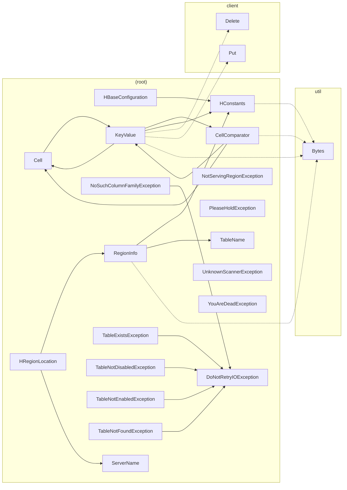

### `client`

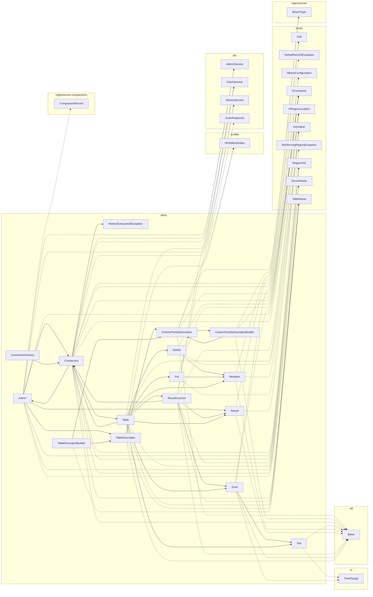

### `codec`

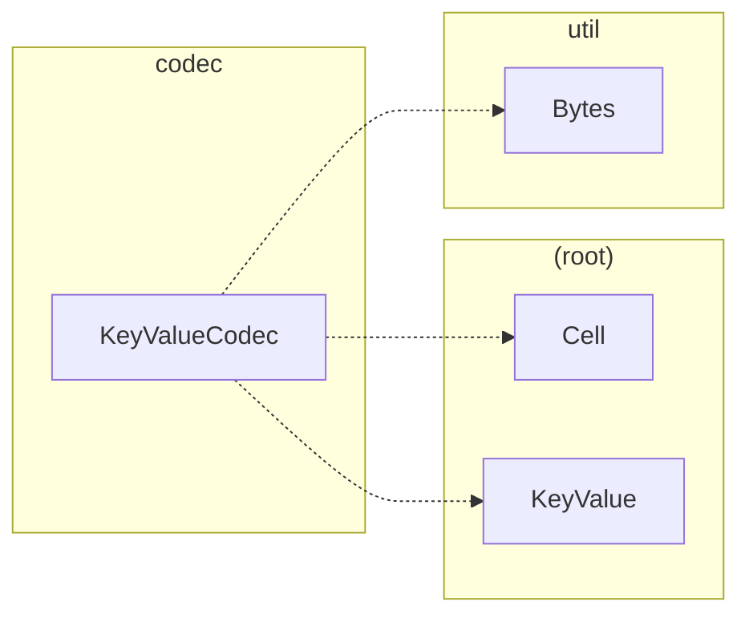

### `fs`

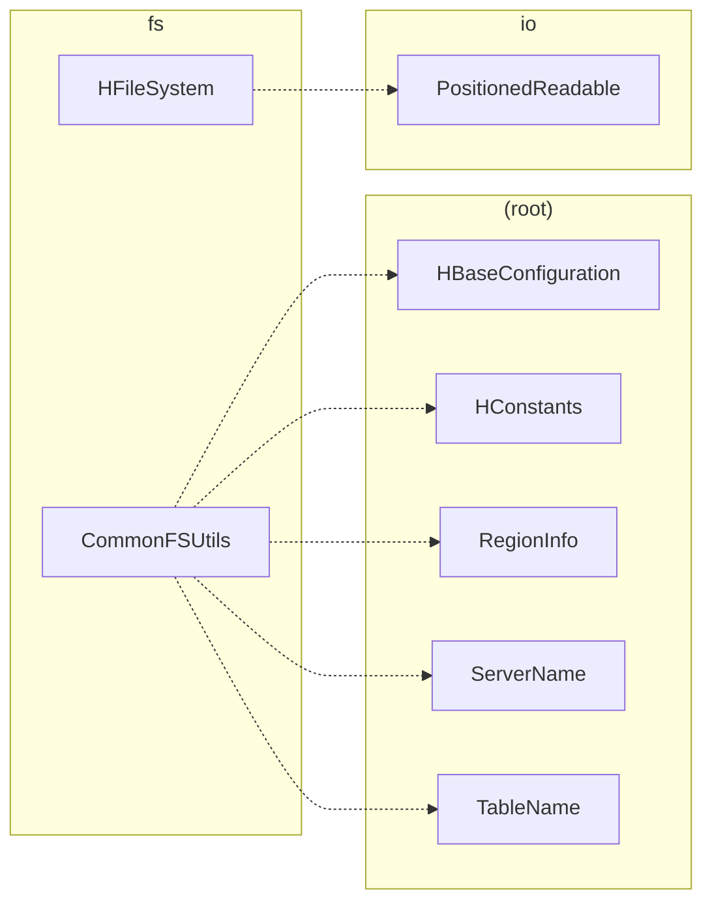

### `io`

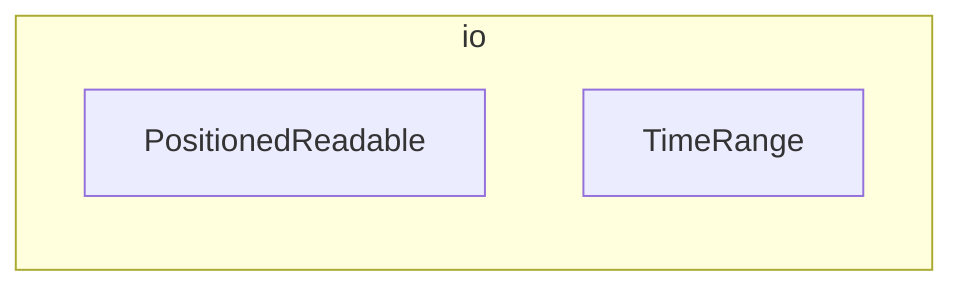

### `io.hfile`

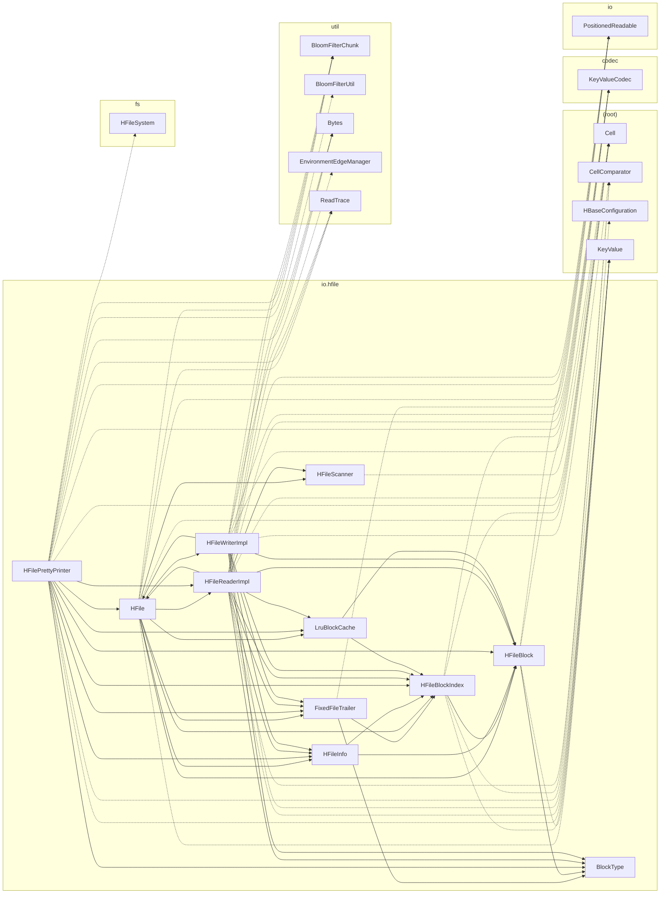

### `ipc`

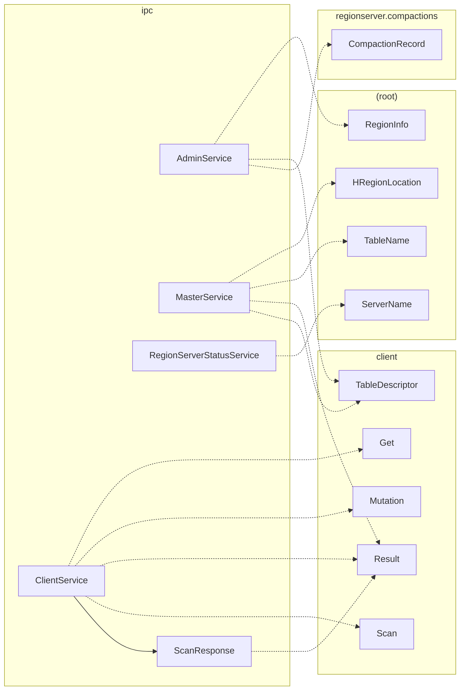

### `master`

```mermaid
flowchart LR
    subgraph master_box["master"]
        master_AssignmentManager["AssignmentManager"]
        master_HMaster["HMaster"]
        master_MasterFileSystem["MasterFileSystem"]
        master_MasterRpcServices["MasterRpcServices"]
        master_RegionState["RegionState"]
        master_ServerCrashProcedure["ServerCrashProcedure"]
        master_ServerManager["ServerManager"]
    end
    subgraph root_ext_master["(root)"]
        Cell["Cell"]
        HBaseConfiguration["HBaseConfiguration"]
        HConstants["HConstants"]
        HRegionLocation["HRegionLocation"]
        KeyValue["KeyValue"]
        PleaseHoldException["PleaseHoldException"]
        RegionInfo["RegionInfo"]
        ServerName["ServerName"]
        TableExistsException["TableExistsException"]
        TableName["TableName"]
        TableNotDisabledException["TableNotDisabledException"]
        TableNotEnabledException["TableNotEnabledException"]
        TableNotFoundException["TableNotFoundException"]
        YouAreDeadException["YouAreDeadException"]
    end
    subgraph client_ext_master["client"]
        client_ColumnFamilyDescriptor["ColumnFamilyDescriptor"]
        client_Result["Result"]
        client_TableDescriptor["TableDescriptor"]
    end
    subgraph fs_ext_master["fs"]
        fs_CommonFSUtils["CommonFSUtils"]
        fs_HFileSystem["HFileSystem"]
    end
    subgraph io_hfile_ext_master["io.hfile"]
        io_hfile_HFileBlockIndex["HFileBlockIndex"]
    end
    subgraph ipc_ext_master["ipc"]
        ipc_AdminService["AdminService"]
        ipc_MasterService["MasterService"]
        ipc_RegionServerStatusService["RegionServerStatusService"]
    end
    subgraph regionserver_ext_master["regionserver"]
        regionserver_HRegion["HRegion"]
    end
    subgraph util_ext_master["util"]
        util_Bytes["Bytes"]
        util_EnvironmentEdgeManager["EnvironmentEdgeManager"]
    end
    subgraph wal_ext_master["wal"]
        wal_WALSplitter["WALSplitter"]
    end
    master_AssignmentManager -.-> RegionInfo
    master_AssignmentManager -.-> ServerName
    master_AssignmentManager -.-> TableName
    master_AssignmentManager -.-> client_TableDescriptor
    master_AssignmentManager -.-> ipc_AdminService
    master_AssignmentManager --> master_HMaster
    master_AssignmentManager --> master_RegionState
    master_AssignmentManager --> master_ServerManager
    master_AssignmentManager -.-> util_Bytes
    master_HMaster -.-> Cell
    master_HMaster -.-> HBaseConfiguration
    master_HMaster -.-> HConstants
    master_HMaster -.-> HRegionLocation
    master_HMaster -.-> KeyValue
    master_HMaster -.-> PleaseHoldException
    master_HMaster -.-> RegionInfo
    master_HMaster -.-> ServerName
    master_HMaster -.-> TableExistsException
    master_HMaster -.-> TableName
    master_HMaster -.-> TableNotDisabledException
    master_HMaster -.-> TableNotEnabledException
    master_HMaster -.-> TableNotFoundException
    master_HMaster -.-> client_ColumnFamilyDescriptor
    master_HMaster -.-> client_Result
    master_HMaster -.-> client_TableDescriptor
    master_HMaster -.-> fs_CommonFSUtils
    master_HMaster -.-> fs_HFileSystem
    master_HMaster -.-> io_hfile_HFileBlockIndex
    master_HMaster -.-> ipc_AdminService
    master_HMaster -.-> ipc_MasterService
    master_HMaster -.-> ipc_RegionServerStatusService
    master_HMaster --> master_AssignmentManager
    master_HMaster --> master_MasterFileSystem
    master_HMaster --> master_MasterRpcServices
    master_HMaster --> master_RegionState
    master_HMaster --> master_ServerCrashProcedure
    master_HMaster --> master_ServerManager
    master_HMaster -.-> regionserver_HRegion
    master_HMaster -.-> util_Bytes
    master_HMaster -.-> util_EnvironmentEdgeManager
    master_MasterFileSystem -.-> HConstants
    master_MasterFileSystem -.-> RegionInfo
    master_MasterFileSystem -.-> TableName
    master_MasterFileSystem -.-> client_TableDescriptor
    master_MasterFileSystem -.-> fs_CommonFSUtils
    master_MasterFileSystem -.-> fs_HFileSystem
    master_MasterRpcServices -.-> HRegionLocation
    master_MasterRpcServices -.-> ServerName
    master_MasterRpcServices -.-> TableName
    master_MasterRpcServices -.-> client_Result
    master_MasterRpcServices -.-> client_TableDescriptor
    master_MasterRpcServices -.-> ipc_MasterService
    master_MasterRpcServices -.-> ipc_RegionServerStatusService
    master_MasterRpcServices --> master_HMaster
    master_RegionState -.-> RegionInfo
    master_RegionState -.-> ServerName
    master_ServerCrashProcedure -.-> HConstants
    master_ServerCrashProcedure -.-> RegionInfo
    master_ServerCrashProcedure -.-> ServerName
    master_ServerCrashProcedure -.-> fs_CommonFSUtils
    master_ServerCrashProcedure -.-> fs_HFileSystem
    master_ServerCrashProcedure --> master_AssignmentManager
    master_ServerCrashProcedure --> master_HMaster
    master_ServerCrashProcedure --> master_RegionState
    master_ServerCrashProcedure -.-> wal_WALSplitter
    master_ServerManager -.-> HBaseConfiguration
    master_ServerManager -.-> ServerName
    master_ServerManager -.-> YouAreDeadException
    master_ServerManager -.-> io_hfile_HFileBlockIndex
    master_ServerManager -.-> ipc_RegionServerStatusService
```

### `regionserver`

```mermaid
flowchart LR
    subgraph regionserver_box["regionserver"]
        regionserver_BloomType["BloomType"]
        regionserver_CompactSplit["CompactSplit"]
        regionserver_DefaultMemStore["DefaultMemStore"]
        regionserver_HRegion["HRegion"]
        regionserver_HRegionFileSystem["HRegionFileSystem"]
        regionserver_HRegionServer["HRegionServer"]
        regionserver_HStore["HStore"]
        regionserver_HStoreFile["HStoreFile"]
        regionserver_KeyValueHeap["KeyValueHeap"]
        regionserver_KeyValueScanner["KeyValueScanner"]
        regionserver_MemStoreFlusher["MemStoreFlusher"]
        regionserver_MultiVersionConcurrencyControl["MultiVersionConcurrencyControl"]
        regionserver_RSRpcServices["RSRpcServices"]
        regionserver_RegionScanner["RegionScanner"]
        regionserver_ScanQueryMatcher["ScanQueryMatcher"]
        regionserver_SegmentScanner["SegmentScanner"]
        regionserver_StoreFileReader["StoreFileReader"]
        regionserver_StoreFileScanner["StoreFileScanner"]
        regionserver_StoreFileWriter["StoreFileWriter"]
        regionserver_StoreScanner["StoreScanner"]
    end
    subgraph root_ext_regionserver["(root)"]
        Cell["Cell"]
        CellComparator["CellComparator"]
        HBaseConfiguration["HBaseConfiguration"]
        HConstants["HConstants"]
        KeyValue["KeyValue"]
        NoSuchColumnFamilyException["NoSuchColumnFamilyException"]
        NotServingRegionException["NotServingRegionException"]
        RegionInfo["RegionInfo"]
        ServerName["ServerName"]
        TableName["TableName"]
        UnknownScannerException["UnknownScannerException"]
        YouAreDeadException["YouAreDeadException"]
    end
    subgraph client_ext_regionserver["client"]
        client_ColumnFamilyDescriptor["ColumnFamilyDescriptor"]
        client_Delete["Delete"]
        client_Get["Get"]
        client_Mutation["Mutation"]
        client_Put["Put"]
        client_Result["Result"]
        client_Scan["Scan"]
        client_TableDescriptor["TableDescriptor"]
    end
    subgraph codec_ext_regionserver["codec"]
        codec_KeyValueCodec["KeyValueCodec"]
    end
    subgraph fs_ext_regionserver["fs"]
        fs_CommonFSUtils["CommonFSUtils"]
        fs_HFileSystem["HFileSystem"]
    end
    subgraph io_ext_regionserver["io"]
        io_PositionedReadable["PositionedReadable"]
        io_TimeRange["TimeRange"]
    end
    subgraph io_hfile_ext_regionserver["io.hfile"]
        io_hfile_FixedFileTrailer["FixedFileTrailer"]
        io_hfile_HFile["HFile"]
        io_hfile_HFileBlockIndex["HFileBlockIndex"]
        io_hfile_HFileInfo["HFileInfo"]
        io_hfile_HFileScanner["HFileScanner"]
        io_hfile_LruBlockCache["LruBlockCache"]
    end
    subgraph ipc_ext_regionserver["ipc"]
        ipc_AdminService["AdminService"]
        ipc_ClientService["ClientService"]
        ipc_RegionServerStatusService["RegionServerStatusService"]
        ipc_ScanResponse["ScanResponse"]
    end
    subgraph regionserver_compactions_ext_regionserver["regionserver.compactions"]
        regionserver_compactions_CompactionRecord["CompactionRecord"]
        regionserver_compactions_CompactionRequest["CompactionRequest"]
        regionserver_compactions_Compactor["Compactor"]
        regionserver_compactions_RatioBasedCompactionPolicy["RatioBasedCompactionPolicy"]
    end
    subgraph util_ext_regionserver["util"]
        util_BloomFilterChunk["BloomFilterChunk"]
        util_Bytes["Bytes"]
        util_EnvironmentEdgeManager["EnvironmentEdgeManager"]
        util_ReadTrace["ReadTrace"]
    end
    subgraph wal_ext_regionserver["wal"]
        wal_FSHLog["FSHLog"]
        wal_TextLogReader["TextLogReader"]
        wal_WAL["WAL"]
        wal_WALEdit["WALEdit"]
        wal_WALKeyImpl["WALKeyImpl"]
    end
    regionserver_CompactSplit -.-> RegionInfo
    regionserver_CompactSplit -.-> ServerName
    regionserver_CompactSplit --> regionserver_HRegion
    regionserver_CompactSplit --> regionserver_HRegionServer
    regionserver_CompactSplit --> regionserver_HStore
    regionserver_CompactSplit -.-> regionserver_compactions_CompactionRecord
    regionserver_DefaultMemStore -.-> Cell
    regionserver_DefaultMemStore -.-> CellComparator
    regionserver_DefaultMemStore -.-> KeyValue
    regionserver_DefaultMemStore --> regionserver_KeyValueScanner
    regionserver_DefaultMemStore --> regionserver_SegmentScanner
    regionserver_HRegion -.-> Cell
    regionserver_HRegion -.-> CellComparator
    regionserver_HRegion -.-> HBaseConfiguration
    regionserver_HRegion -.-> HConstants
    regionserver_HRegion -.-> KeyValue
    regionserver_HRegion -.-> NoSuchColumnFamilyException
    regionserver_HRegion -.-> NotServingRegionException
    regionserver_HRegion -.-> RegionInfo
    regionserver_HRegion -.-> TableName
    regionserver_HRegion -.-> client_ColumnFamilyDescriptor
    regionserver_HRegion -.-> client_Delete
    regionserver_HRegion -.-> client_Get
    regionserver_HRegion -.-> client_Mutation
    regionserver_HRegion -.-> client_Result
    regionserver_HRegion -.-> client_Scan
    regionserver_HRegion -.-> client_TableDescriptor
    regionserver_HRegion -.-> fs_HFileSystem
    regionserver_HRegion -.-> io_hfile_HFileBlockIndex
    regionserver_HRegion -.-> io_hfile_LruBlockCache
    regionserver_HRegion --> regionserver_DefaultMemStore
    regionserver_HRegion --> regionserver_HRegionFileSystem
    regionserver_HRegion --> regionserver_HRegionServer
    regionserver_HRegion --> regionserver_HStore
    regionserver_HRegion --> regionserver_HStoreFile
    regionserver_HRegion --> regionserver_MultiVersionConcurrencyControl
    regionserver_HRegion --> regionserver_RegionScanner
    regionserver_HRegion --> regionserver_StoreScanner
    regionserver_HRegion -.-> regionserver_compactions_CompactionRecord
    regionserver_HRegion -.-> util_Bytes
    regionserver_HRegion -.-> util_EnvironmentEdgeManager
    regionserver_HRegion -.-> util_ReadTrace
    regionserver_HRegion -.-> wal_TextLogReader
    regionserver_HRegion -.-> wal_WAL
    regionserver_HRegion -.-> wal_WALEdit
    regionserver_HRegion -.-> wal_WALKeyImpl
    regionserver_HRegionFileSystem -.-> HConstants
    regionserver_HRegionFileSystem -.-> RegionInfo
    regionserver_HRegionFileSystem -.-> fs_CommonFSUtils
    regionserver_HRegionFileSystem -.-> fs_HFileSystem
    regionserver_HRegionServer -.-> Cell
    regionserver_HRegionServer -.-> HBaseConfiguration
    regionserver_HRegionServer -.-> NotServingRegionException
    regionserver_HRegionServer -.-> RegionInfo
    regionserver_HRegionServer -.-> ServerName
    regionserver_HRegionServer -.-> TableName
    regionserver_HRegionServer -.-> YouAreDeadException
    regionserver_HRegionServer -.-> client_TableDescriptor
    regionserver_HRegionServer -.-> codec_KeyValueCodec
    regionserver_HRegionServer -.-> fs_HFileSystem
    regionserver_HRegionServer -.-> io_hfile_FixedFileTrailer
    regionserver_HRegionServer -.-> io_hfile_HFile
    regionserver_HRegionServer -.-> io_hfile_LruBlockCache
    regionserver_HRegionServer -.-> ipc_AdminService
    regionserver_HRegionServer -.-> ipc_ClientService
    regionserver_HRegionServer -.-> ipc_RegionServerStatusService
    regionserver_HRegionServer --> regionserver_BloomType
    regionserver_HRegionServer --> regionserver_CompactSplit
    regionserver_HRegionServer --> regionserver_DefaultMemStore
    regionserver_HRegionServer --> regionserver_HRegion
    regionserver_HRegionServer --> regionserver_HRegionFileSystem
    regionserver_HRegionServer --> regionserver_HStore
    regionserver_HRegionServer --> regionserver_HStoreFile
    regionserver_HRegionServer --> regionserver_MemStoreFlusher
    regionserver_HRegionServer --> regionserver_RSRpcServices
    regionserver_HRegionServer --> regionserver_StoreFileReader
    regionserver_HRegionServer -.-> regionserver_compactions_CompactionRecord
    regionserver_HRegionServer -.-> util_Bytes
    regionserver_HRegionServer -.-> util_EnvironmentEdgeManager
    regionserver_HRegionServer -.-> wal_FSHLog
    regionserver_HRegionServer -.-> wal_WAL
    regionserver_HStore -.-> Cell
    regionserver_HStore -.-> HConstants
    regionserver_HStore -.-> KeyValue
    regionserver_HStore -.-> RegionInfo
    regionserver_HStore -.-> TableName
    regionserver_HStore -.-> client_ColumnFamilyDescriptor
    regionserver_HStore -.-> client_Scan
    regionserver_HStore -.-> fs_HFileSystem
    regionserver_HStore -.-> io_TimeRange
    regionserver_HStore -.-> io_hfile_LruBlockCache
    regionserver_HStore --> regionserver_DefaultMemStore
    regionserver_HStore --> regionserver_HRegion
    regionserver_HStore --> regionserver_HRegionFileSystem
    regionserver_HStore --> regionserver_HStoreFile
    regionserver_HStore --> regionserver_KeyValueScanner
    regionserver_HStore --> regionserver_ScanQueryMatcher
    regionserver_HStore --> regionserver_StoreFileReader
    regionserver_HStore --> regionserver_StoreFileScanner
    regionserver_HStore --> regionserver_StoreFileWriter
    regionserver_HStore --> regionserver_StoreScanner
    regionserver_HStore -.-> regionserver_compactions_CompactionRecord
    regionserver_HStore -.-> regionserver_compactions_CompactionRequest
    regionserver_HStore -.-> regionserver_compactions_Compactor
    regionserver_HStore -.-> regionserver_compactions_RatioBasedCompactionPolicy
    regionserver_HStore -.-> util_Bytes
    regionserver_HStore -.-> util_EnvironmentEdgeManager
    regionserver_HStore -.-> util_ReadTrace
    regionserver_HStoreFile -.-> fs_CommonFSUtils
    regionserver_HStoreFile -.-> fs_HFileSystem
    regionserver_HStoreFile -.-> io_PositionedReadable
    regionserver_HStoreFile -.-> io_hfile_HFile
    regionserver_HStoreFile -.-> io_hfile_HFileInfo
    regionserver_HStoreFile -.-> io_hfile_LruBlockCache
    regionserver_HStoreFile --> regionserver_StoreFileReader
    regionserver_KeyValueHeap -.-> Cell
    regionserver_KeyValueHeap -.-> CellComparator
    regionserver_KeyValueHeap --> regionserver_KeyValueScanner
    regionserver_KeyValueScanner -.-> Cell
    regionserver_MemStoreFlusher -.-> RegionInfo
    regionserver_MemStoreFlusher --> regionserver_HRegion
    regionserver_RSRpcServices -.-> Cell
    regionserver_RSRpcServices -.-> HBaseConfiguration
    regionserver_RSRpcServices -.-> RegionInfo
    regionserver_RSRpcServices -.-> ServerName
    regionserver_RSRpcServices -.-> UnknownScannerException
    regionserver_RSRpcServices -.-> client_Get
    regionserver_RSRpcServices -.-> client_Mutation
    regionserver_RSRpcServices -.-> client_Result
    regionserver_RSRpcServices -.-> client_Scan
    regionserver_RSRpcServices -.-> client_TableDescriptor
    regionserver_RSRpcServices -.-> ipc_AdminService
    regionserver_RSRpcServices -.-> ipc_ClientService
    regionserver_RSRpcServices -.-> ipc_ScanResponse
    regionserver_RSRpcServices --> regionserver_HRegion
    regionserver_RSRpcServices --> regionserver_HRegionServer
    regionserver_RSRpcServices --> regionserver_RegionScanner
    regionserver_RSRpcServices -.-> regionserver_compactions_CompactionRecord
    regionserver_RSRpcServices -.-> util_EnvironmentEdgeManager
    regionserver_RSRpcServices -.-> util_ReadTrace
    regionserver_RegionScanner -.-> Cell
    regionserver_RegionScanner -.-> RegionInfo
    regionserver_RegionScanner -.-> client_Scan
    regionserver_RegionScanner --> regionserver_HRegion
    regionserver_RegionScanner --> regionserver_StoreScanner
    regionserver_RegionScanner -.-> util_ReadTrace
    regionserver_ScanQueryMatcher -.-> Cell
    regionserver_ScanQueryMatcher -.-> HConstants
    regionserver_ScanQueryMatcher -.-> KeyValue
    regionserver_ScanQueryMatcher -.-> io_TimeRange
    regionserver_ScanQueryMatcher -.-> util_Bytes
    regionserver_SegmentScanner -.-> Cell
    regionserver_SegmentScanner --> regionserver_KeyValueScanner
    regionserver_StoreFileReader -.-> CellComparator
    regionserver_StoreFileReader -.-> KeyValue
    regionserver_StoreFileReader -.-> client_Scan
    regionserver_StoreFileReader -.-> io_TimeRange
    regionserver_StoreFileReader -.-> io_hfile_HFile
    regionserver_StoreFileReader -.-> io_hfile_HFileInfo
    regionserver_StoreFileReader --> regionserver_BloomType
    regionserver_StoreFileReader -.-> util_BloomFilterChunk
    regionserver_StoreFileReader -.-> util_Bytes
    regionserver_StoreFileScanner -.-> Cell
    regionserver_StoreFileScanner -.-> client_Scan
    regionserver_StoreFileScanner -.-> io_TimeRange
    regionserver_StoreFileScanner -.-> io_hfile_HFile
    regionserver_StoreFileScanner -.-> io_hfile_HFileScanner
    regionserver_StoreFileScanner --> regionserver_BloomType
    regionserver_StoreFileScanner --> regionserver_HStoreFile
    regionserver_StoreFileScanner --> regionserver_KeyValueScanner
    regionserver_StoreFileScanner --> regionserver_StoreFileReader
    regionserver_StoreFileScanner -.-> util_Bytes
    regionserver_StoreFileScanner -.-> util_ReadTrace
    regionserver_StoreFileWriter -.-> Cell
    regionserver_StoreFileWriter -.-> HBaseConfiguration
    regionserver_StoreFileWriter -.-> KeyValue
    regionserver_StoreFileWriter -.-> client_ColumnFamilyDescriptor
    regionserver_StoreFileWriter -.-> client_Put
    regionserver_StoreFileWriter -.-> io_hfile_HFile
    regionserver_StoreFileWriter -.-> io_hfile_HFileInfo
    regionserver_StoreFileWriter --> regionserver_BloomType
    regionserver_StoreFileWriter -.-> util_BloomFilterChunk
    regionserver_StoreFileWriter -.-> util_Bytes
    regionserver_StoreScanner -.-> Cell
    regionserver_StoreScanner -.-> KeyValue
    regionserver_StoreScanner --> regionserver_KeyValueHeap
    regionserver_StoreScanner --> regionserver_KeyValueScanner
    regionserver_StoreScanner --> regionserver_ScanQueryMatcher
    regionserver_StoreScanner -.-> util_Bytes
```

### `regionserver.compactions`

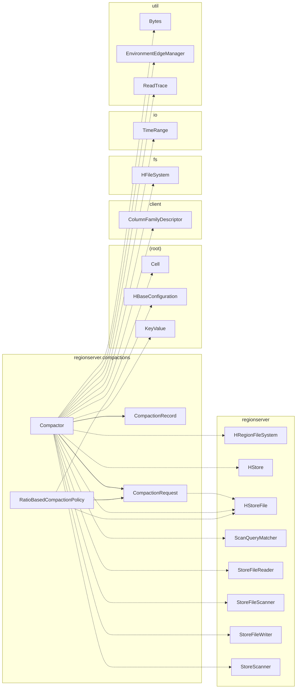

### `tools`

```mermaid
flowchart LR
    subgraph tools_box["tools"]
        tools_Demo["Demo"]
        tools_HBaseShell["HBaseShell"]
        tools_MiniHBaseCluster["MiniHBaseCluster"]
    end
    subgraph root_ext_tools["(root)"]
        Cell["Cell"]
        HBaseConfiguration["HBaseConfiguration"]
        HRegionLocation["HRegionLocation"]
        KeyValue["KeyValue"]
        RegionInfo["RegionInfo"]
        ServerName["ServerName"]
        TableName["TableName"]
        TableNotFoundException["TableNotFoundException"]
    end
    subgraph client_ext_tools["client"]
        client_Admin["Admin"]
        client_ColumnFamilyDescriptor["ColumnFamilyDescriptor"]
        client_ColumnFamilyDescriptorBuilder["ColumnFamilyDescriptorBuilder"]
        client_Connection["Connection"]
        client_ConnectionFactory["ConnectionFactory"]
        client_Delete["Delete"]
        client_Get["Get"]
        client_Put["Put"]
        client_Result["Result"]
        client_ResultScanner["ResultScanner"]
        client_Scan["Scan"]
        client_Table["Table"]
        client_TableDescriptor["TableDescriptor"]
        client_TableDescriptorBuilder["TableDescriptorBuilder"]
    end
    subgraph fs_ext_tools["fs"]
        fs_CommonFSUtils["CommonFSUtils"]
    end
    subgraph io_hfile_ext_tools["io.hfile"]
        io_hfile_HFilePrettyPrinter["HFilePrettyPrinter"]
    end
    subgraph master_ext_tools["master"]
        master_HMaster["HMaster"]
        master_ServerCrashProcedure["ServerCrashProcedure"]
    end
    subgraph regionserver_ext_tools["regionserver"]
        regionserver_BloomType["BloomType"]
        regionserver_HRegion["HRegion"]
        regionserver_HRegionServer["HRegionServer"]
        regionserver_HStore["HStore"]
        regionserver_HStoreFile["HStoreFile"]
    end
    subgraph regionserver_compactions_ext_tools["regionserver.compactions"]
        regionserver_compactions_CompactionRecord["CompactionRecord"]
    end
    subgraph util_ext_tools["util"]
        util_Bytes["Bytes"]
    end
    subgraph wal_ext_tools["wal"]
        wal_WALPrettyPrinter["WALPrettyPrinter"]
    end
    tools_Demo -.-> HBaseConfiguration
    tools_Demo -.-> RegionInfo
    tools_Demo -.-> ServerName
    tools_Demo -.-> client_Connection
    tools_Demo -.-> client_ConnectionFactory
    tools_Demo -.-> fs_CommonFSUtils
    tools_Demo -.-> io_hfile_HFilePrettyPrinter
    tools_Demo -.-> master_HMaster
    tools_Demo -.-> master_ServerCrashProcedure
    tools_Demo -.-> regionserver_HRegion
    tools_Demo -.-> regionserver_HRegionServer
    tools_Demo -.-> regionserver_HStore
    tools_Demo -.-> regionserver_HStoreFile
    tools_Demo --> tools_HBaseShell
    tools_Demo --> tools_MiniHBaseCluster
    tools_Demo -.-> wal_WALPrettyPrinter
    tools_HBaseShell -.-> Cell
    tools_HBaseShell -.-> HRegionLocation
    tools_HBaseShell -.-> KeyValue
    tools_HBaseShell -.-> RegionInfo
    tools_HBaseShell -.-> ServerName
    tools_HBaseShell -.-> TableName
    tools_HBaseShell -.-> TableNotFoundException
    tools_HBaseShell -.-> client_Admin
    tools_HBaseShell -.-> client_ColumnFamilyDescriptor
    tools_HBaseShell -.-> client_ColumnFamilyDescriptorBuilder
    tools_HBaseShell -.-> client_Connection
    tools_HBaseShell -.-> client_ConnectionFactory
    tools_HBaseShell -.-> client_Delete
    tools_HBaseShell -.-> client_Get
    tools_HBaseShell -.-> client_Put
    tools_HBaseShell -.-> client_Result
    tools_HBaseShell -.-> client_ResultScanner
    tools_HBaseShell -.-> client_Scan
    tools_HBaseShell -.-> client_Table
    tools_HBaseShell -.-> client_TableDescriptor
    tools_HBaseShell -.-> client_TableDescriptorBuilder
    tools_HBaseShell -.-> regionserver_BloomType
    tools_HBaseShell -.-> regionserver_compactions_CompactionRecord
    tools_HBaseShell -.-> util_Bytes
    tools_MiniHBaseCluster -.-> HBaseConfiguration
    tools_MiniHBaseCluster -.-> master_HMaster
    tools_MiniHBaseCluster -.-> regionserver_HRegionServer
```

### `util`

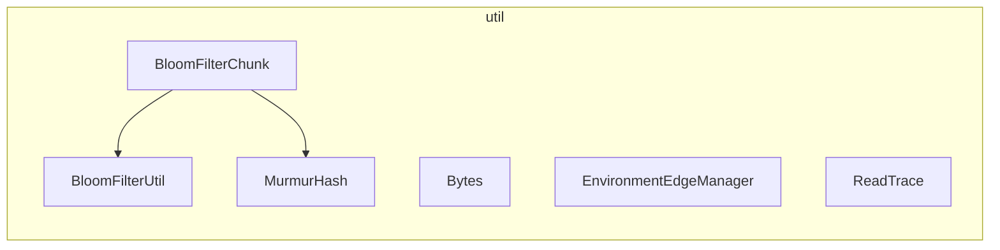

### `wal`

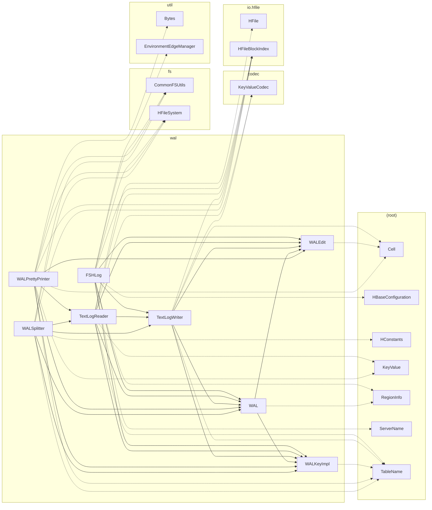

## 4. All classes in detail

Columns: **uses** = outgoing dependencies (fan-out), **used by** = incoming (fan-in).

### Package `(root)`

#### `Cell`

*interface* · [`src/main/java/edudfsbase/Cell.java`](../src/main/java/edudfsbase/Cell.java) · 32 lines

Corresponds to org.apache.hadoop.hbase.Cell: the smallest unit of data in HBase.

| uses (1) | used by (30) |
|---|---|
| *(root):* `KeyValue` | *(root):* `CellComparator`, `KeyValue` *client:* `Mutation`, `Result` *codec:* `KeyValueCodec` *io.hfile:* `HFile`, `HFileBlockIndex`, `HFilePrettyPrinter`, `HFileReaderImpl`, `HFileScanner`, `HFileWriterImpl` *master:* `HMaster` *regionserver:* `DefaultMemStore`, `HRegion`, `HRegionServer`, `HStore`, `KeyValueHeap`, `KeyValueScanner`, `RSRpcServices`, `RegionScanner`, `ScanQueryMatcher`, `SegmentScanner`, `StoreFileScanner`, `StoreFileWriter`, `StoreScanner` *regionserver.compactions:* `Compactor` *tools:* `HBaseShell` *wal:* `TextLogWriter`, `WALEdit`, `WALPrettyPrinter` |

#### `CellComparator`

*class* · [`src/main/java/edudfsbase/CellComparator.java`](../src/main/java/edudfsbase/CellComparator.java) · 91 lines

Corresponds to org.apache.hadoop.hbase.CellComparatorImpl: THE sort order of HBase. MemStore, HFile, block index and all scanners use it.

**extends / implements:** `Comparator`, `Serializable`

| uses (3) | used by (8) |
|---|---|
| *(root):* `Cell`, `KeyValue` *util:* `Bytes` | *(root):* `KeyValue` *io.hfile:* `HFileBlockIndex`, `HFileReaderImpl`, `HFileWriterImpl` *regionserver:* `DefaultMemStore`, `HRegion`, `KeyValueHeap`, `StoreFileReader` |

#### `DoNotRetryIOException`

*class* · [`src/main/java/edudfsbase/DoNotRetryIOException.java`](../src/main/java/edudfsbase/DoNotRetryIOException.java) · 16 lines

Corresponds to org.apache.hadoop.hbase.DoNotRetryIOException: the client must not retry (the error would not go away).

**extends / implements:** `IOException`

| uses (0) | used by (6) |
|---|---|
| – | *(root):* `NoSuchColumnFamilyException`, `TableExistsException`, `TableNotDisabledException`, `TableNotEnabledException`, `TableNotFoundException` *client:* `Connection` |

#### `HBaseConfiguration`

*class* · [`src/main/java/edudfsbase/HBaseConfiguration.java`](../src/main/java/edudfsbase/HBaseConfiguration.java) · 135 lines

Corresponds to org.apache.hadoop.hbase.HBaseConfiguration: reads conf/hbase-site.xml (from the same configuration directory as core-site.xml and hdfs-site.xml).

| uses (1) | used by (14) |
|---|---|
| *(root):* `HConstants` | *client:* `Connection`, `Scan` *fs:* `CommonFSUtils` *io.hfile:* `HFilePrettyPrinter` *master:* `HMaster`, `ServerManager` *regionserver:* `HRegion`, `HRegionServer`, `RSRpcServices`, `StoreFileWriter` *regionserver.compactions:* `RatioBasedCompactionPolicy` *tools:* `Demo`, `MiniHBaseCluster` *wal:* `FSHLog` |

#### `HConstants`

*class* · [`src/main/java/edudfsbase/HConstants.java`](../src/main/java/edudfsbase/HConstants.java) · 45 lines

Corresponds to org.apache.hadoop.hbase.HConstants (excerpt).

| uses (1) | used by (18) |
|---|---|
| *util:* `Bytes` | *(root):* `HBaseConfiguration`, `KeyValue`, `RegionInfo` *client:* `ColumnFamilyDescriptor`, `ColumnFamilyDescriptorBuilder`, `Connection`, `Delete`, `Put`, `Scan` *fs:* `CommonFSUtils` *master:* `HMaster`, `MasterFileSystem`, `ServerCrashProcedure` *regionserver:* `HRegion`, `HRegionFileSystem`, `HStore`, `ScanQueryMatcher` *wal:* `WALSplitter` |

#### `HRegionLocation`

*class* · [`src/main/java/edudfsbase/HRegionLocation.java`](../src/main/java/edudfsbase/HRegionLocation.java) · 41 lines

Corresponds to org.apache.hadoop.hbase.HRegionLocation: which RegionServer serves which region. This is exactly the information of a row in hbase:meta …

**extends / implements:** `Serializable`

| uses (2) | used by (8) |
|---|---|
| *(root):* `RegionInfo`, `ServerName` | *client:* `Admin`, `Connection`, `ResultScanner`, `Table` *ipc:* `MasterService` *master:* `HMaster`, `MasterRpcServices` *tools:* `HBaseShell` |

#### `KeyValue`

*class* · [`src/main/java/edudfsbase/KeyValue.java`](../src/main/java/edudfsbase/KeyValue.java) · 174 lines

Corresponds to org.apache.hadoop.hbase.KeyValue, the standard implementation of Cell.

**extends / implements:** `Cell`, `Serializable`

**inner types:** `Type`

| uses (6) | used by (25) |
|---|---|
| *(root):* `Cell`, `CellComparator`, `HConstants` *client:* `Delete`, `Put` *util:* `Bytes` | *(root):* `Cell`, `CellComparator` *client:* `Delete`, `Mutation`, `Put`, `Result` *codec:* `KeyValueCodec` *io.hfile:* `HFile`, `HFileBlock`, `HFileBlockIndex`, `HFilePrettyPrinter`, `HFileReaderImpl`, `HFileWriterImpl` *master:* `HMaster` *regionserver:* `DefaultMemStore`, `HRegion`, `HStore`, `ScanQueryMatcher`, `StoreFileReader`, `StoreFileWriter`, `StoreScanner` *regionserver.compactions:* `Compactor` *tools:* `HBaseShell` *wal:* `TextLogReader`, `WALPrettyPrinter` |

#### `NoSuchColumnFamilyException`

*class* · [`src/main/java/edudfsbase/NoSuchColumnFamilyException.java`](../src/main/java/edudfsbase/NoSuchColumnFamilyException.java) · 11 lines

Corresponds to org.apache.hadoop.hbase.regionserver.NoSuchColumnFamilyException.

**extends / implements:** `DoNotRetryIOException`

| uses (1) | used by (1) |
|---|---|
| *(root):* `DoNotRetryIOException` | *regionserver:* `HRegion` |

#### `NotServingRegionException`

*class* · [`src/main/java/edudfsbase/NotServingRegionException.java`](../src/main/java/edudfsbase/NotServingRegionException.java) · 16 lines

Corresponds to org.apache.hadoop.hbase.NotServingRegionException: the RegionServer does not (or no longer) serve the region. The client then asks the master for the …

**extends / implements:** `IOException`

| uses (0) | used by (3) |
|---|---|
| – | *client:* `Connection` *regionserver:* `HRegion`, `HRegionServer` |

#### `PleaseHoldException`

*class* · [`src/main/java/edudfsbase/PleaseHoldException.java`](../src/main/java/edudfsbase/PleaseHoldException.java) · 16 lines

Corresponds to org.apache.hadoop.hbase.PleaseHoldException: the master is still initializing (waiting for RegionServers, splitting WALs, assigning regions). The …

**extends / implements:** `IOException`

| uses (0) | used by (1) |
|---|---|
| – | *master:* `HMaster` |

#### `RegionInfo`

*class* · [`src/main/java/edudfsbase/RegionInfo.java`](../src/main/java/edudfsbase/RegionInfo.java) · 127 lines

Corresponds to org.apache.hadoop.hbase.client.RegionInfo (formerly HRegionInfo).

**extends / implements:** `Serializable`

| uses (3) | used by (24) |
|---|---|
| *(root):* `HConstants`, `TableName` *util:* `Bytes` | *(root):* `HRegionLocation` *client:* `Admin`, `Connection`, `ResultScanner`, `Table` *fs:* `CommonFSUtils` *ipc:* `AdminService` *master:* `AssignmentManager`, `HMaster`, `MasterFileSystem`, `RegionState`, `ServerCrashProcedure` *regionserver:* `CompactSplit`, `HRegion`, `HRegionFileSystem`, `HRegionServer`, `HStore`, `MemStoreFlusher`, `RSRpcServices`, `RegionScanner` *tools:* `Demo`, `HBaseShell` *wal:* `FSHLog`, `WAL` |

#### `ServerName`

*class* · [`src/main/java/edudfsbase/ServerName.java`](../src/main/java/edudfsbase/ServerName.java) · 67 lines

Corresponds to org.apache.hadoop.hbase.ServerName: host,port,startcode, e.g. localhost,16020,1761213640123.

**extends / implements:** `Serializable`, `Comparable`

| uses (0) | used by (17) |
|---|---|
| – | *(root):* `HRegionLocation` *client:* `Admin`, `Connection` *fs:* `CommonFSUtils` *ipc:* `RegionServerStatusService` *master:* `AssignmentManager`, `HMaster`, `MasterRpcServices`, `RegionState`, `ServerCrashProcedure`, `ServerManager` *regionserver:* `CompactSplit`, `HRegionServer`, `RSRpcServices` *tools:* `Demo`, `HBaseShell` *wal:* `FSHLog` |

#### `TableExistsException`

*class* · [`src/main/java/edudfsbase/TableExistsException.java`](../src/main/java/edudfsbase/TableExistsException.java) · 11 lines

Corresponds to org.apache.hadoop.hbase.TableExistsException.

**extends / implements:** `DoNotRetryIOException`

| uses (1) | used by (1) |
|---|---|
| *(root):* `DoNotRetryIOException` | *master:* `HMaster` |

#### `TableName`

*class* · [`src/main/java/edudfsbase/TableName.java`](../src/main/java/edudfsbase/TableName.java) · 79 lines

Corresponds to org.apache.hadoop.hbase.TableName: namespace + table name ("ns:t"). Without a namespace the table lives in the namespace "default", in HDFS under …

**extends / implements:** `Serializable`, `Comparable`

| uses (0) | used by (22) |
|---|---|
| – | *(root):* `RegionInfo` *client:* `Admin`, `Connection`, `ResultScanner`, `Table`, `TableDescriptor`, `TableDescriptorBuilder` *fs:* `CommonFSUtils` *ipc:* `MasterService` *master:* `AssignmentManager`, `HMaster`, `MasterFileSystem`, `MasterRpcServices` *regionserver:* `HRegion`, `HRegionServer`, `HStore` *tools:* `HBaseShell` *wal:* `TextLogReader`, `TextLogWriter`, `WALKeyImpl`, `WALPrettyPrinter`, `WALSplitter` |

#### `TableNotDisabledException`

*class* · [`src/main/java/edudfsbase/TableNotDisabledException.java`](../src/main/java/edudfsbase/TableNotDisabledException.java) · 13 lines

Corresponds to org.apache.hadoop.hbase.TableNotDisabledException: e.g. drop of a table that is still enabled.

**extends / implements:** `DoNotRetryIOException`

| uses (1) | used by (1) |
|---|---|
| *(root):* `DoNotRetryIOException` | *master:* `HMaster` |

#### `TableNotEnabledException`

*class* · [`src/main/java/edudfsbase/TableNotEnabledException.java`](../src/main/java/edudfsbase/TableNotEnabledException.java) · 11 lines

Corresponds to org.apache.hadoop.hbase.TableNotEnabledException: access to a disabled table.

**extends / implements:** `DoNotRetryIOException`

| uses (1) | used by (1) |
|---|---|
| *(root):* `DoNotRetryIOException` | *master:* `HMaster` |

#### `TableNotFoundException`

*class* · [`src/main/java/edudfsbase/TableNotFoundException.java`](../src/main/java/edudfsbase/TableNotFoundException.java) · 11 lines

Corresponds to org.apache.hadoop.hbase.TableNotFoundException.

**extends / implements:** `DoNotRetryIOException`

| uses (1) | used by (2) |
|---|---|
| *(root):* `DoNotRetryIOException` | *master:* `HMaster` *tools:* `HBaseShell` |

#### `UnknownScannerException`

*class* · [`src/main/java/edudfsbase/UnknownScannerException.java`](../src/main/java/edudfsbase/UnknownScannerException.java) · 17 lines

Corresponds to org.apache.hadoop.hbase.UnknownScannerException: the scanner ID is unknown to the RegionServer (expired after hbase.client.scanner.timeout.period, or …

**extends / implements:** `IOException`

| uses (0) | used by (1) |
|---|---|
| – | *regionserver:* `RSRpcServices` |

#### `YouAreDeadException`

*class* · [`src/main/java/edudfsbase/YouAreDeadException.java`](../src/main/java/edudfsbase/YouAreDeadException.java) · 16 lines

Corresponds to org.apache.hadoop.hbase.YouAreDeadException: the master has already declared this RegionServer dead (and split its WALs). The RegionServer must stop at …

**extends / implements:** `IOException`

| uses (0) | used by (2) |
|---|---|
| – | *master:* `ServerManager` *regionserver:* `HRegionServer` |

### Package `client`

#### `Admin`

*class* · [`src/main/java/edudfsbase/client/Admin.java`](../src/main/java/edudfsbase/client/Admin.java) · 158 lines

Corresponds to org.apache.hadoop.hbase.client.Admin (HBaseAdmin): administration. DDL goes to the master; flush and compaction go - as in the original - directly to …

**extends / implements:** `Closeable`

| uses (10) | used by (2) |
|---|---|
| *(root):* `HRegionLocation`, `RegionInfo`, `ServerName`, `TableName` *client:* `Connection`, `Result`, `TableDescriptor` *ipc:* `AdminService`, `MasterService` *regionserver.compactions:* `CompactionRecord` | *client:* `Connection` *tools:* `HBaseShell` |

#### `ColumnFamilyDescriptor`

*class* · [`src/main/java/edudfsbase/client/ColumnFamilyDescriptor.java`](../src/main/java/edudfsbase/client/ColumnFamilyDescriptor.java) · 109 lines

Corresponds to org.apache.hadoop.hbase.client.ColumnFamilyDescriptor: the settings of a column family. They apply per family because each family is a store of its own …

**extends / implements:** `Serializable`

| uses (5) | used by (9) |
|---|---|
| *(root):* `HConstants` *client:* `ColumnFamilyDescriptorBuilder` *io.hfile:* `HFileBlockIndex` *regionserver:* `BloomType` *util:* `Bytes` | *client:* `ColumnFamilyDescriptorBuilder`, `TableDescriptor`, `TableDescriptorBuilder` *master:* `HMaster` *regionserver:* `HRegion`, `HStore`, `StoreFileWriter` *regionserver.compactions:* `Compactor` *tools:* `HBaseShell` |

#### `ColumnFamilyDescriptorBuilder`

*class* · [`src/main/java/edudfsbase/client/ColumnFamilyDescriptorBuilder.java`](../src/main/java/edudfsbase/client/ColumnFamilyDescriptorBuilder.java) · 65 lines

Corresponds to org.apache.hadoop.hbase.client.ColumnFamilyDescriptorBuilder.

| uses (4) | used by (2) |
|---|---|
| *(root):* `HConstants` *client:* `ColumnFamilyDescriptor` *regionserver:* `BloomType` *util:* `Bytes` | *client:* `ColumnFamilyDescriptor` *tools:* `HBaseShell` |

#### `Connection`

*class* · [`src/main/java/edudfsbase/client/Connection.java`](../src/main/java/edudfsbase/client/Connection.java) · 203 lines

Corresponds to org.apache.hadoop.hbase.client.Connection (ConnectionImplementation): the client's connection to the cluster. Heavyweight - create once, share, close …

**extends / implements:** `Closeable`

**inner types:** `Callable`, `RegionCallable`

| uses (15) | used by (6) |
|---|---|
| *(root):* `DoNotRetryIOException`, `HBaseConfiguration`, `HConstants`, `HRegionLocation`, `NotServingRegionException`, `RegionInfo`, `ServerName`, `TableName` *client:* `Admin`, `RetriesExhaustedException`, `Table` *ipc:* `AdminService`, `ClientService`, `MasterService` *util:* `Bytes` | *client:* `Admin`, `ConnectionFactory`, `ResultScanner`, `Table` *tools:* `Demo`, `HBaseShell` |

#### `ConnectionFactory`

*class* · [`src/main/java/edudfsbase/client/ConnectionFactory.java`](../src/main/java/edudfsbase/client/ConnectionFactory.java) · 15 lines

Corresponds to org.apache.hadoop.hbase.client.ConnectionFactory. The address of the master comes from hbase-site.xml (original: the client finds everything via the …

| uses (1) | used by (2) |
|---|---|
| *client:* `Connection` | *tools:* `Demo`, `HBaseShell` |

#### `Delete`

*class* · [`src/main/java/edudfsbase/client/Delete.java`](../src/main/java/edudfsbase/client/Delete.java) · 57 lines

Corresponds to org.apache.hadoop.hbase.client.Delete.

**extends / implements:** `Mutation`

| uses (3) | used by (4) |
|---|---|
| *(root):* `HConstants`, `KeyValue` *client:* `Mutation` | *(root):* `KeyValue` *client:* `Table` *regionserver:* `HRegion` *tools:* `HBaseShell` |

#### `Get`

*class* · [`src/main/java/edudfsbase/client/Get.java`](../src/main/java/edudfsbase/client/Get.java) · 88 lines

Corresponds to org.apache.hadoop.hbase.client.Get: reads ONE row (optionally only certain families/columns, several versions, a time range).

**extends / implements:** `Serializable`

| uses (2) | used by (6) |
|---|---|
| *io:* `TimeRange` *util:* `Bytes` | *client:* `Scan`, `Table` *ipc:* `ClientService` *regionserver:* `HRegion`, `RSRpcServices` *tools:* `HBaseShell` |

#### `Mutation`

*abstract class* · [`src/main/java/edudfsbase/client/Mutation.java`](../src/main/java/edudfsbase/client/Mutation.java) · 65 lines

Corresponds to org.apache.hadoop.hbase.client.Mutation: base class of Put and Delete. A mutation always concerns exactly ONE row - and HBase guarantees atomicity per …

**extends / implements:** `Serializable`

| uses (3) | used by (6) |
|---|---|
| *(root):* `Cell`, `KeyValue` *util:* `Bytes` | *client:* `Delete`, `Put`, `Table` *ipc:* `ClientService` *regionserver:* `HRegion`, `RSRpcServices` |

#### `Put`

*class* · [`src/main/java/edudfsbase/client/Put.java`](../src/main/java/edudfsbase/client/Put.java) · 30 lines

Corresponds to org.apache.hadoop.hbase.client.Put: writes cells into one row. Without an explicit timestamp the RegionServer sets its current time on arrival.

**extends / implements:** `Mutation`

| uses (3) | used by (4) |
|---|---|
| *(root):* `HConstants`, `KeyValue` *client:* `Mutation` | *(root):* `KeyValue` *client:* `Table` *regionserver:* `StoreFileWriter` *tools:* `HBaseShell` |

#### `Result`

*class* · [`src/main/java/edudfsbase/client/Result.java`](../src/main/java/edudfsbase/client/Result.java) · 90 lines

Corresponds to org.apache.hadoop.hbase.client.Result: the cells of ONE row, sorted (family, qualifier, newest version first).

**extends / implements:** `Serializable`

| uses (3) | used by (11) |
|---|---|
| *(root):* `Cell`, `KeyValue` *util:* `Bytes` | *client:* `Admin`, `ResultScanner`, `Table` *ipc:* `ClientService`, `MasterService`, `ScanResponse` *master:* `HMaster`, `MasterRpcServices` *regionserver:* `HRegion`, `RSRpcServices` *tools:* `HBaseShell` |

#### `ResultScanner`

*class* · [`src/main/java/edudfsbase/client/ResultScanner.java`](../src/main/java/edudfsbase/client/ResultScanner.java) · 156 lines

Corresponds to org.apache.hadoop.hbase.client.ResultScanner (ClientScanner): iterates over the rows of a scan - region after region in key order.

**extends / implements:** `Closeable`, `Iterable`

| uses (9) | used by (2) |
|---|---|
| *(root):* `HRegionLocation`, `RegionInfo`, `TableName` *client:* `Connection`, `Result`, `Scan` *ipc:* `ClientService`, `ScanResponse` *util:* `Bytes` | *client:* `Table` *tools:* `HBaseShell` |

#### `RetriesExhaustedException`

*class* · [`src/main/java/edudfsbase/client/RetriesExhaustedException.java`](../src/main/java/edudfsbase/client/RetriesExhaustedException.java) · 16 lines

Corresponds to org.apache.hadoop.hbase.client.RetriesExhaustedException: all hbase.client.retries.number attempts failed.

**extends / implements:** `IOException`

| uses (0) | used by (1) |
|---|---|
| – | *client:* `Connection` |

#### `Scan`

*class* · [`src/main/java/edudfsbase/client/Scan.java`](../src/main/java/edudfsbase/client/Scan.java) · 184 lines

Corresponds to org.apache.hadoop.hbase.client.Scan: reads rows in key order from startRow (inclusive) to stopRow (exclusive). A Get is internally a scan over exactly …

**extends / implements:** `Serializable`

| uses (5) | used by (10) |
|---|---|
| *(root):* `HBaseConfiguration`, `HConstants` *client:* `Get` *io:* `TimeRange` *util:* `Bytes` | *client:* `ResultScanner`, `Table` *ipc:* `ClientService` *regionserver:* `HRegion`, `HStore`, `RSRpcServices`, `RegionScanner`, `StoreFileReader`, `StoreFileScanner` *tools:* `HBaseShell` |

#### `Table`

*class* · [`src/main/java/edudfsbase/client/Table.java`](../src/main/java/edudfsbase/client/Table.java) · 64 lines

Corresponds to org.apache.hadoop.hbase.client.Table (HTable): the data operations on a table. Every call goes to the RegionServer that serves the row's region …

**extends / implements:** `Closeable`

| uses (12) | used by (2) |
|---|---|
| *(root):* `HRegionLocation`, `RegionInfo`, `TableName` *client:* `Connection`, `Delete`, `Get`, `Mutation`, `Put`, `Result`, `ResultScanner`, `Scan` *ipc:* `ClientService` | *client:* `Connection` *tools:* `HBaseShell` |

#### `TableDescriptor`

*class* · [`src/main/java/edudfsbase/client/TableDescriptor.java`](../src/main/java/edudfsbase/client/TableDescriptor.java) · 95 lines

Corresponds to org.apache.hadoop.hbase.client.TableDescriptor: name + column families of a table. Only the families are fixed when a table is created - the columns …

**extends / implements:** `Serializable`

| uses (4) | used by (12) |
|---|---|
| *(root):* `TableName` *client:* `ColumnFamilyDescriptor` *io.hfile:* `HFileBlockIndex` *util:* `Bytes` | *client:* `Admin`, `TableDescriptorBuilder` *ipc:* `AdminService`, `MasterService` *master:* `AssignmentManager`, `HMaster`, `MasterFileSystem`, `MasterRpcServices` *regionserver:* `HRegion`, `HRegionServer`, `RSRpcServices` *tools:* `HBaseShell` |

#### `TableDescriptorBuilder`

*class* · [`src/main/java/edudfsbase/client/TableDescriptorBuilder.java`](../src/main/java/edudfsbase/client/TableDescriptorBuilder.java) · 33 lines

Corresponds to org.apache.hadoop.hbase.client.TableDescriptorBuilder.

| uses (3) | used by (1) |
|---|---|
| *(root):* `TableName` *client:* `ColumnFamilyDescriptor`, `TableDescriptor` | *tools:* `HBaseShell` |

### Package `codec`

#### `KeyValueCodec`

*class* · [`src/main/java/edudfsbase/codec/KeyValueCodec.java`](../src/main/java/edudfsbase/codec/KeyValueCodec.java) · 89 lines

Corresponds to org.apache.hadoop.hbase.codec.KeyValueCodec: how a cell is written to a file.

| uses (3) | used by (8) |
|---|---|
| *(root):* `Cell`, `KeyValue` *util:* `Bytes` | *io.hfile:* `HFileBlock`, `HFileBlockIndex`, `HFilePrettyPrinter`, `HFileReaderImpl`, `HFileWriterImpl` *regionserver:* `HRegionServer` *wal:* `TextLogReader`, `TextLogWriter` |

### Package `fs`

#### `CommonFSUtils`

*class* · [`src/main/java/edudfsbase/fs/CommonFSUtils.java`](../src/main/java/edudfsbase/fs/CommonFSUtils.java) · 82 lines

Corresponds to org.apache.hadoop.hbase.util.CommonFSUtils (+ HFileArchiveUtil, AbstractFSWALProvider): where what lies in HDFS. The layout is the original one:

| uses (5) | used by (9) |
|---|---|
| *(root):* `HBaseConfiguration`, `HConstants`, `RegionInfo`, `ServerName`, `TableName` | *master:* `HMaster`, `MasterFileSystem`, `ServerCrashProcedure` *regionserver:* `HRegionFileSystem`, `HStoreFile` *tools:* `Demo` *wal:* `FSHLog`, `WALPrettyPrinter`, `WALSplitter` |

#### `HFileSystem`

*class* · [`src/main/java/edudfsbase/fs/HFileSystem.java`](../src/main/java/edudfsbase/fs/HFileSystem.java) · 131 lines

Corresponds to org.apache.hadoop.hbase.fs.HFileSystem: the HDFS client of a master or RegionServer. Everything HBase stores lies in HDFS - HBase itself keeps nothing …

**extends / implements:** `Closeable`

| uses (1) | used by (13) |
|---|---|
| *io:* `PositionedReadable` | *io.hfile:* `HFilePrettyPrinter` *master:* `HMaster`, `MasterFileSystem`, `ServerCrashProcedure` *regionserver:* `HRegion`, `HRegionFileSystem`, `HRegionServer`, `HStore`, `HStoreFile` *regionserver.compactions:* `Compactor` *wal:* `FSHLog`, `WALPrettyPrinter`, `WALSplitter` |

### Package `io`

#### `PositionedReadable`

*interface* · [`src/main/java/edudfsbase/io/PositionedReadable.java`](../src/main/java/edudfsbase/io/PositionedReadable.java) · 85 lines

Corresponds to org.apache.hadoop.fs.PositionedReadable (+ FSDataInputStreamWrapper): a file from which you can read at any offset. The HFile reader needs nothing else …

**extends / implements:** `Closeable`

| uses (0) | used by (7) |
|---|---|
| – | *fs:* `HFileSystem` *io.hfile:* `FixedFileTrailer`, `HFile`, `HFileBlock`, `HFilePrettyPrinter`, `HFileReaderImpl` *regionserver:* `HStoreFile` |

#### `TimeRange`

*class* · [`src/main/java/edudfsbase/io/TimeRange.java`](../src/main/java/edudfsbase/io/TimeRange.java) · 52 lines

Corresponds to org.apache.hadoop.hbase.io.TimeRange: [minStamp, maxStamp) - min inclusive, max exclusive. Used by Get/Scan (only versions in the range) and by every …

**extends / implements:** `Serializable`

| uses (0) | used by (7) |
|---|---|
| – | *client:* `Get`, `Scan` *regionserver:* `HStore`, `ScanQueryMatcher`, `StoreFileReader`, `StoreFileScanner` *regionserver.compactions:* `Compactor` |

### Package `io.hfile`

#### `BlockType`

*enum* · [`src/main/java/edudfsbase/io/hfile/BlockType.java`](../src/main/java/edudfsbase/io/hfile/BlockType.java) · 46 lines

Corresponds to org.apache.hadoop.hbase.io.hfile.BlockType: every block of an HFile begins with an 8-byte "magic" that names its type. The magics are the original …

| uses (0) | used by (5) |
|---|---|
| – | *io.hfile:* `FixedFileTrailer`, `HFileBlock`, `HFilePrettyPrinter`, `HFileReaderImpl`, `HFileWriterImpl` |

#### `FixedFileTrailer`

*class* · [`src/main/java/edudfsbase/io/hfile/FixedFileTrailer.java`](../src/main/java/edudfsbase/io/hfile/FixedFileTrailer.java) · 127 lines

Corresponds to org.apache.hadoop.hbase.io.hfile.FixedFileTrailer: the last #TRAILER_SIZE bytes of every HFile.

| uses (3) | used by (5) |
|---|---|
| *io:* `PositionedReadable` *io.hfile:* `BlockType`, `HFileBlockIndex` | *io.hfile:* `HFile`, `HFilePrettyPrinter`, `HFileReaderImpl`, `HFileWriterImpl` *regionserver:* `HRegionServer` |

#### `HFile`

*class* · [`src/main/java/edudfsbase/io/hfile/HFile.java`](../src/main/java/edudfsbase/io/hfile/HFile.java) · 89 lines

Corresponds to org.apache.hadoop.hbase.io.hfile.HFile: the file format in which HBase stores its data in HDFS. An HFile is written ONCE, sorted, and never changed …

**inner types:** `Reader`, `Writer`

| uses (13) | used by (9) |
|---|---|
| *(root):* `Cell`, `KeyValue` *io:* `PositionedReadable` *io.hfile:* `FixedFileTrailer`, `HFileBlock`, `HFileBlockIndex`, `HFileInfo`, `HFileReaderImpl`, `HFileScanner`, `HFileWriterImpl`, `LruBlockCache` *util:* `BloomFilterChunk`, `ReadTrace` | *io.hfile:* `HFilePrettyPrinter`, `HFileReaderImpl`, `HFileWriterImpl` *regionserver:* `HRegionServer`, `HStoreFile`, `StoreFileReader`, `StoreFileScanner`, `StoreFileWriter` *wal:* `TextLogReader` |

#### `HFileBlock`

*class* · [`src/main/java/edudfsbase/io/hfile/HFileBlock.java`](../src/main/java/edudfsbase/io/hfile/HFileBlock.java) · 161 lines

Corresponds to org.apache.hadoop.hbase.io.hfile.HFileBlock: the unit in which an HFile is read (and cached in the BlockCache).

| uses (4) | used by (7) |
|---|---|
| *(root):* `KeyValue` *codec:* `KeyValueCodec` *io:* `PositionedReadable` *io.hfile:* `BlockType` | *io.hfile:* `HFile`, `HFileBlockIndex`, `HFileInfo`, `HFilePrettyPrinter`, `HFileReaderImpl`, `HFileWriterImpl`, `LruBlockCache` |

#### `HFileBlockIndex`

*class* · [`src/main/java/edudfsbase/io/hfile/HFileBlockIndex.java`](../src/main/java/edudfsbase/io/hfile/HFileBlockIndex.java) · 126 lines

Corresponds to org.apache.hadoop.hbase.io.hfile.HFileBlockIndex: the data block index.

**inner types:** `BlockIndexReader`, `BlockIndexWriter`, `Entry`

| uses (5) | used by (17) |
|---|---|
| *(root):* `Cell`, `CellComparator`, `KeyValue` *codec:* `KeyValueCodec` *io.hfile:* `HFileBlock` | *client:* `ColumnFamilyDescriptor`, `TableDescriptor` *io.hfile:* `FixedFileTrailer`, `HFile`, `HFileInfo`, `HFilePrettyPrinter`, `HFileReaderImpl`, `HFileWriterImpl`, `LruBlockCache` *master:* `HMaster`, `ServerManager` *regionserver:* `HRegion` *wal:* `FSHLog`, `TextLogReader`, `TextLogWriter`, `WALPrettyPrinter`, `WALSplitter` |

#### `HFileInfo`

*class* · [`src/main/java/edudfsbase/io/hfile/HFileInfo.java`](../src/main/java/edudfsbase/io/hfile/HFileInfo.java) · 66 lines

Corresponds to org.apache.hadoop.hbase.io.hfile.HFileInfo (the "FileInfo"): metadata of an HFile as key/value pairs. Stored as block FILEINF2 in the load-on-open …

| uses (2) | used by (7) |
|---|---|
| *io.hfile:* `HFileBlock`, `HFileBlockIndex` | *io.hfile:* `HFile`, `HFilePrettyPrinter`, `HFileReaderImpl`, `HFileWriterImpl` *regionserver:* `HStoreFile`, `StoreFileReader`, `StoreFileWriter` |

#### `HFilePrettyPrinter`

*class* · [`src/main/java/edudfsbase/io/hfile/HFilePrettyPrinter.java`](../src/main/java/edudfsbase/io/hfile/HFilePrettyPrinter.java) · 418 lines

Corresponds to org.apache.hadoop.hbase.io.hfile.HFilePrettyPrinter (hbase hfile): looks inside an HFile. The flags of the original plus some EduDFSBase views.

| uses (18) | used by (1) |
|---|---|
| *(root):* `Cell`, `HBaseConfiguration`, `KeyValue` *codec:* `KeyValueCodec` *fs:* `HFileSystem` *io:* `PositionedReadable` *io.hfile:* `BlockType`, `FixedFileTrailer`, `HFile`, `HFileBlock`, `HFileBlockIndex`, `HFileInfo`, `HFileReaderImpl`, `LruBlockCache` *util:* `BloomFilterChunk`, `BloomFilterUtil`, `Bytes`, `ReadTrace` | *tools:* `Demo` |

#### `HFileReaderImpl`

*class* · [`src/main/java/edudfsbase/io/hfile/HFileReaderImpl.java`](../src/main/java/edudfsbase/io/hfile/HFileReaderImpl.java) · 298 lines

Corresponds to org.apache.hadoop.hbase.io.hfile.HFileReaderImpl.

**extends / implements:** `HFile.Reader`

**inner types:** `HFileScannerImpl`

| uses (16) | used by (2) |
|---|---|
| *(root):* `Cell`, `CellComparator`, `KeyValue` *codec:* `KeyValueCodec` *io:* `PositionedReadable` *io.hfile:* `BlockType`, `FixedFileTrailer`, `HFile`, `HFileBlock`, `HFileBlockIndex`, `HFileInfo`, `HFileScanner`, `LruBlockCache` *util:* `BloomFilterChunk`, `Bytes`, `ReadTrace` | *io.hfile:* `HFile`, `HFilePrettyPrinter` |

#### `HFileScanner`

*interface* · [`src/main/java/edudfsbase/io/hfile/HFileScanner.java`](../src/main/java/edudfsbase/io/hfile/HFileScanner.java) · 30 lines

Corresponds to org.apache.hadoop.hbase.io.hfile.HFileScanner: a cursor over the cells of an HFile.

| uses (1) | used by (3) |
|---|---|
| *(root):* `Cell` | *io.hfile:* `HFile`, `HFileReaderImpl` *regionserver:* `StoreFileScanner` |

#### `HFileWriterImpl`

*class* · [`src/main/java/edudfsbase/io/hfile/HFileWriterImpl.java`](../src/main/java/edudfsbase/io/hfile/HFileWriterImpl.java) · 170 lines

Corresponds to org.apache.hadoop.hbase.io.hfile.HFileWriterImpl.

**extends / implements:** `HFile.Writer`

| uses (13) | used by (1) |
|---|---|
| *(root):* `Cell`, `CellComparator`, `KeyValue` *codec:* `KeyValueCodec` *io.hfile:* `BlockType`, `FixedFileTrailer`, `HFile`, `HFileBlock`, `HFileBlockIndex`, `HFileInfo` *util:* `BloomFilterChunk`, `Bytes`, `EnvironmentEdgeManager` | *io.hfile:* `HFile` |

#### `LruBlockCache`

*class* · [`src/main/java/edudfsbase/io/hfile/LruBlockCache.java`](../src/main/java/edudfsbase/io/hfile/LruBlockCache.java) · 109 lines

Corresponds to org.apache.hadoop.hbase.io.hfile.LruBlockCache: ONE cache per RegionServer for the blocks of all its HFiles. Key = (HFile name, offset of the block).

**inner types:** `BlockCacheKey`

| uses (2) | used by (7) |
|---|---|
| *io.hfile:* `HFileBlock`, `HFileBlockIndex` | *io.hfile:* `HFile`, `HFilePrettyPrinter`, `HFileReaderImpl` *regionserver:* `HRegion`, `HRegionServer`, `HStore`, `HStoreFile` |

### Package `ipc`

#### `AdminService`

*interface* · [`src/main/java/edudfsbase/ipc/AdminService.java`](../src/main/java/edudfsbase/ipc/AdminService.java) · 41 lines

Corresponds to AdminService (AdminProtos.proto): master or admin client -&gt; RegionServer. Open/close regions (assignment), flush and compaction on request.

**extends / implements:** `Remote`

| uses (3) | used by (6) |
|---|---|
| *(root):* `RegionInfo` *client:* `TableDescriptor` *regionserver.compactions:* `CompactionRecord` | *client:* `Admin`, `Connection` *master:* `AssignmentManager`, `HMaster` *regionserver:* `HRegionServer`, `RSRpcServices` |

#### `ClientService`

*interface* · [`src/main/java/edudfsbase/ipc/ClientService.java`](../src/main/java/edudfsbase/ipc/ClientService.java) · 33 lines

Corresponds to ClientService (ClientProtos.proto): client -&gt; RegionServer, the data operations. The region is addressed by its encoded name. If the RegionServer …

**extends / implements:** `Remote`

| uses (5) | used by (5) |
|---|---|
| *client:* `Get`, `Mutation`, `Result`, `Scan` *ipc:* `ScanResponse` | *client:* `Connection`, `ResultScanner`, `Table` *regionserver:* `HRegionServer`, `RSRpcServices` |

#### `MasterService`

*interface* · [`src/main/java/edudfsbase/ipc/MasterService.java`](../src/main/java/edudfsbase/ipc/MasterService.java) · 48 lines

Corresponds to MasterService (Master.proto): client (Admin) -&gt; master. DDL and cluster information.

**extends / implements:** `Remote`

| uses (4) | used by (4) |
|---|---|
| *(root):* `HRegionLocation`, `TableName` *client:* `Result`, `TableDescriptor` | *client:* `Admin`, `Connection` *master:* `HMaster`, `MasterRpcServices` |

#### `RegionServerStatusService`

*interface* · [`src/main/java/edudfsbase/ipc/RegionServerStatusService.java`](../src/main/java/edudfsbase/ipc/RegionServerStatusService.java) · 32 lines

Corresponds to RegionServerStatusService (RegionServerStatus.proto): RegionServer -&gt; master. As in EduDFS (DatanodeProtocol) the master never calls on its own to …

**extends / implements:** `Remote`

**inner types:** `RegionLoad`

| uses (1) | used by (4) |
|---|---|
| *(root):* `ServerName` | *master:* `HMaster`, `MasterRpcServices`, `ServerManager` *regionserver:* `HRegionServer` |

#### `ScanResponse`

*record* · [`src/main/java/edudfsbase/ipc/ScanResponse.java`](../src/main/java/edudfsbase/ipc/ScanResponse.java) · 10 lines

Corresponds to ScanResponse (ClientProtos.proto): a batch of rows and whether the region has more.

**extends / implements:** `Serializable`

| uses (1) | used by (3) |
|---|---|
| *client:* `Result` | *client:* `ResultScanner` *ipc:* `ClientService` *regionserver:* `RSRpcServices` |

### Package `master`

#### `AssignmentManager`

*class* · [`src/main/java/edudfsbase/master/AssignmentManager.java`](../src/main/java/edudfsbase/master/AssignmentManager.java) · 204 lines

Corresponds to org.apache.hadoop.hbase.master.assignment.AssignmentManager (+ RegionStates, TableStateManager): which region is open where, and which tables are enabled.

| uses (9) | used by (2) |
|---|---|
| *(root):* `RegionInfo`, `ServerName`, `TableName` *client:* `TableDescriptor` *ipc:* `AdminService` *master:* `HMaster`, `RegionState`, `ServerManager` *util:* `Bytes` | *master:* `HMaster`, `ServerCrashProcedure` |

#### `HMaster`

*class* · [`src/main/java/edudfsbase/master/HMaster.java`](../src/main/java/edudfsbase/master/HMaster.java) · 503 lines

Corresponds to org.apache.hadoop.hbase.master.HMaster: the coordinator of the cluster.

| uses (31) | used by (5) |
|---|---|
| *(root):* `Cell`, `HBaseConfiguration`, `HConstants`, `HRegionLocation`, `KeyValue`, `PleaseHoldException`, `RegionInfo`, `ServerName`, `TableExistsException`, `TableName`, `TableNotDisabledException`, `TableNotEnabledException`, `TableNotFoundException` *client:* `ColumnFamilyDescriptor`, `Result`, `TableDescriptor` *fs:* `CommonFSUtils`, `HFileSystem` *io.hfile:* `HFileBlockIndex` *ipc:* `AdminService`, `MasterService`, `RegionServerStatusService` *master:* `AssignmentManager`, `MasterFileSystem`, `MasterRpcServices`, `RegionState`, `ServerCrashProcedure`, `ServerManager` *regionserver:* `HRegion` *util:* `Bytes`, `EnvironmentEdgeManager` | *master:* `AssignmentManager`, `MasterRpcServices`, `ServerCrashProcedure` *tools:* `Demo`, `MiniHBaseCluster` |

#### `MasterFileSystem`

*class* · [`src/main/java/edudfsbase/master/MasterFileSystem.java`](../src/main/java/edudfsbase/master/MasterFileSystem.java) · 83 lines

Corresponds to org.apache.hadoop.hbase.master.MasterFileSystem: creates the directory layout under hbase.rootdir and finds tables and regions in it.

| uses (6) | used by (1) |
|---|---|
| *(root):* `HConstants`, `RegionInfo`, `TableName` *client:* `TableDescriptor` *fs:* `CommonFSUtils`, `HFileSystem` | *master:* `HMaster` |

#### `MasterRpcServices`

*class* · [`src/main/java/edudfsbase/master/MasterRpcServices.java`](../src/main/java/edudfsbase/master/MasterRpcServices.java) · 92 lines

Corresponds to org.apache.hadoop.hbase.master.MasterRpcServices: the RPC endpoints of the master, for clients (MasterService) and for RegionServers …

**extends / implements:** `MasterService`, `RegionServerStatusService`

| uses (8) | used by (1) |
|---|---|
| *(root):* `HRegionLocation`, `ServerName`, `TableName` *client:* `Result`, `TableDescriptor` *ipc:* `MasterService`, `RegionServerStatusService` *master:* `HMaster` | *master:* `HMaster` |

#### `RegionState`

*class* · [`src/main/java/edudfsbase/master/RegionState.java`](../src/main/java/edudfsbase/master/RegionState.java) · 73 lines

Corresponds to org.apache.hadoop.hbase.master.RegionState (+ RegionStateNode): what the master knows about a region - in the original this is the content of the …

**inner types:** `State`

| uses (2) | used by (3) |
|---|---|
| *(root):* `RegionInfo`, `ServerName` | *master:* `AssignmentManager`, `HMaster`, `ServerCrashProcedure` |

#### `ServerCrashProcedure`

*class* · [`src/main/java/edudfsbase/master/ServerCrashProcedure.java`](../src/main/java/edudfsbase/master/ServerCrashProcedure.java) · 129 lines

Corresponds to org.apache.hadoop.hbase.master.procedure.ServerCrashProcedure: what the master does when a RegionServer has died. Steps (states) as in the original:

**extends / implements:** `Runnable`

| uses (9) | used by (2) |
|---|---|
| *(root):* `HConstants`, `RegionInfo`, `ServerName` *fs:* `CommonFSUtils`, `HFileSystem` *master:* `AssignmentManager`, `HMaster`, `RegionState` *wal:* `WALSplitter` | *master:* `HMaster` *tools:* `Demo` |

#### `ServerManager`

*class* · [`src/main/java/edudfsbase/master/ServerManager.java`](../src/main/java/edudfsbase/master/ServerManager.java) · 108 lines

Corresponds to org.apache.hadoop.hbase.master.ServerManager: which RegionServers are alive.

| uses (5) | used by (2) |
|---|---|
| *(root):* `HBaseConfiguration`, `ServerName`, `YouAreDeadException` *io.hfile:* `HFileBlockIndex` *ipc:* `RegionServerStatusService` | *master:* `AssignmentManager`, `HMaster` |

### Package `regionserver`

#### `BloomType`

*enum* · [`src/main/java/edudfsbase/regionserver/BloomType.java`](../src/main/java/edudfsbase/regionserver/BloomType.java) · 18 lines

Corresponds to org.apache.hadoop.hbase.regionserver.BloomType: which key goes into the Bloom filter of an HFile (column family attribute BLOOMFILTER, original default …

| uses (0) | used by (7) |
|---|---|
| – | *client:* `ColumnFamilyDescriptor`, `ColumnFamilyDescriptorBuilder` *regionserver:* `HRegionServer`, `StoreFileReader`, `StoreFileScanner`, `StoreFileWriter` *tools:* `HBaseShell` |

#### `CompactSplit`

*class* · [`src/main/java/edudfsbase/regionserver/CompactSplit.java`](../src/main/java/edudfsbase/regionserver/CompactSplit.java) · 55 lines

Corresponds to org.apache.hadoop.hbase.regionserver.CompactSplit: runs compactions in the background (after a flush, if a store has enough HFiles). In the original …

| uses (6) | used by (1) |
|---|---|
| *(root):* `RegionInfo`, `ServerName` *regionserver:* `HRegion`, `HRegionServer`, `HStore` *regionserver.compactions:* `CompactionRecord` | *regionserver:* `HRegionServer` |

#### `DefaultMemStore`

*class* · [`src/main/java/edudfsbase/regionserver/DefaultMemStore.java`](../src/main/java/edudfsbase/regionserver/DefaultMemStore.java) · 136 lines

Corresponds to org.apache.hadoop.hbase.regionserver.DefaultMemStore: the in-memory part of a store (one per column family and region).

**inner types:** `MemStoreSnapshot`

| uses (5) | used by (3) |
|---|---|
| *(root):* `Cell`, `CellComparator`, `KeyValue` *regionserver:* `KeyValueScanner`, `SegmentScanner` | *regionserver:* `HRegion`, `HRegionServer`, `HStore` |

#### `HRegion`

*class* · [`src/main/java/edudfsbase/regionserver/HRegion.java`](../src/main/java/edudfsbase/regionserver/HRegion.java) · 438 lines

Corresponds to org.apache.hadoop.hbase.regionserver.HRegion: a region = the key range [startKey, endKey) of a table, with one HStore per column family.

| uses (35) | used by (8) |
|---|---|
| *(root):* `Cell`, `CellComparator`, `HBaseConfiguration`, `HConstants`, `KeyValue`, `NoSuchColumnFamilyException`, `NotServingRegionException`, `RegionInfo`, `TableName` *client:* `ColumnFamilyDescriptor`, `Delete`, `Get`, `Mutation`, `Result`, `Scan`, `TableDescriptor` *fs:* `HFileSystem` *io.hfile:* `HFileBlockIndex`, `LruBlockCache` *regionserver:* `DefaultMemStore`, `HRegionFileSystem`, `HRegionServer`, `HStore`, `HStoreFile`, `MultiVersionConcurrencyControl`, `RegionScanner`, `StoreScanner` *regionserver.compactions:* `CompactionRecord` *util:* `Bytes`, `EnvironmentEdgeManager`, `ReadTrace` *wal:* `TextLogReader`, `WAL`, `WALEdit`, `WALKeyImpl` | *master:* `HMaster` *regionserver:* `CompactSplit`, `HRegionServer`, `HStore`, `MemStoreFlusher`, `RSRpcServices`, `RegionScanner` *tools:* `Demo` |

#### `HRegionFileSystem`

*class* · [`src/main/java/edudfsbase/regionserver/HRegionFileSystem.java`](../src/main/java/edudfsbase/regionserver/HRegionFileSystem.java) · 134 lines

Corresponds to org.apache.hadoop.hbase.regionserver.HRegionFileSystem: the directory of a region in HDFS and all file operations on it.

| uses (4) | used by (4) |
|---|---|
| *(root):* `HConstants`, `RegionInfo` *fs:* `CommonFSUtils`, `HFileSystem` | *regionserver:* `HRegion`, `HRegionServer`, `HStore` *regionserver.compactions:* `Compactor` |

#### `HRegionServer`

*class* · [`src/main/java/edudfsbase/regionserver/HRegionServer.java`](../src/main/java/edudfsbase/regionserver/HRegionServer.java) · 384 lines

Corresponds to org.apache.hadoop.hbase.regionserver.HRegionServer: serves regions.

| uses (31) | used by (5) |
|---|---|
| *(root):* `Cell`, `HBaseConfiguration`, `NotServingRegionException`, `RegionInfo`, `ServerName`, `TableName`, `YouAreDeadException` *client:* `TableDescriptor` *codec:* `KeyValueCodec` *fs:* `HFileSystem` *io.hfile:* `FixedFileTrailer`, `HFile`, `LruBlockCache` *ipc:* `AdminService`, `ClientService`, `RegionServerStatusService` *regionserver:* `BloomType`, `CompactSplit`, `DefaultMemStore`, `HRegion`, `HRegionFileSystem`, `HStore`, `HStoreFile`, `MemStoreFlusher`, `RSRpcServices`, `StoreFileReader` *regionserver.compactions:* `CompactionRecord` *util:* `Bytes`, `EnvironmentEdgeManager` *wal:* `FSHLog`, `WAL` | *regionserver:* `CompactSplit`, `HRegion`, `RSRpcServices` *tools:* `Demo`, `MiniHBaseCluster` |

#### `HStore`

*class* · [`src/main/java/edudfsbase/regionserver/HStore.java`](../src/main/java/edudfsbase/regionserver/HStore.java) · 257 lines

Corresponds to org.apache.hadoop.hbase.regionserver.HStore: ONE column family of ONE region. A store = MemStore + n HFiles (in HDFS under …

| uses (27) | used by (5) |
|---|---|
| *(root):* `Cell`, `HConstants`, `KeyValue`, `RegionInfo`, `TableName` *client:* `ColumnFamilyDescriptor`, `Scan` *fs:* `HFileSystem` *io:* `TimeRange` *io.hfile:* `LruBlockCache` *regionserver:* `DefaultMemStore`, `HRegion`, `HRegionFileSystem`, `HStoreFile`, `KeyValueScanner`, `ScanQueryMatcher`, `StoreFileReader`, `StoreFileScanner`, `StoreFileWriter`, `StoreScanner` *regionserver.compactions:* `CompactionRecord`, `CompactionRequest`, `Compactor`, `RatioBasedCompactionPolicy` *util:* `Bytes`, `EnvironmentEdgeManager`, `ReadTrace` | *regionserver:* `CompactSplit`, `HRegion`, `HRegionServer` *regionserver.compactions:* `Compactor` *tools:* `Demo` |

#### `HStoreFile`

*class* · [`src/main/java/edudfsbase/regionserver/HStoreFile.java`](../src/main/java/edudfsbase/regionserver/HStoreFile.java) · 110 lines

Corresponds to org.apache.hadoop.hbase.regionserver.HStoreFile: an HFile of a store, opened.

| uses (7) | used by (8) |
|---|---|
| *fs:* `CommonFSUtils`, `HFileSystem` *io:* `PositionedReadable` *io.hfile:* `HFile`, `HFileInfo`, `LruBlockCache` *regionserver:* `StoreFileReader` | *regionserver:* `HRegion`, `HRegionServer`, `HStore`, `StoreFileScanner` *regionserver.compactions:* `CompactionRequest`, `Compactor`, `RatioBasedCompactionPolicy` *tools:* `Demo` |

#### `KeyValueHeap`

*class* · [`src/main/java/edudfsbase/regionserver/KeyValueHeap.java`](../src/main/java/edudfsbase/regionserver/KeyValueHeap.java) · 112 lines

Corresponds to org.apache.hadoop.hbase.regionserver.KeyValueHeap: merges k sorted scanners (MemStore + n HFiles) into ONE sorted stream - the k-way merge of an LSM tree.

**extends / implements:** `KeyValueScanner`

| uses (3) | used by (1) |
|---|---|
| *(root):* `Cell`, `CellComparator` *regionserver:* `KeyValueScanner` | *regionserver:* `StoreScanner` |

#### `KeyValueScanner`

*interface* · [`src/main/java/edudfsbase/regionserver/KeyValueScanner.java`](../src/main/java/edudfsbase/regionserver/KeyValueScanner.java) · 30 lines

Corresponds to org.apache.hadoop.hbase.regionserver.KeyValueScanner: a sorted stream of cells. Implementations: the MemStore (SegmentScanner), an HFile …

| uses (1) | used by (6) |
|---|---|
| *(root):* `Cell` | *regionserver:* `DefaultMemStore`, `HStore`, `KeyValueHeap`, `SegmentScanner`, `StoreFileScanner`, `StoreScanner` |

#### `MemStoreFlusher`

*class* · [`src/main/java/edudfsbase/regionserver/MemStoreFlusher.java`](../src/main/java/edudfsbase/regionserver/MemStoreFlusher.java) · 64 lines

Corresponds to org.apache.hadoop.hbase.regionserver.MemStoreFlusher: a thread that executes flush requests. A region asks for a flush after a write once its MemStore …

**extends / implements:** `Thread`

**inner types:** `FlushRequest`

| uses (2) | used by (1) |
|---|---|
| *(root):* `RegionInfo` *regionserver:* `HRegion` | *regionserver:* `HRegionServer` |

#### `MultiVersionConcurrencyControl`

*class* · [`src/main/java/edudfsbase/regionserver/MultiVersionConcurrencyControl.java`](../src/main/java/edudfsbase/regionserver/MultiVersionConcurrencyControl.java) · 80 lines

Corresponds to org.apache.hadoop.hbase.regionserver.MultiVersionConcurrencyControl (MVCC).

**inner types:** `WriteEntry`

| uses (0) | used by (1) |
|---|---|
| – | *regionserver:* `HRegion` |

#### `RSRpcServices`

*class* · [`src/main/java/edudfsbase/regionserver/RSRpcServices.java`](../src/main/java/edudfsbase/regionserver/RSRpcServices.java) · 163 lines

Corresponds to org.apache.hadoop.hbase.regionserver.RSRpcServices: the RPC endpoints of the RegionServer. Delegates to HRegion; additionally manages the open scanners …

**extends / implements:** `ClientService`, `AdminService`

**inner types:** `ScannerHolder`

| uses (19) | used by (1) |
|---|---|
| *(root):* `Cell`, `HBaseConfiguration`, `RegionInfo`, `ServerName`, `UnknownScannerException` *client:* `Get`, `Mutation`, `Result`, `Scan`, `TableDescriptor` *ipc:* `AdminService`, `ClientService`, `ScanResponse` *regionserver:* `HRegion`, `HRegionServer`, `RegionScanner` *regionserver.compactions:* `CompactionRecord` *util:* `EnvironmentEdgeManager`, `ReadTrace` | *regionserver:* `HRegionServer` |

#### `RegionScanner`

*class* · [`src/main/java/edudfsbase/regionserver/RegionScanner.java`](../src/main/java/edudfsbase/regionserver/RegionScanner.java) · 88 lines

Corresponds to org.apache.hadoop.hbase.regionserver.RegionScanner (RegionScannerImpl): reads a region row by row. Per row it collects the cells of all requested …

**extends / implements:** `Closeable`

| uses (6) | used by (2) |
|---|---|
| *(root):* `Cell`, `RegionInfo` *client:* `Scan` *regionserver:* `HRegion`, `StoreScanner` *util:* `ReadTrace` | *regionserver:* `HRegion`, `RSRpcServices` |

#### `ScanQueryMatcher`

*class* · [`src/main/java/edudfsbase/regionserver/ScanQueryMatcher.java`](../src/main/java/edudfsbase/regionserver/ScanQueryMatcher.java) · 171 lines

Corresponds to org.apache.hadoop.hbase.regionserver.querymatcher.ScanQueryMatcher (with its subclasses UserScanQueryMatcher, RawScanQueryMatcher, …

**inner types:** `MatchCode`, `ScanType`

| uses (5) | used by (3) |
|---|---|
| *(root):* `Cell`, `HConstants`, `KeyValue` *io:* `TimeRange` *util:* `Bytes` | *regionserver:* `HStore`, `StoreScanner` *regionserver.compactions:* `Compactor` |

#### `SegmentScanner`

*class* · [`src/main/java/edudfsbase/regionserver/SegmentScanner.java`](../src/main/java/edudfsbase/regionserver/SegmentScanner.java) · 73 lines

Corresponds to org.apache.hadoop.hbase.regionserver.SegmentScanner: scans a MemStore segment (active or snapshot). Cells whose sequence ID is above the read point are …

**extends / implements:** `KeyValueScanner`

| uses (2) | used by (1) |
|---|---|
| *(root):* `Cell` *regionserver:* `KeyValueScanner` | *regionserver:* `DefaultMemStore` |

#### `StoreFileReader`

*class* · [`src/main/java/edudfsbase/regionserver/StoreFileReader.java`](../src/main/java/edudfsbase/regionserver/StoreFileReader.java) · 140 lines

Corresponds to org.apache.hadoop.hbase.regionserver.StoreFileReader: the HFile reader plus the filters with which a scan decides whether it needs to look into a file …

| uses (9) | used by (5) |
|---|---|
| *(root):* `CellComparator`, `KeyValue` *client:* `Scan` *io:* `TimeRange` *io.hfile:* `HFile`, `HFileInfo` *regionserver:* `BloomType` *util:* `BloomFilterChunk`, `Bytes` | *regionserver:* `HRegionServer`, `HStore`, `HStoreFile`, `StoreFileScanner` *regionserver.compactions:* `Compactor` |

#### `StoreFileScanner`

*class* · [`src/main/java/edudfsbase/regionserver/StoreFileScanner.java`](../src/main/java/edudfsbase/regionserver/StoreFileScanner.java) · 124 lines

Corresponds to org.apache.hadoop.hbase.regionserver.StoreFileScanner: KeyValueScanner over one HFile. Before it is used at all, #shouldUseScanner checks whether the …

**extends / implements:** `KeyValueScanner`

| uses (11) | used by (2) |
|---|---|
| *(root):* `Cell` *client:* `Scan` *io:* `TimeRange` *io.hfile:* `HFile`, `HFileScanner` *regionserver:* `BloomType`, `HStoreFile`, `KeyValueScanner`, `StoreFileReader` *util:* `Bytes`, `ReadTrace` | *regionserver:* `HStore` *regionserver.compactions:* `Compactor` |

#### `StoreFileWriter`

*class* · [`src/main/java/edudfsbase/regionserver/StoreFileWriter.java`](../src/main/java/edudfsbase/regionserver/StoreFileWriter.java) · 97 lines

Corresponds to org.apache.hadoop.hbase.regionserver.StoreFileWriter: writes an HFile for a store and adds what the store needs beyond the bare format:

**extends / implements:** `Closeable`

| uses (10) | used by (2) |
|---|---|
| *(root):* `Cell`, `HBaseConfiguration`, `KeyValue` *client:* `ColumnFamilyDescriptor`, `Put` *io.hfile:* `HFile`, `HFileInfo` *regionserver:* `BloomType` *util:* `BloomFilterChunk`, `Bytes` | *regionserver:* `HStore` *regionserver.compactions:* `Compactor` |

#### `StoreScanner`

*class* · [`src/main/java/edudfsbase/regionserver/StoreScanner.java`](../src/main/java/edudfsbase/regionserver/StoreScanner.java) · 69 lines

Corresponds to org.apache.hadoop.hbase.regionserver.StoreScanner: reads ONE store (column family) row by row: KeyValueHeap (MemStore + HFiles merged) -&gt; …

| uses (6) | used by (4) |
|---|---|
| *(root):* `Cell`, `KeyValue` *regionserver:* `KeyValueHeap`, `KeyValueScanner`, `ScanQueryMatcher` *util:* `Bytes` | *regionserver:* `HRegion`, `HStore`, `RegionScanner` *regionserver.compactions:* `Compactor` |

### Package `regionserver.compactions`

#### `CompactionRecord`

*class* · [`src/main/java/edudfsbase/regionserver/compactions/CompactionRecord.java`](../src/main/java/edudfsbase/regionserver/compactions/CompactionRecord.java) · 102 lines

EduDFSBase only: the protocol of a finished compaction - which files went in, which came out, and how many cells were dropped for which reason. Shown by the shell …

**extends / implements:** `Serializable`

**inner types:** `FileSummary`

| uses (0) | used by (9) |
|---|---|
| – | *client:* `Admin` *ipc:* `AdminService` *regionserver:* `CompactSplit`, `HRegion`, `HRegionServer`, `HStore`, `RSRpcServices` *regionserver.compactions:* `Compactor` *tools:* `HBaseShell` |

#### `CompactionRequest`

*class* · [`src/main/java/edudfsbase/regionserver/compactions/CompactionRequest.java`](../src/main/java/edudfsbase/regionserver/compactions/CompactionRequest.java) · 44 lines

Corresponds to org.apache.hadoop.hbase.regionserver.compactions.CompactionRequestImpl: which files of a store are compacted together.

| uses (1) | used by (3) |
|---|---|
| *regionserver:* `HStoreFile` | *regionserver:* `HStore` *regionserver.compactions:* `Compactor`, `RatioBasedCompactionPolicy` |

#### `Compactor`

*class* · [`src/main/java/edudfsbase/regionserver/compactions/Compactor.java`](../src/main/java/edudfsbase/regionserver/compactions/Compactor.java) · 89 lines

Corresponds to org.apache.hadoop.hbase.regionserver.compactions.DefaultCompactor.

| uses (18) | used by (1) |
|---|---|
| *(root):* `Cell`, `KeyValue` *client:* `ColumnFamilyDescriptor` *fs:* `HFileSystem` *io:* `TimeRange` *regionserver:* `HRegionFileSystem`, `HStore`, `HStoreFile`, `ScanQueryMatcher`, `StoreFileReader`, `StoreFileScanner`, `StoreFileWriter`, `StoreScanner` *regionserver.compactions:* `CompactionRecord`, `CompactionRequest` *util:* `Bytes`, `EnvironmentEdgeManager`, `ReadTrace` | *regionserver:* `HStore` |

#### `RatioBasedCompactionPolicy`

*class* · [`src/main/java/edudfsbase/regionserver/compactions/RatioBasedCompactionPolicy.java`](../src/main/java/edudfsbase/regionserver/compactions/RatioBasedCompactionPolicy.java) · 85 lines

Corresponds to org.apache.hadoop.hbase.regionserver.compactions.RatioBasedCompactionPolicy: which HFiles a minor compaction picks.

| uses (3) | used by (1) |
|---|---|
| *(root):* `HBaseConfiguration` *regionserver:* `HStoreFile` *regionserver.compactions:* `CompactionRequest` | *regionserver:* `HStore` |

### Package `tools`

#### `Demo`

*class* · [`src/main/java/edudfsbase/tools/Demo.java`](../src/main/java/edudfsbase/tools/Demo.java) · 200 lines

Guided tour of EduDFSBase. Starts its own EduDFS (NameNode + 3 DataNodes, data in demo-data/) and EduDFSBase (HMaster + 2 RegionServers) and runs through the core …

| uses (16) | used by (0) |
|---|---|
| *(root):* `HBaseConfiguration`, `RegionInfo`, `ServerName` *client:* `Connection`, `ConnectionFactory` *fs:* `CommonFSUtils` *io.hfile:* `HFilePrettyPrinter` *master:* `HMaster`, `ServerCrashProcedure` *regionserver:* `HRegion`, `HRegionServer`, `HStore`, `HStoreFile` *tools:* `HBaseShell`, `MiniHBaseCluster` *wal:* `WALPrettyPrinter` | – |

#### `HBaseShell`

*class* · [`src/main/java/edudfsbase/tools/HBaseShell.java`](../src/main/java/edudfsbase/tools/HBaseShell.java) · 623 lines

Corresponds to the HBase shell (hbase shell, in the original a JRuby REPL, module hbase-shell). Same commands and the same argument syntax (Ruby literals), same …

**inner types:** `Parser`, `Str`

| uses (24) | used by (1) |
|---|---|
| *(root):* `Cell`, `HRegionLocation`, `KeyValue`, `RegionInfo`, `ServerName`, `TableName`, `TableNotFoundException` *client:* `Admin`, `ColumnFamilyDescriptor`, `ColumnFamilyDescriptorBuilder`, `Connection`, `ConnectionFactory`, `Delete`, `Get`, `Put`, `Result`, `ResultScanner`, `Scan`, `Table`, `TableDescriptor`, `TableDescriptorBuilder` *regionserver:* `BloomType` *regionserver.compactions:* `CompactionRecord` *util:* `Bytes` | *tools:* `Demo` |

#### `MiniHBaseCluster`

*class* · [`src/main/java/edudfsbase/tools/MiniHBaseCluster.java`](../src/main/java/edudfsbase/tools/MiniHBaseCluster.java) · 117 lines

Corresponds (heavily simplified) to org.apache.hadoop.hbase.MiniHBaseCluster: HMaster + n RegionServers in ONE JVM. They still talk to each other over RMI on …

**extends / implements:** `Closeable`

| uses (3) | used by (1) |
|---|---|
| *(root):* `HBaseConfiguration` *master:* `HMaster` *regionserver:* `HRegionServer` | *tools:* `Demo` |

### Package `util`

#### `BloomFilterChunk`

*class* · [`src/main/java/edudfsbase/util/BloomFilterChunk.java`](../src/main/java/edudfsbase/util/BloomFilterChunk.java) · 96 lines

Corresponds to org.apache.hadoop.hbase.util.BloomFilterChunk: a Bloom filter as a bit array.

| uses (2) | used by (6) |
|---|---|
| *util:* `BloomFilterUtil`, `MurmurHash` | *io.hfile:* `HFile`, `HFilePrettyPrinter`, `HFileReaderImpl`, `HFileWriterImpl` *regionserver:* `StoreFileReader`, `StoreFileWriter` |

#### `BloomFilterUtil`

*class* · [`src/main/java/edudfsbase/util/BloomFilterUtil.java`](../src/main/java/edudfsbase/util/BloomFilterUtil.java) · 35 lines

Corresponds to org.apache.hadoop.hbase.util.BloomFilterUtil: the formulas for sizing a Bloom filter (Bloom 1970; the standard analysis, e.g. Broder/Mitzenmacher 2004 …

| uses (0) | used by (2) |
|---|---|
| – | *io.hfile:* `HFilePrettyPrinter` *util:* `BloomFilterChunk` |

#### `Bytes`

*class* · [`src/main/java/edudfsbase/util/Bytes.java`](../src/main/java/edudfsbase/util/Bytes.java) · 130 lines

Corresponds to org.apache.hadoop.hbase.util.Bytes.

| uses (0) | used by (30) |
|---|---|
| – | *(root):* `CellComparator`, `HConstants`, `KeyValue`, `RegionInfo` *client:* `ColumnFamilyDescriptor`, `ColumnFamilyDescriptorBuilder`, `Connection`, `Get`, `Mutation`, `Result`, `ResultScanner`, `Scan`, `TableDescriptor` *codec:* `KeyValueCodec` *io.hfile:* `HFilePrettyPrinter`, `HFileReaderImpl`, `HFileWriterImpl` *master:* `AssignmentManager`, `HMaster` *regionserver:* `HRegion`, `HRegionServer`, `HStore`, `ScanQueryMatcher`, `StoreFileReader`, `StoreFileScanner`, `StoreFileWriter`, `StoreScanner` *regionserver.compactions:* `Compactor` *tools:* `HBaseShell` *wal:* `WALPrettyPrinter` |

#### `EnvironmentEdgeManager`

*class* · [`src/main/java/edudfsbase/util/EnvironmentEdgeManager.java`](../src/main/java/edudfsbase/util/EnvironmentEdgeManager.java) · 15 lines

Corresponds to org.apache.hadoop.hbase.util.EnvironmentEdgeManager: the single source of the current time in HBase (tests can replace it). Cell timestamps are …

| uses (0) | used by (8) |
|---|---|
| – | *io.hfile:* `HFileWriterImpl` *master:* `HMaster` *regionserver:* `HRegion`, `HRegionServer`, `HStore`, `RSRpcServices` *regionserver.compactions:* `Compactor` *wal:* `FSHLog` |

#### `MurmurHash`

*class* · [`src/main/java/edudfsbase/util/MurmurHash.java`](../src/main/java/edudfsbase/util/MurmurHash.java) · 55 lines

Corresponds to org.apache.hadoop.hbase.util.MurmurHash (MurmurHash2, 32 bit). The original default for Bloom filters (hbase.hash.type = murmur).

| uses (0) | used by (1) |
|---|---|
| – | *util:* `BloomFilterChunk` |

#### `ReadTrace`

*class* · [`src/main/java/edudfsbase/util/ReadTrace.java`](../src/main/java/edudfsbase/util/ReadTrace.java) · 28 lines

EduDFSBase only (no counterpart in the original; comes closest to the TRACE log level of the regionserver and to the read metrics): records the read path of a single …

**extends / implements:** `Serializable`

| uses (0) | used by (9) |
|---|---|
| – | *io.hfile:* `HFile`, `HFilePrettyPrinter`, `HFileReaderImpl` *regionserver:* `HRegion`, `HStore`, `RSRpcServices`, `RegionScanner`, `StoreFileScanner` *regionserver.compactions:* `Compactor` |

### Package `wal`

#### `FSHLog`

*class* · [`src/main/java/edudfsbase/wal/FSHLog.java`](../src/main/java/edudfsbase/wal/FSHLog.java) · 210 lines

Corresponds to org.apache.hadoop.hbase.regionserver.wal.FSHLog: the WAL of a RegionServer as a sequence of files in HDFS under /hbase/WALs/&lt;servername&gt;/.

**extends / implements:** `WAL`

| uses (11) | used by (1) |
|---|---|
| *(root):* `HBaseConfiguration`, `RegionInfo`, `ServerName` *fs:* `CommonFSUtils`, `HFileSystem` *io.hfile:* `HFileBlockIndex` *util:* `EnvironmentEdgeManager` *wal:* `TextLogWriter`, `WAL`, `WALEdit`, `WALKeyImpl` | *regionserver:* `HRegionServer` |

#### `TextLogReader`

*class* · [`src/main/java/edudfsbase/wal/TextLogReader.java`](../src/main/java/edudfsbase/wal/TextLogReader.java) · 99 lines

Reads a WAL file written by TextLogWriter. Corresponds to ProtobufLogReader.

**extends / implements:** `WAL.Reader`

| uses (9) | used by (3) |
|---|---|
| *(root):* `KeyValue`, `TableName` *codec:* `KeyValueCodec` *io.hfile:* `HFile`, `HFileBlockIndex` *wal:* `TextLogWriter`, `WAL`, `WALEdit`, `WALKeyImpl` | *regionserver:* `HRegion` *wal:* `WALPrettyPrinter`, `WALSplitter` |

#### `TextLogWriter`

*class* · [`src/main/java/edudfsbase/wal/TextLogWriter.java`](../src/main/java/edudfsbase/wal/TextLogWriter.java) · 82 lines

Writes a WAL file. Corresponds to org.apache.hadoop.hbase.regionserver.wal.ProtobufLogWriter - but <b>EduDFSBase writes text</b>:

**extends / implements:** `Closeable`

| uses (7) | used by (3) |
|---|---|
| *(root):* `Cell`, `TableName` *codec:* `KeyValueCodec` *io.hfile:* `HFileBlockIndex` *wal:* `WAL`, `WALEdit`, `WALKeyImpl` | *wal:* `FSHLog`, `TextLogReader`, `WALSplitter` |

#### `WAL`

*interface* · [`src/main/java/edudfsbase/wal/WAL.java`](../src/main/java/edudfsbase/wal/WAL.java) · 56 lines

Corresponds to org.apache.hadoop.hbase.wal.WAL: the write-ahead log of a RegionServer.

**extends / implements:** `Closeable`

**inner types:** `Entry`, `Reader`

| uses (3) | used by (7) |
|---|---|
| *(root):* `RegionInfo` *wal:* `WALEdit`, `WALKeyImpl` | *regionserver:* `HRegion`, `HRegionServer` *wal:* `FSHLog`, `TextLogReader`, `TextLogWriter`, `WALPrettyPrinter`, `WALSplitter` |

#### `WALEdit`

*class* · [`src/main/java/edudfsbase/wal/WALEdit.java`](../src/main/java/edudfsbase/wal/WALEdit.java) · 27 lines

Corresponds to org.apache.hadoop.hbase.wal.WALEdit: the cells of ONE mutation (one row). They are written as one WAL entry - so after a crash either all of them are …

| uses (1) | used by (6) |
|---|---|
| *(root):* `Cell` | *regionserver:* `HRegion` *wal:* `FSHLog`, `TextLogReader`, `TextLogWriter`, `WAL`, `WALPrettyPrinter` |

#### `WALKeyImpl`

*class* · [`src/main/java/edudfsbase/wal/WALKeyImpl.java`](../src/main/java/edudfsbase/wal/WALKeyImpl.java) · 44 lines

Corresponds to org.apache.hadoop.hbase.wal.WALKeyImpl: the header of a WAL entry - to which region it belongs and which sequence ID the edit has. Since ALL regions of …

| uses (1) | used by (7) |
|---|---|
| *(root):* `TableName` | *regionserver:* `HRegion` *wal:* `FSHLog`, `TextLogReader`, `TextLogWriter`, `WAL`, `WALPrettyPrinter`, `WALSplitter` |

#### `WALPrettyPrinter`

*class* · [`src/main/java/edudfsbase/wal/WALPrettyPrinter.java`](../src/main/java/edudfsbase/wal/WALPrettyPrinter.java) · 170 lines

Corresponds to org.apache.hadoop.hbase.wal.WALPrettyPrinter (hbase wal): shows the entries of WAL files - also of recovered.edits and oldWALs, since they have the …

| uses (11) | used by (1) |
|---|---|
| *(root):* `Cell`, `KeyValue`, `TableName` *fs:* `CommonFSUtils`, `HFileSystem` *io.hfile:* `HFileBlockIndex` *util:* `Bytes` *wal:* `TextLogReader`, `WAL`, `WALEdit`, `WALKeyImpl` | *tools:* `Demo` |

#### `WALSplitter`

*class* · [`src/main/java/edudfsbase/wal/WALSplitter.java`](../src/main/java/edudfsbase/wal/WALSplitter.java) · 83 lines

Corresponds to org.apache.hadoop.hbase.wal.WALSplitter: splits the WAL file of a crashed RegionServer by region.

**inner types:** `SplitResult`

| uses (9) | used by (1) |
|---|---|
| *(root):* `HConstants`, `TableName` *fs:* `CommonFSUtils`, `HFileSystem` *io.hfile:* `HFileBlockIndex` *wal:* `TextLogReader`, `TextLogWriter`, `WAL`, `WALKeyImpl` | *master:* `ServerCrashProcedure` |

## 5. Metrics

### Most used classes (fan-in)

| Class | Package | used by |
|---|---|---|
| `Bytes` | `util` | 30 |
| `Cell` | `(root)` | 30 |
| `KeyValue` | `(root)` | 25 |
| `RegionInfo` | `(root)` | 24 |
| `TableName` | `(root)` | 22 |
| `HConstants` | `(root)` | 18 |
| `HFileBlockIndex` | `io.hfile` | 17 |
| `ServerName` | `(root)` | 17 |
| `HBaseConfiguration` | `(root)` | 14 |
| `HFileSystem` | `fs` | 13 |
| `TableDescriptor` | `client` | 12 |
| `Result` | `client` | 11 |
| `Scan` | `client` | 10 |
| `ColumnFamilyDescriptor` | `client` | 9 |
| `CommonFSUtils` | `fs` | 9 |

### Classes with the most dependencies (fan-out)

| Class | Package | uses |
|---|---|---|
| `HRegion` | `regionserver` | 35 |
| `HMaster` | `master` | 31 |
| `HRegionServer` | `regionserver` | 31 |
| `HStore` | `regionserver` | 27 |
| `HBaseShell` | `tools` | 24 |
| `RSRpcServices` | `regionserver` | 19 |
| `Compactor` | `regionserver.compactions` | 18 |
| `HFilePrettyPrinter` | `io.hfile` | 18 |
| `Demo` | `tools` | 16 |
| `HFileReaderImpl` | `io.hfile` | 16 |
| `Connection` | `client` | 15 |
| `HFile` | `io.hfile` | 13 |
| `HFileWriterImpl` | `io.hfile` | 13 |
| `Table` | `client` | 12 |
| `FSHLog` | `wal` | 11 |

### Package sizes

| Package | Classes | Lines |
|---|---|---|
| `(root)` | 19 | 929 |
| `client` | 16 | 1428 |
| `codec` | 1 | 89 |
| `fs` | 2 | 213 |
| `io` | 2 | 137 |
| `io.hfile` | 11 | 1640 |
| `ipc` | 5 | 164 |
| `master` | 7 | 1192 |
| `regionserver` | 20 | 2743 |
| `regionserver.compactions` | 4 | 320 |
| `tools` | 3 | 940 |
| `util` | 6 | 359 |
| `wal` | 8 | 771 |

